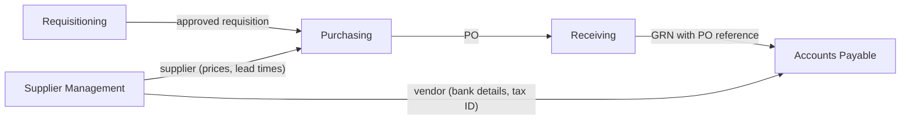

# Lecture Script: The FDE Role and Business Domain Understanding

> **Instructor reference.** Phase 1 (Focus area 1), Module 1 | Duration: 5 hours (2 h concepts and demos, 3 h hands-on) | Previous script: none (first module) | Companion plan: separate document, not in this repo

## Session overview

**Goal.** Learners step into the Forward Deployed Engineer (FDE) role: they interview a client sponsor, map the procurement process, event-storm the domain, and commit a glossary and user profile as Capstone increment CI-1.

**Learner profile at this point.** Early-career to mid-level software engineers. They can build a basic web app, use Git and Markdown, and read a flowchart. Until now, every project they have done started from a ticket or a spec. Today introduces the first genuinely new idea of the program: **the engineer finds the problem before building the solution.**

**Key outcome.** Every learner can restate a feature request as a business outcome, run a discovery interview, map as-is and to-be processes, build an event-storming map with bounded contexts, and commit `glossary.md` and `users.md` in the sponsor's own language.

**Case for this session.** ProcureFlow, a procure-to-pay app for Meridian Components (fictional mid-size manufacturer: Pune, Chennai, Leeds). The trainer plays **Priya Nair, Head of Finance and project sponsor**. All facts come from the sponsor fact card in Segment 4; keep the numbers consistent all day.

**Note on AI use.** Lab 4 uses an AI assistant to draft the glossary. Its wording will vary run to run; the example outputs below are illustrative. The point of the lab is the human correction step, not the draft.

## Timing breakdown

| Segment | Duration | Cumulative | Kind |
| --- | --- | --- | --- |
| SEGMENT 1: Opening — From Tickets to Outcomes | 20 min | 0:20 | Concept |
| SEGMENT 2: Reading a Business | 15 min | 0:35 | Concept + demo |
| SEGMENT 3: Stakeholders and Discovery | 27 min | 1:02 | Concept + demo |
| **BREAK** | 10 min | — |  |
| SEGMENT 4: Lab 1 — Discovery Role-Play | 40 min | 1:42 | Hands-on |
| SEGMENT 5: Lab 2 — As-Is and To-Be Process | 35 min | 2:17 | Hands-on |
| **BREAK** | 10 min | — |  |
| SEGMENT 6: Domain Language and Event Storming | 35 min | 2:52 | Concept + demo |
| SEGMENT 7: Lab 3 — Event-Storming Workshop | 50 min | 3:42 | Hands-on |
| SEGMENT 8: Sizing, Risks and Open Questions | 18 min | 4:00 | Concept + demo |
| SEGMENT 9: Lab 4 — Glossary and User Profile (AI-assisted) | 40 min | 4:40 | Hands-on |
| SEGMENT 10: CI-1 Review, Summary and Wrap-Up | 20 min | 5:00 | Hands-on + close |

Concepts and demos: 120 min (40%). Labs and capstone: 180 min (60%). Breaks are not counted.

## SEGMENT 1: Opening — From Tickets to Outcomes (20 min)

### The Hook (5 min)

**Show one slide with this story. No bullets, no definitions.**

**Say:** *"A strong team built a purchase-approval app for a manufacturer in six weeks. Clean code, 90% test coverage, a great demo. Three months later, only 11% of purchase requests went through it. Finance still approved by email. At the first month-end, the app slowed to a crawl. The CFO said: 'This isn't what we asked for.' The team said: 'It's exactly what was in the ticket.'"*

**Ask:** *"The code worked. The tests passed. Why did nobody use it, and what would you have done differently in week one?"*

**Do:** Think-pair-share for 1 minute, then take 4–5 answers. Write them on the board in two columns: **Technical** and **Business**.

**Respond to likely answers:**

- *"They didn't gather requirements."* → *"They did. They gathered the wrong ones. Who do you think they talked to?"*
- *"Bad UX."* → *"Maybe. Would better UX fix the month-end slowdown or the CFO's complaint?"*
- *"No load testing."* → *"Good. How would they have known month-end was the peak?"*
- *"They didn't talk to real users."* → *"That's the big one. Who are the real users, and who decides?"*

**Point at the Business column** (it will be the longer one).

**Say:** *"Every failure on this board happened before a single line of code was written. The team knew how to build. They didn't know the business. So here is today's one line to remember:"*

**Write on board, large, and leave it up all day:**

> **The first thing an FDE ships is understanding.**

### The FDE Role (10 min)

**Say:** *"A client asks you: 'Can you add a bulk-approve button?' What do you ship?"* (Pause. Most will say "the button".)

**Say:** *"A Forward Deployed Engineer does three things. You **embed**: you work on the client's side, in their world, with their people. You **translate**: you turn a business problem into software. And you **own** the outcome: you're not done when the code ships, you're done when the business number moves."*

**Draw on whiteboard:**

|  | Ticket-taking engineer | Forward Deployed Engineer |
| --- | --- | --- |
| Starts from | A ticket or spec | A business problem |
| Talks to | A product manager | Sponsor, users, IT, security, compliance |
| Works from | Vendor's office | Client's site and tools |
| Done when | Code is deployed | The KPI moved and users adopted it |

**Say:** *"Back to bulk-approve. Why would someone want it? Because approvers get 60 requests on Friday and want them gone. The real problem is the pile-up. The outcome is 'approval cycle time from 9 days to 2 days.' Bulk-approve might even make it worse: people rubber-stamp, and audit flags it."*

**Live demo (2 min): rewrite a feature as an outcome.**

**Write:** `"Export POs to Excel"`

**Rewrite below it:** `"Finance controllers reconcile open POs at month-end in under 1 hour (today: 2 days)."`

**Say:** *"Same request, different question. Now we can ask: is Excel even the best way to hit one hour?"*

**Do (pairs, 2 min):** Rewrite *"Add email notifications for approvals"* using this template on the board:

> *[who] can [do what] so that [KPI moves from X to Y].*

**Example answer (illustrative — learner wording will vary):** *"Approvers see new requests the same day, so approval cycle time drops from 9 days to 2."*

### Learning Contract — write on board (2 min)

- Restate a client request as a business outcome
- Run a discovery interview and map stakeholders
- Map the as-is and to-be process
- Model the domain with event storming and bounded contexts
- Commit a glossary and user profile in the client's own language (CI-1)

### Comprehension Check (3 min)

1. *"Which of these is an FDE success measure: (a) 14 features shipped, (b) approval cycle time fell from 9 to 3 days, (c) 95% test coverage, (d) the sponsor signed the spec?"* (b. The others measure delivery, not the outcome.)
2. *"Why might building exactly what the ticket says still fail?"* (The ticket describes a solution someone guessed at; it may not address the real problem or the people who feel it.)

**Re-teach trigger:** if more than a quarter pick (a) or (d), repeat the rewrite demo with a new domain: *"Add a dashboard"* for a hospital ward.

**Transition — Say:** *"An FDE's unit of work is an outcome. To find outcomes, you first have to read the business."*

## SEGMENT 2: Reading a Business (15 min)

### The Five Layers (6 min)

**Say:** *"Meridian Components makes precision parts. Why would its CFO lose sleep over purchasing? To answer that, we read the business in five layers, from the big picture down to the people who hurt."*

**Draw the value chain left to right on the board:** Buy materials → Machine parts → Ship → Get paid. Draw procurement as a band underneath, feeding every step.

**Say, pointing at each layer as you add it to a table on the board:**

| Layer | Say this | Meridian example |
| --- | --- | --- |
| Value chain | *"How the company turns inputs into money."* | Buy → machine → ship → get paid |
| Business process | *"A repeatable sequence of work."* | Procure-to-pay: request → approve → order → receive → invoice → match → pay |
| Policy | *"A rule the process must obey."* | Approval limits by amount; three quotes above ₹2 lakh; "no PO, no pay" |
| KPI | *"A number leaders watch."* | Approval cycle time; % of spend under a PO; invoices on hold |
| Pain point | *"Symptom, plus who feels it, plus what it costs."* | Invoices on hold → AP clerks chase buyers for a week → suppliers threaten to stop deliveries |

**Say:** *"The last column is the one engineers skip. A pain point without a person and a cost is just a complaint. You can't prioritise a complaint."*

### Worked Example: Trace One Pain (4 min)

**Say:** *"Watch how one pain touches every layer. I'll start from the symptom and walk up."*

**Write on board, one line at a time, top to bottom:**

```
Pain point:   Suppliers paid late          (felt by AP clerks and suppliers)
KPI:          Invoices paid on time: 71%
Policy:       No PO, no pay
Process step: Three-way match (PO, goods receipt, invoice)
Value chain:  Inbound materials — late payment risks late parts
```

**Say:** *"So when the CFO says 'fix purchasing', she might mean 'stop my plant from running out of parts because suppliers stopped trusting us.' That's a very different brief from 'build an approval app.'"*

### Try It (3 min)

**Do (groups of three):** For a business you know (food delivery, college admissions, a gym), name one process, one policy, one KPI, and one pain point with who feels it.

**Example answer (illustrative):** Food delivery. Process: order → assign rider → deliver. Policy: refund if more than 45 minutes late. KPI: on-time delivery rate. Pain: riders wait 10 minutes at busy restaurants, felt by riders (lost earnings) and customers (cold food).

### Comprehension Check (2 min)

**Ask:** *"Classify each: 'POs above ₹2 lakh need three quotes.' 'Approvals take nine days.' 'Raise a PO.'"*

(Policy. A KPI value that reveals a pain point. A process step.)

**Common misconception:** naming a feature as a KPI ("has a dashboard") or mixing up a policy with a pain point.

**Re-teach trigger:** if groups cannot say *who* feels their pain point, re-run the trace and stop at each layer to ask: *"Whose day does this ruin?"*

**Transition — Say:** *"Pain lives in people. Next: which people, and how to get them talking."*

## SEGMENT 3: Stakeholders and Discovery (27 min)

### Who Is in the Room? (7 min)

**Say:** *"Our failed app had a happy sponsor and unhappy everyone else. Who did that team forget? Let's list everyone who can fund, use, approve, block, or support a system like ProcureFlow."*

**Build this table on the board with the class calling out names:**

| Role | Meridian example | Why they matter |
| --- | --- | --- |
| Sponsor | Priya Nair, Head of Finance | Funds the work, defines success |
| Users | Requesters, buyers, AP clerks | Adoption lives or dies with them |
| Approvers | Line managers, department heads, CFO | Approve purchases; can keep approving by email |
| IT | ERP team that owns SAP | Integration and hosting |
| Security | CISO's team | Sign-in, data access; can veto go-live |
| Compliance | Internal audit | Audit trail, who approved what |
| Support | IT service desk | Every ticket after go-live |

### The Power-Interest Grid (5 min)

**Draw a 2x2 on the board.** Power on the vertical axis, interest on the horizontal.

**Say, writing each label in its quadrant:** *"High power, high interest: **manage closely**. High power, low interest: **keep satisfied**. Low power, high interest: **keep informed**. Low power, low interest: **monitor**."*

**Live demo:** Place two sticky notes and say your reasoning aloud.

**Say:** *"Priya goes top right: she funds it and cares daily. The CISO goes top left: he can stop go-live, but today he couldn't care less. That top-left corner is where projects die late."*

**Do:** Hand five sticky notes (Users, Approvers, IT, Compliance, Support) to five learners. They place them; the class can challenge. Spend one minute on the most argued placement, usually internal audit.

**Say:** *"Positions move. Internal audit is quiet until an audit finding lands, then it's the most powerful voice in the room."*

**Check (1 min) — Ask:** *"The CISO skipped every meeting and said 'send me the design later'. Where is he, and what's the risk?"* (High power, low interest. Risk: a late security requirement, like single sign-on, blocks go-live.)

**Re-teach trigger:** if most place him bottom-left, ask one test question: *"Can this person stop go-live?"*

### Discovery Techniques (6 min)

**Say:** *"Now we know who to talk to. How? If you ask Priya 'what features do you want?', you'll get a wish list shaped like a solution. People describe the process they think they run, not the one they actually run. So we use four techniques together."*

- **Interviews.** *"Ask about real past events: 'Walk me through the last purchase that went wrong.' Then follow up: how often, how long, who else, what did it cost?"*
- **Shadowing.** *"Sit with an AP clerk for an hour. Look for workarounds: a personal spreadsheet, sticky notes on the monitor, an email folder called 'chase'."*
- **Document review.** *"Approval matrix, policies, sample POs and invoices, KPI reports, last year's audit findings."*
- **Process mapping.** *"Draw the as-is: swimlanes, one per role, every hand-off. Mark manual steps with an M and waits with a clock and a duration. Then draw the to-be. Every change must trace back to a pain point. No screens yet."*

### Live Demo: Fishbowl Interview (6 min)

**Do:** Pick a volunteer. Hand them this card to read silently:

> *You are Asha, an AP clerk. You hate month-end. Invoices that don't match the PO go on hold, and you spend days emailing buyers who don't reply. Answer honestly; don't volunteer numbers unless asked.*

**Say to the class:** *"Hold up green for a good question, red for a bad one. Be ready to say why."*

**Ask the volunteer, in this order:**

1. *"Tell me about the last invoice you put on hold."* (Green: a real past event.)
2. *"Would a dashboard help?"* (Red: a solution question.)
3. *"What did you do next, and how long did it take?"* (Green: sequence and duration.)
4. *"The process is really slow, isn't it?"* (Red: a leading question.)
5. *"Who else had to act before it was paid?"* (Green: finds hand-offs and stakeholders.)

**Then sketch four as-is steps from the volunteer's answers** on a mini swimlane, marking one **M** and one clock.

**Example output (illustrative — the volunteer's answers will vary):**

```
AP clerk:  Receive invoice (M) → Match to PO and GRN (M) → Mismatch: put on hold
Buyer:                                                    → [wait ~1 week] → Reply with fix
```

### Comprehension Check (3 min)

1. *"Which question reveals the most: (a) 'Would automated approvals help?' (b) 'How do you feel about the process?' (c) 'Tell me about the last invoice that went on hold, step by step.' (d) 'What features do you need?'"* (c. A concrete past event gives facts, sequence, and numbers.)
2. *"Why shadow someone if you've already interviewed them?"* (People leave out workarounds they no longer notice; watching reveals the real process.)

**Re-teach trigger:** if more than a quarter pick (a) or (d), replay the opening story: what the ticket said versus what was really happening.

**Transition — Say:** *"After the break, you'll interview Priya herself. Your notes feed straight into your process map, so write down her exact words."*

### BREAK (10 min)

*Suggested break prompt:* *"Write three questions you'd ask Priya first. At least two must be about something that already happened."*

## SEGMENT 4: Lab 1 — Discovery Role-Play (40 min)

### Instructions (read aloud, step by step)

**Say:** *"Priya Nair has funded 'something to fix purchasing'. Your job: find out what's really wrong, who feels it, what it costs, and what success looks like in numbers. You get 25 minutes of her time. She's busy, so plan first."*

1. **Plan (5 min).** In teams of 4–5, write 8 questions. At least half must ask about real past events. Pick a lead questioner and a note-taker whose only job is to write Priya's **exact words**.
2. **Interview (25 min).** Press-conference style: teams take turns, two questions each per round. Every team hears every answer.
3. **Consolidate (10 min).** Fill in the two tables below, place every role Priya mentioned on your power-interest grid, and save as `docs/domain/interview-notes.md`.

### Starter Template (give to learners)

```markdown
# Interview notes: Priya Nair, Head of Finance

## Pain points
| Pain point | Who feels it | How often / how much | Priya's exact words |
|---|---|---|---|
| ___ | ___ | ___ | "___" |

## Goals
| Goal | KPI today | Target |
|---|---|---|
| ___ | ___ | ___ |

## Stakeholder grid
(photo or list: role, quadrant, one-line reason)
```

### How to Play Priya (instructor only)

**Rules for yourself:**

- Reveal a fact only when a question reaches it. Don't volunteer.
- Give numbers only when asked "how many", "how long" or "how much".
- Speak in Priya's words: *requisition*, *indent*, *PO*, *GRN*, *on hold*, *vendor*. Never use the learners' tech words back to them.
- If asked about features, take the bait: *"I'd love a dashboard."* Debrief it later.

**Sponsor fact card:**

| If asked about… | Priya says |
| --- | --- |
| How purchasing works today | "The shop floor raises an indent, which we call a requisition, on an Excel form and emails it to their manager. It goes up the approval chain. Then procurement keys the PO into SAP." |
| Approval time | "Nine working days on average. Each approver sits on it two or three days. I want two days, total." |
| Approval rules | "Up to ₹50,000 the line manager signs. From ₹50,000 to ₹5 lakh, the department head too. Above ₹5 lakh, the CFO. Above ₹2 lakh, buyers need three quotes." |
| Biggest pain | "Invoices on hold. 22% can't be matched to the PO and the GRN. A held invoice takes about a week to clear while my AP team chases buyers." |
| Goals and KPIs | "Only 71% of invoices are paid on time; I want 95%. Only 82% of spend goes through a PO; I want 95%. We lose early-payment discounts every month." |
| Urgent or skipped purchases (hidden) | "18% of POs are raised after the invoice arrives. Audit flagged it last year." |
| Receiving | "The warehouse writes GRNs on paper. They reach SAP about two days later." |
| Who uses it, how many | "About 1,200 people raise requisitions, 150 approve, 12 buyers, 8 AP clerks, 4 finance controllers, 3 internal auditors." |
| Volumes | "Roughly 3,000 requisitions and 4,500 invoices a month." |
| Peaks | "The last five working days of the month. About 40% of invoices land then. March year-end is the worst." |
| Locations | "Head office in Pune, plants in Chennai and Leeds in the UK. Same SAP everywhere." |
| Growth | "We close an acquisition next year. Expect 30% more volume." |
| IT and security | "IT is buried in the March SAP upgrade. Everyone signs in with company Microsoft accounts. Talk to the CISO before you build anything." |
| Audit and compliance | "Audit wants to see who approved what, and when. GST e-invoicing in India, VAT in the UK." |
| Suppliers (hidden) | "Procurement calls them suppliers, AP calls them vendors. About 15% of our vendor records are duplicates." |
| Managers on leave (hidden) | "When a manager is on leave, requests just sit. Nobody delegates." |

### Example Output (illustrative — teams will capture different facts)

```markdown
## Pain points
| Pain point | Who feels it | How often / how much | Priya's exact words |
|---|---|---|---|
| Invoices on hold | AP clerks, suppliers | 22% of invoices; ~1 week each | "22% can't be matched to the PO and the GRN" |
| Slow approvals | Requesters, plant managers | 9 working days average | "Each approver sits on it two or three days" |
| Late payments | Suppliers, Priya | 71% paid on time | "We lose early-payment discounts every month" |

## Goals
| Goal | KPI today | Target |
|---|---|---|
| Faster approvals | 9 days | 2 days |
| Pay on time | 71% | 95% |
| Spend under PO | 82% | 95% |
```

### Instructor Circulates

- **At 15 minutes:** if a team has asked no "how many / how long" question, prompt: *"Could you size this pain yet?"*
- **Check note-takers:** are they writing Priya's words ("indent", "on hold") or translating into their own ("request", "blocked")? Push for verbatim.
- **Debrief the dashboard trap (2 min, end of lab) — Say:** *"Who got 'I'd love a dashboard'? Good. What decision would that dashboard help her make? That follow-up is the real question."*

**Success check:** at least 5 pain points each with a person and a number; at least 3 goals with baseline and target; all 7 stakeholder roles placed with a reason.

**Extension (fast teams):** uncover one hidden fact no other team found. Bring it to Lab 3 as a hot spot.

## SEGMENT 5: Lab 2 — As-Is and To-Be Process (35 min)

**Say:** *"You just heard Priya's pain. Now let's draw it, because a picture of nine days of waiting is far more convincing than a sentence about it."*

### Instructions (read aloud, step by step)

1. **Lanes (3 min).** In pairs, draw six swimlanes by **role**, not department: Requester, Approvers, Buyer, Warehouse, AP clerk, SAP.
2. **As-is steps (12 min).** One verb + noun per sticky ("Email requisition form"), left to right, in the right lane.
3. **Mark (5 min).** Write **M** on every manual step. Draw a clock on every wait and write its duration. Use Priya's numbers, or write "assumed".
4. **Pick (3 min).** Circle the three worst delays. Next to each, write which Lab 1 pain point it causes.
5. **To-be (10 min).** Merge pairs into teams. Redraw the same lanes for the target state. Label each change *removed*, *automated* or *moved*, and name the pain point it fixes. **No screens.**
6. **Save (2 min).** Photograph both maps into `docs/domain/process-as-is.png` and `docs/domain/process-to-be.png`.

### Reference Solution (instructor)

**As-is (illustrative — teams' wording and level of detail will vary):**

```
Requester  : Fill Excel form (M) → Email to manager
Approvers  : [wait 2–3 days] Manager approves by email (M)
             → [wait 2–3 days] Dept head approves if > ₹50,000 (M)
             → [wait] CFO approves if > ₹5 lakh (M)
Buyer      : Collect 3 quotes if > ₹2 lakh (M) → Key PO into SAP (M)
Warehouse  : Receive goods → Write paper GRN (M) → [wait ~2 days] Key GRN into SAP (M)
AP clerk   : Receive emailed invoice → Key invoice (M) → Match PO + GRN + invoice by hand (M)
             → Mismatch? Put on hold → [wait ~1 week] chase buyer by email (M)
SAP        : Payment run
```

**Three worst delays:** approval chain (9 days → slow approvals), paper GRN (2 days → invoices fail to match), on-hold chasing (about a week → late payments, lost discounts).

**To-be (illustrative):**

```
Requester  : Submit requisition in one form
Approvers  : Routed automatically by amount; delegate when on leave  [automated, fixes slow approvals]
Buyer      : Approved requisition creates PO in SAP                 [automated, fixes keying + after-the-fact POs]
Warehouse  : Record GRN at the dock, same day                       [moved, fixes match failures]
AP clerk   : Invoice captured once; auto three-way match within tolerance;
             AP sees only exceptions                                [automated, fixes on-hold rate]
```

### Instructor Circulates

- **Feature-shaped stickies** ("Click approve", "Open dashboard"): ask *"What is the business doing here?"*
- **Happy path only:** ask *"What happens when the invoice doesn't match?"*
- **Lanes by department** ("Finance", "Ops"): ask *"Which person actually does this step?"*
- **To-be with no link to pain:** point at a change and ask *"Which of Priya's pains does this fix?"* If nobody knows, it goes.

**Success check:** every step sits in a lane; at least 5 M marks and 3 timed delays; every to-be change names the pain point it fixes.

**Extension (fast teams):** add the exception path for a partial delivery.

**Transition — Say:** *"Notice how many words you argued over just now: requisition or indent? Approved by whom? After the break, we'll take language seriously."*

### BREAK (10 min)

*Suggested break prompt:* *"Find one word Priya used that you think means something different to AP than it does to procurement."*

## SEGMENT 6: Domain Language and Event Storming (35 min)

### Hook: "One Word, Two Meanings" (4 min)

**Ask:** *"At Meridian, what does 'approved' mean?"* Take two or three answers.

**Say:** *"Trick question. In procurement, an approved requisition means 'OK to buy'. In accounts payable, an approved invoice means 'OK to pay'. Different people, different rules, different audit trail. Same word."*

**Say:** *"And it's not just 'approved'. Procurement says supplier; AP says vendor. The shop floor says indent; finance says requisition. If our code picks one meaning and ignores the other, we've built the failed app from this morning."*

### Domain-Driven Design for Engineers (10 min)

**Say:** *"Domain-Driven Design gives us four tools for this. You don't need the whole book today. You need these four."*

**Write each term on the board as you say it:**

- **Ubiquitous language.** *"One vocabulary shared by the business and the code: in meetings, docs, class names, API fields. If Priya says requisition, the code says `Requisition`, not `PurchaseRequest`."*
- **Domain glossary.** *"The written record of that language. Term, meaning in the sponsor's words, context, example, words to avoid, where you heard it."*
- **Bounded context.** *"A boundary inside which every word has exactly one meaning. Meridian has five: Requisitioning, Purchasing, Receiving, Accounts Payable, Supplier Management."*
- **Context map.** *"A sketch of how contexts connect and what passes between them. Requisitioning hands an approved requisition to Purchasing. Purchasing hands a PO to Receiving. Receiving hands a goods receipt to AP. Supplier Management feeds both Purchasing and AP. SAP sits outside; we translate its terms at the edge."*

**Live demo (3 min):** Show one finished glossary entry on screen:

```markdown
| Term | Meaning (sponsor's words) | Context | Example | Avoid | Source |
|---|---|---|---|---|---|
| Requisition | A request to buy, before anything is ordered | Requisitioning | Excel form for 200 bearings | indent, PR | Priya, interview |
```

Then sketch the context map as five boxes with labelled arrows.

**Say:** *"A supplier in Purchasing has prices and lead times. A vendor in AP has bank details and a tax ID. Same company, two models. That's fine, as long as the boundary is drawn on purpose."*

**Check (2 min) — Ask:** *"A developer creates one `Approval` table for both requisitions and invoices. What's the risk?"* (Two meanings, two sets of approvers and rules, two audit needs. When the CFO tightens the invoice tolerance rule, requisition approvals break. Keep them separate, one per context.)

**Common misconception:** *"One shared model is simpler and saves code."*

### Event Storming (6 min)

**Say:** *"You have six pages of notes and two process maps. How do eight people agree on what actually happens, in 50 minutes? Event storming: a wall workshop. We lay out what happens in the business as past-tense events, then add what causes them and the rules that react to them."*

**Put up the sticky legend and leave it up for Lab 3:**

| Sticky | Colour | Meaning | Meridian example |
| --- | --- | --- | --- |
| Domain event | Orange | Something that happened; past tense | Requisition Submitted |
| Command | Blue | An action that causes an event | Submit Requisition |
| Actor | Small yellow | Who issues the command | Requester |
| Policy | Lilac | "Whenever X, then Y" rule | Whenever a requisition over ₹5 lakh is submitted, route it to the CFO |
| Hot spot | Pink | Conflict, question or pain | Who approves when the manager is on leave? |

**Say:** *"Two rules. Events are in the past tense. And they're in business words: 'Invoice Matched', never 'DB row updated'."*

### Live Demo: First Six Stickies (6 min)

**Do:** At the wall, place these orange events left to right, saying each aloud:

```
Requisition Submitted → Requisition Approved → PO Issued → Goods Received → Invoice Received → Invoice Matched
```

**Then add, explaining each:**

- Blue *Submit Requisition* before the first event, with yellow *Requester* beside it.
- Lilac policy after *Requisition Submitted*: *"Whenever over ₹5 lakh, route to CFO."*
- Pink hot spot near *PO Issued*: *"POs raised after the invoice arrives (18%)."*

**Ask:** *"What comes after Invoice Matched?"* (Payment Scheduled, Payment Made.) *"And what goes wrong?"* (Invoice Put On Hold.)

### Comprehension Check: Spot the Error (3 min)

**Show four orange stickies:** "Approve Requisition", "Email sent to manager", "Clicked submit button", "Invoice Put On Hold".

**Ask:** *"Which are wrong, and how would you fix them?"*

(1: a command, so blue, not orange. 2: technical; the business fact is "Approval Requested". 3: a UI click; the business fact is "Requisition Submitted". 4: correct.)

**Re-teach trigger:** if more than a third miss two or more, run the test *"past tense, business words?"* on three more stickies before Lab 3.

**Transition — Say:** *"You've seen the moves. Now your team runs the whole wall."*

## SEGMENT 7: Lab 3 — Event-Storming Workshop (50 min)

**Say:** *"Your goal: a wall that anyone could read, in order, from 'someone needs a part' to 'the supplier is paid', and see where the language changes. Two halves of 25 minutes, with a checkpoint in the middle."*

### Instructions — First Half (25 min)

1. **Silent storm (7 min).** Everyone writes orange events, one per sticky, past tense. No talking. Quantity over quality.
2. **Timeline (10 min).** Arrange left to right. Merge duplicates. Agree on wording using Priya's words from Lab 1.
3. **Commands and actors (8 min).** Add a blue command before each event and a yellow actor beside it.

**Checkpoint (instructor visits each wall):** at least 12 events, in order, all past tense, all business words. If not, run the S6 test on three stickies with the team before they continue.

### Instructions — Second Half (25 min)

4. **Policies (7 min).** Add lilac "whenever X, then Y" stickies between events.
5. **Hot spots (5 min).** Add pink stickies for disagreements, questions and pains. Bring in hidden facts from Lab 1.
6. **Bounded contexts (10 min).** Draw lines where the language changes. Name each context and list its key terms. Draw arrows between contexts, labelled with what passes across.
7. **Save (3 min).** Photo to `docs/domain/event-storming.png`. Write contexts, key terms and the context map into `docs/domain/bounded-contexts.md`.

### Starter Template

```markdown
# Bounded contexts

## ___ (context name)
- Key terms: ___
- Events: ___
- Owner (role): ___

## Context map
- ___ → ___ : ___ (what passes across)
```

### Reference Solution (instructor)

**Reference context map (recreated from the bounded contexts below):**



```markdown
# Bounded contexts (illustrative — teams may split or name contexts differently)

## Requisitioning
- Key terms: requisition (indent), approver, approval limit, approved (= OK to buy)
- Events: Requisition Submitted, Requisition Approved, Requisition Rejected

## Purchasing
- Key terms: supplier, quote, PO
- Events: Quotes Received, Supplier Selected, PO Issued

## Receiving
- Key terms: GRN, delivery
- Events: Goods Received, Goods Partly Received

## Accounts Payable
- Key terms: vendor, invoice, three-way match, on hold, approved (= OK to pay)
- Events: Invoice Received, Invoice Matched, Invoice Put On Hold, Payment Made

## Supplier Management
- Key terms: supplier / vendor record
- Events: Supplier Registered, Vendor Record Merged

## Context map
- Requisitioning → Purchasing : approved requisition
- Purchasing → Receiving : PO
- Receiving → Accounts Payable : GRN with PO reference
- Supplier Management → Purchasing : supplier (prices, lead times)
- Supplier Management → Accounts Payable : vendor (bank details, tax ID)
```

**Expected policies:**

- Whenever a requisition over ₹5 lakh is submitted, route it to the CFO.
- Whenever a requisition over ₹2 lakh is approved, request three quotes.
- Whenever an invoice is received, attempt a three-way match.
- Whenever a match fails beyond tolerance, put the invoice on hold and notify the buyer.

**Expected hot spots:** approver on leave; POs raised after the invoice; duplicate vendor records; unknown price tolerance; partial deliveries.

### Instructor Circulates

- **Happy path only:** *"What goes wrong?"* (Requisition Rejected, Invoice Put On Hold.)
- **Contexts follow the org chart:** *"Where does the meaning of a word change?"*
- **One person holding the pen:** hand markers to the quietest team members.
- **Commands without actors:** *"Who presses that button in real life?"*

**Success check:** at least 12 past-tense events including 2 failure events; every command has an actor; at least 3 policies; at least 3 hot spots; at least 3 named contexts with a context map.

**Extension (fast teams):** add green read models. *"What does an approver need on screen to decide in under a minute?"*

**Engagement tip:** when the first team draws its context lines, stop the room for 30 seconds. Ask that team to say which word made them draw the line. It's usually *approved* or *supplier*, and it lands the morning's hook.

## SEGMENT 8: Sizing, Risks and Open Questions (18 min)

### Sizing the Problem (10 min)

**Say:** *"Remember the failed app that slowed at month-end? Which number would have warned the team?"* (The month-end peak.) *"Sizing is how we find those numbers before they find us."*

**Draw this table on the board; fill the Meridian column from the class's Lab 1 notes:**

| Dimension | Question to ask | Meridian value |
| --- | --- | --- |
| Users by type | Who uses it, and how many of each? | 1,200 requesters, 150 approvers, 12 buyers, 8 AP clerks, 4 controllers, 3 auditors |
| Concurrency | How many at the same time, at the worst hour? | Unknown; estimate and confirm |
| Data volume | How many records per month? | 3,000 requisitions, 4,500 invoices |
| Growth | What changes next year? | +30% after an acquisition |
| Peaks | When does it spike? | 40% of invoices in the last 5 working days |
| Geography | Where are the users? | Pune, Chennai (India); Leeds (UK) |
| Compliance | Which rules apply? | GST e-invoicing, UK VAT, internal-audit trail |

**Live demo: worked calculation (4 min).** Write each line as you say it.

```
Peak invoices     = 4,500 × 40%            = 1,800 in 5 working days
Per day at peak   = 1,800 ÷ 5               = 360 invoices/day
Per AP clerk      = 360 ÷ 8                 = 45 invoices/clerk/day
Next year         = 360 × 1.3               ≈ 468 invoices/day
Total users       = 1,200+150+12+8+4+3      = 1,377
Peak concurrency  = 10% of 1,377            ≈ 140 users   ← ASSUMPTION: confirm with login data
```

**Say:** *"See that arrow on the last line? We just made something up. That's allowed, but only if we say so in writing."*

**Do (1 min):** Learners work out next year's requisitions per working day. (3,000 × 1.3 = 3,900 a month; ÷ 22 working days ≈ 177 a day.)

**Check — Ask:** *"Priya says 'about 1,500 users'. Is that enough for `users.md`?"* (No. You need counts by role, concurrency, peak timing, location, and the source of each number.)

**Common misconception:** total headcount equals system load. **Re-teach:** compare 1,200 requesters who log in twice a month with 8 AP clerks logged in all day.

### Risks, Assumptions and Open Questions (8 min)

**Say:** *"Three kinds of uncertainty. Each gets written down, with an owner."*

- **Risk:** *"Something that might happen and hurt the outcome. 'The SAP team has no capacity in Q1, so integration slips.' Note impact and likelihood."*
- **Assumption:** *"Something we're betting on without proof. 'All approvers have company sign-in accounts.' Note how we'll check it."*
- **Open question:** *"An unknown that blocks a decision. 'Who approves when the manager is on leave?' Note who can answer it."*

**Say:** *"Domain risks come from the business, not the tech: a policy change, duplicate supplier records, a seasonal peak."*

**Card sort (4 min).** Learners hold up an R, A or Q card for each statement you read:

1. *"Approvers will approve on mobile phones."* (A)
2. *"The March ERP upgrade may change the PO interface."* (R)
3. *"What price-mismatch tolerance does AP allow?"* (Q)
4. *"Suppliers will email invoices as PDFs."* (A)
5. *"Duplicate supplier records may cause double payments."* (R)
6. *"How long must internal audit keep approval records?"* (Q)

**Common misconception:** anything the sponsor says is a fact. (Priya *believes* approvers will use phones; nobody has checked.)

**Re-teach trigger:** if the room splits on more than two cards, re-sort with three tests: *"Could it happen?"* (R). *"Are we betting on it?"* (A). *"Do we need an answer?"* (Q).

**Transition — Say:** *"You now have notes, maps, a wall and a list of unknowns. Lab 4 turns them into files the next module can build on."*

## SEGMENT 9: Lab 4 — Glossary and User Profile, AI-Assisted (40 min)

**Say:** *"An AI assistant can turn six pages of notes into a draft glossary in seconds. It will also quietly replace Priya's words with textbook words, merge supplier and vendor, and invent a term or two. Your job is to catch every one. The draft is free; the correction is the skill."*

### Instructions (read aloud, step by step)

1. **Draft with AI (5 min).** Paste your `interview-notes.md` into the assistant with the prompt below.
2. **Correct every term (15 min).** For each row, find Priya's words in your notes. Keep, fix or delete the row, and fill the Checked column.
3. **User profile (12 min).** Write `docs/domain/users.md`: three short personas (Requester, Approver, AP clerk) and the volume profile. Every number cites Lab 1 or says "assumption".
4. **Open questions (5 min).** Move your hot spots and Segment 8 items into `docs/domain/open-questions.md`, each tagged R, A or Q, with an owner.
5. **Commit (3 min).** `git commit -m "CI-1: domain glossary, users and open questions"`

### The AI Prompt (give to learners exactly)

```
From these interview notes, draft a domain glossary as a Markdown table with
columns Term, Meaning, Context, Example, Avoid, Source. Use only terms that
appear in the notes. In Source, quote the speaker's exact words. List any term
you are unsure about under "Needs checking".
```

### What the AI Draft Typically Gets Wrong (show learners)

**Example AI draft rows (illustrative — actual AI output will vary run to run):**

```markdown
| Term | Meaning | Context | ... | Source |
|---|---|---|---|---|
| Purchase Requisition (PR) | A formal document used to request goods or services from the procurement department | Procurement | ... | (none) |
| Vendor | A supplier of goods to the company | All | ... | "AP calls them vendors" |
| RFQ | Request for quotation sent to suppliers | Purchasing | ... | (none) |
```

**Say, pointing at each row:**

- *"Row 1: a textbook definition. Priya never said 'formal document'. She said 'a request to buy, before anything is ordered', and she uses 'requisition', not 'PR'."*
- *"Row 2: supplier and vendor merged into one, context 'All'. That's exactly the boundary we drew in Lab 3. Split it."*
- *"Row 3: Priya never said RFQ. No source, no row. Delete it, or move it to open questions."*

### Starter Templates

```markdown
# docs/domain/glossary.md
| Term | Meaning (sponsor's words) | Context | Example | Avoid | Source | Checked |
|---|---|---|---|---|---|---|
| ___ | ___ | ___ | ___ | ___ | "___" | ___ |
```

```markdown
# docs/domain/users.md
## Personas
**Requester (name, role, site):** what they do, how often, what they want.

## Volume profile
| Role | Count | Usage pattern | Peak | Location | Source |
|---|---|---|---|---|---|

## Growth, geography, compliance
```

### Reference Solution (instructor, partial)

```markdown
# docs/domain/glossary.md (illustrative excerpt)
| Term | Meaning (sponsor's words) | Context | Example | Avoid | Source | Checked |
|---|---|---|---|---|---|---|
| Requisition | A request to buy, before anything is ordered | Requisitioning | Excel form for 200 bearings | indent (shop floor), PR | Priya | yes |
| Approved (requisition) | OK to buy | Requisitioning | Manager signs ₹40,000 request | approved for payment | Priya | yes |
| Approved (invoice) | OK to pay | Accounts Payable | Invoice passes three-way match | approved requisition | Priya | yes |
| Supplier | Who we buy from: prices, lead times | Purchasing | Bearing maker in Coimbatore | vendor | "Procurement calls them suppliers" | yes |
| Vendor | Who we pay: bank details, tax ID | Accounts Payable | Same bearing maker, AP record | supplier | "AP calls them vendors" | yes |
| On hold | Invoice that can't be paid until a mismatch is fixed | Accounts Payable | 22% of invoices | blocked, rejected | "Invoices on hold" | yes |
| GRN | Goods receipt note: what actually arrived | Receiving | Paper slip at the dock | delivery note | "The warehouse writes GRNs on paper" | yes |
```

```markdown
# docs/domain/users.md (illustrative excerpt)
## Personas
**Requester — Ravi, maintenance supervisor, Chennai:** raises requisitions when a machine part fails; wants to know where his request is without emailing anyone.
**Approver — Meera, department head, Pune:** approves ₹50,000–₹5 lakh; approves in batches on Fridays; wants to see budget left before she signs.
**AP clerk — Asha, Pune:** matches invoices all day; dreads month-end; wants only the mismatches, not every invoice.

## Volume profile
| Role | Count | Usage pattern | Peak | Location | Source |
|---|---|---|---|---|---|
| Requester | 1,200 | A few times a month | Unknown | All sites | Priya |
| Approver | 150 | Weekly batches | Fridays (assumption) | All sites | Priya + assumption |
| AP clerk | 8 | All day | Last 5 working days: ~360 invoices/day | Pune | Priya + calculation |
| All users | 1,377 | — | ~140 concurrent | — | Assumption: confirm with login data |
```

### Instructor Circulates

- **At 20 minutes, spot check:** point at one random glossary row and ask *"Where did Priya say that?"* If the learner can't show it, the row is deleted or moved to open questions.
- **Unsourced numbers in `users.md`:** ask *"Did Priya say that, did you calculate it, or did you assume it?"* All three are fine; unlabelled is not.
- **Empty Checked column:** the lab isn't done until every row is checked.

**Success check:** at least 15 glossary terms, each with a context and a source quote; *supplier/vendor*, *indent/requisition* and both meanings of *approved* resolved; no AI-invented term survives; `users.md` covers roles, counts, concurrency, peaks, growth, geography and compliance.

**Extension (fast learners):** add a Mermaid context map to `bounded-contexts.md` that matches the wall.

## SEGMENT 10: CI-1 Review, Summary and Wrap-Up (20 min)

### CI-1 Peer Review — Gallery Walk (15 min)

**Say:** *"Swap repos with the team to your left. Check their CI-1 against this list. Leave exactly two review comments: one strength, one gap. Be specific: 'Row 7 has no source' beats 'glossary needs work'."*

**CI-1 checklist (put on screen):**

- [ ] `docs/domain/glossary.md`: at least 15 terms in the sponsor's words, each with a context
- [ ] `docs/domain/event-storming.png`: events, commands, actors, policies, hot spots
- [ ] `docs/domain/bounded-contexts.md`: at least 3 contexts, key terms, context map
- [ ] `docs/domain/users.md`: personas and user volume profile
- [ ] `docs/domain/open-questions.md`: risks, assumptions and questions, each with an owner
- [ ] Supporting: `interview-notes.md`, `process-as-is.png`, `process-to-be.png`

### What We Covered Today (1 min)

- Restated client requests as business outcomes with a KPI
- Read a business in five layers, and found who feels each pain
- Mapped stakeholders by power and interest, and ran a discovery interview
- Drew the as-is and to-be procurement process, with manual steps and delays marked
- Event-stormed the domain and drew bounded contexts where the language changes
- Sized the problem and wrote down risks, assumptions and open questions
- Used AI to draft a glossary, and corrected every term against the sponsor's words

### Back to the Opening (1.5 min)

**Point at this morning's board** with the Technical and Business columns.

**Ask:** *"Which of today's artefacts would have saved that team?"*

(Expected: the stakeholder map — they'd have found finance and AP users; the glossary — two meanings of *approved*; the user profile — the month-end peak.)

### Exit Ticket (2 min, written, one per learner)

> *"A new client says: 'We need an app to approve staff leave.' List the first three things you'd do before writing code, and one word you'd check for two meanings."*

**Expected answer:** map stakeholders (employee, manager, HR, payroll); interview about real past leave requests; size users and peaks (holiday seasons). A word such as *approved* (manager OK vs HR recorded) or *leave balance*.

**Re-teach trigger:** if more than a quarter list features or screens first, open Module 2 with a 5-minute replay of the opening story.

### Bridge to What Comes Next (30 sec)

**Say:** *"This morning, a team shipped working code that the business didn't use. Today you interviewed a sponsor, mapped her process, event-stormed her domain and committed CI-1. Remember: the first thing an FDE ships is understanding. Next module, we turn that understanding into requirements, acceptance criteria and guardrails that ProcureFlow must meet, and your glossary becomes the vocabulary every requirement is written in."*

### Homework / Self-Practice

1. **Fix your CI-1 gaps.** Address the gap comment from peer review. Then list three glossary terms where the AI's meaning differed from Priya's, with a one-line before/after for each.
2. **Re-size for growth.** After the acquisition, invoices grow 30%. Update `users.md` with peak invoices per day and per AP clerk (still 8 clerks), and add two open questions the growth raises.
3. **Transfer task.** From the one-page interview transcript you'll be sent about hospital staff expense claims, write 10 domain events, 3 policies, 2 bounded contexts, and one word that changes meaning between them.

## Q&A & Doubt Solving

**Likely questions and suggested answers:**

**Q: Isn't discovery the product manager's job, not the engineer's?** → On a typical product team, often yes. An FDE usually has no PM between them and the client, so discovery is part of the job. Even with a PM, an engineer who understands the domain catches problems a spec never mentions, like the month-end peak.

**Q: How do I know when discovery is "done"?** → Never fully. It's done enough when the sponsor agrees with your glossary and event-storming map, your user profile has a source or an "assumption" label on every number, and your open questions have owners. Discovery keeps going during the build.

**Q: Is DDD only for big systems? ProcureFlow seems small.** → You don't need all of DDD. The ubiquitous language and bounded contexts pay off at any size, because the cost of the wrong word (one `Approval` table for two meanings) shows up even in small apps.

**Q: Can't we just use the client's ERP terms (SAP field names) as the glossary?** → Use them as a source, not the answer. SAP's terms are the vendor's model, not how Priya's people talk. Translate at the boundary to SAP; keep the glossary in the business's words.

**Q: Why not let the AI write the whole glossary? It's faster.** → The draft is fast. The value is in correcting it against the sponsor's actual words. An unchecked AI glossary silently replaces the client's language with generic language, which is exactly how the failed app happened.

**Q: What if the sponsor and the users disagree about how the process works?** → That's a finding, not a problem. Put a hot spot on the wall, show both versions, and take the conflict back to the sponsor with evidence from shadowing or documents.

**Q: Do bounded contexts mean separate microservices?** → No. A bounded context is a language boundary. It can be a module, a package, or a service; that decision comes later.

## Instructor Notes

- **Stay in character as Priya.** The lab only works if facts are earned by good questions. Don't hint, and don't volunteer numbers.
- **Keep the numbers consistent all day.** Segments 6, 8 and 9 reuse the fact-card numbers. Keep the card on your desk.
- **Common mistake:** learners translate Priya's words into tech words in their notes ("request" instead of "requisition", "blocked" instead of "on hold"). Catch this in Lab 1; it costs more to fix in Lab 4.
- **Common mistake:** process stickies written as UI actions ("Click approve"). Ask what the business is doing.
- **Common mistake:** bounded contexts drawn along the org chart. Ask where the meaning of a word changes.
- **Common mistake:** numbers in `users.md` with no source. Every number needs "Priya", "calculation" or "assumption".
- **Engagement tip:** the strongest moment is when the first team draws a context line in Lab 3 because of *approved* or *supplier*. Stop the room and let them explain it.
- **Time check:** if running behind before the first break, shorten the fishbowl interview to three questions (two good, one bad).
- **Materials to prepare:** printed fact card; sticky notes in five colours; a wall or digital board per team; team repos with an empty `docs/domain/`; AI assistant access verified on the classroom network; a pre-captured AI glossary draft as backup.

## Common Mistakes — Quick Reference

| Mistake | Symptom | Fix |
| --- | --- | --- |
| Asking for features in discovery | Notes full of "dashboard", "button", "export" | Ask about real past events: "Tell me about the last time…" |
| Pain point without a person or cost | Long list of complaints, no way to prioritise | Add who feels it and how often / how much |
| Lanes by department | Steps with no clear owner | One lane per role that does the work |
| Events written as UI clicks or logs | "Clicked submit", "Email sent" on orange | Past tense, business words: "Requisition Submitted" |
| One model for two meanings | One `Approval` concept for buying and paying | Split by bounded context |
| Contexts follow the org chart | Contexts named "Finance", "Ops" | Draw lines where the language changes |
| Unchecked AI glossary | Textbook definitions, invented terms, no source | Check every row against the sponsor's quotes |
| Headcount as load | "1,500 users" as the whole profile | Break down by role, concurrency, peak, location |

## Timing Contingencies

| Situation | Action |
| --- | --- |
| Running 10 min behind before the first break | Cut the fishbowl to three questions; skip the "Try It" in Segment 2 and do one group answer aloud |
| Lab 1 teams finish early | Release the extension: find a hidden fact no one else found |
| Running long after the second break | Shorten Segment 8's card sort to three statements; protect Lab 3 and Lab 4 time |
| Low energy after lunch | Run Lab 3's silent storm standing, with a visible 7-minute timer |
| AI assistant unavailable | Hand out the pre-captured AI draft; the correction step works the same |
| No wall space | Use a shared digital board (Miro or FigJam) with the same colour legend |
| Very large class | Run Lab 1 as press conference rounds; teams that don't get a turn take notes for others |

## End-of-Session Quiz (5 Questions)

1. Rewrite "Add a bulk-approve button" as an outcome statement with a KPI.
2. The CISO has high power but low interest in ProcureFlow. What should you do, and what's the risk if you don't?
3. Give one word that means different things in two Meridian bounded contexts, and both meanings.
4. Which of these is a correctly written domain event: "Approve Invoice", "Invoice Matched", "Clicked Save", "Row inserted"? Fix the other three.
5. Is "about 140 users at peak" a risk, an assumption or an open question? What must you write next to it?

**Answer key (instructor):**

1. Example: "Approvers clear requests the same week, so approval cycle time falls from 9 days to 2." Any answer with who, what, and a KPI from X to Y.
2. Keep satisfied: brief him early on sign-in and data access. Risk: a late security requirement blocks go-live.
3. *Approved*: OK to buy (Requisitioning) vs OK to pay (Accounts Payable). Also accepted: *supplier* vs *vendor* for the same company.
4. "Invoice Matched". "Approve Invoice" is a command (blue); "Clicked Save" becomes a business fact such as "Requisition Submitted"; "Row inserted" is technical, rewrite in business words.
5. An assumption. Write how you'll confirm it (for example, "confirm with login data") and who owns it.

## Homework Rubric

| Criterion | Excellent (4) | Good (3) | Needs Work (2) | Incomplete (1) |
| --- | --- | --- | --- | --- |
| CI-1 gap fixed + AI comparison | Gap fixed; three clear before/after term comparisons with sponsor quotes | Gap fixed; comparisons present but one lacks a quote | Gap partly fixed or comparisons vague | Not attempted |
| Growth re-sizing | Correct figures (5,850/month; \~468/day; \~58 per clerk) and two sharp open questions with owners | Figures correct, questions generic | Calculation errors or no questions | Not attempted |
| Transfer task (expense claims) | 10 past-tense events, 3 "whenever… then…" policies, 2 contexts split by language, a real two-meaning word | Mostly correct; one weak element | Events mixed with commands or contexts follow the org chart | Not attempted |

**Total:** /12. Pass threshold: 8/12.

## Materials Checklist

- [ ] Printed sponsor fact card (instructor only)
- [ ] Fishbowl volunteer card ("Asha, AP clerk")
- [ ] Sticky notes in five colours: orange, blue, small yellow, lilac, pink
- [ ] Green and red cards for the fishbowl; R, A, Q cards for the card sort
- [ ] One wall section or digital board per team
- [ ] Team repos with an empty `docs/domain/` folder
- [ ] AI assistant access tested on the classroom network
- [ ] Backup: pre-captured AI glossary draft
- [ ] Opening story slide (no bullets)
- [ ] Timer visible for all labs
