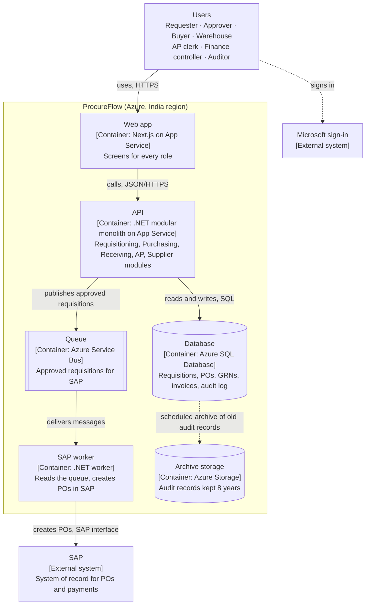

# Lecture Script: Technology Selection and Solution Architecture

> **Instructor reference.** Phase 2: Decide and build (Focus area 2), Module 4 | Duration: 5 hours (3 h concepts and demos, 2 h hands-on), run as Day 5 (4 h, Segments 1–10) and Day 6 (1 h, Segments 11–12) | Previous script: [Module 3 — Project Guardrails, .md Files and AI-Assisted Development](../Phase-1/Module-03-Guardrails-and-AI-Assisted-Development.md)

## Session overview

**Goal.** Learners choose ProcureFlow's architecture, hosting and data stack from evidence, not habit. They build a weighted decision matrix from the Module 1 user profile and Module 2 NFRs, test how the stack changes at 50 and 50,000 users, draw C4 context and container diagrams, write three ADRs, estimate monthly cloud cost, and defend it all in a design review with the sponsor (Capstone increment CI-4).

**Learner profile at this point.** Learners have the domain model (Module 1), requirements and NFRs (Module 2), and a guarded repo with a walking skeleton deployed to dev on the starter-kit stack: Next.js, .NET, SQL Server (Module 3). That stack was a **provisional default**. Today introduces the first genuinely new idea of Phase 2: **every technology choice is a decision you can explain, cost and defend to the client.**

**Key outcome.** Every learner can list the inputs that drive a technology choice, match architecture styles, hosting options, data stores and frontend rendering to a user profile, run a weighted decision matrix, estimate monthly cost and total cost of ownership, and record the outcome in ADRs and C4 diagrams.

**Case for this session.** ProcureFlow at Meridian Components. Profile from earlier modules: 1,377 users, about 140 concurrent at month-end (assumption), 3,000 requisitions and 4,500 invoices a month, 360 invoices a day at peak, +30% growth, Pune, Chennai and Leeds, hosting in India (NFR-SEC-04), Microsoft sign-in, SAP as system of record, audit records kept 8 years, 99.5% availability in business hours, at most 15 minutes of data loss. The trainer plays **Priya** and, in the design review, relays questions from the **CISO** and the **SAP owner in IT**.

**Note on prices.** Cloud prices change often and differ by region. This script never quotes a price. Learners take every figure from the provider's pricing calculator on the day, for the India region, and label it with the date. Example cost tables below use placeholders.

**Note on AI output.** AI stack recommendations vary run to run; examples are marked **illustrative**.

## Timing breakdown

| Segment | Duration | Cumulative | Kind |
| --- | --- | --- | --- |
| SEGMENT 1: Opening — Choosing on Purpose; Selection Inputs | 20 min | 0:20 | Concept |
| SEGMENT 2: Architecture Styles and When Each Fits | 25 min | 0:45 | Concept + demo |
| SEGMENT 3: Hosting Options | 20 min | 1:05 | Concept + demo |
| **BREAK** | 10 min | — |  |
| SEGMENT 4: Data and Frontend Choices | 25 min | 1:30 | Concept + demo |
| SEGMENT 5: Build, Buy or Open Source | 15 min | 1:45 | Concept |
| SEGMENT 6: Weighted Decision Matrix, Spikes and Challenging AI | 20 min | 2:05 | Concept + demo |
| SEGMENT 7: Lab 1 — ProcureFlow Decision Matrix | 35 min | 2:40 | Hands-on |
| **BREAK** | 10 min | — |  |
| SEGMENT 8: Cost Estimation and TCO | 20 min | 3:00 | Concept + demo |
| SEGMENT 9: Lab 2 — 50 Users vs 50,000 Users | 35 min | 3:35 | Hands-on |
| SEGMENT 10: ADRs and C4 Diagrams | 25 min | 4:00 | Concept + demo |
| SEGMENT 11: Lab 3 — C4, ADRs and Cost | 35 min | 4:35 | Hands-on |
| SEGMENT 12: CI-4 Design Review and Wrap-Up | 25 min | 5:00 | Hands-on + close |

Concepts and demos: 180 min (60%, including the 10-minute close). Labs and design review: 120 min (40%), as the module specifies. Breaks are not counted. Day 5: Segments 1–10 = 240 min; Day 6: Segments 11–12 = 60 min.

## SEGMENT 1: Opening — Choosing on Purpose; Selection Inputs (20 min)

### The Hook (7 min)

**Show one slide: an email Priya has forwarded to you.**

> *"From: Meridian's new IT manager. Why is ProcureFlow on .NET and SQL Server? At my last company we used microservices on Kubernetes with a NoSQL database. That's the modern way. Please justify before we spend more money."* *Priya adds: "I don't know who's right. Can you answer him by Friday?"*

**Ask:** *"How do you reply, without saying 'because the starter kit said so' or 'because we like it'?"*

**Do:** Take 4–5 answers. Write them on the board.

**Respond to likely answers:**

- *"Microservices are overkill."* → *"Maybe. Overkill compared to what? Which number tells you that?"*
- *"Our team knows .NET."* → *"A real input. Is it enough on its own?"*
- *"Kubernetes is too expensive."* → *"How expensive? Compared to what? You'd need a figure."*
- *"He might be right."* → *"He might. How would we find out fairly?"*

**Say:** *"Every answer on the board is an opinion. Opinions lose to job titles. Evidence doesn't. Here's today's line:"*

**Write on board, large, and leave it up all day:**

> **Pick the stack your evidence can defend, not the one you'd like to try.**

**Say:** *"By the end of today you'll reply to that email with a decision matrix, a cost estimate, two diagrams and three decision records, and Priya will approve them in a design review."*

### Selection Inputs (10 min)

**Say:** *"Before anyone says a technology name, we list the inputs. Most of them you already gathered in Modules 1 and 2."*

**Build this table on the board, asking the class for each ProcureFlow value:**

| Input | ProcureFlow value | Source | What it pushes towards |
| --- | --- | --- | --- |
| Business domain | Five bounded contexts; approval workflows; audit-heavy | Module 1 | Clear module boundaries; strong transactions |
| Users | 1,377 internal users in 6 roles | `users.md` | Modest scale; no public internet traffic |
| Concurrency and peaks | ~140 concurrent (assumption); 40% of invoices in last 5 days | `users.md`, `nfr.md` | Plan for month-end, not average |
| Data volume and retention | 3,000 requisitions + 4,500 invoices a month; audit kept 8 years | `nfr.md` | Relational data; long-term, cheap archive |
| Integrations | SAP (system of record), Microsoft sign-in, GST e-invoicing later | Modules 1–2 | Reliable, retryable integration |
| Compliance | Audit trail, segregation of duties, hosting in India | `nfr.md` | India region; append-only audit |
| Team skills | .NET, React/Next.js, SQL | Team | Stay close to known tools |
| Budget | Run cost to be agreed with Priya | Design review | Prefer managed, right-sized services |
| Client standards | Microsoft shop: Azure, SQL Server, Microsoft sign-in (confirm) | IT | Azure services first |

**Say:** *"Notice how much is already decided by the inputs, before we compare a single product. And notice two rows we still don't know well: budget and client standards. We'll ask."*

### Comprehension Check (3 min)

1. *"Which three inputs most argue against Kubernetes for ProcureFlow today?"* (Modest users and concurrency, team skills, and operational cost for a small team.)
2. *"Which input could reverse that?"* (A client standard requiring Kubernetes, or a big jump in scale, like the 50,000-user variant later today.)

**Common misconception:** technology choice starts with comparing products.

**Re-teach trigger:** if learners name products before inputs, cover the product names on the board and ask: *"What would have to be true about Meridian for this to be the right choice?"*

**Transition — Say:** *"Inputs first. Now the first big choice they feed: architecture style."*

## SEGMENT 2: Architecture Styles and When Each Fits (25 min)

### Five Styles (12 min)

**Say:** *"Five styles you'll be asked about. None is 'modern' or 'legacy'. Each fits a situation, and each has a cost you pay whether or not you need its benefits."*

**Put on screen and talk through each row:**

| Style | What it is | Fits when | Cost you pay |
| --- | --- | --- | --- |
| Monolith | One deployable app, one database | Small team, early product, simple domain | Grows tangled without discipline |
| Modular monolith | One deployable app, internally split into modules with strict boundaries | Clear domain boundaries, small-to-medium team, modest scale | Needs discipline (architecture tests) to keep modules apart |
| Microservices | Many independently deployed services, each owning its data | Many teams, very different scaling needs per part, mature DevOps | Network calls, distributed data, many pipelines, harder debugging |
| Serverless | Functions run on events; the platform scales and bills per use | Spiky or low, event-driven workloads; glue and background jobs | Cold starts, execution limits, platform lock-in, cost at high steady volume |
| Event-driven | Parts communicate by publishing and reacting to events | Several consumers of the same fact; slow or unreliable partners | Eventual consistency; harder to trace a flow |

**Say:** *"Real systems are usually hybrids. A common one: a modular monolith for the core, plus a few event-driven or serverless pieces at the edges."*

### Live Demo: Map Styles onto ProcureFlow (8 min)

**Say:** *"Watch me map our Module 1 bounded contexts onto a modular monolith."*

**Draw on whiteboard:**

```
ProcureFlow API (one deployable .NET app)
 ├── Requisitioning module      ─┐
 ├── Purchasing module           │  each module: own folder, own tables,
 ├── Receiving module            │  talks to others only through a public interface
 ├── Accounts Payable module     │  (enforced by architecture tests, Module 3)
 └── Supplier Management module ─┘

Edge pieces:
  SAP integration → queue + background worker (event-driven, retryable)
  Nightly archive of old audit records → scheduled function (serverless)
```

**Say:** *"The bounded contexts from Module 1 become module boundaries. If Accounts Payable one day needs to scale on its own, or a separate team takes it over, the boundary is already there. We can split it into a service then, with evidence, instead of now on a guess."*

**Say:** *"And the SAP integration is event-driven on purpose. SAP will be down for its March upgrade. If we call it directly, approvals fail. If we put a message on a queue, approvals succeed and the PO reaches SAP when it's back."*

### Comprehension Check (5 min)

1. *"Name two signals that would justify splitting Accounts Payable into its own microservice."* (A separate team owning it; very different scaling or release needs; a hard compliance boundary.)
2. *"Why not run the whole of ProcureFlow as serverless functions?"* (Steady daily workload, complex transactions across modules, cold starts for interactive users, harder local development and testing for the team.)
3. *"What does event-driven buy us for SAP?"* (Approvals don't depend on SAP being up; retries are automatic.)

**Common misconception:** microservices are the default for serious systems.

**Re-teach trigger:** if most choose microservices for ProcureFlow, ask: *"How many teams will deploy independently? How many pipelines will you run? Who's on call for each?"*

**Transition — Say:** *"A style still has to run somewhere. Next: hosting."*

## SEGMENT 3: Hosting Options (20 min)

### IaaS, PaaS, Serverless (5 min)

**Say:** *"Think of hosting as a question: how much of the stack do you want to own? The more you own, the more you control, and the more you get paged at 3 a.m."*

**Draw on whiteboard:**

| Model | You manage | Provider manages | Example |
| --- | --- | --- | --- |
| On-premises | Everything: hardware, network, OS, runtime, app | Nothing | Meridian's own data centre |
| IaaS | OS, patches, runtime, app | Hardware, network | Virtual machines |
| PaaS | App and configuration | OS, patching, runtime, scaling | App Service, Container Apps |
| Serverless | Code and triggers | Almost everything, including scaling to zero | Functions |

**Say:** *"For a small FDE team that also has to support the system after go-live, every layer you don't own is time you get back."*

### Four Azure Hosting Options (10 min)

**Say:** *"Meridian is an Azure shop, so here are the four Azure options you'll compare. The same thinking applies on any cloud."*

| Option | What it is | Fits when | Watch out for |
| --- | --- | --- | --- |
| App Service | Managed web hosting for code or containers | Web apps and APIs with steady traffic; small teams | Less control over networking and runtime details |
| Container Apps | Managed containers with scaling rules, without running Kubernetes yourself | Several containerised parts, background workers, scale-on-events | Container build and image management |
| Kubernetes (AKS) | Managed Kubernetes cluster; full container orchestration | Many services, many teams, platform engineers on staff | Significant skills and operational effort |
| Functions | Event-triggered code, billed per use on consumption plans | Scheduled jobs, queue processing, spiky glue work | Cold starts, time limits, cost at high steady volume |

**Live demo (3 min):** Open the Azure portal or documentation page for each service and show the region selector, pointing out that every choice must be available in an **India region** (NFR-SEC-04).

**Say:** *"Cloud versus on-premises constraints matter too. If Meridian's CISO had said 'no cloud for finance data', every row of this table would be off the menu, and we'd be comparing VMs in their data centre. Always ask before you design."*

### Comprehension Check (5 min)

1. *"For ProcureFlow's API and web app, which two hosting options are strongest, and why not AKS?"* (App Service or Container Apps: managed, enough for the scale, fits team skills. AKS adds operational load the team and scale don't justify.)
2. *"Where would Functions fit in ProcureFlow?"* (Scheduled or queue-driven edge jobs: nightly audit archive, SAP message processing.)
3. *"What single client answer would change everything here?"* ("No public cloud" or a mandated platform.)

**Common misconception:** serverless is always cheapest.

**Re-teach trigger:** if learners pick AKS "for future scale", ask: *"Who on this team runs a Kubernetes upgrade? What's the scale trigger that would justify it?"*

**Transition — Say:** *"After the break: where the data lives, and how the pages get to the browser."*

### BREAK (10 min)

*Suggested break prompt:* *"ProcureFlow's audit records must be kept 8 years. Would you keep them all in the main database? What would that cost in year 8?"*

## SEGMENT 4: Data and Frontend Choices (25 min)

### Relational vs NoSQL (6 min)

**Ask:** *"Your break question: keep 8 years of audit records in the main database?"* Take two answers.

**Say:** *"Good instinct: hot data and cold data can live in different places. But first the main choice: relational or NoSQL."*

|  | Relational (e.g., Azure SQL Database) | NoSQL (e.g., document store such as Cosmos DB) |
| --- | --- | --- |
| Data shape | Tables with relationships; fixed schema | Documents or key-value; flexible schema |
| Transactions | Strong, across many tables | Usually per document or partition |
| Queries | Rich joins and reporting | Fast lookups by key; joins are on you |
| Fits when | Business records that reference each other; audit and reporting | Huge scale, global distribution, variable shapes, simple access patterns |

**Say:** *"ProcureFlow's data is a web of references: a requisition becomes a PO, which matches a GRN and an invoice, all checked together. That's a relational problem. NoSQL isn't 'modern'; it's a different trade-off. For our profile, relational wins clearly. For the 8-year audit archive, move older records to cheap storage on a schedule, still queryable for auditors."*

### Caching and Messaging (7 min)

**Say:** *"Two more data tools. Caching keeps a copy of data close by to avoid repeated work. Messaging moves work between parts reliably."*

**Caching:** *"Add a cache when measurement shows a hot, slow, rarely-changing read: the approval matrix or the cost-centre list, for example. At 140 concurrent users, start without one and add it when a load test says so. Every cache is one more thing that can be stale."*

**Messaging: draw both patterns on the board.**

```
QUEUE (point-to-point)         ApprovedRequisition ──► [queue] ──► SAP worker
                               one message, one consumer; retries until it succeeds

PUB/SUB (topic)                InvoiceMatched ──► [topic] ──► Payments scheduler
                                                          ├──► Notifications
                                                          └──► KPI reporting
                               one event, many independent subscribers
```

**Say:** *"Use a queue when one thing must happen, reliably, once: send the PO to SAP. Use pub/sub when several parts care about the same fact and shouldn't know about each other. On Azure, Service Bus gives you both: queues and topics."*

### Frontend: SPA vs SSR vs Static; Why Next.js (8 min)

| Rendering | How it works | Fits when |
| --- | --- | --- |
| SPA (single-page app) | Browser downloads JavaScript and builds the page | Highly interactive tools; logged-in users |
| SSR (server-side rendering) | Server builds HTML per request | Fast first view; data that changes per user; secure server-side data access |
| Static | HTML built once at deploy time | Content that rarely changes: help pages, policy pages |

**Say:** *"Next.js lets you choose per page. For ProcureFlow's profile that matters."*

- *"Approval lists and status pages: rendered on the server with the user's data, fast on Leeds and Chennai connections, no API keys in the browser."*
- *"The requisition form: interactive on the client."*
- *"Help and policy pages: static."*
- *"Microsoft sign-in handled on the server side."*
- *"And the team already knows React, which Next.js is built on."*

**Say:** *"The point isn't that Next.js is best. It's that this profile, internal users, mixed pages, server-side auth, React skills, fits it well. A public marketing site might choose differently."*

### Comprehension Check (4 min)

1. *"Why a queue, not a direct API call, for sending POs to SAP?"* (SAP may be unavailable; the queue holds and retries without failing the approval.)
2. *"When would you add a cache to ProcureFlow?"* (When a load test shows a hot, slow, rarely-changing read; not before.)
3. *"Name one ProcureFlow page for each rendering mode."* (SSR: approval list; client-side: requisition form; static: help page.)

**Common misconception:** NoSQL scales and relational doesn't. (Both scale; they scale differently and suit different data.)

**Re-teach trigger:** if queue and pub/sub are confused, redraw with one consumer vs three and ask *"Who needs to know?"*

**Transition — Say:** *"So far we've assumed we build it. Should we?"*

## SEGMENT 5: Build, Buy or Open Source (15 min)

### Three Options, Asked Honestly (6 min)

**Say:** *"An FDE who never asks 'should we buy this?' is selling engineering, not outcomes. Procure-to-pay is a well-known problem. Commercial suites exist, such as SAP Ariba or Coupa. So let's ask the question properly."*

|  | Build | Buy (SaaS / product) | Open source |
| --- | --- | --- | --- |
| Gives you | Exact fit to Meridian's process and language | Mature features quickly; vendor maintains it | Free code, community, ability to change it |
| Costs you | Build and support effort; you own every bug | Licence fees per user or volume; adapt to the product's process; vendor roadmap | Integration effort; you own upgrades and security patches; licence obligations |
| Fits when | Process is a differentiator or unusual; strong integration needs; small, focused scope | Process is standard; budget for licences; client accepts the product's way | A solid component exists for a part of the problem |

**Say:** *"For ProcureFlow, there's a real case for buying: procure-to-pay is standard. The case for building: Meridian already pays for SAP, the immediate pain is narrow (approvals and invoice holds), and Priya wants it in her people's language. Write both cases into the ADR. If you can't argue the other side, you haven't decided; you've assumed."*

**Say:** *"Most real answers are mixed: build the workflow, buy the pieces that aren't your problem (sign-in, email, monitoring), and use open-source libraries inside."*

### Vendor Lock-in (4 min)

**Say:** *"Lock-in is the cost of leaving. Every managed service has some. The question isn't 'is there lock-in?' but 'is it worth what it saves us?'"*

- **Low lock-in:** standard SQL, containers, open protocols. *"Moving is work, but possible."*
- **Higher lock-in:** provider-specific serverless triggers, proprietary databases, provider-only identity features. *"Moving means rewriting."*
- **Reduce it cheaply:** keep provider-specific code behind your own interfaces; use standard formats; record the choice and exit cost in an ADR.

### Licence Considerations (3 min)

**Say:** *"Every open-source package comes with a licence, and some licences come with obligations. This is what `DEPENDENCIES.md` from Module 3 is for."*

| Licence family | Examples | What it means for ProcureFlow |
| --- | --- | --- |
| Permissive | MIT, Apache 2.0, BSD | Generally fine; keep notices |
| Weak copyleft | LGPL, MPL | Usually fine as a library; check how it's linked or modified |
| Strong copyleft | GPL, AGPL | Can require releasing your source in some uses; needs legal approval |
| No licence | (none stated) | Not open source; don't use |

**Say:** *"You're not the lawyer. Your job is to check, record, and escalate anything outside the allowed list."*

### Comprehension Check (2 min)

1. *"Give one argument for buying a P2P suite instead of building ProcureFlow."* (Standard process; mature features; vendor maintains it.)
2. *"An AI suggests a PDF library with an AGPL licence. What do you do?"* (Don't add it; check `DEPENDENCIES.md`; find a permissive alternative or escalate.)

**Common misconception:** open source is free. (No licence fee; but integration, upgrades, security patching and obligations all cost.)

**Re-teach trigger:** if no one can argue for buying, have pairs spend one minute building the strongest "buy" case.

**Transition — Say:** *"We have lots of options and lots of trade-offs. How do we pick, fairly, in a way the IT manager can't dismiss?"*

## SEGMENT 6: Weighted Decision Matrix, Spikes and Challenging AI (20 min)

### How a Weighted Matrix Works (5 min)

**Say:** *"A weighted decision matrix turns a debate into arithmetic you can show. Five rules make it honest."*

1. **Must-haves are gates, not weights.** *"Hosting in India, Microsoft sign-in. An option that fails a gate is out, whatever it scores."*
2. **Agree criteria and weights before scoring.** *"Otherwise people tune the weights to get the answer they wanted."*
3. **Score 1–5 with evidence.** *"Every score gets a one-line reason or a source."*
4. **Weighted total = sum of weight × score.**
5. **Check sensitivity.** *"Move each big weight up and down by 5. If the winner changes, the decision is fragile: run a spike."*

### Live Demo: A Small Matrix (7 min)

**Say:** *"Decision: how do approved requisitions reach SAP? Three options."*

**Build this on screen, filling scores with the class:**

| Criterion | Weight | Direct API call | Service Bus queue | Nightly batch file |
| --- | --- | --- | --- | --- |
| Reliability when SAP is down | 30 | 1 (approval fails) | 5 (holds and retries) | 3 (waits for next night) |
| Team skills | 20 | 5 | 4 | 4 |
| Run cost | 15 | 5 | 4 | 5 |
| Operational simplicity | 20 | 4 | 4 | 3 |
| Fit with SAP team's preferences | 15 | 3 | 4 | 5 |
| **Weighted total** | **100** | **330** | **430** | **380** |
| **Out of 100** (total ÷ 5) |  | **66** | **86** | **76** |

**Say:** *"Queue wins. Now sensitivity: drop reliability to 20 and give the 10 points to SAP team fit. Queue: 430 − 50 + 40 = 420. Batch: 380 − 30 + 50 = 400. Still the queue, but closer. If the SAP team insisted on batch files, that's a conversation, not a recalculation."*

### Proof-of-Concept Spikes (3 min)

**Say:** *"When scores are close or an important score is a guess, don't argue. Spike. A spike is time-boxed, answers one question, and has a pass/fail line written before it starts."*

| Spike | Question | Pass if | Time box |
| --- | --- | --- | --- |
| SAP PO interface (PF-020) | Can we create a PO in SAP's test system from a queue message? | PO created and acknowledged | 2 days |
| Load test | Does the chosen hosting tier meet NFR-PERF-01 at 140 users? | 95% of actions under 2 s | 1 day |
| Sign-in | Does Microsoft sign-in work with server-rendered Next.js pages and role checks? | Roles enforced on server | 1 day |

### Live Demo: Ask the AI, Then Challenge It (5 min)

**Prompt 1:**

```
Recommend a technology stack for this system. Users: 1,377 internal, ~140 concurrent at
month-end peak, 3 sites (India and UK). Integrates with SAP. Must host in India. Audit
records kept 8 years. Availability 99.5% in business hours.
```

**Example output (illustrative — actual AI output will vary run to run):** microservices on Kubernetes, a NoSQL document database, a distributed cache, and an event streaming platform.

**Prompt 2:**

```
Here are our constraints and team: a team of 5 .NET/React developers who will also support
the system; client standard is Azure and SQL Server; run cost must be kept low. Here is our
weighted decision matrix [paste]. Critique your recommendation against these. Which parts
do you still recommend, which would you drop, and what evidence would change your mind?
```

**Example output (illustrative):** the assistant moves towards a modular monolith on managed hosting with a relational database, and suggests a load test and an SAP spike as the evidence to gather.

**Say:** *"Notice what happened. The first answer was generic best practice for a big system. It changed once we gave it our inputs. The AI is great at listing options and spotting what we forgot. It doesn't know your client, your team or your budget unless you tell it, and it doesn't own the decision. You do."*

**Comprehension check (folded into the demo):** *"Why are must-haves gates rather than heavily weighted criteria?"* (A high score elsewhere could outweigh a failed must-have and select an option that's not allowed.)

**Transition — Say:** *"Now build the full matrix for ProcureFlow."*

## SEGMENT 7: Lab 1 — ProcureFlow Decision Matrix (35 min)

**Say:** *"Three decisions: architecture style, hosting, and data stack. Use your Module 1 user profile and Module 2 NFRs as evidence. Then ask an AI for its recommendation and make it argue with your matrix. If your matrix can't survive the argument, fix the matrix, not the AI."*

### Instructions (read aloud, step by step)

1. **Gates (3 min).** List must-haves as pass/fail: India region, Microsoft sign-in, supports .NET and Node, meets audit retention. Strike any option that fails.
2. **Criteria and weights (5 min).** Agree 5–6 criteria per decision and weights summing to 100 **before** scoring.
3. **Score architecture (8 min).** Options: monolith, modular monolith, microservices, serverless-first. One-line evidence per score.
4. **Score hosting (7 min).** Options: App Service, Container Apps, AKS, Functions-only.
5. **Score data stack (5 min).** Options: Azure SQL Database, Cosmos DB, SQL Server on a VM. Note messaging and archive choices beside it.
6. **Challenge with AI (5 min).** Run Prompt 1 and Prompt 2 from Segment 6 with your own profile and matrix. Record where the AI disagreed and whether you changed anything.
7. **Sensitivity and save (2 min).** Shift your top weight by ±5. Record whether the winner changes. Save to `docs/architecture/decision-matrix.md`.

### Starter Template

```markdown
# docs/architecture/decision-matrix.md

## Gates (must pass)
- [ ] India region · [ ] Microsoft sign-in · [ ] .NET + Node · [ ] 8-year audit retention

## Decision 1: Architecture style
| Criterion | Weight | Option A | Option B | Option C | Option D |
|---|---|---|---|---|---|
| ___ | ___ | score — reason | | | |
| **Total** | 100 | | | | |

Sensitivity: ___
AI challenge: what the AI recommended, where it disagreed, what we changed (if anything) and why.
```

### Reference Solution (instructor)

**Example (illustrative — teams' weights and scores will differ; check the reasoning and arithmetic):**

**Architecture style**

| Criterion | Weight | Monolith | Modular monolith | Microservices | Serverless-first |
| --- | --- | --- | --- | --- | --- |
| Fit to NFRs | 20 | 4 | 5 | 4 | 3 |
| Team skills | 20 | 5 | 5 | 2 | 3 |
| Operational simplicity | 20 | 5 | 4 | 1 | 3 |
| Run cost | 15 | 5 | 5 | 2 | 4 |
| Can evolve / split later | 15 | 2 | 4 | 5 | 3 |
| Client standards | 10 | 5 | 5 | 3 | 3 |
| **Total (out of 100)** |  | **435 (87)** | **465 (93)** | **275 (55)** | **315 (63)** |

**Hosting**

| Criterion | Weight | App Service | Container Apps | AKS | Functions-only |
| --- | --- | --- | --- | --- | --- |
| Operational effort (5 = least) | 25 | 5 | 4 | 1 | 4 |
| Team skills | 20 | 5 | 4 | 2 | 3 |
| Fit for workload | 20 | 4 | 5 | 4 | 2 |
| Run cost | 20 | 4 | 4 | 2 | 4 |
| Client standards | 15 | 5 | 5 | 4 | 5 |
| **Total (out of 100)** |  | **460 (92)** | **435 (87)** | **245 (49)** | **355 (71)** |

**Say (when teams find App Service and Container Apps close):** *"Five points apart. Shift operational effort down by 5 and fit for workload up by 5 and the gap shrinks to three (455 vs 440). That's exactly when you spike: a one-day load test on each, against NFR-PERF-01."*

**Data stack**

| Criterion | Weight | Azure SQL Database | Cosmos DB | SQL Server on VM |
| --- | --- | --- | --- | --- |
| Fit to relational, audited data | 30 | 5 | 2 | 5 |
| Team skills | 20 | 5 | 2 | 5 |
| Operational effort (5 = least) | 20 | 5 | 4 | 2 |
| Run cost | 15 | 4 | 3 | 3 |
| Client standards | 15 | 5 | 3 | 5 |
| **Total (out of 100)** |  | **485 (97)** | **270 (54)** | **410 (82)** |

**Alongside:** Service Bus queue for SAP; scheduled function to archive audit records older than a set age to low-cost storage; no cache until a load test shows the need.

### Instructor Circulates

- **Weights changed after scoring:** *"When did you agree these?"* Ask them to show the first version.
- **Scores with no reason:** every score needs a line of evidence.
- **Must-haves used as weights:** move them to gates.
- **AI recommendation copied in as the answer:** *"Where did it disagree with your inputs? Who decided?"*
- **Arithmetic errors:** spot-check one total per team.

**Success check:** gates listed; three matrices with agreed weights, evidence and correct totals; sensitivity recorded; AI challenge recorded with what (if anything) changed.

**Extension (fast teams):** add "Buy a P2P SaaS suite" as an option in the architecture matrix and score it honestly.

**Transition — Say:** *"The IT manager will ask one more question: how much? After the break, costs."*

### BREAK (10 min)

*Suggested break prompt:* *"Guess ProcureFlow's monthly production cloud bill in rupees. Write it down; we'll compare after the calculator."*

## SEGMENT 8: Cost Estimation and TCO (20 min)

### Where Cloud Costs Hide (5 min)

**Ask:** *"Who wrote down a guess for the monthly bill?"* Collect three or four guesses on the board. Leave them there.

**Say:** *"Estimates are usually wrong in the same direction: too low. Because people price production and forget everything around it."*

**Write on board:**

- **Environments:** dev, test and production, each with its own services. *"Is test running 24/7 when nobody uses it at night?"*
- **Always-on tiers:** a plan that runs whether or not anyone uses it.
- **Database tier and backups:** 8-year audit retention and a 15-minute recovery target both cost money.
- **Monitoring:** log and telemetry data is billed by volume. *"Logging every request body is expensive as well as risky."*
- **Messaging, storage and data transfer out.**
- **Support plan and licences** (including any third-party tools).

### Live Demo: The Pricing Calculator (7 min)

**Do:** Open the Azure pricing calculator. Select an **India region**. Add, for production:

1. App Service plan for web and API (pick a tier; note instance count)
2. Azure SQL Database (pick a tier; note backup retention options)
3. Service Bus (tier that supports queues)
4. Storage account for the audit archive
5. Application Insights / Log Analytics (estimate GB per month)

**Say, while adding each:** *"Notice I write down the tier, the region and today's date next to every number. Prices change. An estimate without a date is a rumour."*

**Then duplicate for dev and test at smaller tiers.** Compare the total with the board guesses.

**Show the estimate table format learners will use:**

```markdown
| Service | Environment | Tier / size | Quantity | Monthly (₹) | Source and date |
|---|---|---|---|---|---|
| App Service plan | Prod | ___ | ___ | ___ | Azure calculator, India region, <date> |
```

### Serverless Cost at Different Volumes (4 min)

**Say:** *"Serverless is billed per use, so its cost grows with volume. A fixed plan costs the same at any volume up to its limit. Somewhere they cross."*

**Write on board:**

```
Serverless monthly cost ≈ (executions × price per execution)
                        + (memory GB × seconds per run × executions × price per GB-second)
                        − free monthly grant

Fixed plan monthly cost = plan price (same at any volume up to capacity)
```

**Do (with the calculator):** fill in the serverless cost at 10 thousand, 1 million and 100 million executions a month for a 1-second, small-memory job, and compare with one fixed plan.

**Say:** *"At ProcureFlow's volume, a nightly archive job is a few dozen runs a month: almost free on serverless. A busy API taking millions of requests is a different story. Same technology, different answer at different volume."*

### Total Cost of Ownership (2 min)

**Write on board:**

> **TCO over 3 years** = build cost + run cost × 36 + support and operations effort + licences + cost of change (upgrades, migrations, exit)

**Say:** *"Kubernetes may cost a little more to run; it costs much more in people. A SaaS suite may cost nothing to build; it costs licences every year. Compare TCO, not just the monthly bill."*

### Comprehension Check (2 min)

1. *"Name three costs people forget when estimating cloud spend."* (Non-production environments, monitoring data, backup retention, data transfer, support plans.)
2. *"When is serverless more expensive than a fixed plan?"* (At high, steady volume, past the crossover point.)

**Common misconception:** the cheapest monthly bill is the cheapest option.

**Re-teach trigger:** if most estimates price only production, ask *"Where does the team test before release?"*

**Transition — Say:** *"Every number so far assumes Meridian's profile. Change the profile and watch the whole stack move."*

## SEGMENT 9: Lab 2 — 50 Users vs 50,000 Users (35 min)

**Say:** *"Same domain, procure-to-pay. Two very different clients. Half the teams get a 50-user start-up, half get a 50,000-user global group. Re-derive the inputs, rerun your matrix, and show how and why the stack changes. If your answer doesn't change, you didn't really use the inputs."*

### Instructions (read aloud, step by step)

1. **Read your brief (3 min).** Instructor assigns each team Variant A or B.
2. **Re-derive the inputs (5 min).** Fill the Segment 1 inputs table for your variant.
3. **Rerun the decisions (12 min).** Architecture, hosting, data, messaging. Adjust weights where the brief changes priorities. Start from your Lab 1 matrix.
4. **Sketch the stack (2 min).** One box-and-arrow sketch.
5. **Partner presentation (10 min).** Pair an A team with a B team. Each presents for 4 minutes: *what changed from ProcureFlow, and which input caused it.* Partners ask one challenge question.
6. **Debrief (3 min).** Instructor compares the three profiles side by side (table below).

### Variant Briefs (give to learners)

**Variant A — "QuickBuy", a start-up**

> 50 staff in one Bengaluru office; about 10 using the system at once. Around 200 purchase requests a month. Accounting runs in an online accounting SaaS; no ERP. Two developers, who also run everything else. The founders want it live in six weeks and the running cost as low as possible. No special compliance beyond basic financial records.

**Variant B — "Atlas Group", a global manufacturer**

> 50,000 staff across 12 countries in Asia, Europe and the Americas. Month-ends roll around the clock across time zones; roughly 5,000 users at once at regional peaks (assumption: 10%). Four different ERPs after acquisitions. Some countries require personal and financial data to stay in-country or in-region. 24/7 availability target of 99.9%. Six development teams and a central platform team. Multiple languages and currencies.

### Reference Comparison (instructor debrief)

**Example (illustrative — teams may argue for different, equally valid choices; reward reasoning tied to inputs):**

| Decision | A: QuickBuy (50 users) | ProcureFlow (1,377 users) | B: Atlas (50,000 users, 12 countries) |
| --- | --- | --- | --- |
| First question | Buy or use a low-cost SaaS before building? | Build, with SAP as system of record | Build a platform, or standardise on one suite? |
| Architecture | Simple monolith | Modular monolith + event-driven SAP edge | Modular core split into services where teams and scale differ (e.g., AP, supplier master) |
| Hosting | Lowest-tier PaaS or serverless; scale to zero | App Service (or Container Apps), India region | Container Apps or AKS run by the platform team; several regions |
| Data | One small relational database (serverless or basic tier) | Azure SQL Database + archive storage | Relational per region for residency; read replicas; caching for reference data |
| Messaging | Probably none | Queue to SAP | Pub/sub events to four ERPs and reporting |
| Frontend | Same Next.js, or a SaaS UI | Next.js, mixed rendering | Next.js with a CDN, multiple languages and currencies |
| Driving inputs | Tiny team, tiny budget, 6-week deadline | Team skills, SAP, India hosting, audit | Data residency, 24/7, many teams, many ERPs |
| Cost shape | Very low; dominated by people time | Moderate, mostly fixed | High; needs active cost management per team and region |

**Say (debrief):** *"Look down the columns. Nothing about procure-to-pay changed. The users, the team, the integrations and the laws changed, and they moved every row. That's what 'evidence-based' means."*

### Instructor Circulates

- **Variant A teams designing microservices:** *"Who runs this at 2 a.m.? You have two developers."*
- **Variant A teams not considering buying:** *"What would a SaaS tool cost compared with six weeks of two developers?"*
- **Variant B teams ignoring data residency:** *"Where does a German employee's data live?"*
- **Variant B teams jumping to one microservice per table:** *"Split along team and bounded-context lines, not tables."*
- **Changes with no input named:** every change needs "because…".

**Success check:** each team shows an inputs table, revised decisions with a cause for each change, and a sketch; partner team asked and recorded one challenge.

**Extension (fast teams):** list the three signals that would tell ProcureFlow it's time to move from its column towards Atlas's.

## SEGMENT 10: ADRs and C4 Diagrams (25 min)

### Architecture Decision Records (10 min)

**Say:** *"In a year, someone new will ask 'why is there a queue in front of SAP?' If the answer is in a former colleague's head, the queue gets ripped out the first time it's inconvenient. An ADR is a short file that records one significant decision and why. You started the habit in Module 3. Today you write the big ones."*

**Show the template (`docs/adr/NNNN-title.md`):**

```markdown
# ADR-NNNN: <decision in a few words>
- Status: Proposed | Accepted | Superseded by ADR-____
- Date: ____ · Deciders: ____

## Context
The forces at play: inputs, constraints, NFRs, with links.

## Options considered
Each option in one line, with its matrix score (link to decision-matrix.md).

## Decision
What we chose, in one or two sentences.

## Consequences
Good, bad and neutral. What it costs, what it locks us into, what would make us revisit it.
```

**Live demo: write ADR-0005 from the Segment 6 matrix, in front of the class.**

```markdown
# ADR-0005: Send approved requisitions to SAP through a Service Bus queue
- Status: Proposed · Date: <today> · Deciders: tech lead; SAP owner (IT); Priya (sponsor)

## Context
SAP is the system of record for POs. It is unavailable during its March upgrade and occasional
maintenance. Approvals must not fail when SAP is down (NFR-AVL-01). Team knows .NET.

## Options considered
Direct API call (66/100) · Service Bus queue (86/100) · Nightly batch file (76/100).

## Decision
Publish an approved-requisition message to a Service Bus queue; a worker creates the PO in
SAP and retries until acknowledged.

## Consequences
+ Approvals succeed while SAP is down; automatic retries.
− PO appears in SAP after a short delay; needs a dead-letter process and monitoring.
− Azure-specific messaging; the worker hides it behind an interface to limit lock-in.
Revisit if: the SAP team mandates a different integration method.
```

**Say:** *"Two habits. Never edit an accepted ADR; supersede it with a new one, so the history stays true. And always write the 'revisit if' line, so future you knows when this decision has expired."*

### C4 Diagrams (12 min)

**Say:** *"C4 is a simple way to draw architecture at different zoom levels, like maps: country, city, street. We use the first three."*

| Level | Shows | Audience | ProcureFlow example |
| --- | --- | --- | --- |
| 1. Context | The system as one box, the people who use it, and the systems it talks to | Everyone, including Priya | ProcureFlow + 7 user roles + SAP, Microsoft sign-in, email |
| 2. Container | The deployable or runnable parts and data stores inside the system, with technology | Technical stakeholders, CISO, IT | Web app, API, database, queue, worker, archive storage, monitoring |
| 3. Component | The main parts inside one container | Developers | Requisitioning, Purchasing, Receiving, AP and Supplier modules inside the API |

**Say:** *"Four rules make a C4 diagram useful rather than decorative. Every box has a name, a type, its technology, and one line of what it does. Every arrow is labelled with what flows and how ('sends POs, via queue'). Every diagram has a title and a key. And one diagram, one level: don't mix people and database tables."*

**Live demo: write the context level on the board as a list first, then sketch it.**

```
People:   Requester · Approver · Buyer · Warehouse · AP clerk · Finance controller · Auditor
System:   ProcureFlow — manages requisitions, approvals, POs, receipts and invoice matching
External: SAP (system of record for POs and payments)
          Microsoft sign-in (identity)
          Email service (notifications)
          GST e-invoicing portal (later release)
```

**Say:** *"Keep diagrams in the repo too, as diagrams-as-code (Mermaid or Structurizr DSL) or exported images next to the source file. A diagram nobody can edit goes stale in a month."*

### Comprehension Check (3 min)

1. *"The team switches from App Service to Container Apps after a load test. What happens to the original ADR?"* (It's marked Superseded and a new ADR records the change and the evidence.)
2. *"Does a database table belong on a C4 container diagram?"* (No. The database is a container; tables are below the levels we draw.)
3. *"Which C4 level would you show Priya?"* (Context; container if she asks how it's built.)

**Common misconception:** architecture documentation means one huge diagram with everything on it.

**Re-teach trigger:** if learners' context diagrams contain internal parts, redraw with one box for ProcureFlow and ask *"What does Priya need to see?"*

**Transition — Say:** *"Now produce your own: two diagrams, three ADRs, one cost estimate. Then you'll defend them to Priya."*

## SEGMENT 11: Lab 3 — C4, ADRs and Cost (35 min)

**Say:** *"Four artefacts for the design review: a context diagram, a container diagram, three ADRs and a monthly cost estimate. Priya will see them in 35 minutes. Make every box, arrow and number defensible."*

### Instructions (read aloud, step by step)

1. **C4 context (5 min).** ProcureFlow as one box, the seven user roles, and the external systems. Save to `docs/architecture/c4-context.md` (Mermaid or Structurizr DSL) with an exported image.
2. **C4 container (10 min).** The runnable parts and data stores, each with technology and one-line responsibility; every arrow labelled. Save to `docs/architecture/c4-container.md`.
3. **Three ADRs (10 min).** One per Lab 1 decision: `docs/adr/0003-architecture-style.md`, `0004-hosting.md`, `0005-data-and-integration.md`. Link each to the matrix. Include "revisit if".
4. **Monthly cost (8 min).** Use the pricing calculator, India region, for dev, test and production. Save `docs/architecture/cost-estimate.md` with tier, quantity, monthly cost, source and date per line, plus a 3-year TCO line.
5. **Commit (2 min).** One PR, `docs(architecture): CI-4 design pack`, reviewed by the tech lead.

### Starter Template

```markdown
# docs/architecture/cost-estimate.md
Region: ____ (India) · Prices from: Azure pricing calculator · Date: ____

| Service | Environment | Tier / size | Qty | Monthly (₹) | Notes |
|---|---|---|---|---|---|
| App Service plan | Prod | | | | |
| Azure SQL Database | Prod | | | | backup retention: |
| Service Bus | Prod | | | | |
| Storage (audit archive) | Prod | | | | 8-year retention |
| Monitoring | Prod | | | | est. GB/month: |
| (repeat for Test, Dev) | | | | | |
| **Total monthly** | | | | | |

Assumptions: ____ (e.g., test stopped outside office hours)
3-year TCO: build ____ + run ____ × 36 + support ____ + licences ____
```

### Reference Solution (instructor)

**Expected ADR set (illustrative — teams' titles and wording will vary):**

| ADR | Decision | Key consequence | Revisit if |
| --- | --- | --- | --- |
| 0003 | Modular monolith with modules per bounded context | One deployment; boundaries enforced by architecture tests | A module needs separate scaling or a separate team |
| 0004 | Azure App Service (India region) for web and API | Low operational effort; less runtime control | Load-test spike fails NFR-PERF-01, or containers become a client standard |
| 0005 | Azure SQL Database; Service Bus queue to SAP; scheduled archive of old audit records to storage | Relational integrity; resilient SAP integration; low-cost 8-year retention | SAP mandates another integration method; data volumes grow far beyond the profile |

**Cost estimate:** every figure comes from the calculator on the day. Check that teams priced all three environments, monitoring and backup retention, and dated the source. Expect the database and app hosting to be the largest lines.

**Reference container diagram:**



*Recreated as Mermaid from the original embedded drawing, using this module's container list and ADRs 0003–0005. Monitoring (Application Insights) is left off, as in the original.*

Read top to bottom: users reach the web app, which calls the API; the API owns the database and publishes approved requisitions to a queue, so SAP being down never blocks an approval. Monitoring (Application Insights) watches every part and is left off to keep the picture readable.

### Instructor Circulates

- **Boxes without technology** ("Backend"): *"Which technology? Where does it run?"*
- **Unlabelled arrows:** *"What flows along this, and how?"*
- **ADRs with only the chosen option:** *"What did you reject, and why?"*
- **Cost with no date or region:** send back.
- **Only production priced:** *"Where does the team test?"*

**Success check:** context and container diagrams follow the four C4 rules; three ADRs with options, consequences and "revisit if"; cost estimate covers three environments with source and date; one reviewed PR.

## SEGMENT 12: CI-4 Design Review and Wrap-Up (25 min)

### Design Review (15 min)

**Say:** *"Design review. Priya chairs. The CISO and the SAP owner have sent questions. One team presents live; every other team runs the same review in pairs right after. The outcome is one of three: approved, approved with conditions, or not approved."*

**Format:**

1. **Fishbowl (7 min).** One team presents for 3 minutes: decision matrix, container diagram, ADRs, monthly cost. The instructor, as Priya, asks questions from the card below for 4 minutes and gives a verdict.
2. **Paired reviews (8 min, after the fishbowl).** Every other team pairs up. Team A presents for 3 minutes; Team B asks three questions from the card and records a verdict. Then swap for the remaining time, shortened to 2 minutes of questions.
3. **Record.** Each team writes `docs/architecture/design-review.md`: date, reviewers, questions, answers, verdict and any conditions.

### Reviewer Card (Priya, CISO, SAP owner)

| From | Question | What a strong answer includes |
| --- | --- | --- |
| Priya | "In one sentence: why not the microservices the IT manager suggested?" | Inputs: team size, scale, operational cost; matrix score; "revisit if" trigger |
| Priya | "What does it cost a month, and what makes that go up?" | Total from the calculator with date; drivers (database tier, monitoring volume, environments left on) |
| Priya | "My finance committee approved up to ₹1.5 lakh a month for running costs across all environments. Are we inside that?" (illustrative budget) | Yes or no with the gap; options to reduce if over |
| CISO | "Where is the data stored, and who can see vendor bank details?" | India region (NFR-SEC-04); AP roles only (NFR-SEC-03) |
| CISO | "What happens to audit records over 8 years?" | Archive to low-cost storage; queryable for auditors; not editable |
| SAP owner | "What happens when SAP is down for the March upgrade?" | Queue holds messages; worker retries; approvals unaffected (ADR-0005) |
| SAP owner | "If you retry, how do you avoid creating the same PO twice?" | Use the requisition ID as a unique reference; check before creating (idempotency) |
| Priya | "What would make you change these decisions?" | The "revisit if" lines from each ADR |
| Trap: Priya | "Can you guarantee it never goes down?" | No; 99.5% in business hours with a recovery target, as agreed in `nfr.md` |

**Say (after the fishbowl verdict):** *"Notice the SAP owner's retry question. Nobody asked it in the matrix. Design reviews exist to find exactly that. A condition like 'add idempotent PO creation to ADR-0005' is a good outcome, not a failure."*

### CI-4 Checklist (put on screen)

- [ ] `docs/architecture/decision-matrix.md`: gates, three matrices, sensitivity, AI challenge
- [ ] `docs/architecture/c4-context.md` and `c4-container.md` with exported images
- [ ] `docs/adr/0003`, `0004`, `0005` with options, consequences and "revisit if"
- [ ] `docs/architecture/cost-estimate.md`: three environments, dated, with 3-year TCO
- [ ] `docs/architecture/design-review.md`: verdict and any conditions

### What We Covered Today (2 min)

- Selection inputs come first: domain, users, peaks, data, integrations, compliance, skills, budget, standards
- Architecture styles, hosting options, data stores and frontend rendering each fit a situation
- Build, buy or open source, asked honestly, with lock-in and licences in view
- Weighted decision matrices with gates, evidence and sensitivity; spikes when scores are close
- Cost estimates from the calculator, dated, across environments; TCO over years
- ADRs and C4 diagrams so decisions survive the people who made them

### Back to the Opening (2 min)

**Show the IT manager's email again.** **Ask:** *"What do we send him now?"*

(Expected: the decision matrix showing microservices scored and why they lost for this profile; ADR-0003 with "revisit if a module needs separate scaling or a separate team"; the cost estimate; and an offer to rerun the matrix together if he disagrees with a weight.)

### Exit Ticket (3 min, written, one per learner)

> *"A new client has 300 users in one country, a team of three Java developers, and a mandate to use their existing Kubernetes platform. Name your architecture style and hosting, the two inputs that decided it, and one 'revisit if'."*

**Expected answer:** a modular monolith (or simple monolith) in containers on the client's existing Kubernetes platform. Deciding inputs: the client standard and the small team / modest scale. Revisit if a module needs separate scaling or another team takes part of it. (Kubernetes is chosen because it's mandated and already run by someone else, not because of scale.)

**Re-teach trigger:** if more than a quarter pick microservices because "it's Kubernetes", open the next module by separating the hosting choice from the architecture style.

### Bridge to What Comes Next (1 min)

**Say:** *"This morning an IT manager challenged our stack with an opinion. You answered with inputs, a matrix, a cost, diagrams and decision records, and Priya approved them. Remember: pick the stack your evidence can defend, not the one you'd like to try. Next, we start building on these decisions, and any change to them goes through a new ADR."*

### Homework / Self-Practice

1. **Meet your conditions.** Address any design-review conditions through PRs (for example, add idempotent PO creation to ADR-0005).
2. **Run one spike.** Plan the closest-scored decision's spike: question, pass/fail line, time box. If time allows, run the load test against NFR-PERF-01.
3. **Variant ADR.** Write one ADR for your Lab 2 variant client (QuickBuy or Atlas) explaining its key difference from ProcureFlow, with "revisit if".

## Q&A & Doubt Solving

**Likely questions and suggested answers:**

**Q: Isn't a decision matrix just a way to dress up the answer we already wanted?** → It can be, if weights are set after scoring. That's why weights are agreed first, scores need evidence, and sensitivity is checked. A matrix that's been gamed is visible: someone can ask to see the first version.

**Q: Why didn't we choose before Module 3, when we built the walking skeleton?** → The starter kit stack was a provisional default so we could practise the guardrails. Today we tested it with evidence. If the evidence had pointed elsewhere, an ADR would record the change and the skeleton would move.

**Q: When should a modular monolith become microservices?** → When there's evidence: a module needs very different scaling, a separate team owns it and needs to release independently, or a hard compliance boundary appears. Record the trigger in the ADR's "revisit if".

**Q: How accurate does the cost estimate need to be?** → Accurate enough to make the decision and set a budget: right services, right tiers, all environments, dated prices. Refine it after load tests and the first month of real bills.

**Q: Is it wrong to choose a cloud provider's specific service if it creates lock-in?** → No. Lock-in is a cost to weigh, not a sin. Choose it when it saves more than leaving would cost, keep it behind your own interface where cheap, and record the exit cost in the ADR.

**Q: How much should we trust an AI's architecture recommendation?** → As a list of options and a check for blind spots. It doesn't know the client's team, standards or budget unless you tell it, and it doesn't own the decision.

**Q: Do we need C4 component diagrams too?** → Only for containers complex enough to need them, like the API with its five modules. Draw them when a developer would otherwise get lost.

## Instructor Notes

- **Never quote cloud prices from memory.** Open the calculator live, India region, and date every figure. Prices change.
- **Keep the numbers consistent** with earlier modules: 1,377 users, ~140 concurrent (assumption), 360 invoices a day at peak, +30% growth, India hosting, 8-year audit retention.
- **Common mistake:** weights adjusted after scoring to favour a preferred option.
- **Common mistake:** must-haves used as heavily weighted criteria instead of gates.
- **Common mistake:** context diagrams that show internal parts; container diagrams with unlabelled arrows.
- **Common mistake:** cost estimates that price production only.
- **Engagement tip:** the strongest moments are the AI's first recommendation (usually "big system" best practice) shifting once given the real inputs, and the SAP owner's duplicate-PO question in the design review. Pause for both.
- **Time check:** if behind before the first break, shorten the hosting table to App Service versus AKS only.
- **Materials to prepare:** pricing calculator access; Variant A and B briefs printed; reviewer cards; a pre-built reference cost estimate (dated) as backup; a diagramming tool or Mermaid preview in the repo.

## Common Mistakes — Quick Reference

| Mistake | Symptom | Fix |
| --- | --- | --- |
| Starting from products | "We'll use Kubernetes and Kafka" before any inputs | List the selection inputs first |
| Weights set after scoring | Winner always matches someone's preference | Agree weights first; keep the first version |
| Must-haves as weights | A disallowed option can still win | Make them pass/fail gates |
| Scores without evidence | Matrix is opinion in a table | One line of evidence or source per score |
| No sensitivity check | Fragile decision presented as certain | Shift big weights ±5; spike if the winner flips |
| Choosing microservices for a small team | Many pipelines, slow delivery | Modular monolith with a "revisit if" trigger |
| Undated, production-only cost | Budget surprises | All environments; source, region and date per line |
| ADR records only the winner | Nobody knows what was rejected | Options considered, consequences, "revisit if" |
| C4 levels mixed | Unreadable diagram | One level per diagram; label every box and arrow |

## Timing Contingencies

| Situation | Action |
| --- | --- |
| Running 10 min behind before the first break | Shorten the hosting table to App Service vs AKS; skip comprehension question 3 in Segment 3 |
| Lab 1 running long | Score architecture and hosting only; data stack becomes homework |
| Pricing calculator unavailable | Use the instructor's pre-built dated estimate; teams adjust tiers and explain |
| AI tools unavailable | Show the illustrative AI recommendation from the script; teams still write the challenge |
| Running long after the second break | In Lab 3, require context and container diagrams plus one ADR; remaining ADRs become homework |
| Large class in design review | Run two fishbowls in parallel if a second instructor is available; otherwise paired reviews only |
| Advanced team finishes early | Add "Buy a P2P suite" to the matrix and write its ADR as a rejected (or accepted) option |

## End-of-Session Quiz (5 Questions)

1. Name four selection inputs and say how each pushed ProcureFlow's stack.
2. Give one situation where a modular monolith fits better than microservices, and one signal that would justify splitting a module out.
3. When do you use a queue and when do you use pub/sub? Give a ProcureFlow example of each.
4. A decision matrix gives Option A 455 and Option B 440. What do you do next?
5. What are the three C4 levels used in this module, and who is the audience for each?

**Answer key (instructor):**

1. Any four, e.g.: modest users and concurrency → no need for Kubernetes or microservices; team skills (.NET, React) → .NET and Next.js; SAP integration → queue for resilience; India hosting → India region for every service; audit retention → relational database plus archive storage; client standards → Azure.
2. Fits: a small team, clear bounded contexts, modest scale (ProcureFlow). Signal: a module needs very different scaling, an independent team and release cycle, or a hard compliance boundary.
3. Queue: one consumer must do one job reliably (approved requisition → SAP worker). Pub/sub: several independent consumers care about one event (InvoiceMatched → payments, notifications, reporting).
4. Check sensitivity; if a small weight change flips the winner, run a time-boxed spike with a pass/fail line written beforehand, then record the result in an ADR.
5. Context (everyone, including the sponsor), container (technical stakeholders, security, IT), component (developers).

## Homework Rubric

| Criterion | Excellent (4) | Good (3) | Needs Work (2) | Incomplete (1) |
| --- | --- | --- | --- | --- |
| Design-review conditions met | Every condition addressed through a reviewed PR; ADRs updated or superseded correctly | Most conditions addressed | Conditions acknowledged but not resolved | Not attempted |
| Spike plan | One clear question, a pass/fail line, a time box, and the decision it informs; results recorded if run | Clear plan; pass/fail line vague | Spike described without a question or criterion | Not attempted |
| Variant ADR | Context, options, decision, consequences and "revisit if" clearly tied to the variant's inputs | Mostly complete; one part thin | Describes a stack without inputs or reasons | Not attempted |

**Total:** /12. Pass threshold: 8/12.

## Materials Checklist

- [ ] Opening slide: the IT manager's email
- [ ] Pricing calculator open and working; India region selected
- [ ] Variant A (QuickBuy) and Variant B (Atlas) briefs printed
- [ ] Reviewer cards for the design review (Priya, CISO, SAP owner)
- [ ] Team repos with `docs/architecture/` and `docs/adr/` folders
- [ ] Mermaid or Structurizr preview available, or a diagramming tool
- [ ] AI assistant access tested on the classroom network
- [ ] Backup: a pre-built, dated reference cost estimate
- [ ] Timer visible for all labs and the design review
