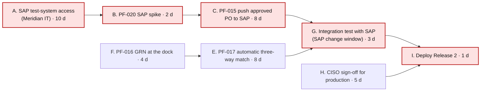

# Lecture Script: Framework Building and Dependency Management

> **Instructor reference.** Phase 2: Decide and build (Focus area 2), Module 5 | Duration: 6 hours (2.5 h concepts and demos, 3.5 h hands-on) | Previous script: [Module 4 — Technology Selection and Solution Architecture](Module-04-Technology-Selection-and-Architecture.md)

## Session overview

**Goal.** Learners build ProcureFlow's thin internal framework so that every service gets error handling, logging, validation, authorisation and health checks right by default. They package it, wrap it in a solution template, add a typed frontend client and shared components, put dependency guardrails around it all, and plan the remaining sprints' work dependencies (Capstone increment CI-5).

**Learner profile at this point.** Learners have the domain model, requirements and NFRs (Modules 1–2), a guarded repo with a walking skeleton in dev (Module 3), and an approved architecture: modular monolith, .NET API and Next.js on App Service, Azure SQL Database, Service Bus to SAP (Module 4). Today introduces the first genuinely new idea of the build: **solve a cross-cutting problem once, in a shared platform, so every service and every developer gets it right by default.**

**Key outcome.** Every learner can explain the dependency rule, build and publish shared .NET and npm packages, scaffold a new service from a template in under 5 minutes, generate a typed API client from OpenAPI, set up central package management with automated update PRs, an SBOM and licence and vulnerability checks, and maintain a RAID log and dependency board with a critical path.

**Case for this session.** ProcureFlow at Meridian Components. The approved stack from Module 4. The team's internal feed is assumed to be GitHub Packages (swap for Azure Artifacts if that's your standard). The trainer plays the tech lead for most of the day and briefly relays dependencies from Meridian IT and the SAP team.

**Note on tool versions.** Code targets .NET 8 or later and current npm tooling. Commands for third-party tools (CycloneDX, licence checkers) change between versions; check `--help` on the day. **Licences change too**: always check the current terms of a package before adding it.

**Note on AI output.** AI-generated code and package suggestions vary run to run; examples are marked **illustrative**.

## Timing breakdown

| Segment | Duration | Cumulative | Kind |
| --- | --- | --- | --- |
| SEGMENT 1: Opening — Why a Thin Internal Framework | 15 min | 0:15 | Concept |
| SEGMENT 2: Clean Architecture and the Dependency Rule | 20 min | 0:35 | Concept + demo |
| SEGMENT 3: Cross-Cutting Building Blocks | 25 min | 1:00 | Concept + demo |
| SEGMENT 4: Lab 1A — Build the Platform Blocks | 35 min | 1:35 | Hands-on |
| **BREAK** | 10 min | — |  |
| SEGMENT 5: Design Patterns in the Framework | 18 min | 1:53 | Concept + demo |
| SEGMENT 6: Packaging, Templates and Enforcement | 20 min | 2:13 | Concept + demo |
| SEGMENT 7: Lab 1B — Harden and Publish the Platform | 20 min | 2:33 | Hands-on |
| SEGMENT 8: Lab 2 — Solution Template in Under 5 Minutes | 30 min | 3:03 | Hands-on |
| **BREAK** | 30 min (lunch) | — |  |
| SEGMENT 9: Frontend Platform | 12 min | 3:15 | Concept + demo |
| SEGMENT 10: Lab 3 — Typed API Client and Component Library | 40 min | 3:55 | Hands-on |
| SEGMENT 11: Code Dependency Management and Health | 20 min | 4:15 | Concept + demo |
| SEGMENT 12: Lab 4 — Dependency Guardrails | 40 min | 4:55 | Hands-on |
| **BREAK** | 10 min | — |  |
| SEGMENT 13: Work Dependencies, RAID and the Critical Path | 12 min | 5:07 | Concept + demo |
| SEGMENT 14: Lab 5 — RAID Log and Dependency Board | 30 min | 5:37 | Hands-on |
| SEGMENT 15: CI-5 Review and Wrap-Up | 23 min | 6:00 | Hands-on + close |

Concepts and demos: 150 min (about 42%, including the 8-minute close). Labs and capstone: 210 min (about 58%), as the module specifies. Breaks are not counted.

## SEGMENT 1: Opening — Why a Thin Internal Framework (15 min)

### The Hook (7 min)

**Show one slide: "Sprint 1 review, three endpoints".**

**Say:** *"Three developers each built one ProcureFlow endpoint last sprint. All three work. Now look closer. Endpoint one returns errors as plain text; endpoint two returns JSON with a stack trace in it; endpoint three returns a proper problem-details object. Two of them log without a correlation ID, so support can't trace a failure. The approve endpoint forgot its authorisation check. One developer added a validation library the AI suggested; its licence changed last year. And the new joiner who started on Monday is still setting up her project on Thursday."*

**Ask:** *"Every one of those developers knew the rules. We wrote them down in Module 3. So what would stop this happening again on the fiftieth endpoint?"*

**Do:** Take 4–5 answers. Write them on the board.

**Respond to likely answers:**

- *"Better code review."* → *"Reviewers catch some of it. Will they catch all of it, on every PR, at 6 p.m. on a Friday?"*
- *"More documentation."* → *"They had the documentation. Reading it isn't the problem; re-implementing it fifty times is."*
- *"Copy-paste from the good endpoint."* → *"Closer. Now fifty copies drift. What if the good one gets a fix?"*
- *"Make it shared code."* → *"Yes. Where does it live, and how does everyone get it?"*

**Say:** *"The rules from Module 3 tell people what to do. A platform does it for them. Here's today's line:"*

**Write on board, large, and leave it up all day:**

> **Solve it once, in the platform; then every service gets it right by default.**

### Why Teams Build a Thin Internal Framework (6 min)

**Say:** *"Four payoffs. Write them down; you'll measure two of them today."*

| Payoff | ProcureFlow example | Measured today |
| --- | --- | --- |
| Consistency | Every error is the same ProblemDetails shape with a correlation ID | Lab 1 |
| Speed | A new service starts with logging, auth and health checks already wired | Lab 2: under 5 minutes |
| Fewer defects | Authorisation policies defined once, not re-typed per endpoint | Lab 1 |
| Easier onboarding | A new joiner runs one command, not a four-day setup | Lab 2 |

**Say:** *"Note the word 'thin'. We're not building our own web framework. ASP.NET Core and Next.js do the heavy lifting. Our platform is a few hundred lines that set them up the ProcureFlow way. The moment it grows into something people have to fight, it's too thick."*

### Comprehension Check (2 min)

**Ask:** *"Which of this morning's six problems does a shared platform solve, and which still needs a different guardrail?"* (Platform: error format, correlation IDs, auth policy defaults, onboarding. The changed licence needs dependency guardrails, which come this afternoon.)

**Transition — Say:** *"Before we write shared code, we need a rule about which code may depend on which. Otherwise the platform becomes the tangle."*

## SEGMENT 2: Clean Architecture and the Dependency Rule (20 min)

### Four Layers, One Rule (8 min)

**Say:** *"In Module 4 we chose a modular monolith: one module per bounded context. Clean Architecture is how we organise the code inside each module. Four layers, and one rule."*

**Draw on whiteboard as concentric rings, then as a list:**

| Layer | Contains | ProcureFlow example (Requisitioning module) | May depend on |
| --- | --- | --- | --- |
| Domain | Business rules and entities; no frameworks | `Requisition`, `ApprovalRouting`, `Money` | Nothing (plus tiny shared primitives such as `Result`) |
| Application | Use cases; interfaces (ports) the use cases need | `SubmitRequisition` handler; `IRequisitionRepository`, `IPurchaseOrderGateway` | Domain |
| Infrastructure | Implementations of those interfaces | EF Core repository; Service Bus publisher; SAP client | Application, Domain |
| Presentation | How the outside world talks to us | Minimal API endpoints; Next.js pages | Application |

**Write the rule on the board:**

> **The dependency rule: source code dependencies point inward. Inner layers know nothing about outer layers.**

**Say:** *"Why bother? Because the outer layers are the ones that change. SAP's interface will change. We might swap App Service for Container Apps. The approval rules (₹50,000, ₹5 lakh) belong to Meridian's business, and they shouldn't break because a database driver was upgraded."*

### Live Demo: Catch a Violation (8 min)

**Say:** *"Watch what happens when someone, or some AI, takes a shortcut."*

**Live-code — the shortcut (in the Domain project):**

```csharp
// Domain/Requisition.cs — WRONG: domain reaches out to infrastructure
public void Approve(string approverId, ProcureFlowDbContext db)
{
    Status = RequisitionStatus.Approved;
    db.AuditEntries.Add(new AuditEntry(Id, approverId, "Approved"));
}
```

**Run the architecture test from Module 3 (NetArchTest):**

```bash
dotnet test --filter Architecture
```

**Example output (illustrative — test runner formatting varies):**

```
Failed Domain_does_not_depend_on_Infrastructure
  Assert.True() Failure
  Expected: True
  Actual:   False
```

**Live-code — the fix:** the domain raises a fact; the application layer decides what to do with it.

```csharp
// Domain/Requisition.cs — the domain only records what happened
public void Approve(string approverId)
{
    Status = RequisitionStatus.Approved;
    _events.Add(new RequisitionApproved(Id, approverId));
}

// Application/ApproveRequisitionHandler.cs — uses ports, not concrete classes
requisition.Approve(command.ApproverId);
await _repository.SaveAsync(requisition, ct);   // IRequisitionRepository
await _audit.RecordAsync(requisition.Events, ct); // IAuditLog
```

**Say:** *"Notice `RequisitionApproved`. That's the domain event from our Module 1 event-storming wall, showing up in code. And the audit log is now behind an interface, so we can test approval without a database."*

### Comprehension Check (4 min)

1. *"Where does `IPurchaseOrderGateway` (the SAP port) live, and where does its implementation live?"* (Interface in Application; implementation in Infrastructure.)
2. *"A developer adds `[JsonPropertyName]` attributes to the `Requisition` entity so the API can return it directly. Which rule is bent, and what's the alternative?"* (Domain now depends on a serialisation framework; map to a response DTO in the presentation layer instead.)

**Common misconception:** Clean Architecture means lots of projects and boilerplate. (It means dependency direction; the number of projects is a choice.)

**Re-teach trigger:** if learners can't place the SAP interface, redraw the rings and trace one request from endpoint to database.

**Transition — Say:** *"The layers tell us where code goes. Now: which pieces of code does every module need, and should therefore live in the platform?"*

## SEGMENT 3: Cross-Cutting Building Blocks (25 min)

### Seven Blocks Every Service Needs (5 min)

**Say:** *"Cross-cutting means 'every module needs it, and none of them should write it'. Here are the seven blocks of ProcureFlow.Platform, each tied to a rule you already wrote."*

| Block | What it does | Rule it enforces |
| --- | --- | --- |
| Error handling | Every error becomes a ProblemDetails response (RFC 9457, formerly 7807); no stack traces leak | `CODING_STANDARDS.md` |
| Logging and correlation IDs | Structured logs; one correlation ID per request, returned to the user | `LOGGING.md`, Module 3 Bug 2 |
| Validation pipeline | Every command validated before its handler runs | Story acceptance criteria |
| Authorisation policies | Named policies such as `CanApproveRequisition`, defined once | NFR-SEC-02, NFR-SEC-03 |
| Configuration | Typed, validated settings that fail at startup, not at 2 a.m. | `SECURITY.md` (no secrets in config) |
| Health checks | `/health/live` and `/health/ready` for the hosting platform | NFR-AVL-01 |
| Result types | Handlers return success or a typed error, not exceptions for expected failures | `CODING_STANDARDS.md` |

### Live Demo: Three Blocks in Code (15 min)

**Say:** *"Three of the seven, live. The others follow the same shape, and you'll build them in the lab."*

**1. Correlation IDs (5 min).** *"Set an ID at the front door, put it in every log line, and send it back to the user."*

```csharp
public sealed class CorrelationIdMiddleware(RequestDelegate next, ILogger<CorrelationIdMiddleware> logger)
{
    public const string Header = "X-Correlation-ID";

    public async Task InvokeAsync(HttpContext context)
    {
        var incoming = context.Request.Headers[Header].ToString();
        var id = IsValid(incoming) ? incoming : Guid.NewGuid().ToString("N");

        context.Items[Header] = id;
        context.Response.OnStarting(() => { context.Response.Headers[Header] = id; return Task.CompletedTask; });

        using (logger.BeginScope(new Dictionary<string, object> { ["CorrelationId"] = id }))
        {
            await next(context);
        }
    }

    private static bool IsValid(string value) =>
        value.Length is > 0 and <= 64 && value.All(char.IsAsciiLetterOrDigit);
}
```

**Say:** *"Two details worth pointing at. We validate an incoming ID, because headers come from outside and could be used to inject junk into logs. And we set the response header in `OnStarting`, so it survives even when the exception handler clears the response."*

**2. Errors as ProblemDetails (5 min).**

```csharp
builder.Services.AddProblemDetails(options =>
    options.CustomizeProblemDetails = ctx =>
        ctx.ProblemDetails.Extensions["correlationId"] = ctx.HttpContext.Items[CorrelationIdMiddleware.Header]);
builder.Services.AddExceptionHandler<UnhandledExceptionHandler>(); // logs, then writes a 500 ProblemDetails
```

**Example output (illustrative — field order and `traceId` format vary):**

```json
{
  "type": "https://tools.ietf.org/html/rfc9110#section-15.6.1",
  "title": "Something went wrong",
  "status": 500,
  "detail": "Quote the reference when contacting support.",
  "correlationId": "7f3c9a2e…"
}
```

**Say:** *"Remember Module 3's Bug 2? The user saw 'Reference: 7f3c9a2e' and support found the stack trace in the logs. This is the code that makes that happen for every service, without anyone remembering to."*

**3. Result types (5 min).** *"Expected failures, like a validation error or 'requisition not found', aren't exceptions. They're results."*

```csharp
public enum ErrorKind { Validation, NotFound, Conflict, Forbidden }
public sealed record Error(string Code, string Message, ErrorKind Kind);

public sealed record Result<T>
{
    public T? Value { get; init; }
    public IReadOnlyList<Error> Errors { get; init; } = [];
    public bool IsSuccess => Errors.Count == 0;
    public static Result<T> Ok(T value) => new() { Value = value };
    public static Result<T> Fail(params Error[] errors) => new() { Errors = errors };
}
```

**Say:** *"One extension method in the platform, `result.ToHttpResult()`, turns every `ErrorKind` into the right status code and ProblemDetails. Developers return a result; the platform does the HTTP."*

### Comprehension Check (5 min)

1. *"Why validate an incoming correlation ID instead of trusting it?"* (It comes from outside; unchecked, it can inject misleading or harmful content into logs.)
2. *"'Requisition not found': exception or result? Why?"* (Result: it's an expected outcome, not a system failure; exceptions are for the unexpected.)
3. *"Which block makes the approve endpoint's missing authorisation check less likely?"* (Named authorisation policies, applied by default through the platform and templates.)

**Common misconception:** a platform means hiding ASP.NET Core behind our own abstractions. (It means configuring the framework consistently, not replacing it.)

**Re-teach trigger:** if learners want to throw exceptions for validation, show the cost: a stack trace in logs for every typo a requester makes.

**Transition — Say:** *"Now you build them."*

## SEGMENT 4: Lab 1A — Build the Platform Blocks (35 min)

**Say:** *"Build ProcureFlow.Platform: shared .NET code for error handling, logging, validation and authorisation policies. Use AI to write it, with your instruction files in place. But every package the AI suggests goes through the package gate before it touches the project file. After the break, you'll harden it and publish it."*

### Instructions (read aloud, step by step)

1. **Create the solution (3 min).** In your team repo, create `platform/ProcureFlow.Platform.sln` with these class libraries:
   - `ProcureFlow.Platform.Primitives`: `Result<T>`, `Error`, `ErrorKind` (no dependencies)
   - `ProcureFlow.Platform.Errors`: ProblemDetails setup, exception handler, `ToHttpResult()`
   - `ProcureFlow.Platform.Logging`: correlation ID middleware, logging setup
   - `ProcureFlow.Platform.Validation`: validation for commands (finished in Lab 1B)
   - `ProcureFlow.Platform.Auth`: named authorisation policies
2. **Build the blocks with AI (20 min).** Split across the team, one block each. Use the prompt below. Any package the AI proposes goes through the gate first.
3. **One entry point (5 min).** Add `AddProcureFlowPlatform()` and `UseProcureFlowPlatform()` that wire everything. Call them in your API's `Program.cs`, replacing any hand-written setup.
4. **Prove it (7 min).** Write integration tests with `WebApplicationFactory` for the four checks in the success criteria.

### The AI Prompt (give to learners)

```
Using CODING_STANDARDS.md and LOGGING.md, implement the <block name> block of
ProcureFlow.Platform as a .NET class library. Expose one extension method to register it.
Use only what ships with ASP.NET Core unless a package is essential; if you propose a
package, give its name, licence and why the framework can't do it. Include xUnit tests.
```

### The Package Gate (every AI-suggested package)

| Check | Question | Pass if |
| --- | --- | --- |
| Exists | Is it really on nuget.org / npm under exactly this name? | Found; not a look-alike name |
| Licence | What is the licence *for the version we'd use*? | On the allowed list in `DEPENDENCIES.md` |
| Maintenance | Last release, number of maintainers, open security issues | Released in the last year; more than one maintainer, or a reason it's fine |
| Vulnerabilities | Any known advisories? | None open at or above "high" |
| Necessity | Could ASP.NET Core or our own 50 lines do it? | A clear reason it can't |

**Say (when the first team gets a mediator library suggestion):** *"Good case study. Popular .NET libraries have changed licence model before: MediatR, for example, announced commercial licensing for its newer releases in 2025. Check the current terms yourself; don't trust my memory or the AI's. That's why the licence check is per version, not per name. And notice the necessity check: we only need a pipeline for validation and logging, which a small decorator can do. You'll write it after the break."*

### Starter: the Entry Point

```csharp
public static class PlatformExtensions
{
    public static IHostApplicationBuilder AddProcureFlowPlatform(this IHostApplicationBuilder builder)
    {
        builder.AddProcureFlowErrors();      // ProblemDetails + exception handler
        builder.AddProcureFlowLogging();     // structured logging setup
        builder.AddProcureFlowAuth();        // named policies
        builder.Services.AddHealthChecks();  // checks added per service
        return builder;
    }

    public static WebApplication UseProcureFlowPlatform(this WebApplication app)
    {
        app.UseMiddleware<CorrelationIdMiddleware>(); // first, so everything after has the ID
        app.UseExceptionHandler();
        app.MapHealthChecks("/health/live");
        return app;
    }
}
```

### Reference Solution (instructor, partial): Authorisation Policies

```csharp
public static class Policies
{
    public const string CanApproveRequisition = nameof(CanApproveRequisition);
    public const string CanViewVendorBankDetails = nameof(CanViewVendorBankDetails);
}

public static IHostApplicationBuilder AddProcureFlowAuth(this IHostApplicationBuilder builder)
{
    builder.Services.AddAuthorizationBuilder()
        .AddPolicy(Policies.CanApproveRequisition, p => p
            .RequireRole("Approver")
            .AddRequirements(new NotOwnRequisitionRequirement()))    // NFR-SEC-02
        .AddPolicy(Policies.CanViewVendorBankDetails, p => p
            .RequireRole("APClerk"));                                  // NFR-SEC-03
    builder.Services.AddSingleton<IAuthorizationHandler, NotOwnRequisitionHandler>();
    return builder;
}
```

**Say:** *"`NotOwnRequisitionRequirement` is resource-based: the handler needs the requisition to compare its requester with the current user. The endpoint calls `IAuthorizationService.AuthorizeAsync(user, requisition, Policies.CanApproveRequisition)`. The rule lives in one place; every approve endpoint uses it."*

### Instructor Circulates

- **Package added before the gate:** *"Show me the gate row for this package."*
- **Setup still hand-written in `Program.cs`:** everything goes through the one entry point.
- **Correlation middleware registered after the exception handler:** errors then lose their ID; move it first.
- **Policies named by role** ("ApproverPolicy"): name them by the action ("CanApproveRequisition"); roles may change, actions don't.

**Success check (four integration tests pass):** an unhandled exception returns a 500 ProblemDetails with `correlationId`; every response carries `X-Correlation-ID`; a requester approving their own requisition gets 403; `/health/live` returns 200.

### BREAK (10 min)

*Suggested break prompt:* *"Meridian's Leeds plant will have different approval limits, in pounds. Where in our code would that difference live?"*

## SEGMENT 5: Design Patterns in the Framework (18 min)

### Six Patterns, Each With a Job (6 min)

**Say:** *"Design patterns are named solutions to recurring problems. You don't use them to look clever; you use them because they give the team a shared word. Here are the six our platform uses, each with its ProcureFlow job."*

| Pattern | Problem it solves | ProcureFlow use |
| --- | --- | --- |
| Repository | Use cases shouldn't know how data is stored | `IRequisitionRepository` in Application; EF Core version in Infrastructure |
| Strategy | Several interchangeable rules for the same job | Approval routing: India limits in rupees, Leeds limits in pounds |
| Factory | Choosing or building the right object at runtime | Pick the routing strategy for a site; `IHttpClientFactory` for the SAP client |
| Options | Typed, validated configuration | `SapOptions`, `ApprovalLimitsOptions`, validated at startup |
| Decorator | Add behaviour around something without changing it | Validation and logging wrapped around every command handler |
| Mediator | Senders shouldn't know which handler runs | Endpoint sends `SubmitRequisition`; the mediator finds its handler |

### Live Demo: Strategy and Decorator (9 min)

**Ask:** *"Your break question: where does the Leeds difference live?"* (In a second routing strategy, chosen per site.)

**Strategy (3 min):**

```csharp
public interface IApprovalRoutingStrategy
{
    IReadOnlyList<Approver> RouteFor(Money amount);
}

public sealed class IndiaRouting(IOptions<ApprovalLimitsOptions> limits) : IApprovalRoutingStrategy { /* ₹50,000 / ₹5 lakh */ }
public sealed class UkRouting(IOptions<ApprovalLimitsOptions> limits) : IApprovalRoutingStrategy { /* £ limits from config */ }
```

**Say:** *"Adding a site means adding a strategy and its limits, not editing an `if` that already works. That's Strategy plus Options."*

**Decorator (6 min):** *"This is the validation pipeline from Lab 1A, without a third-party mediator library."*

```csharp
public interface ICommandHandler<TCommand, TResult>
{
    Task<Result<TResult>> HandleAsync(TCommand command, CancellationToken ct);
}

public interface ICommandValidator<TCommand>
{
    IEnumerable<Error> Validate(TCommand command);
}

public sealed class ValidationDecorator<TCommand, TResult>(
    ICommandHandler<TCommand, TResult> inner,
    IEnumerable<ICommandValidator<TCommand>> validators) : ICommandHandler<TCommand, TResult>
{
    public async Task<Result<TResult>> HandleAsync(TCommand command, CancellationToken ct)
    {
        var errors = validators.SelectMany(v => v.Validate(command)).ToArray();
        return errors.Length == 0
            ? await inner.HandleAsync(command, ct)
            : Result<TResult>.Fail(errors);
    }
}
```

**Say:** *"The handler never sees invalid input, and nobody has to remember to call a validator. A logging decorator wraps it the same way. Registration can be done by hand, or with a small decorator-registration library; if you use one, it goes through the package gate like everything else."*

### Comprehension Check (3 min)

1. *"Meridian adds a plant in Germany with euro limits. Which two patterns make that a small change?"* (Strategy for the new routing, Options for its limits; a Factory picks it by site.)
2. *"Why put validation in a decorator instead of the first line of each handler?"* (It can't be forgotten, and it's written and tested once.)

**Common misconception:** more patterns mean better design. (Each pattern adds indirection; use one only when its problem is present.)

**Re-teach trigger:** if learners can't tell Strategy from Decorator, ask: *"Are we choosing one of several ways (Strategy), or wrapping extra behaviour around one way (Decorator)?"*

## SEGMENT 6: Packaging, Templates and Enforcement (20 min)

### Internal Packages and Semantic Versioning (7 min)

**Say:** *"Shared code that's copied is shared code that drifts. We publish the platform as versioned packages to the team feed: NuGet for .NET, npm for the frontend. Services take a version, and upgrade on purpose."*

**Write the semantic versioning rule on the board:**

> **MAJOR.MINOR.PATCH** — MAJOR: you broke someone (renamed `AddProcureFlowPlatform`). MINOR: you added something (a new health check helper). PATCH: you fixed something without changing how it's used.

**Live demo: pack and push (illustrative — use your team feed's URL and credentials):**

```bash
dotnet pack platform/ProcureFlow.Platform.sln -c Release -p:Version=1.0.0 -o out
dotnet nuget push "out/*.nupkg" --source github --api-key "$GITHUB_TOKEN"
```

**Say:** *"In practice the pipeline does this on a tag, not a developer's laptop. A release tag `platform-v1.1.0` builds, tests and publishes. Nobody publishes by hand."*

### Solution Templates (5 min)

**Say:** *"Packages give you the blocks. A `dotnet new` template gives you a whole new service already wired: four layers, platform packages referenced, architecture tests, analysers, health checks, a README."*

**Show the heart of a template:**

```json
// .template.config/template.json
{
  "$schema": "http://json.schemastore.org/template",
  "author": "ProcureFlow team",
  "identity": "ProcureFlow.Service.Template",
  "name": "ProcureFlow service",
  "shortName": "pf-service",
  "sourceName": "ProcureFlow.ServiceName",
  "classifications": ["Web", "API", "ProcureFlow"],
  "tags": { "language": "C#", "type": "solution" },
  "preferNameDirectory": true
}
```

**Say:** *"`sourceName` is the magic: every file and namespace containing `ProcureFlow.ServiceName` gets renamed to whatever you pass with `-n`."*

### Enforcing the Framework (6 min)

**Say:** *"A platform nobody uses is a wiki page with extra steps. Three enforcement tools, all shipped inside the template so every new service gets them."*

- **Architecture tests (NetArchTest):** *"Domain doesn't depend on Infrastructure. Endpoints don't call repositories directly. Every command handler is wrapped by the validation decorator."*
- **Analysers:** *"`.editorconfig` severities, `AnalysisLevel`, and warnings as errors, set once in `Directory.Build.props`."*
- **Banned APIs:** *"The banned-API analyser turns a rule into a compile error."*

```
# BannedSymbols.txt
P:System.DateTime.Now;Use TimeProvider so time can be controlled in tests
M:System.Console.WriteLine(System.String);Use ILogger (LOGGING.md)
```

**Say:** *"`DateTime.Now` in approval code makes approval tests flaky. One line in this file and nobody can use it again, human or AI."*

**Comprehension check (2 min):** *"The platform team renames a method in `ProcureFlow.Platform.Errors`. What version change is that, and what must they tell service teams?"* (MAJOR; a changelog entry and an upgrade note.)

**Transition — Say:** *"Back to your platform: harden it with these patterns and tools, then publish version 1.0.0."*

## SEGMENT 7: Lab 1B — Harden and Publish the Platform (20 min)

**Say:** *"Finish the platform with the patterns and enforcement you just saw, then publish version 1.0.0 to the team feed and make the API use the package instead of the source."*

### Instructions (read aloud, step by step)

1. **Decorators (5 min).** Add `ValidationDecorator` and a `LoggingDecorator` to `ProcureFlow.Platform.Validation`. Register them for every `ICommandHandler<,>`.
2. **Architecture tests (3 min).** Add `ProcureFlow.Platform.ArchitectureTests`: Primitives depends on nothing; no platform project depends on any ProcureFlow business module.
3. **Analysers (4 min).** `Directory.Build.props`: nullable enabled, `AnalysisLevel` set, warnings as errors, banned-API analyser with `BannedSymbols.txt`.
4. **Changelog and version (3 min).** `platform/CHANGELOG.md` with a 1.0.0 entry.
5. **Publish (3 min).** Push the tag `platform-v1.0.0`; the workflow packs and publishes to the team feed. (If the workflow isn't ready, push manually with the Segment 6 commands.)
6. **Consume (2 min).** Replace the API's project references with package references to `ProcureFlow.Platform.*` 1.0.0. Run the four Lab 1A tests again.

### Starter: Directory.Build.props

```xml
<Project>
  <PropertyGroup>
    <Nullable>enable</Nullable>
    <AnalysisLevel>latest-recommended</AnalysisLevel>
    <TreatWarningsAsErrors>true</TreatWarningsAsErrors>
  </PropertyGroup>
  <ItemGroup>
    <AdditionalFiles Include="$(MSBuildThisFileDirectory)BannedSymbols.txt" />
  </ItemGroup>
</Project>
```

**Note:** the banned-API analyser itself is a package (`Microsoft.CodeAnalysis.BannedApiAnalyzers`); add it through central package management in Lab 4, or temporarily per project now.

### Instructor Circulates

- **Publishing from a laptop with a personal token:** fine for today, but the pipeline must own it by CI-5.
- **Version 1.0.0 published twice with different content:** feeds usually reject it; versions are immutable. Bump the patch.
- **API still referencing platform source projects:** the point is to consume the package.

**Success check:** platform 1.0.0 is on the team feed; the API builds from the package; the four Lab 1A tests pass; `DateTime.Now` in any platform file fails the build.

## SEGMENT 8: Lab 2 — Solution Template in Under 5 Minutes (30 min)

**Say:** *"Package everything a new ProcureFlow service needs into a `dotnet new` template. The test: someone who didn't build it scaffolds a working service, with tests passing and health checks answering, in under 5 minutes. For example, the GST e-invoicing integration planned for Release 4."*

### Instructions (read aloud, step by step)

1. **Template content (10 min).** Under `templates/pf-service/`, create a minimal solution named `ProcureFlow.ServiceName` with four layers (Domain, Application, Infrastructure, Api), one sample command and handler, package references to `ProcureFlow.Platform.*`, architecture tests, `Directory.Build.props`, and a short `README.md`.
2. **Template config (3 min).** Add `.template.config/template.json` from Segment 6.
3. **Install and test locally (5 min).** Run the commands below. Fix anything that doesn't build.
4. **Package the template (5 min).** Create a template-pack project and publish it to the team feed (snippet below).
5. **The 5-minute race (5 min).** A teammate who didn't build the template installs it from the feed and scaffolds a service. The instructor times it.
6. **Record (2 min).** Time taken and any friction in `templates/pf-service/README.md`.

### Commands

```bash
dotnet new install ./templates/pf-service
dotnet new pf-service -n ProcureFlow.EInvoicing -o services/einvoicing
cd services/einvoicing
dotnet build
dotnet test
dotnet run --project src/ProcureFlow.EInvoicing.Api
# in another terminal (port shown in the run output)
curl http://localhost:<port>/health/live
```

**Example output (illustrative — exact wording varies by SDK version):**

```
The template "ProcureFlow service" was created successfully.
...
Passed!  - Failed: 0, Passed: 6, Skipped: 0
Healthy
```

### Template Pack Project

```xml
<!-- templates/ProcureFlow.Templates.csproj -->
<Project Sdk="Microsoft.NET.Sdk">
  <PropertyGroup>
    <PackageType>Template</PackageType>
    <PackageId>ProcureFlow.Templates</PackageId>
    <Version>1.0.0</Version>
    <TargetFramework>net8.0</TargetFramework>
    <IncludeContentInPack>true</IncludeContentInPack>
    <IncludeBuildOutput>false</IncludeBuildOutput>
    <ContentTargetFolders>content</ContentTargetFolders>
    <NoDefaultExcludes>true</NoDefaultExcludes>
  </PropertyGroup>
  <ItemGroup>
    <Content Include="pf-service/**/*" Exclude="pf-service/**/bin/**;pf-service/**/obj/**" />
    <Compile Remove="**/*" />
  </ItemGroup>
</Project>
```

**Say (when the first teammate finishes):** *"Compare with Monday's new joiner, who took four days. That's the onboarding payoff from this morning, measured."*

### Instructor Circulates

- **Scaffolded names still say `ServiceName`:** check `sourceName` matches the folder and namespace text exactly.
- **`bin/` and `obj/` inside the template package:** exclude them.
- **Template copies platform source instead of referencing packages:** reference the published packages.
- **Race over 5 minutes:** ask where the time went and fix that step (usually feed authentication or a missing README step).

**Success check:** template published to the team feed; a teammate scaffolds, builds, tests and gets `/health/live` = Healthy in under 5 minutes; friction recorded.

**Extension (fast teams):** add a template parameter (for example `--with-sap`) that includes or leaves out the SAP queue worker.

**Transition — Say:** *"After lunch, the same idea for the frontend."*

### BREAK (30 min, lunch)

*Suggested break prompt:* *"How many places in our Next.js app currently define what a 'requisition status' looks like? Count them after lunch."*

## SEGMENT 9: Frontend Platform (12 min)

### Three Shared Pieces (5 min)

**Ask:** *"Your lunch question: how many places define what a requisition status looks like?"* (Usually three or four: a colour in one page, a label map in another, a string comparison somewhere else.)

**Say:** *"The frontend needs the same 'solve it once' treatment. Three shared pieces."*

| Piece | What it is | ProcureFlow example |
| --- | --- | --- |
| Design tokens | Named values for colour, spacing and type, defined once | `--pf-color-status-approved`, `--pf-space-md` |
| Shared component library | Reusable React components built on the tokens | `StatusBadge`, `MoneyField`, `Button`, `FormField` |
| Typed API client | TypeScript types and calls generated from the API's OpenAPI description | `api.GET("/requisitions/{id}/status")` with checked types |

### Live Demo: Generate a Typed Client (6 min)

**Say:** *"Remember Module 3's demo bug, where the API sent `Status` and the page read `status`? A typed client turns that runtime blank into a compile error."*

**1. Expose the OpenAPI description from the API (.NET 9 or later shown; on .NET 8 use your starter kit's OpenAPI package):**

```csharp
builder.Services.AddOpenApi();
app.MapOpenApi(); // serves /openapi/v1.json
```

**2. Generate types and create a client (openapi-typescript + openapi-fetch; both go through the package gate):**

```bash
npx openapi-typescript http://localhost:<port>/openapi/v1.json -o src/schema.d.ts
```

```ts
import createClient from "openapi-fetch";
import type { paths } from "./schema";

export const api = createClient<paths>({ baseUrl: process.env.NEXT_PUBLIC_API_URL });

const { data, error } = await api.GET("/requisitions/{id}/status", {
  params: { path: { id } },
});
```

**3. Break it on purpose:** rename the property in the API, regenerate, and show the TypeScript error where the page reads the old name.

**Say:** *"Now the API's contract and the frontend can't silently drift. Add one CI step that regenerates the client and fails if it differs from what's committed, and drift is caught on the PR."*

**Comprehension check (1 min):** *"Why generate the client instead of writing fetch calls by hand?"* (Types come from the real API contract; changes break the build instead of production.)

## SEGMENT 10: Lab 3 — Typed API Client and Component Library (40 min)

**Say:** *"Build and publish two npm packages: the generated API client and a small component library on design tokens. Then make the ProcureFlow web app use them."*

### Instructions (read aloud, step by step)

1. **Design tokens (5 min).** Create `packages/ui/tokens.json` and generate CSS variables from it (a short script, or a token tool that passes the gate).
2. **Components (10 min).** In `packages/ui`, build `StatusBadge`, `MoneyField` (amount + currency, formatted for India and the UK), and `Button`, all using tokens only. No hard-coded colours.
3. **API client package (10 min).** In `packages/api-client`, generate types from your API's OpenAPI document and export a configured client. Make sure the API serialises enums as strings so statuses arrive as readable names.
4. **Publish (8 min).** Publish both as `@<org>/procureflow-ui` and `@<org>/procureflow-api-client` version 1.0.0 to the team npm feed.
5. **Consume (5 min).** Replace the web app's hand-written fetch calls and status colours with the packages.
6. **Drift check (2 min).** Add a CI step: regenerate the client; fail if `git diff` isn't empty.

### Starter Files

```json
// packages/ui/tokens.json
{
  "color": { "status": { "awaiting": "#b45309", "approved": "#15803d", "rejected": "#b91c1c" } },
  "space": { "sm": "8px", "md": "16px" },
  "radius": { "md": "8px" }
}
```

```
# .npmrc (repo root; token comes from the environment, never committed)
@<org>:registry=https://npm.pkg.github.com
//npm.pkg.github.com/:_authToken=${NODE_AUTH_TOKEN}
```

### Reference Solution (instructor, partial)

```tsx
// packages/ui/src/StatusBadge.tsx
import type { components } from "@<org>/procureflow-api-client";

type Status = components["schemas"]["RequisitionStatus"];

const label: Record<Status, string> = {
  AwaitingApproval: "Awaiting approval",
  Approved: "Approved",
  Rejected: "Rejected",
};

export function StatusBadge({ status }: { status: Status }) {
  return <span className={`pf-badge pf-badge--${status}`}>{label[status]}</span>;
}
```

**Say:** *"Because `label` is typed against the API's own status list, adding a new status in the API, say 'Withdrawn', makes this file fail to compile until someone gives it a label. The frontend can't forget a status again."*

### Instructor Circulates

- **Hard-coded colours in components:** tokens only.
- **Token committed in `.npmrc`:** remove it; use the environment variable. This is `SECURITY.md` again.
- **Generated `schema.d.ts` edited by hand:** never; regenerate instead.
- **Enums arriving as numbers:** configure string enum serialisation in the API.
- **`MoneyField` using `number` maths for rupees:** format only; amounts and maths stay in the API as decimals.

**Success check:** both packages at 1.0.0 on the team feed; the web app uses them; no hand-written fetch calls or status colours remain; the drift check fails when the API changes and the client isn't regenerated.

**Extension (fast teams):** add a Storybook page or a simple gallery page showing every component in every status, for Priya's design review.

## SEGMENT 11: Code Dependency Management and Health (20 min)

### The Iceberg (3 min)

**Say:** *"Count the packages you added today. Maybe ten. Now count what's actually in the build."*

**Live-code:**

```bash
dotnet list api/ProcureFlow.sln package --include-transitive
npm ls --all --prefix web | wc -l
```

**Say (pointing at the output):** *"The ones you chose are the tip. The rest are **transitive dependencies**: what your dependencies depend on. You didn't choose them, nobody reviewed them, and you're responsible for every one of them in production."*

### Managing Versions (7 min)

**Say:** *"Four tools keep versions under control."*

**1. Lock files** — *"record the exact version of every package, direct and transitive, so every build is identical."*

- npm: `package-lock.json`, installed in CI with `npm ci` (fails if the lock file doesn't match).
- NuGet: `packages.lock.json`, turned on with `RestorePackagesWithLockFile`, restored in CI with `dotnet restore --locked-mode`.

**2. Central package management (.NET)** — *"one file holds every version for the whole repo, so ten projects can't use ten versions of the same library."*

```xml
<!-- Directory.Packages.props -->
<Project>
  <PropertyGroup>
    <ManagePackageVersionsCentrally>true</ManagePackageVersionsCentrally>
    <CentralPackageTransitivePinningEnabled>true</CentralPackageTransitivePinningEnabled>
  </PropertyGroup>
  <ItemGroup>
    <PackageVersion Include="ProcureFlow.Platform.Errors" Version="1.0.0" />
    <PackageVersion Include="Microsoft.CodeAnalysis.BannedApiAnalyzers" Version="x.y.z" />
  </ItemGroup>
</Project>
```

*"Projects then write `<PackageReference Include="ProcureFlow.Platform.Errors" />` with no version. Transitive pinning lets you raise a vulnerable transitive package to a safe version from this one file."*

**3. Semantic versioning ranges** — *"Know what your version string allows. In npm, `^1.4.2` accepts any 1.x from 1.4.2 up. In NuGet, `Version="1.4.2"` means 'at least 1.4.2'. The lock file is what actually freezes it."*

**4. Transitive overrides** — *"When a transitive package is vulnerable and the direct one hasn't updated: pin it in `Directory.Packages.props` (.NET) or use `overrides` in `package.json` (npm). Then record why, and remove the override when the parent catches up."*

### Dependency Health (7 min)

**Say:** *"Versions under control is half of it. The other half is knowing when they go bad."*

| Tool | What it does | ProcureFlow use |
| --- | --- | --- |
| Dependabot or Renovate | Opens PRs to update dependencies on a schedule; can group updates | Weekly grouped PRs for NuGet, npm and GitHub Actions |
| Vulnerability scanning | Checks dependencies against known advisories | `dotnet list package --vulnerable --include-transitive`, NuGet audit during restore, `npm audit` |
| SBOM (CycloneDX) | A machine-readable ingredients list of the release | Generated on every release build; stored with the artefact |
| Licence check | Compares every dependency's licence with the allowed list | Fails the build on anything not allowed by `DEPENDENCIES.md` |

**Live-code:**

```bash
dotnet list api/ProcureFlow.sln package --vulnerable --include-transitive
npm audit --prefix web --audit-level=high
```

**Example output (illustrative — results depend on today's advisories):**

```
The given project `ProcureFlow.Api` has no vulnerable packages given the current sources.
...
found 0 vulnerabilities
```

**Say:** *"Two practical notes. `dotnet list package --vulnerable` reports but doesn't fail the build by itself; NuGet's restore-time audit warnings, with warnings as errors, can. And an SBOM pays for itself the first time a big vulnerability hits the news and Meridian's CISO asks 'are we affected?' You search one file instead of fifty repos."*

### Comprehension Check (3 min)

1. *"Why does CI use `npm ci` instead of `npm install`?"* (It installs exactly what's in the lock file and fails if they disagree, so builds are reproducible.)
2. *"A critical advisory hits a package you've never heard of. How do you find out if ProcureFlow uses it, and fix it?"* (Search the SBOM or the transitive list; update the parent, or pin the transitive version centrally / with `overrides`, and record why.)
3. *"What does an SBOM give the client?"* (A list of every component in the release, to answer vulnerability and licence questions quickly.)

**Common misconception:** "we only depend on the packages we installed."

**Re-teach trigger:** if learners miss question 2, redo the iceberg command and find one transitive package together.

**Transition — Say:** *"Now set all of this up for real, and write the policy that ties it together: `DEPENDENCIES.md`."*

## SEGMENT 12: Lab 4 — Dependency Guardrails (40 min)

**Say:** *"Make the repo manage its own dependencies: one place for versions, frozen builds, automatic update PRs, a vulnerability gate, an SBOM on every build, a licence check, and the policy that explains it all. By the end, a bad package should fail the PR, not surprise the CISO."*

### Instructions (read aloud, step by step)

1. **Central package management (8 min).** Add `Directory.Packages.props` (Segment 11). Remove `Version` from every `PackageReference`. Build.
2. **Lock files (4 min).** Turn on `RestorePackagesWithLockFile`; commit `packages.lock.json`. In CI: `dotnet restore --locked-mode` and `npm ci`.
3. **Automated updates (6 min).** Add `.github/dependabot.yml` (or `renovate.json`), including your team feed so platform updates arrive as PRs too.
4. **Vulnerability gate (5 min).** CI fails on high or critical advisories (.NET and npm).
5. **SBOM (6 min).** Generate CycloneDX SBOMs for the API and web app on every build; upload them as build artefacts.
6. **Licence check (5 min).** CI fails on any licence not on the allowed list.
7. **`DEPENDENCIES.md` (6 min).** Write the policy (template below). Replace the starter version from Module 3.

### Starter Files

```yaml
# .github/dependabot.yml
version: 2
registries:
  team-nuget:
    type: nuget-feed
    url: https://nuget.pkg.github.com/<org>/index.json
    token: ${{secrets.PACKAGES_TOKEN}}
updates:
  - package-ecosystem: "nuget"
    directory: "/"
    registries: [team-nuget]
    schedule: { interval: "weekly" }
    groups:
      minor-and-patch:
        update-types: ["minor", "patch"]
  - package-ecosystem: "npm"
    directory: "/web"
    schedule: { interval: "weekly" }
  - package-ecosystem: "github-actions"
    directory: "/"
    schedule: { interval: "weekly" }
```

```yaml
# CI steps (illustrative — check each tool's --help for your installed version)
- run: dotnet restore api/ProcureFlow.sln --locked-mode
- run: dotnet list api/ProcureFlow.sln package --vulnerable --include-transitive
- run: npm ci --prefix web && npm audit --prefix web --audit-level=high
- run: |
    dotnet tool install --global CycloneDX
    dotnet CycloneDX api/ProcureFlow.sln -o sbom
- run: npx @cyclonedx/cyclonedx-npm --output-file ../sbom/web.cdx.json
  working-directory: web
- run: npx license-checker --production --onlyAllow "MIT;Apache-2.0;BSD-2-Clause;BSD-3-Clause;ISC"
  working-directory: web
# .NET licence check: use a licence tool that passed your gate, with the same allowed list
```

**Note:** the SBOM and licence tools above are themselves dependencies. Run them through the package gate too, and pin their versions.

```markdown
# DEPENDENCIES.md
## Allowed licences
MIT · Apache-2.0 · BSD-2-Clause · BSD-3-Clause · ISC
## Needs approval (tech lead + Meridian legal)
LGPL · MPL · any commercial licence · any licence change on an existing package
## Not allowed
GPL · AGPL · no licence stated
## Adding a package (including anything an AI suggests)
Run the package gate: exists · licence for this version · maintenance · vulnerabilities · necessity.
Record the result in the PR description.
## Updates
Dependabot opens grouped PRs weekly. Security fixes: critical within 2 working days, high within 7.
## Overrides
Every transitive pin or npm override is listed here with the reason and the date to remove it.
## SBOM
Generated on every build; attached to every release.
```

### Instructor Circulates

- **Versions left in a `.csproj`:** central management will flag it; remove them.
- **Lock file in `.gitignore`:** it must be committed.
- **Dependabot can't reach the team feed:** the `registries` block and a repository secret are needed.
- **Vulnerability step that never fails:** test it with a known-vulnerable test package version on a throwaway branch (instructor supplies one), then revert.
- **Security-fix deadlines with no owner:** add who triages Dependabot PRs.

**Success check:** builds use central versions and lock files; at least one Dependabot (or Renovate) PR has opened; CI fails on a high advisory and on a disallowed licence; SBOMs appear as build artefacts; `DEPENDENCIES.md` merged.

**Extension (fast teams):** add `CHANGELOG.md` automation for platform packages from conventional commits, so every Dependabot upgrade PR shows what changed.

**Transition — Say:** *"Code dependencies are under control. After the break: the dependencies that aren't in any lock file — between people, teams and systems."*

### BREAK (10 min)

*Suggested break prompt:* *"Which one thing, outside our team's control, could stop Release 2 shipping on time?"*

## SEGMENT 13: Work Dependencies, RAID and the Critical Path (12 min)

### Dependencies No Lock File Can See (4 min)

**Ask:** *"Your break question: what outside our team could stop Release 2?"* Collect answers. (Expect: SAP test-system access, the SAP change window, CISO approval, Meridian IT network access.)

**Say:** *"Notice none of those are code. Work dependencies come in three kinds, and on client engagements the third kind sinks most plans."*

| Kind | Example | Who you talk to |
| --- | --- | --- |
| Story → story | PF-015 "push PO to SAP" needs PF-020 "SAP spike" done first | Your own team |
| Team → team / service → service | Web app needs the API's new status endpoint | Another team in the program |
| External | SAP test-system access from Meridian IT; CISO sign-off for production | The client's people, with their own priorities and calendars |

### RAID Log (3 min)

**Say:** *"A RAID log keeps four kinds of uncertainty in one place, each with an owner and a date. You already met three of them in Module 1."*

| Letter | Meaning | ProcureFlow example |
| --- | --- | --- |
| R — Risk | Might happen; would hurt | SAP change window moves after the March upgrade |
| A — Assumption | We're acting as if it's true | ~140 concurrent users at peak |
| I — Issue | Already happening; needs action now | SAP test-system access still not granted |
| D — Dependency | We need something from someone else, by a date | CISO production sign-off by sprint 4 |

**Say:** *"The difference between a risk and an issue is time. 'SAP access might be late' is a risk on Monday. On Friday, with no access, it's an issue."*

### The Critical Path (4 min)

**Say:** *"The critical path is the longest chain of dependent work from now to the release. Its length is the earliest the release can happen. Any delay on it delays the release; delays elsewhere don't, until they use up their slack."*

**Draw a tiny example on the board:**

```
A (3 days) → B (2 days) → D (1 day)        = 6 days   ← critical path
C (2 days) ──────────────→ D               = 3 days   (3 days of slack)
```

**Say:** *"So if C slips by two days, nobody should panic. If A slips by one day, the release slips by one day. That tells you where to spend your worry, and your escalations."*

**Comprehension check (1 min):** *"'The CISO hasn't replied for two weeks.' Risk, issue or dependency?"* (It's a dependency that has turned into an issue; log the issue, name an owner, escalate.)

## SEGMENT 14: Lab 5 — RAID Log and Dependency Board (30 min)

**Say:** *"Plan the remaining sprints to Release 2. Find every dependency, put them on a board, work out the critical path, and build the RAID log. Then decide the first thing you'd escalate to Priya tomorrow."*

### Instructions (read aloud, step by step)

1. **List dependencies (8 min).** From your backlog, story map, ADRs and the Module 4 design review, list every dependency for R2: story-to-story, team-to-team and external.
2. **Dependency board (7 min).** One row per dependency: what, needed by (story and sprint), provider, date needed, status, risk if late. Use a GitHub Project board or `docs/plan/dependency-board.md`.
3. **Critical path (8 min).** Draw the network of R2 work with durations. Find the longest chain and the slack on the others.
4. **RAID log (5 min).** `docs/plan/raid-log.md`: carry over Module 1 risks and assumptions, add issues and dependencies, each with owner, date and next action.
5. **Escalation (2 min).** Write the one-sentence escalation you'd send Priya tomorrow, and why it's on the critical path.

### Starter Templates

```markdown
# docs/plan/dependency-board.md
| ID | Dependency | Needed by | Provider | Date needed | Status | Risk if late |
|---|---|---|---|---|---|---|
| D-01 | SAP test-system access | PF-020, sprint 2 | Meridian IT | ___ | Requested | Blocks SAP integration |
```

```markdown
# docs/plan/raid-log.md
| ID | Type (R/A/I/D) | Description | Owner | Date | Next action | Status |
|---|---|---|---|---|---|---|
```

### Reference Solution (instructor)

**R2 work network (illustrative — durations in working days are teaching numbers):**

| Work item | Duration | Depends on |
| --- | --- | --- |
| A. SAP test-system access (Meridian IT) | 10 | — |
| B. PF-020 SAP spike | 2 | A |
| C. PF-015 push approved PO to SAP | 8 | B |
| F. PF-016 GRN at the dock | 4 | — |
| E. PF-017 automatic three-way match | 8 | F |
| G. Integration test with SAP (only in SAP's change window) | 3 | C, E |
| H. CISO sign-off for production | 5 | — |
| I. Deploy Release 2 | 1 | G, H |

**Reference critical path:**



*Critical path (red): A → B → C → G → I. Recreated as Mermaid from the original embedded drawing.*

The top chain (10 + 2 + 8 + 3 + 1 = 24 days) is the critical path, and it starts with an external dependency, not a coding task. The auto-match chain (4 + 8 = 12 days to the SAP test) has 8 days of slack; CISO sign-off (5 days before deploy) has 18.

**Expected escalation:** *"Priya, SAP test-system access is the first step on Release 2's critical path; every day it's late moves the release by a day. Can you ask Meridian IT to grant it by \<date>?"*

**Expected RAID entries (excerpt):**

| ID | Type | Description | Owner | Next action |
| --- | --- | --- | --- | --- |
| R-01 | Risk | SAP change window moves after the March upgrade | Tech lead | Confirm dates with the SAP owner this week |
| A-01 | Assumption | ~140 concurrent users at month-end | Tech lead | Confirm with login data; load test (Module 4 spike) |
| I-01 | Issue | SAP test-system access not yet granted | Priya (sponsor) | Escalate to Meridian IT |
| D-01 | Dependency | CISO production sign-off by sprint 4 | Security lead | Send design pack and ADRs |

### Instructor Circulates

- **Only story-to-story dependencies:** *"What do you need from Meridian's people?"*
- **Dependencies with no date or owner:** a dependency without a date is a hope.
- **Critical path drawn through the biggest coding task by reflex:** add the durations and check.
- **RAID log that copies the board:** the board tracks every dependency; RAID holds the ones worth managing as risks or issues.

**Success check:** dependency board with owners and dates; network with durations and the critical path marked; RAID log with at least two of each type; one escalation sentence tied to the critical path.

## SEGMENT 15: CI-5 Review and Wrap-Up (23 min)

### CI-5 Peer Review — Gallery Walk (15 min)

**Say:** *"Swap repos with the team to your left. Run their platform the way a new joiner would: install the template, scaffold a service, and check every item below. Leave two review comments: one strength, one gap."*

**CI-5 checklist (put on screen):**

- [ ] Platform packages `ProcureFlow.Platform.*` published to the team feed, with a changelog and semantic version
- [ ] Four platform tests pass: ProblemDetails with correlation ID, `X-Correlation-ID` header, self-approval blocked, health check
- [ ] `dotnet new pf-service` template on the feed; a reviewer scaffolds a working service in under 5 minutes
- [ ] `@<org>/procureflow-api-client` and `@<org>/procureflow-ui` published and used by the web app; drift check in CI
- [ ] Central package management and lock files; Dependabot or Renovate PRs opening
- [ ] CI fails on high vulnerabilities and disallowed licences; SBOMs produced on every build
- [ ] `DEPENDENCIES.md` merged, including the package gate for AI-suggested packages
- [ ] RAID log and dependency board, with the critical path and owners

**Say (during the walk):** *"The reviewer's 5-minute scaffold is the honest test of your platform. If they get stuck, that's a gap in your template or README, not in the reviewer."*

### What We Covered Today (2 min)

- A thin internal framework gives consistency, speed, fewer defects and faster onboarding
- Clean Architecture's dependency rule: inner layers know nothing about outer layers
- Cross-cutting blocks: ProblemDetails, correlation IDs, validation, authorisation policies, options, health checks, result types
- Patterns with a purpose: Repository, Strategy, Factory, Options, Decorator, Mediator
- Packages, semantic versions and templates; architecture tests and analysers to enforce them
- Frontend platform: design tokens, shared components, a typed API client from OpenAPI
- Dependency guardrails: lock files, central versions, update PRs, SBOM, licence and vulnerability checks
- Work dependencies: dependency board, critical path and RAID log

### Back to the Opening (2 min)

**Show the "Sprint 1 review, three endpoints" slide again.** For each problem, ask which part of today fixes it.

(Expected: three error formats → `ProcureFlow.Platform.Errors`. Missing correlation IDs → the logging block, on by default. Forgotten authorisation → named policies in the platform and template. Licence-changed library → the package gate and the CI licence check. Four-day onboarding → the solution template, under 5 minutes.)

### Exit Ticket (2 min, written, one per learner)

> *"An AI assistant suggests adding a package to ProcureFlow to handle retries for the SAP worker. List the five checks you run before adding it, and name the file where the result is recorded."*

**Expected answer:** exists under exactly that name; licence for that version on the allowed list; maintained (recent release, more than one maintainer); no open high or critical advisories; necessary (the framework or a few lines of our own can't do it). Recorded in the PR description, per `DEPENDENCIES.md`.

**Re-teach trigger:** if more than a quarter forget the licence-per-version or necessity check, open the next module with the mediator-library licence story as a 3-minute case.

### Bridge to What Comes Next (1 min)

**Say:** *"This morning, three endpoints did the same things three different ways. Now every new service starts from a template, gets the platform by default, and can't take on a bad dependency without the build complaining. Remember: solve it once, in the platform; then every service gets it right by default. Next, we build the remaining features on this platform, along the critical path you mapped today."*

### Homework / Self-Practice

1. **Close the gaps.** Fix the peer-review gap through a PR and release a platform PATCH or MINOR version as appropriate.
2. **Merge one update PR properly.** Review one Dependabot or Renovate PR: read the changelog, run the tests, and merge or close it with a reason in the PR.
3. **Escalate.** Turn your Lab 5 escalation sentence into a short message to Priya with the date you need, the impact if late, and one alternative.

## Q&A & Doubt Solving

**Likely questions and suggested answers:**

**Q: How do we stop the platform becoming a big framework nobody can change?** → Keep it thin: configure ASP.NET Core and Next.js, don't replace them. Every block must remove repeated code from at least two services. If a service has to fight the platform, the platform is wrong; fix it or let that service opt out with an ADR.

**Q: Should every module in a modular monolith use separate projects for each layer?** → Not necessarily. The dependency rule matters, not the project count. Folders plus architecture tests can enforce it too. Separate projects make the rule compiler-enforced, which helps larger teams.

**Q: Why write our own small mediator or decorator instead of using a popular library?** → Sometimes a library is the right call. Here, the need is small (validation and logging around handlers), and every dependency brings licence, maintenance and upgrade costs. The package gate's necessity check decides; record the reason either way.

**Q: Who owns the platform?** → Name an owner (often the tech lead) and treat it as a product: a changelog, semantic versions, and a channel for requests. On a bigger program, a small platform team.

**Q: Dependabot opens too many PRs. Can we turn it off?** → Group minor and patch updates, set a weekly schedule, and give one person triage duty. Turning it off means finding out about vulnerabilities from the client instead.

**Q: What do we do with an SBOM once we have it?** → Attach it to every release; search it when a new vulnerability is announced; share it with the client's security team when asked.

**Q: How is a dependency board different from the sprint board?** → The sprint board tracks our work. The dependency board tracks what we need from others, by when, and what happens if it's late.

## Instructor Notes

- **Prepare the team feeds before class.** NuGet and npm feeds created, tokens available as repository secrets, and a tested `dotnet nuget push` and `npm publish` from the instructor's machine.
- **Have a known-vulnerable test package version** ready for the Lab 4 vulnerability-gate test (on a throwaway branch only).
- **Licences change; check before you teach.** Re-check the current licence terms of any library you mention as an example, including mediator libraries, on the day.
- **Common mistake:** correlation middleware registered after the exception handler, so error responses lose their ID.
- **Common mistake:** platform code depending on ProcureFlow business modules (the dependency rule, inverted).
- **Common mistake:** tokens committed in `.npmrc` or `NuGet.config`.
- **Common mistake:** versions still in `.csproj` files after central package management is enabled.
- **Engagement tip:** the two strongest moments are the 5-minute scaffold race and the critical path turning out to start with SAP access, not code. Pause for both.
- **Time check:** if Lab 1A runs long, give teams the reference correlation and ProblemDetails code and let them focus on auth policies and tests.
- **Materials to prepare:** team feed URLs and tokens; starter `Directory.Build.props` and `BannedSymbols.txt`; Lab 5 work-network cards; a backup published platform 1.0.0 that lagging teams can consume.

## Common Mistakes — Quick Reference

| Mistake | Symptom | Fix |
| --- | --- | --- |
| Domain depends on infrastructure | Architecture test fails; domain can't be tested alone | Domain raises events; Application uses ports; Infrastructure implements them |
| Correlation middleware registered late | Error responses have no correlation ID | Register it first in `UseProcureFlowPlatform()` |
| Exceptions for expected failures | Stack traces in logs for every validation error | Return `Result<T>`; map with `ToHttpResult()` |
| Package added before the gate | Licence or vulnerability surprise later | Gate first; record the result in the PR |
| Template copies platform source | Services drift from the platform | Reference the published packages |
| Hand-edited generated client | Drift check fails or hides changes | Regenerate from OpenAPI; never edit |
| Versions scattered across projects | Same library at several versions | `Directory.Packages.props`; no versions in projects |
| Vulnerability scan that never fails | Green builds with known advisories | Fail on high/critical; test the gate once |
| Only internal dependencies tracked | Surprised by client-side delays | Add external dependencies with owners and dates |

## Timing Contingencies

| Situation | Action |
| --- | --- |
| Lab 1A running long | Hand out reference code for two blocks; teams build the rest and the tests |
| Team feed or tokens not working | Publish to a local folder feed (`dotnet nuget add source ./local-feed`) and move to the real feed as homework |
| Template race fails repeatedly | Instructor scaffolds from a reference template; teams compare and fix theirs as homework |
| OpenAPI generation fails | Use a committed reference `openapi.json` to generate the client; fix the API's document later |
| Running long after lunch | In Lab 4, require central management, Dependabot and `DEPENDENCIES.md`; SBOM and licence steps become homework |
| Low energy late in the day | Run Lab 5's critical path as a standing exercise with cards on the wall |
| Advanced team finishes early | Add an architecture test that every command handler is wrapped by the validation decorator |

## End-of-Session Quiz (5 Questions)

1. State the dependency rule, and say where `IPurchaseOrderGateway` and its SAP implementation live.
2. Name four cross-cutting blocks in ProcureFlow.Platform and the rule or NFR each enforces.
3. The platform team removes a public method from `ProcureFlow.Platform.Auth`. What is the new version number if the current one is 1.4.2, and why?
4. A critical vulnerability is announced in a library ProcureFlow doesn't reference directly. How do you find out whether you're affected, and how do you fix it before the parent package updates?
5. In the Release 2 network, the GRN-at-dock story slips by 5 days. Does Release 2 slip? Explain using slack.

**Answer key (instructor):**

1. Source-code dependencies point inward; inner layers know nothing about outer ones. The interface lives in Application; the SAP implementation in Infrastructure.
2. Any four, e.g.: ProblemDetails errors (`CODING_STANDARDS.md`); correlation IDs (`LOGGING.md`); authorisation policies (NFR-SEC-02, NFR-SEC-03); health checks (NFR-AVL-01); validated options (`SECURITY.md`, fail at startup); validation pipeline (acceptance criteria).
3. 2.0.0. Removing a public method breaks existing users, so it's a MAJOR change; add a changelog entry and upgrade note.
4. Search the SBOM or run `dotnet list package --include-transitive` / `npm ls`. Pin a safe version centrally (transitive pinning in `Directory.Packages.props`) or with npm `overrides`, record it in `DEPENDENCIES.md`, and remove the pin when the parent updates.
5. No. The GRN → auto-match chain has 8 days of slack, so a 5-day slip uses slack without moving the release. A 9-day slip would move it by one day.

## Homework Rubric

| Criterion | Excellent (4) | Good (3) | Needs Work (2) | Incomplete (1) |
| --- | --- | --- | --- | --- |
| Gap fixed and platform released | Gap fixed via PR; correct semantic version; changelog entry; package published by the pipeline | Fixed and published; version or changelog slightly off | Fixed but not released, or released by hand without changelog | Not attempted |
| Update PR handled | Changelog read, tests run, decision and reason recorded in the PR | Decision made; reason thin | Merged or closed without review | Not attempted |
| Escalation message | Clear ask, date needed, impact on the critical path, one alternative | Ask and date clear; impact vague | Describes the problem without an ask or date | Not attempted |

**Total:** /12. Pass threshold: 8/12.

## Materials Checklist

- [ ] Opening slide: "Sprint 1 review, three endpoints"
- [ ] Team NuGet and npm feeds created; tokens stored as repository secrets
- [ ] Starter `Directory.Build.props`, `BannedSymbols.txt` and `Directory.Packages.props`
- [ ] Reference platform 1.0.0 published as a fallback for lagging teams
- [ ] Reference `pf-service` template and a stopwatch for the 5-minute race
- [ ] A committed reference `openapi.json` in case API generation fails
- [ ] Known-vulnerable test package version for the Lab 4 gate test (throwaway branch only)
- [ ] Lab 5 work-network cards (or the reference table) for the critical-path exercise
- [ ] AI assistant access tested; current licence terms of example libraries re-checked
- [ ] Timer visible for all labs
