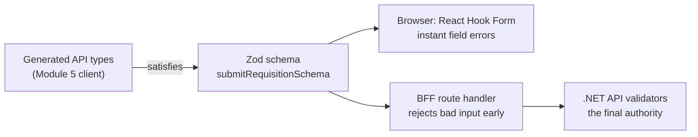
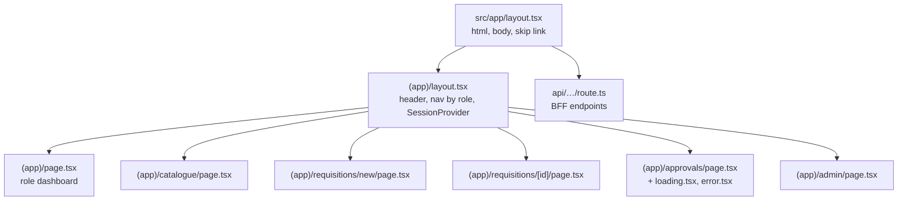

# Lecture Script: Frontend Implementation: React and Next.js

> **Instructor reference.** Phase 2: Decide and build (Focus area 2), Module 6 | Duration: 8 hours (3 h concepts and demos, 5 h hands-on) | Previous script: [Module 5 — Framework Building and Dependency Management](Module-05-Framework-Building-and-Dependency-Management.md)

## Session overview

**Goal.** Learners build ProcureFlow's first real screens on the Module 5 platform: catalogue list, search and filter components against a mock API, a purchase request form with dynamic line items and Zod validation, and a Next.js App Router shell with shared layouts and role dashboards as server components. They then put a Backend-for-Frontend (BFF) between the browser and the API, protect `/approvals` and `/admin`, and audit everything for accessibility (Capstone increment CI-6).

**Learner profile at this point.** Learners have the domain model, requirements and NFRs (Modules 1–2), a guarded repo with a walking skeleton in dev (Module 3), an approved architecture with ADRs 0003–0005 (Module 4), and the ProcureFlow platform: `ProcureFlow.Platform.*` packages, the `pf-service` template, `@<org>/procureflow-ui`, `@<org>/procureflow-api-client`, dependency guardrails and a RAID log (Module 5). They know some React but have mostly written single pages. Today introduces the first genuinely new idea of the frontend build: **every component runs in a place you choose — server or client — and that choice decides what it can see, what it costs, and who can use it.**

**Key outcome.** Every learner can type React components and props with TypeScript, choose the right hook for a job and write a custom hook, separate server state (TanStack Query) from UI and URL state, build a form with React Hook Form and a Zod schema tied to the API contract, structure a Next.js App Router app with layouts, loading and error boundaries, choose a rendering strategy per page, classify components as server or client and prove it, put a BFF and route protection in front of the API, run an accessibility audit to WCAG 2.2 AA, and name the levers that move Core Web Vitals.

**Case for this session.** ProcureFlow at Meridian Components, continued. Today's screens serve R1 and R2 stories: **PF-001** (submit a requisition), **PF-003** (see status), **PF-002** (approve or reject), with dashboard panels for **PF-019** (AP on-hold queue). The approved stack from Module 4: Next.js web app and .NET API on App Service in an India region (NFR-SEC-04), Microsoft sign-in (NFR-SEC-01). Two new items are **assumptions for this module**, to be logged in `docs/plan/raid-log.md`: (1) Meridian's buyers maintain an **approved-items catalogue** that requesters pick from, with free-text lines still allowed; (2) a new **`Admin`** role maintains the catalogue and settings, reached through `/admin`. The trainer plays the tech lead, and relays one piece of feedback from Priya's month-end dry run in the opening.

**Note on tool versions.** Code targets React 19 and Next.js 15 or later with the App Router, TanStack Query v5, React Hook Form v7, Zod 4 (Zod 3 differences noted), MSW v2, Storybook (current), and Playwright with `@axe-core/playwright`. **Next.js 16 renamed `middleware.ts` to `proxy.ts`** (the exported function becomes `proxy`); the logic is the same, so this script says "middleware" and shows both names. Next.js 16 also adds Cache Components (`"use cache"`); this script uses route-segment options that work without it. Check the docs and `--help` for your installed versions on the day.

**Note on licences.** Every new package today goes through the Module 5 package gate and `DEPENDENCIES.md`. Most of today's packages are MIT at the time of writing, but **axe-core and `@axe-core/playwright` are MPL-2.0**, which `DEPENDENCIES.md` puts under "needs approval". Re-check every licence on the day; don't trust this script, or the AI.

**Note on AI output.** AI-generated components, stories and classifications vary run to run; examples are marked **illustrative**. Build output and test-runner output are also marked illustrative because formatting changes between versions.

## Timing breakdown

| Segment | Duration | Cumulative | Kind |
| --- | --- | --- | --- |
| SEGMENT 1: Opening — Typed Components and Composition | 25 min | 0:25 | Concept + demo |
| SEGMENT 2: Hooks and Custom Hooks | 25 min | 0:50 | Concept + demo |
| SEGMENT 3: State Management and Server State | 20 min | 1:10 | Concept + demo |
| SEGMENT 4: Lab 1 — Catalogue List, Search and Filter on a Mock API | 55 min | 2:05 | Hands-on |
| **BREAK** | 10 min | — |  |
| SEGMENT 5: Forms and Validation | 20 min | 2:25 | Concept + demo |
| SEGMENT 6: Lab 2 — Purchase Request Form with Line Items | 55 min | 3:20 | Hands-on |
| **BREAK** | 30 min (lunch) | — |  |
| SEGMENT 7: Next.js App Router, Rendering, Server and Client Components | 35 min | 3:55 | Concept + demo |
| SEGMENT 8: Lab 3 — App Router Shell and Role Dashboards | 60 min | 4:55 | Hands-on |
| **BREAK** | 10 min | — |  |
| SEGMENT 9: Route Handlers as a BFF; Middleware | 15 min | 5:10 | Concept + demo |
| SEGMENT 10: Lab 4 — BFF and Protected Routes | 55 min | 6:05 | Hands-on |
| SEGMENT 11: Accessibility to WCAG 2.2 AA | 15 min | 6:20 | Concept + demo |
| SEGMENT 12: Lab 5 — Accessibility Audit and Fixes | 50 min | 7:10 | Hands-on |
| **BREAK** | 10 min | — |  |
| SEGMENT 13: Frontend Performance and Core Web Vitals | 15 min | 7:25 | Concept + demo |
| SEGMENT 14: CI-6 Review and Wrap-Up | 35 min | 8:00 | Hands-on + close |

Concepts and demos: 25 + 25 + 20 + 20 + 35 + 15 + 15 + 15 + 10 (close) = 180 min (37.5%). Labs and CI-6 review: 55 + 55 + 60 + 55 + 50 + 25 = 300 min (62.5%). Total 480 min = 8 h, matching the module's 3 h / 5 h split. Breaks (60 min) are not counted.

## SEGMENT 1: Opening — Typed Components and Composition (25 min)

### The Hook (7 min)

**Show one slide: "Month-end dry run: what users told Priya".**

> 1. *"I added 14 lines to a requisition, one price was wrong, I pressed Submit, and the page cleared everything."* — Requester, Pune
> 2. *"Search freezes for a moment on every letter I type."* — Requester, Chennai
> 3. *"I sent an approvals link to a colleague. She opened it and got a spinner that never stopped."* — Approver, Leeds
> 4. *"Our AP clerk works keyboard-only. She can't reach the Remove button on a line, and the date picker traps her."* — AP team lead, Chennai
> 5. *"The home page takes six seconds on the plant Wi-Fi, and the layout jumps when the logo loads."* — Warehouse, Pune
> 6. *"Your browser's network tab shows our API address and a bearer token."* — Meridian CISO

**Say:** *"That's the walking skeleton from Module 3, stretched into a few more screens by copy-paste. The API behind it is fine. The platform is fine. Every complaint is about the screens."*

**Ask:** *"Which of these six is a React problem, which is a Next.js problem, and which is neither?"*

**Do:** Take 4–5 answers. Write them on the board in three columns.

**Respond to likely answers:**

- *"Number 1 is a form bug."* → *"Yes. Is it a bug in one form, or in how we build every form?"*
- *"Number 3 is a permissions problem in the API."* → *"The API did refuse. So why did the user see a spinner instead of a clear message?"*
- *"Number 6 is the API's problem."* → *"The API needs a token. The question is where that token lives: in her browser, or on our server?"*
- *"Number 5 is the Wi-Fi."* → *"We can't fix the Wi-Fi. We can decide how much we send over it, and when."*

**Say:** *"Every one of these comes back to three questions: is it typed, is it running in the right place, and can everyone use it? Here's today's line:"*

**Write on board, large, and leave it up all day:**

> **Typed end to end, rendered where it belongs, usable by everyone.**

### TypeScript Essentials for React (8 min)

**Say:** *"A React component is a function that takes props and returns JSX. TypeScript's job is to make the props a contract. Five things you'll use all day."*

| Idea | What it looks like | ProcureFlow use |
| --- | --- | --- |
| Typed props | `type Props = { status: Status; compact?: boolean }` | `StatusBadge` can't receive a status the API doesn't have |
| Children and composition | `children: React.ReactNode` | `Panel` wraps any dashboard content; no prop drilling |
| Types from the API | `components["schemas"]["CatalogueItem"]` | The generated client from Module 5 is the single source of shapes |
| Union types for states | `type Load = { kind: "loading" } \| { kind: "error"; message: string } \| { kind: "ready"; items: Item[] }` | A list can't be "loading" and "ready" at once |
| Generics | `function DataTable<T>(props: DataTableProps<T>)` | One table for catalogue items, requisitions and invoices |

**Say:** *"JSX is just function calls with HTML-like syntax. Two rules trip people up: use `className` not `class`, and every item in a list needs a stable `key`, the item's ID, not its index."*

### Live Demo: A Generic Table and Composition (7 min)

**Say:** *"We'll build one component the catalogue, the approvals list and the AP queue will all use."*

**Live-code (in `packages/ui/src/DataTable.tsx`):**

```tsx
import type { ReactNode } from "react";

export type Column<T> = {
  key: string;
  header: string;
  cell: (row: T) => ReactNode;
};

type DataTableProps<T> = {
  caption: string;
  rows: T[];
  columns: Column<T>[];
  rowKey: (row: T) => string;
  empty?: ReactNode;
};

export function DataTable<T>({ caption, rows, columns, rowKey, empty }: DataTableProps<T>) {
  if (rows.length === 0) return <>{empty ?? <p>No results.</p>}</>;
  return (
    <table className="pf-table">
      <caption>{caption}</caption>
      <thead>
        <tr>{columns.map((c) => <th key={c.key} scope="col">{c.header}</th>)}</tr>
      </thead>
      <tbody>
        {rows.map((row) => (
          <tr key={rowKey(row)}>{columns.map((c) => <td key={c.key}>{c.cell(row)}</td>)}</tr>
        ))}
      </tbody>
    </table>
  );
}
```

**Live-code — use it with API types:**

```tsx
import type { components } from "@<org>/procureflow-api-client";
import { DataTable, MoneyField } from "@<org>/procureflow-ui";

type CatalogueItem = components["schemas"]["CatalogueItem"];

<DataTable<CatalogueItem>
  caption="Approved catalogue items"
  rows={items}
  rowKey={(i) => i.id}
  columns={[
    { key: "name", header: "Item", cell: (i) => i.name },
    { key: "price", header: "Unit price", cell: (i) => <MoneyField amount={i.unitPrice} currency={i.currency} /> },
  ]}
/>;
```

**Do:** Type `i.price` instead of `i.unitPrice`. Show the red underline.

**Say:** *"That's Module 5's typed client paying off again: the column can't read a field the API doesn't send. And notice `<caption>` and `scope=\"col\"`: accessibility starts in the first component, not in an audit at the end."*

### Comprehension Check (3 min)

1. *"Why use the item's `id` as the `key`, not the array index?"* (When rows are filtered or reordered, an index key makes React reuse the wrong row's DOM and state.)
2. *"`Panel` takes `children` instead of a `content` string. What does that buy us?"* (Composition: any JSX, including other components, can go inside without changing `Panel`.)

**Common misconception:** TypeScript checks data at runtime. (Types vanish when the code runs; data from users or the network still needs runtime validation. That's Zod, after the break.)

**Re-teach trigger:** if learners can't explain why `i.price` fails, open the generated `schema.d.ts` and follow `CatalogueItem` from the API to the column.

**Transition — Say:** *"Components describe what to show. Hooks are how a component remembers things and reacts to change. That's complaint number 2."*

## SEGMENT 2: Hooks and Custom Hooks (25 min)

### Seven Hooks, Each With a Job (6 min)

**Say:** *"Hooks are functions that start with `use` and let a component hold state or reach outside itself. Two rules: call them at the top level of a component, never inside an `if` or a loop; and only from components or other hooks."*

| Hook | Job | ProcureFlow example |
| --- | --- | --- |
| `useState` | Remember a value; re-render when it changes | The text in the catalogue search box |
| `useEffect` | Sync with something outside React after render | Start a debounce timer; subscribe to a browser event |
| `useRef` | Hold a value or DOM node without re-rendering | The search input, to move focus back after "Clear" |
| `useMemo` | Cache an expensive calculation between renders | Filtering 2,000 catalogue items |
| `useCallback` | Keep the same function between renders | An `onSelect` passed to memoised table rows |
| `useContext` | Read a value provided higher up the tree | The signed-in user's name and roles |
| Custom hook | Package a reusable piece of hook logic | `useDebouncedValue`, `useCatalogue` |

### Live Demo: Fixing "Search Freezes" (12 min)

**Say:** *"Complaint 2. The copy-pasted search filters the whole catalogue and re-renders the table on every keystroke. Let's fix it with hooks, one at a time."*

**1. A custom hook (4 min):**

```ts
// web/src/hooks/useDebouncedValue.ts
import { useEffect, useState } from "react";

export function useDebouncedValue<T>(value: T, delayMs = 300): T {
  const [debounced, setDebounced] = useState(value);
  useEffect(() => {
    const id = setTimeout(() => setDebounced(value), delayMs);
    return () => clearTimeout(id); // cancel if the user types again
  }, [value, delayMs]);
  return debounced;
}
```

**Say:** *"The cleanup function is the important line. Without it, every keystroke leaves a timer running."*

**2. The component (8 min):**

```tsx
// web/src/features/catalogue/CatalogueSearch.tsx
"use client";
import { useCallback, useMemo, useRef, useState } from "react";
import { useDebouncedValue } from "@/hooks/useDebouncedValue";

export function CatalogueSearch({ items }: { items: CatalogueItem[] }) {
  const [query, setQuery] = useState("");
  const debounced = useDebouncedValue(query, 300);
  const inputRef = useRef<HTMLInputElement>(null);

  const results = useMemo(
    () => items.filter((i) => i.name.toLowerCase().includes(debounced.toLowerCase())),
    [items, debounced],
  );

  const clear = useCallback(() => {
    setQuery("");
    inputRef.current?.focus();
  }, []);

  return (
    <>
      <label htmlFor="catalogue-search">Search catalogue</label>
      <input id="catalogue-search" ref={inputRef} value={query} onChange={(e) => setQuery(e.target.value)} />
      <button type="button" onClick={clear}>Clear</button>
      <p role="status">{results.length} items</p>
      <CatalogueTable items={results} />
    </>
  );
}
```

**Say:** *"The input updates instantly because `query` changes on every key. The expensive filter only runs when `debounced` changes. `useRef` puts focus back in the box after Clear, so a keyboard user isn't dropped at the top of the page. And `role=\"status\"` makes a screen reader announce the result count. Hold onto that for Segment 11."*

### You Might Not Need an Effect (3 min)

**Say:** *"The most common hook mistake in AI-generated React: an effect that copies one state into another."*

```tsx
// WRONG: an extra render and a moment where the two disagree
const [items, setItems] = useState<CatalogueItem[]>([]);
const [filtered, setFiltered] = useState<CatalogueItem[]>([]);
useEffect(() => setFiltered(items.filter(matches)), [items]);

// RIGHT: calculate it during render (wrap in useMemo only if it's expensive)
const filtered = items.filter(matches);
```

**Say:** *"Effects are for talking to things outside React: timers, subscriptions, the browser. If you can calculate it from props or state, just calculate it. And fetching data in a bare `useEffect` is the next segment's problem."*

### Comprehension Check (4 min)

1. *"What would happen without the `return () => clearTimeout(id)` line?"* (Every keystroke's timer would still fire; stale values could overwrite newer ones.)
2. *"When is `useMemo` worth it, and when is it noise?"* (Worth it when the calculation is measurably expensive or its result is passed to a memoised child; noise for cheap calculations.)
3. *"Where do the signed-in user's roles come from on the client, and which hook reads them?"* (A context provided by the app layout; `useContext`.)

**Common misconception:** `useEffect` is the place to fetch data and derive state. (It's an escape hatch for syncing with outside systems; derived values are calculated during render, and server data belongs to a data-fetching library or a server component.)

**Re-teach trigger:** if learners reach for `useEffect` to filter, draw the render → effect → setState → render loop on the board and count the renders.

**Transition — Say:** *"Hooks hold state. But not all state is the same kind, and putting it in the wrong place is how apps get slow and confusing."*

## SEGMENT 3: State Management and Server State (20 min)

### Four Kinds of State (6 min)

**Say:** *"Before choosing a library, ask what kind of state it is. Most React mess comes from treating server data as if it were local state."*

| Kind | Example on the catalogue page | Where it lives | Tool |
| --- | --- | --- | --- |
| Server state | Catalogue items, requisition status | The API owns it; we hold a cached copy | TanStack Query (client) or a server component |
| URL state | Search text, category filter, page number | The address bar, so it can be shared and bookmarked | Search params (Lab 3) |
| Global UI state | Signed-in user's name and roles; theme | Shared by many components | React Context; Zustand if it grows |
| Local UI state | Is this filter panel open? | One component | `useState` |

**Say:** *"Three library options for the global kind. **Context** is built in and fine for values that rarely change, like the user. **Zustand** is a small store for UI state that changes often and is read in many places. **Redux Toolkit** suits large apps with complex client-side workflows and teams that want strict patterns. For ProcureFlow, server state is most of what we have, and TanStack Query handles it. Our default: Context for the user, TanStack Query for API data, the URL for filters, and no global store until we can name the problem it solves. If you add Zustand or Redux Toolkit, it goes through the package gate with a reason."*

### Live Demo: Server State with TanStack Query and a Mock API (10 min)

**Say:** *"Lab 1 needs data before the real endpoints are ready. MSW, Mock Service Worker, intercepts network requests in the browser and in tests and answers them from handlers we write. The app doesn't know it's talking to a mock."*

**1. Mock the BFF path, typed from the API contract (4 min):**

```ts
// web/src/mocks/handlers.ts
import { http, HttpResponse, delay } from "msw";
import type { components } from "@<org>/procureflow-api-client";

type CatalogueItem = components["schemas"]["CatalogueItem"];

const items: CatalogueItem[] = [
  { id: "CAT-0001", name: "A4 copier paper, 500 sheets", category: "Stationery", unit: "ream", unitPrice: 320, currency: "INR", supplierName: "Deccan Office Supplies" },
  { id: "CAT-0002", name: "Safety gloves, nitrile, size L", category: "PPE", unit: "box", unitPrice: 850, currency: "INR", supplierName: "Shakti Safety" },
  // … about 30 items across 5 categories in the starter file
];

export const handlers = [
  http.get("/api/catalogue", async ({ request }) => {
    const url = new URL(request.url);
    const search = (url.searchParams.get("search") ?? "").toLowerCase();
    const category = url.searchParams.get("category");
    await delay(300); // feel a realistic network
    return HttpResponse.json(
      items.filter((i) => i.name.toLowerCase().includes(search) && (!category || i.category === category)),
    );
  }),
];
```

**Say:** *"Two choices here matter. The mock answers `/api/catalogue`, the path our own BFF will have this afternoon, not the .NET API's path. So in Lab 4 we switch the mock off and nothing else changes. And the mock data is typed from the generated client, so the mock can't drift from the contract either."*

**2. A query hook (6 min):**

```ts
// web/src/features/catalogue/useCatalogue.ts
"use client";
import { keepPreviousData, useQuery } from "@tanstack/react-query";

export type CatalogueFilters = { search: string; category?: string };

export function useCatalogue(filters: CatalogueFilters) {
  return useQuery({
    queryKey: ["catalogue", filters],
    queryFn: async ({ signal }) => {
      const params = new URLSearchParams({ search: filters.search, ...(filters.category && { category: filters.category }) });
      const res = await fetch(`/api/catalogue?${params}`, { signal });
      if (!res.ok) throw new Error(`Catalogue failed (${res.status})`);
      return (await res.json()) as CatalogueItem[];
    },
    placeholderData: keepPreviousData, // keep showing old results while new ones load
    staleTime: 60_000,
  });
}
```

**Do:** In the browser, type quickly in the search box. Open the network tab: show requests are cancelled when the key changes (`signal`), and repeat searches come from the cache.

**Say:** *"Caching, cancelling, retrying, loading and error flags: written once in the library, not in fifty `useEffect`s. The component just reads `data`, `isPending` and `isError`."*

### Comprehension Check (4 min)

1. *"The approver's 'awaiting my approval' count: which kind of state?"* (Server state; the API owns it.)
2. *"Why put the search text in the URL rather than a Zustand store?"* (It survives a refresh and can be shared as a link: complaint 3's colleague would land on the same view.)
3. *"Why does the mock answer `/api/catalogue` instead of the .NET API's path?"* (That's the BFF path the browser will use later; switching the mock off then needs no code change.)

**Common misconception:** "we need Redux for a serious app." (Most of a line-of-business app's state is server state; a server-state library plus the URL covers most of it.)

**Re-teach trigger:** if learners put catalogue items in Context or a store, ask: *"Who owns this data, and what happens when someone else changes it?"*

**Transition — Say:** *"You have components, hooks, server state and a mock. Build the catalogue."*

## SEGMENT 4: Lab 1 — Catalogue List, Search and Filter on a Mock API (55 min)

**Say:** *"Build the catalogue screen from parts of the team component library, against MSW. Use AI to generate component skeletons and Storybook stories, then make them right. Every component gets stories for loading, empty, error and full states. You'll move this screen into the Next.js app after lunch, so keep it free of routing code for now."*

### Instructions (read aloud, step by step)

1. **Set up MSW and Storybook (8 min).** In `web/`: install MSW and generate its worker (`npx msw init public/ --save`; check `--help` for your version). Initialise Storybook (`npx storybook@latest init`, choose the Next.js framework). Configure Storybook to also load stories from `../../packages/ui/src/**/*.stories.tsx`. Add `msw-storybook-addon` so stories can use your handlers. Every package goes through the package gate; record results in the PR.
2. **AI skeletons and stories (12 min).** Use the AI prompt below to generate skeletons for four library components in `packages/ui`: `SearchInput`, `FilterSelect`, `EmptyState`, and the `DataTable` from Segment 1, plus a story file for each. Review every line against `CODING_STANDARDS.md` before committing.
3. **The catalogue screen (20 min).** In `web/src/features/catalogue/`, build `CatalogueScreen` from the library parts: search box (debounced), category filter, results table with item, category, supplier and unit price (`MoneyField`), and a result count in a `role="status"` element. Data comes from `useCatalogue`. Filters are `useState` for now.
4. **All four states (8 min).** Add MSW handler variants and stories for: loading (`delay("infinite")`), empty (no matches), error (500 ProblemDetails with `correlationId`, shown to the user as a reference), and full.
5. **Tests (7 min).** One component test with your starter kit's runner (Vitest or Jest) and React Testing Library, using MSW's `setupServer`: typing "gloves" shows only matching rows and announces the count.

### The AI Prompt (give to learners)

```
Using CODING_STANDARDS.md and the design tokens in packages/ui/tokens.json, create a
React 19 + TypeScript component <ComponentName> for packages/ui.
Props: <list the props and their types>.
Requirements: tokens only (no hard-coded colours or spacing); semantic HTML;
a visible <label> for every input; no data fetching inside the component.
Also create <ComponentName>.stories.tsx (Component Story Format 3) with stories for
default, empty and disabled states. Do not add any npm package.
```

### What the AI Draft Typically Gets Wrong (show learners)

| AI draft does this (illustrative — varies by run) | Why it's wrong | Fix |
| --- | --- | --- |
| `placeholder="Search"` with no `<label>` | Placeholder disappears and isn't a reliable accessible name | Visible `<label htmlFor>` |
| Hard-coded `#2563eb` and `padding: 12px` | Bypasses the design tokens from Module 5 | `var(--pf-…)` tokens |
| `fetch` inside `DataTable` | Library components should be data-agnostic | Pass `rows` in; fetch in the screen |
| Index as `key` | Wrong rows re-used when filtering | Item `id` |
| A clickable `<div>` for the clear button | Not focusable or announced as a button | `<button type="button">` |
| Imports a date or icon library | New dependency without the gate | Remove, or run the gate and record it |

### Starter Files

```ts
// web/src/mocks/browser.ts
import { setupWorker } from "msw/browser";
import { handlers } from "./handlers";
export const worker = setupWorker(...handlers);
```

```ts
// web/src/mocks/node.ts (tests)
import { setupServer } from "msw/node";
import { handlers } from "./handlers";
export const server = setupServer(...handlers);
```

```ts
// web/.storybook/preview.ts (excerpt — check msw-storybook-addon's README for your version)
import { initialize, mswLoader } from "msw-storybook-addon";
import { handlers } from "../src/mocks/handlers";
initialize();
export const loaders = [mswLoader];
export const parameters = { msw: { handlers } };
```

### Reference Solution (instructor, partial)

```tsx
// web/src/features/catalogue/CatalogueScreen.tsx
"use client";
import { useState } from "react";
import { DataTable, EmptyState, FilterSelect, MoneyField, SearchInput } from "@<org>/procureflow-ui";
import { useDebouncedValue } from "@/hooks/useDebouncedValue";
import { useCatalogue } from "./useCatalogue";

const categories = ["Stationery", "PPE", "IT accessories", "Maintenance", "Packaging"];

export function CatalogueScreen() {
  const [search, setSearch] = useState("");
  const [category, setCategory] = useState<string | undefined>();
  const { data = [], isPending, isError, error } = useCatalogue({ search: useDebouncedValue(search), category });

  return (
    <section aria-labelledby="catalogue-heading">
      <h1 id="catalogue-heading">Catalogue</h1>
      <SearchInput label="Search catalogue" value={search} onChange={setSearch} />
      <FilterSelect label="Category" options={categories} value={category} onChange={setCategory} />
      <p role="status">{isPending ? "Loading items…" : `${data.length} items`}</p>
      {isError ? (
        <p role="alert">Couldn't load the catalogue. {error.message}</p>
      ) : (
        <DataTable
          caption="Approved catalogue items"
          rows={data}
          rowKey={(i) => i.id}
          empty={<EmptyState title="No items match" action="Try another search or clear the category." />}
          columns={[
            { key: "name", header: "Item", cell: (i) => i.name },
            { key: "category", header: "Category", cell: (i) => i.category },
            { key: "supplier", header: "Supplier", cell: (i) => i.supplierName },
            { key: "price", header: "Unit price", cell: (i) => <MoneyField amount={i.unitPrice} currency={i.currency} /> },
          ]}
        />
      )}
    </section>
  );
}
```

**Say:** *"The screen is all composition: five library parts and one hook. Nothing in it knows MSW exists."*

### Instructor Circulates

- **Generated story files committed unread:** *"Show me which line you changed in the AI's version, and why."*
- **Fetching inside a library component:** move it to the screen; library components take data as props.
- **`DataTable` in `web/` instead of `packages/ui`:** it's shared; it belongs in the library, released as a MINOR version (1.1.0) at the end of the day.
- **Error state shows a stack trace or raw JSON:** show a plain message and the `correlationId` from the ProblemDetails, like Module 5's Bug 2.
- **MSW not starting in Storybook:** `mockServiceWorker.js` must be in the folder Storybook serves as static files.

**Success check:** catalogue screen renders from library components against MSW; search is debounced and announces the count; loading, empty, error and full stories exist for the screen and each new library component; one passing component test.

**Extension (fast teams):** add keyboard-friendly sorting to `DataTable` (a `<button>` in each sortable header with `aria-sort` on the `<th>`).

### BREAK (10 min)

*Suggested break prompt:* *"Complaint 1: fourteen lines gone after one wrong price. What would you need to know about the form's state to make sure that never happens?"*

## SEGMENT 5: Forms and Validation (20 min)

### One Schema, Two Checks, One Contract (5 min)

**Ask:** *"Your break question: why did fourteen lines vanish?"* (Expect: the form did a full-page submit, or re-mounted on error, or reset its state after a failed request.)

**Say:** *"A form has three jobs: keep what the user typed, tell them exactly what's wrong and where, and send the API something it will accept. Two tools do most of the work."*

| Tool | Job | Why this one |
| --- | --- | --- |
| React Hook Form | Holds form state, tracks touched fields and errors, manages dynamic lists with `useFieldArray` | Inputs aren't re-rendered on every keystroke; focuses the first error on submit by default |
| Zod | Declares the rules once as a schema; validates at runtime; infers the TypeScript type | The same schema runs in the browser and in our BFF |

**Draw on the board:**



**Say:** *"The API's validation decorator from Module 5 is still the authority. Nobody trusts the browser. The schema in the browser is for the user's sake; the schema in the BFF stops junk early. And `satisfies` ties the schema to the API's generated type, so if the contract changes, the schema stops compiling. Tools exist that generate Zod straight from OpenAPI; they're a fine choice if they pass the package gate. Our default is a hand-written schema pinned to the generated type, because the messages are ours to write."*

### Live Demo: The Schema and a Dynamic Line List (11 min)

**1. The schema (4 min):**

```ts
// web/src/features/requisitions/schema.ts
import { z } from "zod";
import type { components } from "@<org>/procureflow-api-client";

type SubmitRequisitionRequest = components["schemas"]["SubmitRequisitionRequest"];

export const lineSchema = z.object({
  catalogueItemId: z.string().optional(), // empty for free-text lines
  description: z.string().trim().min(3, "Describe the item in at least 3 characters"),
  quantity: z.number({ error: "Enter a quantity" }).int("Whole numbers only").positive("Quantity must be at least 1"),
  unitPrice: z.number({ error: "Enter a unit price" }).positive("Unit price must be more than 0"),
});

export const submitRequisitionSchema = z.object({
  site: z.enum(["Pune", "Chennai", "Leeds"]),
  neededBy: z.iso.date("Enter a date"), // Zod 3: z.string().date()
  justification: z.string().trim().min(10, "Explain why in at least 10 characters"),
  lines: z.array(lineSchema).min(1, "Add at least one line"),
}) satisfies z.ZodType<SubmitRequisitionRequest>;

export type SubmitRequisitionForm = z.infer<typeof submitRequisitionSchema>;
```

**Note (Zod versions):** this is Zod 4 syntax. In Zod 3, use `z.number({ invalid_type_error: "…" })` and `z.string().date()`. Zod 4 needs a recent `@hookform/resolvers` (v5 or later at the time of writing); check its README.

**Say:** *"Every message is written for a requester, not a developer. 'Unit price must be more than 0', not 'Number must be greater than 0'. And there's no currency field: the API decides currency from the site, rupees for Pune and Chennai, pounds for Leeds. The form only displays it."*

**2. The form (7 min):**

```tsx
// web/src/features/requisitions/RequisitionForm.tsx (excerpt)
"use client";
import { useFieldArray, useForm } from "react-hook-form";
import { zodResolver } from "@hookform/resolvers/zod";
import { submitRequisitionSchema, type SubmitRequisitionForm } from "./schema";

export function RequisitionForm({ onSubmit }: { onSubmit: (v: SubmitRequisitionForm) => Promise<void> }) {
  const { control, register, handleSubmit, setFocus, formState: { errors, isSubmitting } } =
    useForm<SubmitRequisitionForm>({
      resolver: zodResolver(submitRequisitionSchema),
      defaultValues: { site: "Pune", justification: "", lines: [{ description: "", quantity: 1, unitPrice: 0 }] },
    });
  const { fields, append, remove } = useFieldArray({ control, name: "lines" });

  const addLine = () => {
    append({ description: "", quantity: 1, unitPrice: 0 });
    setTimeout(() => setFocus(`lines.${fields.length}.description`)); // focus the new line
  };

  return (
    <form onSubmit={handleSubmit(onSubmit)} noValidate>
      {/* site, neededBy, justification fields … */}
      <fieldset>
        <legend>Lines</legend>
        {fields.map((field, index) => (
          <div key={field.id} className="pf-line">
            <label htmlFor={`line-${index}-desc`}>Line {index + 1} description</label>
            <input
              id={`line-${index}-desc`}
              {...register(`lines.${index}.description`)}
              aria-invalid={!!errors.lines?.[index]?.description}
              aria-describedby={`line-${index}-desc-error`}
            />
            <p id={`line-${index}-desc-error`}>{errors.lines?.[index]?.description?.message}</p>
            {/* quantity and unitPrice: register(..., { valueAsNumber: true }) */}
            <button type="button" onClick={() => remove(index)} disabled={fields.length === 1}>
              Remove line {index + 1}
            </button>
          </div>
        ))}
      </fieldset>
      <button type="button" onClick={addLine}>Add line</button>
      <button type="submit" disabled={isSubmitting}>Submit requisition</button>
    </form>
  );
}
```

**Do:** Add three lines, put a 0 in one price, submit. Show: nothing is lost, focus jumps to the bad field, the message sits under it.

**Say:** *"`key={field.id}`, not the index: React Hook Form gives each line a stable ID, so removing line 2 doesn't shift line 3's values into line 2. And 'Remove line 2' is a real name for a screen reader, not a lonely ✕."*

### Comprehension Check (4 min)

1. *"The API team renames `neededBy` to `requiredBy` and the client is regenerated. What happens to our schema?"* (The `satisfies` check fails to compile, pointing at the schema; we fix it before release.)
2. *"Validation passes in the browser. Why validate again in the BFF and the API?"* (Anyone can send a request without our form; browser checks are for the user, server checks are for safety.)
3. *"Why `valueAsNumber` on quantity?"* (HTML inputs give strings; the schema expects numbers.)

**Common misconception:** "client-side validation is security." (It's user experience. The API is the authority; NFR-SEC-02's self-approval rule, for example, can only be enforced on the server.)

**Re-teach trigger:** if learners can't say why `field.id` matters, remove the middle line of three with index keys on screen and watch the values shift.

**Transition — Say:** *"Build the real form. When the API says no, the user must still have their fourteen lines."*

## SEGMENT 6: Lab 2 — Purchase Request Form with Line Items (55 min)

**Say:** *"Build the purchase request form for PF-001: site, needed-by date, justification, and dynamic line items, each picked from the catalogue or typed as free text. Validate with the shared Zod schema. Submit to the mock BFF, and handle the API saying no without losing a single line."*

### Instructions (read aloud, step by step)

1. **Schema (10 min).** Create `web/src/features/requisitions/schema.ts` (Segment 5). Pin it to the generated `SubmitRequisitionRequest` type with `satisfies`. If your API's request type differs, change the schema, never the generated file. Write three unit tests for the schema: a valid requisition passes; zero lines fails; a negative price fails with your message.
2. **The form (20 min).** Build `RequisitionForm` with `useFieldArray`. A line can be filled from a catalogue item (reuse your `SearchInput` and `useCatalogue` in a picker that fills description and unit price) or typed by hand. Show a running display total per currency with `MoneyField`, labelled "Estimated total (the API calculates the final amount)".
3. **Errors where the user looks (8 min).** Each error sits under its field, linked with `aria-describedby`; invalid fields have `aria-invalid`. Add an error summary at the top on submit that lists each error as a link to its field.
4. **Submit and server errors (10 min).** Add an MSW handler for `POST /api/requisitions`: return 201 with an ID, or a 400 ValidationProblemDetails when the justification contains "TEST-REJECT". On success, show the new requisition ID and status with `StatusBadge`. On 400 or 500, keep every value, show the server's message and the `correlationId`.
5. **Stories and a test (7 min).** Stories: empty form, one line, ten lines, server error. One component test: add three lines, submit with a zero price, assert focus is on that field and all three lines are still there.

### Starter Files

```ts
// web/src/mocks/handlers.ts (add)
http.post("/api/requisitions", async ({ request }) => {
  const body = (await request.json()) as SubmitRequisitionRequest;
  await delay(400);
  if (body.justification.includes("TEST-REJECT")) {
    return HttpResponse.json(
      {
        type: "https://tools.ietf.org/html/rfc9110#section-15.5.1",
        title: "One or more validation errors occurred.",
        status: 400,
        errors: { justification: ["Justification must name the cost centre."] },
        correlationId: "4b1d9e07",
      },
      { status: 400 },
    );
  }
  return HttpResponse.json({ id: "REQ-2041", status: "AwaitingApproval" }, { status: 201 });
}),
```

```ts
// web/src/features/requisitions/submit.ts
export async function submitRequisition(values: SubmitRequisitionForm) {
  const res = await fetch("/api/requisitions", {
    method: "POST",
    headers: { "Content-Type": "application/json" },
    body: JSON.stringify(values),
  });
  const body = await res.json();
  if (!res.ok) throw Object.assign(new Error(body.title), { problem: body });
  return body as { id: string; status: RequisitionStatus };
}
```

### Reference Solution (instructor, partial): Mapping Server Errors

```tsx
const onSubmit = async (values: SubmitRequisitionForm) => {
  try {
    const created = await submitRequisition(values);
    setCreated(created); // shows ID + StatusBadge; the form stays mounted
  } catch (e) {
    const problem = (e as { problem?: ProblemDetails }).problem;
    for (const [field, messages] of Object.entries(problem?.errors ?? {})) {
      setError(field as keyof SubmitRequisitionForm, { message: messages[0] });
    }
    setError("root.server", {
      message: `${problem?.title ?? "Something went wrong"} Reference: ${problem?.correlationId ?? "none"}`,
    });
  }
};
```

**Say:** *"No `reset()`, no page reload, no re-mount. That's the whole fix for complaint 1. The reference number is the correlation ID from Module 5's platform, so support can find the log line."*

**Note:** field names in the API's `errors` object depend on its serialiser settings (for example `justification` versus `Justification`, or `lines[0].unitPrice`). Check what your API actually returns and map names if they differ.

### Instructor Circulates

- **`key={index}` on lines:** remove a middle line and watch values shift; switch to `field.id`.
- **Form calls `reset()` in a `catch` or `finally`:** that's complaint 1 again.
- **Totals calculated and sent to the API:** display only; the API computes the real amount in decimals (Module 5's `MoneyField` rule).
- **Schema written without `satisfies`:** rename a field in the generated type on a scratch branch and show the schema doesn't notice.
- **Error summary as plain text:** each entry should be a link that moves focus to its field.

**Success check:** a requisition with three lines submits to the mock and shows its ID and status; a zero price is caught in the browser with focus on the field; the "TEST-REJECT" response keeps every line and shows the message and reference; schema tests and the component test pass.

**Extension (fast teams):** show a read-only "who will approve this" hint, fetched from a mock `/api/requisitions/approval-preview` that applies the ₹50,000 and ₹5 lakh limits (the real rules stay in the API's routing strategy from Module 5).

### BREAK (30 min, lunch)

*Suggested break prompt:* *"Your catalogue screen and form run in the browser. Which parts of a ProcureFlow page don't need to be in the browser at all?"*

## SEGMENT 7: Next.js App Router, Rendering, Server and Client Components (35 min)

### The App Router in One Picture (8 min)

**Say:** *"In Module 4 we chose Next.js because ProcureFlow needs different rendering per page and server-side sign-in. The App Router is how Next.js maps folders to pages. Folders are routes; special files give each route its layout, loading state and error state."*

| File | Job | ProcureFlow example |
| --- | --- | --- |
| `layout.tsx` | UI shared by a route and its children; stays mounted on navigation | Header, role-based nav, skip link |
| `page.tsx` | The page for that URL | `/catalogue`, `/requisitions/new` |
| `loading.tsx` | Shown instantly while the page's data loads (wraps the page in a Suspense boundary) | Skeleton rows for the approvals list |
| `error.tsx` | Shown when the page throws; must be a client component; offers retry | "Couldn't load approvals. Reference: …" |
| `not-found.tsx` | Shown for `notFound()` or unknown URLs | Unknown requisition ID |
| `route.ts` | An HTTP endpoint instead of a page | The BFF, Segment 9 |
| `(group)` folder | Groups routes without adding to the URL | `(app)` for signed-in pages |
| `[id]` folder | A dynamic segment | `/requisitions/[id]` |

**Draw on the board:**



**Say:** *"Complaint 3, the never-ending spinner: with `loading.tsx` and `error.tsx` in place, a failed load becomes a clear message with a retry button, not a spinner forever."*

### Rendering Strategies (8 min)

**Say:** *"Five ways to produce a page. Next.js lets us choose per route, and the right choice depends on who the data belongs to."*

| Strategy | When HTML is made | How in the App Router | ProcureFlow fit |
| --- | --- | --- | --- |
| SSR (dynamic) | On each request, on the server | Automatic when a page reads cookies, headers or search params, or with `export const dynamic = "force-dynamic"` | Dashboards, approvals, requisition status: per-user data |
| CSR | In the browser, after JavaScript loads | Client components fetching with TanStack Query | Catalogue results updating as you type |
| SSG (static) | Once, at build time | The default for pages with no per-request data | Help and policy pages: "How approval limits work" |
| ISR | At build, then regenerated after a time | `export const revalidate = 3600` | Catalogue category list: same for everyone, changes rarely |
| Streaming | Sent in pieces as each part's data is ready | `loading.tsx` and `<Suspense>` around slow parts | Dashboard: the header appears first; each panel arrives when ready |

**Say:** *"One hard rule: never make a page static or ISR if it shows one user's data. A cached page is served to everyone. An approver's queue cached for an hour would show to the next person who asks for it."*

### Server Components and Client Components (8 min)

**Say:** *"In the App Router, every component is a **server component** unless you say otherwise. Server components run only on the server: they can be `async`, read the database or call the API with secrets, and send no JavaScript to the browser. A **client component** is marked with `\"use client\"` at the top of its file. It's rendered to HTML on the server first, then hydrated in the browser so it can use state, effects and event handlers."*

| Question about a component | If yes → |
| --- | --- |
| Does it use `useState`, `useEffect`, `useRef` or other hooks with state? | Client |
| Does it have `onClick`, `onChange` or other event handlers? | Client |
| Does it use browser APIs (`window`, `localStorage`)? | Client |
| Does it need secrets, the access token, or server-only code? | Server |
| Does it only fetch and display data? | Server |

**Say:** *"Three rules for the boundary. One: `\"use client\"` marks a boundary, and everything that file imports becomes client code too. So push it as far down the tree as you can: the approve button is a client component; the approvals page around it isn't. Two: a client component can't import a server component, but it can receive one as `children`. Three: props crossing the boundary must be serialisable, plain data, and anything you pass across is visible in the browser. Never pass the access token as a prop."*

**Do:** Point at complaint 6 on the slide. *"That's how the token got into the browser."*

### Live Demo: A Role Dashboard That Streams (8 min)

```tsx
// web/src/app/(app)/page.tsx — a server component (no "use client")
import { Suspense } from "react";
import { requireSession } from "@/server/session";
import { MyRequisitions, AwaitingMyApproval, OnHoldInvoices } from "@/features/dashboard/panels";
import { PanelSkeleton } from "@<org>/procureflow-ui";

export default async function DashboardPage() {
  const session = await requireSession(); // redirects to sign-in if there's no session

  return (
    <>
      <h1>Welcome, {session.name}</h1>
      <Suspense fallback={<PanelSkeleton title="My requisitions" />}>
        <MyRequisitions />
      </Suspense>
      {session.roles.includes("Approver") && (
        <Suspense fallback={<PanelSkeleton title="Awaiting your approval" />}>
          <AwaitingMyApproval />
        </Suspense>
      )}
      {session.roles.includes("APClerk") && (
        <Suspense fallback={<PanelSkeleton title="Invoices on hold" />}>
          <OnHoldInvoices />
        </Suspense>
      )}
    </>
  );
}
```

```tsx
// web/src/features/dashboard/panels.tsx — async server components
import { serverApi } from "@/server/api";
import { DataTable, Panel, StatusBadge } from "@<org>/procureflow-ui";

export async function AwaitingMyApproval() {
  const api = await serverApi();
  const { data, error } = await api.GET("/approvals/pending");
  if (error) throw new Error("Couldn't load approvals"); // caught by the nearest error.tsx
  return (
    <Panel title="Awaiting your approval">
      <DataTable caption="Requisitions awaiting your approval" rows={data} rowKey={(r) => r.id} columns={/* … */ []} />
    </Panel>
  );
}
```

**Do:** Add an artificial delay to one panel in the API stub. Reload. Show the heading and other panels appearing first, then the slow panel streaming in.

**Say:** *"That's complaint 5 half-fixed: the user sees a useful page in the time it takes the fastest query, not the slowest. And this page sends almost no JavaScript, because nothing on it is interactive."*

### Comprehension Check (3 min)

1. *"The approve and reject buttons, the approvals table, the page itself: server or client?"* (Buttons: client, they have click handlers. Table and page: server.)
2. *"Can the catalogue category list be ISR? Can 'My requisitions'?"* (Categories: yes, same for everyone. My requisitions: no, it's one user's data, so dynamic.)
3. *"A teammate adds `\"use client\"` to `(app)/layout.tsx` to use one hook. What's the cost?"* (Everything that file imports becomes client code and ships as JavaScript; move the hook into a small client component instead.)

**Common misconception:** "`\"use client\"` means the component only renders in the browser." (Client components are also rendered to HTML on the server; the directive means their JavaScript is also sent to the browser and hydrated.)

**Re-teach trigger:** if learners put `"use client"` on pages by reflex, draw the component tree for `/approvals` and colour each node server or client together, pushing the boundary down to the buttons.

**Transition — Say:** *"Now move your morning's screens into a real App Router app, and prove which components are server and which are client."*

## SEGMENT 8: Lab 3 — App Router Shell and Role Dashboards (60 min)

**Say:** *"Turn the walking skeleton into ProcureFlow's app shell: shared layouts, your catalogue and request screens as routes, and role dashboards as server components that stream. Then ask the AI to classify every component as server or client, and prove each answer with a build, not with an opinion."*

### Instructions (read aloud, step by step)

1. **App structure and layouts (12 min).** Create the `src/app` tree from Segment 7. Root layout: `<html lang="en">`, a "Skip to main content" link, and `<main id="main">`. `(app)/layout.tsx`: header with Meridian's logo, nav links filtered by role, and a `SessionProvider` (client component) that gives client components the user's name and roles only. Never put the access token in it.
2. **Move the screens (12 min).** `/catalogue` renders `CatalogueScreen`; `/requisitions/new` renders `RequisitionForm`. The pages stay server components; only the screens are client. Move the catalogue filters into the URL with `useSearchParams` and `router.replace`, so a filtered view can be shared as a link.
3. **Role dashboards (14 min).** Build `(app)/page.tsx` with panels as async server components: "My requisitions" (everyone), "Awaiting your approval" (`Approver`), "Invoices on hold" (`APClerk`, PF-019). Each panel in its own `<Suspense>`. For now `serverApi()` can point at the reference API or MSW's node server; you'll wire it fully in Lab 4.
4. **Loading and error boundaries (7 min).** Add `loading.tsx` and `error.tsx` for `/approvals` and the dashboard. `error.tsx` shows a plain message, a "Try again" button calling `reset()`, and nothing technical. Add `not-found.tsx` for `/requisitions/[id]`.
5. **AI classification, then proof (15 min).** Run the AI prompt below over `web/src`. Record its answers in `docs/frontend/component-boundaries.md`. Then prove each one with the three build checks below. Where the AI was wrong, record what it got wrong.

### The AI Prompt (give to learners)

```
Here are the files in web/src/app and web/src/features. For each React component,
classify it as Server Component or Client Component in the Next.js App Router.
For each, cite the exact line that forces the decision (a hook, an event handler,
a browser API, server-only code) or say "no client features: server by default".
Flag any component that is client only because of one small part, and suggest how
to push the "use client" boundary lower. Output a markdown table:
Component | File | Server/Client | Evidence (line) | Suggestion.
```

### The Three Build Checks (prove the classification)

| Check | How | What it proves |
| --- | --- | --- |
| 1. Server-only guard | Add `import "server-only";` to `src/server/api.ts`, `src/server/session.ts` and every component the AI called server-only. Run `npm run build`. | If any client component imports them, the build fails and names the import chain. Passing = no client code can reach the token. |
| 2. Client features in a server component | Temporarily add `useState` to one component classified as server, without `"use client"`. Run `npm run build`. | The build fails and names the file: it really was a server component. Revert afterwards. |
| 3. Route output and client bundle | Read the route table at the end of `next build`; then inspect the client bundle with the bundle analyser (`@next/bundle-analyzer`, or the analyser for your Next.js version and bundler; check the docs). | Each route is static (○) or dynamic (ƒ) as intended; only client components appear in browser chunks. |

**Example output (illustrative — the table format, symbols and sizes vary by Next.js version):**

```
Route (app)                                 Size  First Load JS
┌ ƒ /                                       …
├ ○ /_not-found                             …
├ ƒ /admin                                  …
├ ƒ /approvals                              …
├ ƒ /catalogue                              …
├ ○ /help/approval-limits                   …
├ ƒ /requisitions/[id]                      …
└ ƒ /requisitions/new                       …

○  (Static)   prerendered as static content
ƒ  (Dynamic)  server-rendered on demand
```

**Example AI classification (illustrative — AI output varies; this one contains a deliberate kind of error to look for):**

| Component | AI said | Evidence it cited | Build check result |
| --- | --- | --- | --- |
| `CatalogueScreen` | Client | `useState` for search | Confirmed |
| `AwaitingMyApproval` | Server | async, calls `serverApi()` | Confirmed (server-only guard passes) |
| `StatusBadge` | Client | "UI components are client" | **Wrong**: no hooks or handlers; renders as server when used from a server component |
| `ApproveButton` | Client | `onClick` | Confirmed |

**Say:** *"The AI's mistake on `StatusBadge` is typical: it guesses from what a component looks like. The build doesn't guess. A component with no client features has no client JavaScript unless a client component imports it."*

### Starter Files

```ts
// web/src/server/session.ts (shape only — wire to your starter kit's Microsoft sign-in, e.g. Auth.js with the Microsoft Entra ID provider)
import "server-only";
import { redirect } from "next/navigation";

export type Session = { userId: string; name: string; roles: string[] };

export async function getSession(): Promise<Session | null> { /* read from your auth library */ }
export async function getAccessToken(): Promise<string | null> { /* server side only */ }

export async function requireSession(): Promise<Session> {
  const session = await getSession();
  if (!session) redirect("/signin");
  return session;
}
```

```tsx
// web/src/app/(app)/layout.tsx
import { requireSession } from "@/server/session";
import { SessionProvider } from "@/features/session/SessionProvider"; // "use client"
import { AppHeader } from "@/features/shell/AppHeader";

export default async function AppLayout({ children }: { children: React.ReactNode }) {
  const { name, roles } = await requireSession(); // pass only what the client needs
  return (
    <SessionProvider value={{ name, roles }}>
      <AppHeader name={name} roles={roles} />
      <main id="main" tabIndex={-1}>{children}</main>
    </SessionProvider>
  );
}
```

### Reference Solution (instructor, partial): Filters in the URL

```tsx
// in CatalogueScreen ("use client")
import { usePathname, useRouter, useSearchParams } from "next/navigation";

const params = useSearchParams();
const router = useRouter();
const pathname = usePathname();
const search = params.get("search") ?? "";
const category = params.get("category") ?? undefined;

function setParam(name: string, value?: string) {
  const next = new URLSearchParams(params);
  if (value) next.set(name, value); else next.delete(name);
  router.replace(`${pathname}?${next}`, { scroll: false });
}
```

**Note:** the input should still hold its own `useState` for the text being typed, and write the debounced value to the URL; writing every keystroke to the URL brings complaint 2 back. A component using `useSearchParams` should sit inside a `<Suspense>` boundary; check your version's docs for the exact build-time rule.

### Instructor Circulates

- **`"use client"` on `page.tsx` or a layout:** push it down to the interactive component.
- **Session object with the access token passed to `SessionProvider`:** complaint 6 again; pass name and roles only.
- **Dashboard panels awaited one after another in the page:** each panel in its own `<Suspense>` so they stream in parallel.
- **`error.tsx` without `"use client"`:** it must be a client component (it receives `reset`).
- **AI classification accepted without the build checks:** *"Which check proves that row?"*

**Success check:** the app runs with shared layouts and a skip link; catalogue filters survive a refresh and a shared link; the dashboard shows role-based panels streaming independently; loading, error and not-found states work; `docs/frontend/component-boundaries.md` lists every component with the AI's answer, the build-check result and any AI errors; `import "server-only"` guards pass the build.

**Extension (fast teams):** add `/help/approval-limits` as a static page and confirm it shows as ○ in the build output.

### BREAK (10 min)

*Suggested break prompt:* *"Open the network tab on your dashboard. Which requests go from the browser straight to the .NET API, and what do they carry?"*

## SEGMENT 9: Route Handlers as a BFF; Middleware (15 min)

### Why a Backend-for-Frontend (4 min)

**Ask:** *"Your break question: what did the network tab show?"* (Client components still calling the API directly, using Module 5's `NEXT_PUBLIC_API_URL`, with a bearer token in the request.)

**Say:** *"Anything named `NEXT_PUBLIC_` is built into the browser bundle. That was fine for a walking skeleton. It's complaint 6 for production. A **Backend-for-Frontend** is a thin server layer that belongs to this frontend: the browser calls our Next.js server with its session cookie; the server adds the token and calls the API. The browser never sees the API's address or the token."*

```mermaid
sequenceDiagram
  participant B as Browser (client component)
  participant N as Next.js server (route handler)
  participant A as ProcureFlow API (.NET)
  B->>N: GET /api/catalogue?search=gloves (session cookie)
  N->>N: Read session; get access token (server only)
  N->>A: GET /catalogue/items?search=gloves (Bearer token, X-Correlation-ID)
  A-->>N: 200 JSON, or ProblemDetails
  N-->>B: Same status and body; no token, no API address
```

**Say:** *"Server components already call the API from the server, so they don't need the BFF. The BFF is for client components: the catalogue search and the requisition form. Keep it thin: shape and forward, no business rules. Approval rules live in the API."*

### Live Demo: One Route Handler (5 min)

```ts
// web/src/server/api.ts
import "server-only";
import createClient from "openapi-fetch";
import type { paths } from "@<org>/procureflow-api-client";
import { getAccessToken } from "./session";

export async function serverApi(correlationId?: string) {
  const token = await getAccessToken();
  if (!token) throw new Error("No session");
  return createClient<paths>({
    baseUrl: process.env.API_URL, // server-only variable: no NEXT_PUBLIC_ prefix
    headers: { Authorization: `Bearer ${token}`, ...(correlationId && { "X-Correlation-ID": correlationId }) },
  });
}
```

```ts
// web/src/app/api/catalogue/route.ts
import { NextResponse, type NextRequest } from "next/server";
import { serverApi } from "@/server/api";

export async function GET(req: NextRequest) {
  const api = await serverApi(req.headers.get("X-Correlation-ID") ?? undefined);
  const { data, error, response } = await api.GET("/catalogue/items", {
    params: { query: { search: req.nextUrl.searchParams.get("search") ?? undefined,
                       category: req.nextUrl.searchParams.get("category") ?? undefined } },
  });
  if (error) return NextResponse.json(error, { status: response.status }); // pass ProblemDetails through
  return NextResponse.json(data);
}
```

**Say:** *"Same generated client as Module 5, now on the server, with types from the contract. And the ProblemDetails from the platform passes straight through, correlation ID included."*

### Middleware for Route Protection (3 min)

**Say:** *"Middleware runs before a route renders. We'll use it to send people away from `/approvals` and `/admin` early if they're signed out or don't have the role. In Next.js 16 the file is `proxy.ts`; in 15 it's `middleware.ts`. Same job."*

**Write on the board:**

> **Middleware is the front door, not the safe.** The API's `CanApproveRequisition` policy (Module 5) is the safe.

**Say:** *"Why? Middleware can be misconfigured, skipped by a matcher mistake, or bypassed by a framework bug. In 2025 a Next.js advisory showed that a crafted header could skip middleware entirely on unpatched versions. Check the current advisories for your version. So every protected page also checks the session on the server, and the API checks the role and NFR-SEC-02 itself. Three layers, each sufficient for its own job."*

### Comprehension Check (3 min)

1. *"Why `API_URL` and not `NEXT_PUBLIC_API_URL` in `serverApi`?"* (`NEXT_PUBLIC_` values are built into the browser bundle; the API address and calls should stay on the server.)
2. *"Middleware blocks a requester from `/approvals`. A clever requester calls the approve endpoint directly. What stops them?"* (The API's authorisation policy: role check plus the not-own-requisition rule, NFR-SEC-02.)
3. *"Does the dashboard need to go through the BFF?"* (No. Its server components call the API from the server already. The BFF serves client components.)

**Common misconception:** "middleware secures the route." (It improves the experience and blocks the obvious cases; authorisation is enforced by the server component and the API.)

**Re-teach trigger:** if learners say the BFF should check approval limits, redraw the sequence diagram and ask which box owns business rules (the API).

**Transition — Say:** *"Switch MSW off, put the BFF in, and lock the two doors."*

## SEGMENT 10: Lab 4 — BFF and Protected Routes (55 min)

**Say:** *"Replace the mock with route handlers that call the real API through the generated client. Then protect `/approvals` and `/admin` with middleware, and prove two things: the browser never talks to the API directly, and a requester still can't approve even when middleware is out of the way."*

### Instructions (read aloud, step by step)

1. **Server-only API client (8 min).** Create `src/server/api.ts` (Segment 9). Add `API_URL` to `.env.local` and to the App Service configuration in the pipeline. Remove `NEXT_PUBLIC_API_URL` from the web app.
2. **Route handlers (15 min).** Create `src/app/api/catalogue/route.ts` (`GET`) and `src/app/api/requisitions/route.ts` (`POST`). In `POST`, parse the body with `submitRequisitionSchema.safeParse`; on failure return a 400 ProblemDetails without calling the API; on success forward to the API. Pass the API's status and ProblemDetails through unchanged. Forward `X-Correlation-ID` if present.
3. **Switch off the mock (7 min).** Start MSW only in Storybook and tests, not in the running app. Your client components shouldn't change at all; if they do, find out why.
4. **Middleware (12 min).** Add `src/middleware.ts` (or `src/proxy.ts` on Next.js 16) from the starter below. Signed out → `/signin?returnTo=…`. Signed in without the role → `/forbidden`, a page that says what role is needed and who to ask (Priya's team). Add a server-side role check in `approvals/page.tsx` and `admin/page.tsx` as well.
5. **Prove it (13 min).** Write Playwright tests for: (a) signed-out user on `/approvals` lands on sign-in; (b) a `Requester` on `/admin` lands on `/forbidden`; (c) on the catalogue and request pages, no browser request goes to the API host, and no request carries an `Authorization` header; (d) a `Requester` calling the API's approve endpoint directly for their own requisition gets 403. Use your starter kit's test sign-in (for example Playwright `storageState` per role).

### Starter Files

```ts
// web/src/middleware.ts  (Next.js 16: name the file proxy.ts and the function proxy)
import { NextResponse, type NextRequest } from "next/server";
import { readSessionFromRequest } from "@/server/session-edge"; // from your sign-in library; check its middleware docs

const rules = [
  { prefix: "/approvals", roles: ["Approver"] },
  { prefix: "/admin", roles: ["Admin"] },
];

export async function middleware(req: NextRequest) {
  const path = req.nextUrl.pathname;
  const session = await readSessionFromRequest(req);

  if (!session) {
    const signIn = new URL("/signin", req.url);
    signIn.searchParams.set("returnTo", path);
    return NextResponse.redirect(signIn);
  }

  const rule = rules.find((r) => path === r.prefix || path.startsWith(`${r.prefix}/`));
  if (rule && !rule.roles.some((role) => session.roles.includes(role))) {
    return NextResponse.redirect(new URL("/forbidden", req.url));
  }
  return NextResponse.next();
}

export const config = { matcher: ["/approvals/:path*", "/admin/:path*"] };
```

**Say (pointing at the `rules.find` line):** *"Why not just `path.startsWith(r.prefix)`? Because then `/approvalsreport` would match `/approvals`. Small bugs in route matching are how doors get left open."*

```ts
// web/tests/bff.spec.ts (excerpt)
test("browser never calls the API directly", async ({ page }) => {
  const apiHost = new URL(process.env.API_URL!).host;
  const leaks: string[] = [];
  page.on("request", (r) => {
    if (new URL(r.url()).host === apiHost || r.headers()["authorization"]) leaks.push(r.url());
  });
  await page.goto("/catalogue?search=gloves");
  await page.goto("/requisitions/new");
  expect(leaks).toEqual([]);
});
```

### Reference Solution (instructor, partial): POST Route Handler

```ts
// web/src/app/api/requisitions/route.ts
import { NextResponse, type NextRequest } from "next/server";
import { serverApi } from "@/server/api";
import { submitRequisitionSchema } from "@/features/requisitions/schema";

export async function POST(req: NextRequest) {
  const parsed = submitRequisitionSchema.safeParse(await req.json());
  if (!parsed.success) {
    return NextResponse.json(
      { title: "One or more validation errors occurred.", status: 400, errors: parsed.error.flatten().fieldErrors },
      { status: 400 },
    );
  }
  const api = await serverApi(req.headers.get("X-Correlation-ID") ?? undefined);
  const { data, error, response } = await api.POST("/requisitions", { body: parsed.data });
  if (error) return NextResponse.json(error, { status: response.status });
  return NextResponse.json(data, { status: 201 });
}
```

**Note:** `error.flatten()` still works in Zod 4 but is deprecated in favour of `z.flattenError(error)`. Use whichever your version documents. Flattened errors give top-level field names; for line-level messages, map `error.issues` paths such as `lines.2.unitPrice`.

### Instructor Circulates

- **`NEXT_PUBLIC_API_URL` still in the bundle:** search the build output for the API host; remove the variable.
- **Route handler returns 200 with an error body:** pass the API's status through; the client's error handling depends on it.
- **Business rules creeping into the BFF** (for example checking approval limits): move them back to the API.
- **Middleware matcher protects `/approvals` but not `/approvals/123`:** use `:path*`.
- **Only middleware checks roles:** add the server-side check in the page, and run test (d) against the API.
- **Tokens or session cookies logged in route handlers:** `LOGGING.md` says never; log the correlation ID instead.

**Success check:** catalogue and request screens work against the real API through the BFF with MSW off; no browser request goes to the API host or carries a bearer token; `/approvals` and `/admin` redirect correctly for signed-out and wrong-role users; the four Playwright tests pass; `NEXT_PUBLIC_API_URL` is gone.

**Extension (fast teams):** add a BFF route for `GET /api/requisitions/[id]/status` and use it to refresh `StatusBadge` on the submitted-requisition view with TanStack Query's `refetchInterval`, stopping once the status is final.

## SEGMENT 11: Accessibility to WCAG 2.2 AA (15 min)

### Four Habits That Fix Most Problems (5 min)

**Say:** *"Complaint 4: Meridian's AP clerk works keyboard-only. She isn't an edge case. Keyboard users, screen-reader users, people zooming to 200% on a small laptop at a plant office, people with a broken arm at month-end. WCAG 2.2 level AA is the standard most organisations sign up to, and the one Meridian's CISO will ask about. Four habits get you most of the way."*

| Habit | What it means | ProcureFlow example |
| --- | --- | --- |
| Semantic HTML first | Use the element that already does the job: `button`, `a`, `label`, `table`, `fieldset` | "Remove line 2" is a `<button>`, not a clickable `<div>` |
| ARIA only to fill gaps | ARIA adds meaning HTML lacks; wrong ARIA is worse than none | `aria-invalid` and `aria-describedby` on a field with an error; `role="status"` for the result count |
| Manage focus | When content changes, put focus where the user needs to be next | New line → focus its description; error on submit → focus the first error; route change → focus the `<h1>` or `<main>` |
| Everything by keyboard | Every action reachable with Tab, Shift+Tab, Enter, Space, arrow keys; visible focus; no traps | The date picker must let focus out; Escape closes the catalogue picker |

### What WCAG 2.2 Added (3 min)

**Say:** *"WCAG 2.2 became a W3C Recommendation in October 2023. It added these criteria at A and AA. Four of them hit ProcureFlow directly."*

| Criterion | Level | What it asks | ProcureFlow risk |
| --- | --- | --- | --- |
| 2.4.11 Focus Not Obscured (Minimum) | AA | Focused element not completely hidden by sticky content | Sticky header hiding the focused line item |
| 2.5.7 Dragging Movements | AA | Anything done by dragging also has a single-pointer alternative | Reordering lines by drag needs up/down buttons |
| 2.5.8 Target Size (Minimum) | AA | Targets at least 24 × 24 CSS pixels (with exceptions) | Tiny ✕ remove buttons on lines |
| 3.3.8 Accessible Authentication (Minimum) | AA | No cognitive test to sign in, unless alternatives exist | Covered by Microsoft sign-in; don't add puzzles |
| 3.2.6 Consistent Help | A | Help in the same place on every page | Help link position in the header |
| 3.3.7 Redundant Entry | A | Don't make users re-type what they already gave in the same process | Don't make requesters re-enter site on each line |

### Live Demo: Automated and Manual (4 min)

**Do:** Open `/requisitions/new` with the axe DevTools browser extension (or Storybook's accessibility panel). Run a scan. Show one finding, for example an icon-only button with no accessible name. Fix it with visible text or an `aria-label`. Re-run.

**Do:** Now unplug the mouse. Tab through the form, out loud. Show where focus goes after "Add line", and whether the sticky header hides the focused field.

**Say:** *"Automated tools catch only part of the problems, the ones a machine can detect: missing names, contrast, invalid ARIA. Focus order, whether messages make sense, whether a keyboard user can actually finish the task: those need a person. So the lab does both."*

### Comprehension Check (3 min)

1. *"A teammate adds `role=\"button\"` to a `<div>` with an `onClick`. What's still missing?"* (Keyboard focus, `tabIndex={0}`, and Enter/Space handling; a real `<button>` gives all of it for free.)
2. *"After submitting with errors, where should focus go?"* (To the error summary or the first invalid field.)
3. *"axe reports zero issues. Is the page accessible?"* (Not necessarily; keyboard flow, focus order and meaning still need a manual check.)

**Common misconception:** "more ARIA means more accessible." (The first rule of ARIA is to use native HTML if you can; incorrect ARIA misleads screen readers.)

**Re-teach trigger:** if learners can't name the missing parts of a `div` button, have one learner operate the demo form with the keyboard only while the room watches.

**Transition — Say:** *"Now audit your own screens, both ways, and fix every critical issue."*

## SEGMENT 12: Lab 5 — Accessibility Audit and Fixes (50 min)

**Say:** *"Audit four screens: catalogue, new requisition, dashboard and approvals. Run axe automatically; then do a keyboard-only walkthrough. Fix every critical issue, and make the automated check part of CI so they don't come back."*

### Instructions (read aloud, step by step)

1. **Automated scan (10 min).** Add `@axe-core/playwright` (package gate first: note its licence, MPL-2.0 at the time of writing, which `DEPENDENCIES.md` lists as "needs approval"; the instructor has pre-approval for the course). Write one Playwright test per screen using the WCAG 2.2 A and AA tags. Record every violation by impact in `docs/frontend/a11y-audit.md`.
2. **Keyboard-only walkthrough (12 min).** Pairs. One person drives with the keyboard only; the other records. Follow the script below on each screen. Note every place focus is lost, hidden, trapped or invisible.
3. **Fix (20 min).** Fix every **critical** issue from both the scan and the walkthrough, and as many **serious** ones as time allows. Fix library components in `packages/ui`, not in screens, so every screen benefits.
4. **Re-run and gate (8 min).** Re-run the scans. Add the axe tests to CI, failing on critical violations. Record before and after counts in the audit file.

### Keyboard Walkthrough Script (give to learners)

| Step | Action | Pass if |
| --- | --- | --- |
| 1 | Load the page; press Tab once | "Skip to main content" appears and works |
| 2 | Tab through the header | Focus is always visible; order matches the screen |
| 3 | Catalogue: search, filter, reach a result | Result count is announced; filter works with arrow keys or Enter |
| 4 | New requisition: add three lines | Focus moves to each new line's description |
| 5 | Remove line 2 | Focus moves to a sensible place (the next line, or "Add line"); not lost to the top of the page |
| 6 | Pick a needed-by date | You can open, choose and leave the date field without a trap |
| 7 | Submit with an error | Focus moves to the summary or first error; the message says what to do |
| 8 | Dashboard and approvals | Panels have headings; tables have captions; approve and reject are reachable and named |

### Starter File

```ts
// web/tests/a11y.spec.ts
import { test, expect } from "@playwright/test";
import AxeBuilder from "@axe-core/playwright";

const screens = ["/", "/catalogue", "/requisitions/new", "/approvals"];

for (const path of screens) {
  test(`no critical axe violations on ${path}`, async ({ page }) => {
    await page.goto(path);
    const results = await new AxeBuilder({ page })
      .withTags(["wcag2a", "wcag2aa", "wcag21a", "wcag21aa", "wcag22aa"])
      .analyze();
    const critical = results.violations.filter((v) => v.impact === "critical");
    expect(critical, JSON.stringify(critical.map((v) => v.id))).toEqual([]);
  });
}
```

```markdown
# docs/frontend/a11y-audit.md
| Screen | Source (axe / keyboard) | Issue | Impact | WCAG criterion | Fixed in (PR) |
|---|---|---|---|---|---|
```

### Reference Solution (instructor): Typical Findings

**Example findings (illustrative — results depend on each team's code):**

| Finding | Impact | Criterion | Fix |
| --- | --- | --- | --- |
| Icon-only remove button with no name | Critical | 4.1.2 Name, Role, Value | Visible text "Remove line 2", or `aria-label` |
| Quantity input with no label | Critical | 1.3.1, 4.1.2 | `<label htmlFor>` per line |
| Status badge colour contrast below 4.5:1 | Serious | 1.4.3 Contrast (Minimum) | Darken the token in `tokens.json`; republish `procureflow-ui` |
| Focus lost after removing a line | Keyboard | 2.4.3 Focus Order | Focus the next line's description, or "Add line" |
| Sticky header covers focused field | Keyboard | 2.4.11 Focus Not Obscured | `scroll-padding-top` equal to the header height |
| Remove ✕ is 16 × 16 px | Serious | 2.5.8 Target Size | Minimum 24 × 24 via the button token |
| Date input from a third-party picker traps focus | Keyboard | 2.1.2 No Keyboard Trap | Use the native `<input type="date">`, or fix the picker |

**Say:** *"Notice where most fixes landed: in `packages/ui` and `tokens.json`. Fix the library once, and every screen gets it right. That's Module 5's line again, applied to accessibility."*

### Instructor Circulates

- **Fixing violations by suppressing axe rules:** not allowed without a recorded reason in the audit file.
- **`aria-label` on everything:** prefer visible text; a label sighted users can't see helps nobody who uses voice control.
- **`outline: none` in global CSS:** that's why focus is invisible; use `:focus-visible` styles from the tokens.
- **Walkthrough done with a mouse "just to check":** keyboard only, the whole way.
- **Tests failing on sign-in:** use the per-role `storageState` from Lab 4.

**Success check:** axe tests for four screens pass with zero critical violations and run in CI; `docs/frontend/a11y-audit.md` lists findings from both methods with before and after counts; every keyboard-walkthrough step passes on the request form.

**Extension (fast teams):** test the request form with a screen reader (NVDA on Windows or VoiceOver on macOS) and record two things the automated scan couldn't find.

### BREAK (10 min)

*Suggested break prompt:* *"Complaint 5 said six seconds on plant Wi-Fi. If you could measure only one thing about page speed, what would it be?"*

## SEGMENT 13: Frontend Performance and Core Web Vitals (15 min)

### Three Numbers Users Feel (4 min)

**Ask:** *"Your break question: what would you measure?"* (Expect: load time, time to first content, bundle size.)

**Say:** *"Google's Core Web Vitals are three measures of what users actually feel. 'Good' means at least 75% of page visits meet the threshold."*

| Metric | Measures | Good | ProcureFlow risk |
| --- | --- | --- | --- |
| LCP — Largest Contentful Paint | How quickly the main content appears | ≤ 2.5 s | Dashboard waiting for the slowest panel |
| INP — Interaction to Next Paint (replaced FID in March 2024) | How quickly the page responds to a click or key | ≤ 200 ms | Filtering 2,000 items on every keystroke |
| CLS — Cumulative Layout Shift | How much the page jumps while loading | ≤ 0.1 | Logo and thumbnails without dimensions |

**Say:** *"These sit next to our own NFR, not instead of it. NFR-PERF-01 says 95% of submit and approve actions under 2 seconds at 140 concurrent users. That's the API plus the screen. Core Web Vitals tell you whether the screen is the slow part."*

### Four Levers (5 min)

| Lever | What it does | ProcureFlow use |
| --- | --- | --- |
| Server components and streaming | Less JavaScript; useful content sooner | Dashboards (Lab 3) |
| Memoisation (`memo`, `useMemo`, `useCallback`) | Skips re-rendering unchanged parts | Catalogue rows, after the Profiler shows they're the cost |
| Code splitting (`next/dynamic`) | Loads a heavy component only when needed | Finance controller's spend chart; the attachment viewer |
| Image optimisation (`next/image`) | Right size and format; reserves space | Meridian logo; catalogue thumbnails: fixes CLS |

**Say:** *"Memoisation is the lever people pull first and need least. Measure first: the React DevTools Profiler shows which components re-render and how long they take. If your project has the React Compiler enabled, it memoises much of this automatically; check what your Next.js version supports before hand-tuning."*

### Live Demo: Measure, Then Fix One Thing (3 min)

```tsx
// Code-split a heavy chart (inside a client component)
import dynamic from "next/dynamic";
const SpendChart = dynamic(() => import("./SpendChart"), { loading: () => <PanelSkeleton title="Spend by category" /> });

// Reserve space for the logo: no layout jump
import Image from "next/image";
<Image src="/meridian-logo.svg" alt="Meridian Components" width={160} height={40} priority />;
```

```tsx
// web/src/app/web-vitals.tsx — report real users' numbers to monitoring
"use client";
import { useReportWebVitals } from "next/web-vitals";
export function WebVitals() {
  useReportWebVitals((metric) => {
    // send metric.name, metric.value and metric.rating to Application Insights (Module 4's monitoring)
  });
  return null;
}
```

**Do:** Run Lighthouse in Chrome DevTools on the dashboard before and after adding the logo's dimensions. Point at CLS. (Results vary by machine and network; compare before and after on the same machine.)

### Comprehension Check (3 min)

1. *"Complaint 2, search freezing: which Core Web Vital, and which two fixes from today?"* (INP; debouncing with `useDebouncedValue`, and `useMemo` on the filter or moving filtering to the API.)
2. *"Why does `next/image` need a `width` and `height`?"* (So the browser reserves the space before the image loads: no layout shift.)
3. *"Lighthouse on your laptop says LCP is 1.1 s. Is the Chennai Wi-Fi complaint fixed?"* (Not proven; lab tests aren't field data. Use `useReportWebVitals` from real users and compare at the 75th percentile.)

**Common misconception:** "wrap everything in `useMemo` and `memo` to be fast." (Memoisation has a cost and adds complexity; apply it where the Profiler shows a problem.)

**Re-teach trigger:** if learners can't link a complaint to a metric, put the three metrics on the board and sort the six opening complaints under them together.

**Transition — Say:** *"Performance is homework. Now let's see what CI-6 looks like in another team's hands."*

## SEGMENT 14: CI-6 Review and Wrap-Up (35 min)

### CI-6 Peer Review — Gallery Walk (25 min)

**Say:** *"Swap repos with the team to your left. Sign in as each test role and use their app the way Meridian's people would. Then check every item below. Do one pass with the keyboard only. Leave two review comments: one strength, one gap."*

**CI-6 checklist (put on screen):**

**Component library**

- [ ] `@<org>/procureflow-ui` 1.1.0 published with `DataTable`, `SearchInput`, `FilterSelect`, `EmptyState` built on design tokens
- [ ] Storybook stories for every library component and screen, including loading, empty and error states (AI-generated skeletons reviewed)

**Request screens**

- [ ] Catalogue list, search and filter: debounced search, filters in the URL, result count announced
- [ ] Purchase request form: dynamic line items, Zod schema tied to the API contract with `satisfies`, no data lost on a server error
- [ ] axe tests with zero critical violations in CI; keyboard walkthrough recorded in `docs/frontend/a11y-audit.md`

**Next.js app shell**

- [ ] App Router with shared layouts, skip link, loading, error and not-found boundaries
- [ ] Role dashboards as server components, panels streaming in their own `<Suspense>`
- [ ] `docs/frontend/component-boundaries.md`: AI classification proven by build checks; `import "server-only"` guards in place

**BFF and protected routes**

- [ ] Route handlers call the generated API client from the server; no API host or bearer token in the browser; `NEXT_PUBLIC_API_URL` removed
- [ ] Middleware (or proxy) protects `/approvals` and `/admin`; server-side role checks in those pages; the API still returns 403 for self-approval

**Say (during the walk):** *"Open the network tab on their catalogue page. If you can see a bearer token, that's the most important comment you'll write today."*

### What We Covered Today (2 min)

- TypeScript for React: typed props, composition, unions and generics, types from the API contract
- Hooks with a job each, custom hooks, and when not to use an effect
- Four kinds of state; TanStack Query for server state; the URL for filters; MSW for a mock API
- Forms with React Hook Form and a Zod schema shared with the API contract
- App Router layouts, routing, loading and error boundaries
- SSR, CSR, SSG, ISR and streaming; server versus client components, proven by build
- Route handlers as a BFF; middleware as the front door, the API as the safe
- Accessibility to WCAG 2.2 AA: semantic HTML, ARIA, focus, keyboard, automated and manual audits
- Core Web Vitals and the four performance levers

### Back to the Opening (3 min)

**Show the "Month-end dry run" slide again.** For each complaint, ask which part of today fixes it.

(Expected: 1. Lines lost → React Hook Form keeps state; server errors mapped with `setError`, no reset. 2. Search freezes → debounced search, TanStack Query cancelling and caching, memoisation where measured. 3. Endless spinner → middleware sends the colleague to `/forbidden`; `loading.tsx` and `error.tsx` replace the spinner. 4. Keyboard user stuck → named buttons, focus management, native date input, axe and walkthrough. 5. Slow, jumping home page → server components, streaming panels, `next/image` with dimensions. 6. Token in the browser → BFF route handlers and `server-only`.)

**Point at the board:** *"Typed end to end, rendered where it belongs, usable by everyone. Which complaints were 'typed', which 'where it belongs', which 'everyone'?"*

### Exit Ticket (3 min, written, one per learner)

> *"Draw the `/approvals` page as a component tree. Mark each component server or client, and say where the access token lives and why it never reaches the browser."*

**Expected answer:** Page, layout and approvals table are server components; the approve and reject buttons (and any comment box) are client components. The access token is read on the server only (`src/server/session.ts`, guarded by `server-only`) and used by `serverApi()` in server components and BFF route handlers; client components call the BFF with the session cookie, and only name and roles are passed to the client.

**Re-teach trigger:** if more than a quarter mark the whole page as client, or put the token in a client component's props, open the next module with a 5-minute redraw of the `/approvals` tree.

### Bridge to What Comes Next (2 min)

**Say:** *"This morning, six people told Priya the screens were failing them. Now the forms keep their data, the search keeps up, the doors are locked in three places, and a keyboard user can finish a requisition. Remember: typed end to end, rendered where it belongs, usable by everyone. Next, in **Module 7 — Backend Implementation: C#, .NET and REST APIs**, we build the real API behind these screens: contract first, so this BFF and these Zod schemas have a promise to hold the backend to."*

### Homework / Self-Practice

1. **Close the gap.** Fix the peer-review gap through a PR. If the fix is in `packages/ui`, release the right semantic version (PATCH or MINOR) with a changelog entry.
2. **Performance baseline.** Measure LCP, INP (or Total Blocking Time in Lighthouse as a lab proxy) and CLS on the dashboard and catalogue. Fix one issue with one of today's four levers. Record before, after, method and date in `docs/frontend/performance-baseline.md`.
3. **ADR-0006.** Write `docs/adr/0006-frontend-state-and-rendering.md`: how ProcureFlow handles server, URL, global and local state, which pages are dynamic, static or ISR, and why the BFF exists. Include "revisit if" conditions.

## Q&A & Doubt Solving

**Likely questions and suggested answers:**

**Q: Should we use the Pages Router instead? Many tutorials still do.** → New work should use the App Router; it's where Next.js puts new features, and server components and streaming only exist there. Existing Pages Router apps can migrate a route at a time, because both routers can run in one app.

**Q: Why not call the .NET API directly from server components and skip the BFF completely?** → That's exactly what server components do. The BFF is for client components that need data after the page loads, such as search-as-you-type and form submission. Both paths keep the token on the server.

**Q: Zustand or Redux Toolkit: which should we pick?** → Neither until you can name the problem. If you need a small global store for UI state, Zustand is less code; if you have complex client-side workflows and a large team that wants strict patterns and devtools, Redux Toolkit. Either goes through the package gate, with an ADR.

**Q: Should the Zod schema be generated from OpenAPI instead of written by hand?** → It can be. Generation removes drift entirely but gives you generic messages and adds a dependency. Hand-written plus `satisfies` keeps our messages and still breaks the build on contract changes. Pick one, record it in ADR-0006.

**Q: Is middleware enough for authorisation if we're careful?** → No. Use it as the front door. Check the session and role in the server component or route handler, and let the API enforce its policies. Defence in depth means a single mistake, or a framework bug, doesn't open the safe.

**Q: How do we test server components?** → Test the pieces: unit-test data-shaping functions; test the API through the BFF with integration tests; test the rendered page end to end with Playwright. Async server components are still awkward to unit-test with React Testing Library; check its current docs.

**Q: Do we need to meet WCAG 2.2 AA if Meridian hasn't asked?** → Treat it as the default. Meridian's UK site may have legal or policy duties, and the CISO's checklist often includes accessibility. Fixing it now in the library is cheap; fixing it after go-live, screen by screen, isn't. Confirm Meridian's policy and add it to the NFRs if missing.

## Instructor Notes

- **Prepare a reference API branch** with `GET /catalogue/items`, `POST /requisitions`, `GET /requisitions?mine=true`, `GET /approvals/pending` and `GET /invoices/on-hold`, seeded with about 30 catalogue items. Teams' own APIs may not have these yet; the frontend shouldn't be blocked by backend work today.
- **Test users for every role** in the sign-in test tenant: `Requester`, `Approver`, `APClerk`, `Admin`, plus one user with no role. Save Playwright `storageState` files for each before class.
- **Run the package gate on today's packages in advance** (Storybook, MSW, `msw-storybook-addon`, TanStack Query, React Hook Form, `@hookform/resolvers`, Zod, `server-only`, `@axe-core/playwright`). Get the MPL-2.0 approval for axe in writing, or use it as a live gate example.
- **Pick the Next.js version before class** and check the middleware-or-proxy file name, the bundle analyser for your bundler, and any open security advisories. Re-check everything time-sensitive in this script on the day.
- **Log the two assumptions** (catalogue; `Admin` role) in the RAID log at the start of class.
- **Common mistake:** `"use client"` at the top of pages and layouts, pulling the whole tree into the browser.
- **Common mistake:** access token or full session passed as a prop to a client component.
- **Common mistake:** form state reset after a failed submit.
- **Common mistake:** `outline: none` hiding focus everywhere.
- **Engagement tip:** the two strongest moments are the build failing on the AI's wrong classification, and a learner finding a bearer token in another team's network tab. Pause for both.
- **Time check:** if Lab 2 runs long, hand out the reference schema and server-error mapping, and let teams focus on `useFieldArray` and focus behaviour.
- **Materials to prepare:** reference API branch; seeded catalogue; role test users and `storageState` files; starter MSW handlers; reference app shell to hand to lagging teams after Lab 3; the opening slide.

## Common Mistakes — Quick Reference

| Mistake | Symptom | Fix |
| --- | --- | --- |
| Index used as `key` in lists or line items | Values jump to the wrong row after remove or filter | Use the item `id` or `field.id` |
| Effect copying state into state | Extra renders; values briefly disagree | Calculate during render; `useMemo` only if expensive |
| Server data in Context or a global store | Stale data; manual refetching everywhere | TanStack Query or a server component |
| Form reset after a failed submit | Users lose their lines | Keep state; map ProblemDetails with `setError` |
| Zod schema not tied to the API type | Contract changes break production, not the build | `satisfies z.ZodType<GeneratedType>` |
| `"use client"` high in the tree | Large client bundle; server data fetching lost | Push the boundary down to interactive leaves |
| Token or session passed to client components | Token visible in the browser | Pass name and roles only; `import "server-only"` |
| `NEXT_PUBLIC_API_URL` used for API calls | API host and calls visible from the browser | BFF route handlers with server-only `API_URL` |
| Middleware as the only role check | One mistake opens the route | Page-level check plus API policies |
| Static or ISR for per-user pages | One user's data shown to another | Dynamic rendering for anything user-specific |
| Clickable `div`s and missing labels | axe critical violations; keyboard users stuck | Native `button`, `label`, `fieldset` |

## Timing Contingencies

| Situation | Action |
| --- | --- |
| Storybook or MSW setup fails in Lab 1 | Build the screen in a plain page using the browser MSW worker; add stories as homework |
| Lab 2 running long | Hand out the reference schema and server-error mapping; teams finish `useFieldArray` and focus handling |
| Sign-in not working for some teams | Use the instructor's reference app shell with test sessions; wire real sign-in as homework |
| Team APIs missing endpoints | Point `API_URL` at the instructor's reference API branch |
| Running 15 min behind after lunch | In Lab 3, drop the not-found page and the URL filters; keep the AI classification and build checks |
| Running long before Lab 5 | Run axe and the walkthrough on two screens (new requisition, approvals) instead of four |
| Advanced team finishes early | Add Storybook's accessibility addon to CI, or measure INP on the catalogue with the Profiler and fix the top cost |

## End-of-Session Quiz (5 Questions)

1. For the requisition form page, name which parts should be server components and which client components, and give the reason for each.
2. On the catalogue page, give one example each of server state, URL state, global UI state and local UI state, and say where each should live.
3. The API renames `neededBy` to `requiredBy`, and the client package is regenerated. What happens to the frontend if the Zod schema uses `satisfies`, and what happens if it doesn't?
4. Middleware for `/approvals` is accidentally removed in a release. A requester tries to approve their own requisition. What stops them, at which two layers?
5. Name the three Core Web Vitals and their "good" thresholds. Which one does a slow `onChange` handler hurt, and which one does an image without dimensions hurt?

**Answer key (instructor):**

1. The page and layout are server components: they only fetch and display, and can read the session securely. `RequisitionForm` and the catalogue picker are client components: they use state, effects and event handlers. Push `"use client"` down to them.
2. Server state: catalogue items (TanStack Query, owned by the API). URL state: search text and category (search params). Global UI state: the signed-in user's name and roles (Context from the app layout). Local UI state: whether the filter panel is open (`useState`).
3. With `satisfies`: the schema fails to compile, so the build catches it before release. Without: it still compiles, the form sends `neededBy`, and the API rejects every submission in production.
4. The server-side role check in `approvals/page.tsx` blocks the page; and the API's `CanApproveRequisition` policy with the not-own-requisition rule (NFR-SEC-02) returns 403 on the approve call itself.
5. LCP ≤ 2.5 s, INP ≤ 200 ms, CLS ≤ 0.1 (at the 75th percentile of visits). A slow `onChange` hurts INP; an image without dimensions hurts CLS.

## Homework Rubric

| Criterion | Excellent (4) | Good (3) | Needs Work (2) | Incomplete (1) |
| --- | --- | --- | --- | --- |
| Gap fixed and released | Gap fixed via PR; library change released with the correct semantic version and changelog | Fixed and released; version or changelog slightly off | Fixed but not released, or no changelog | Not attempted |
| Performance baseline | Three metrics measured on two screens; one fix with before and after on the same method; dated | Metrics and one fix; method or date missing | Metrics only, or a fix with no measurement | Not attempted |
| ADR-0006 | Covers all four kinds of state, rendering per page and the BFF; clear reasons; "revisit if" conditions | Covers most areas; reasons thin in places | Lists choices without reasons | Not attempted |

**Total:** /12. Pass threshold: 8/12.

## Materials Checklist

- [ ] Opening slide: "Month-end dry run: what users told Priya"
- [ ] Reference API branch with catalogue, requisitions, approvals and on-hold endpoints; seeded catalogue
- [ ] Test users for `Requester`, `Approver`, `APClerk`, `Admin` and a no-role user; Playwright `storageState` files
- [ ] Starter MSW handlers and catalogue seed data typed from the generated client
- [ ] Package gate results for today's packages; written approval for axe's MPL-2.0 licence
- [ ] Next.js version chosen; middleware or proxy file name, bundle analyser and security advisories checked
- [ ] Reference app shell (after Lab 3) for lagging teams
- [ ] axe DevTools extension installed on the instructor machine; a keyboard with no mouse for the walkthrough demo
- [ ] Assumptions (catalogue; `Admin` role) logged in the RAID log
- [ ] AI assistant access tested
- [ ] Timer visible for all labs
