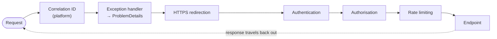
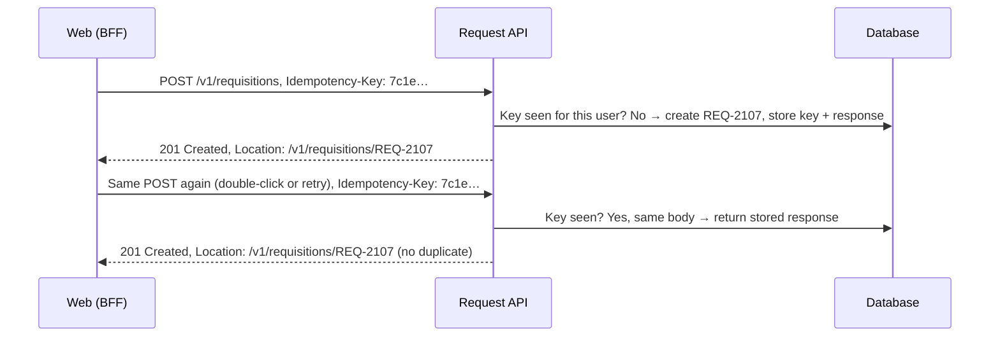
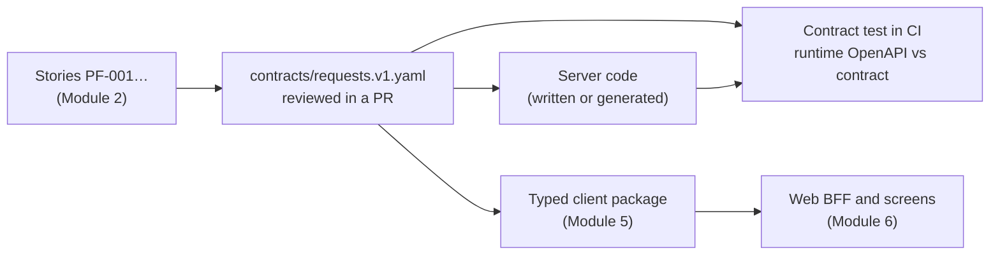
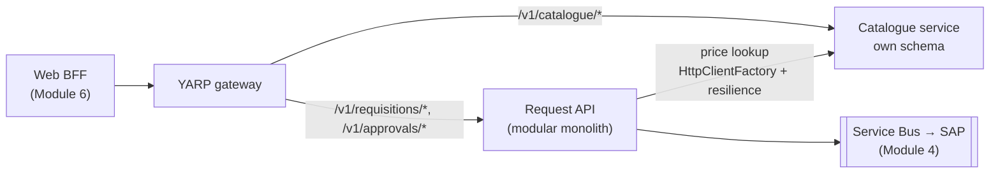

# Lecture Script: Backend Implementation: C#, .NET and REST APIs

> **Instructor reference.** Phase 2: Decide and build (Focus area 2), Module 7 | Duration: 9 hours (4 h concepts and demos, 5 h hands-on) | Previous script: [Module 6 — Frontend Implementation: React and Next.js](Module-06-Frontend-Implementation-React-Nextjs.md)

## Session overview

**Goal.** Learners build the backend behind Module 6's screens. They model the ProcureFlow domain with value objects and invariants on the Module 5 platform, refactor an approval-routing class with SOLID, design the Catalogue and Request API contracts in OpenAPI first and implement them with validation and ProblemDetails, then put both services behind a YARP gateway with Polly resilience and prove it with a chaos test (Capstone increment CI-7).

**Learner profile at this point.** Learners have the domain model and glossary (Module 1), stories and NFRs (Module 2), a guarded repo and walking skeleton (Module 3), the approved architecture and ADRs 0003–0005 (Module 4), the platform, `pf-service` template and dependency guardrails (Module 5), and Module 6's screens: a catalogue screen, a requisition form with a Zod schema, and a Next.js BFF calling the generated API client. Module 6 ran against MSW mocks and a reference API. Today the real API arrives, and introduces the first genuinely new idea of the backend build: **design the contract before the code, and design every call across the network to fail safely.**

**Key outcome.** Every learner can use records, interfaces, generics, LINQ, pattern matching and nullable reference types to model a domain with value objects and invariants; spot and fix SOLID violations; explain `Program.cs`, minimal APIs versus controllers, DI lifetimes and the options pattern; order a middleware pipeline and pass cancellation through; design REST resources with correct verbs, status codes, idempotency, pagination and filtering; write an OpenAPI contract first, validate with FluentValidation, version an API, and prove code matches contract with a test; draw service boundaries from bounded contexts; call other services with `HttpClientFactory`; and run a YARP gateway with retry, timeout, circuit breaker and health checks.

**Case for this session.** ProcureFlow at Meridian Components, continued. Today's stories: **PF-001** (submit), **PF-002** (approve or reject), **PF-003** (status), **PF-010/011/012** (approval routing at ₹50,000 and ₹5 lakh), **PF-013** (delegation), **PF-014** (no self-approval, NFR-SEC-02). Two naming notes. The syllabus says *PurchaseRequest*; ProcureFlow's glossary (Module 1) says **requisition**, so the code says `Requisition`. The syllabus says *Catalog*; this script uses **Catalogue**, matching Module 6's `/catalogue` paths and British spelling. The trainer plays the tech lead, and briefly relays an incident report from Meridian IT in the opening.

**Note on architecture.** ADR-0003 chose a modular monolith, and that stands: the Request API *is* that monolith. Today the **Catalogue** becomes a separate service at the edge (the hybrid Module 4 described: a modular core plus a few pieces at the edges) and a **YARP gateway** becomes the single front door for the BFF and the e-invoicing service scaffolded in Module 5. Learners record this as **ADR-0007** with honest consequences and a "revisit if" line. Say plainly in class: at ProcureFlow's scale this is a judgement call, and the course teaches the pattern so learners can use it when the signals in Module 4 really appear.

**Note on tool versions.** Code targets .NET 8 or later (C# 12 features such as primary constructors and collection expressions). OpenAPI generation uses `Microsoft.AspNetCore.OpenApi` (`AddOpenApi`, .NET 9 or later; on .NET 8 use your starter kit's OpenAPI package). Resilience uses **Polly v8** through `Microsoft.Extensions.Http.Resilience`. Polly v8 calls them *resilience strategies* in a *pipeline*; the syllabus's "policies" is the older Polly name for the same idea. Gateway: YARP (`Yarp.ReverseProxy`). Versioning: `Asp.Versioning.*`. Contract diffing: `oasdiff`. Check `--help` and current docs for each on the day.

**Note on licences.** Every new package goes through the Module 5 package gate. At the time of writing, FluentValidation is Apache-2.0, Polly is BSD-3-Clause, YARP, `Microsoft.Extensions.Http.Resilience` and `Asp.Versioning` are MIT, and oasdiff is Apache-2.0. Re-check each on the day: licences change.

**Note on AI output.** AI-generated specs, controllers and refactorings vary run to run; examples are marked **illustrative**. Test-runner, curl-timing and tool output is also illustrative.

## Timing breakdown

| Segment | Duration | Cumulative | Kind |
| --- | --- | --- | --- |
| SEGMENT 1: Opening — Modern C# for a Domain Model | 35 min | 0:35 | Concept + demo |
| SEGMENT 2: Lab 1 — Model the ProcureFlow Domain | 55 min | 1:30 | Hands-on |
| **BREAK** | 10 min | — |  |
| SEGMENT 3: OOP and SOLID, Before and After | 25 min | 1:55 | Concept + demo |
| SEGMENT 4: Lab 2 — SOLID Refactoring Kata: Approval Routing | 50 min | 2:45 | Hands-on |
| **BREAK** | 10 min | — |  |
| SEGMENT 5: ASP.NET Core: Program.cs, Endpoints, DI and Options | 30 min | 3:15 | Concept + demo |
| SEGMENT 6: Middleware, Exceptions, Async and Cancellation | 25 min | 3:40 | Concept + demo |
| **BREAK** | 30 min (lunch) | — |  |
| SEGMENT 7: REST Design | 30 min | 4:10 | Concept + demo |
| SEGMENT 8: Contract-First, FluentValidation and Versioning | 30 min | 4:40 | Concept + demo |
| SEGMENT 9: Lab 3A — Contracts from Stories, AI-Assisted | 40 min | 5:20 | Hands-on |
| **BREAK** | 10 min | — |  |
| SEGMENT 10: Lab 3B — Implement the Catalogue and Request APIs | 50 min | 6:10 | Hands-on |
| SEGMENT 11: Service Boundaries and HttpClientFactory | 25 min | 6:35 | Concept + demo |
| SEGMENT 12: Gateway, Resilience and Health Checks | 30 min | 7:05 | Concept + demo |
| **BREAK** | 10 min | — |  |
| SEGMENT 13: Lab 4 — Gateway, Resilience and a Chaos Test | 75 min | 8:20 | Hands-on |
| SEGMENT 14: CI-7 Review and Wrap-Up | 40 min | 9:00 | Hands-on + close |

Concepts and demos: 35 + 25 + 30 + 25 + 30 + 30 + 25 + 30 + 10 (close) = 240 min (44%). Labs and CI-7 review: 55 + 50 + 40 + 50 + 75 + 30 = 300 min (56%). Total 540 min = 9 h, matching the module's 4 h / 5 h split. Breaks (70 min) are not counted.

## SEGMENT 1: Opening — Modern C# for a Domain Model (35 min)

### The Hook (8 min)

**Show one slide: "Meridian IT incident report, last month-end (pilot)".**

> 1. 09:40 — The catalogue lookup went slow. Requisition submits hung for up to **100 seconds**, then failed. Approvals slowed down too, though they don't use the catalogue.
> 2. 09:52 — A requester double-clicked Submit while the page was hanging. **Two identical requisitions**, REQ-2107 and REQ-2108, both went to her line manager.
> 3. 10:15 — An approver approved REQ-2096 **after the requester had withdrawn it**. Nothing stopped him.
> 4. 10:30 — The new requisitions list returned `200 OK` with `{ "error": "not found" }`. The web app showed an empty table.
> 5. 11:05 — A backend developer renamed `neededBy` in a response. Module 6's screens broke in production; nobody knew which other clients used it.
> 6. 11:20 — A log search for the incident found **vendor bank details** in plain text in a debug log line.

**Say:** *"None of this is exotic. Every one of these happens on real projects in the first month of a backend going live."*

**Ask:** *"Which of these is a bug in one line of code, and which is a design problem that would come back in a different line next week?"*

**Do:** Take 4–5 answers. Write them in two columns: *line bug* and *design problem*.

**Respond to likely answers:**

- *"Number 3 is a missing if-statement."* → *"Where should that if live so that no endpoint, job or future developer can skip it?"*
- *"Number 1 is the catalogue team's fault."* → *"Their service was slow. Why did our approvals slow down too? Whose design let that spread?"*
- *"Number 2: disable the button."* → *"Good for the user. Does it stop a network retry sending the same request twice?"*
- *"Number 5: tell people before renaming."* → *"Tell whom? Where is the list of what we promised?"*

**Say:** *"Almost all six are design problems. Today has three parts, and each one closes some of these. Here's the line:"*

**Write on board, large, and leave it up all day:**

> **Model the rules, design the contract, expect the failure.**

### Modern C# in Ten Minutes (10 min)

**Say:** *"Six C# features carry most of a domain model. You've seen some in Module 5's platform."*

| Feature | What it gives you | ProcureFlow use |
| --- | --- | --- |
| Records | Value equality, immutability by default, concise syntax | `Money`, `Quantity`, `RequisitionId`: two `Money(500, INR)` are equal |
| Interfaces | A contract without an implementation | `IApprovalRoutingStrategy`, `IRequisitionRepository` (Module 5 ports) |
| Generics | One type-safe implementation for many types | `Result<T>` from the platform; `PagedResult<T>` today |
| LINQ | Query collections and databases with the same syntax | Requisition total; the approvals queue query |
| Pattern matching | Branch on shape and value, checked by the compiler | Approval routing by amount: `<= 50_000m => …` |
| Nullable reference types | The compiler tracks what may be null | `Vendor? PreferredVendor` must be checked before use; already errors under Module 5's `Directory.Build.props` |

**Say:** *"A **value object** is a small type defined by its values, not an identity: money, a quantity, a site. An **entity** has an identity that lasts while its values change: a requisition. An **aggregate** is a cluster with one root that guards its rules. `Requisition` is the root; its lines and approvals change only through it. That's how complaint 3 gets fixed once."*

### Live Demo: Money and Routing (12 min)

**1. A value object that can't be wrong (6 min):**

```csharp
// api/src/Requisitioning/Domain/Money.cs
public enum Currency { INR, GBP }

public readonly record struct Money
{
    public decimal Amount { get; }
    public Currency Currency { get; }

    private Money(decimal amount, Currency currency) => (Amount, Currency) = (amount, currency);

    public static Result<Money> Of(decimal amount, Currency currency) =>
        amount < 0
            ? Result<Money>.Fail(new Error("money.negative", "Amount can't be negative.", ErrorKind.Validation))
            : Result<Money>.Ok(new Money(decimal.Round(amount, 2), currency));

    public static Money Zero(Currency currency) => new(0m, currency);

    public static Money operator +(Money a, Money b) =>
        a.Currency == b.Currency
            ? new Money(a.Amount + b.Amount, a.Currency)
            : throw new InvalidOperationException($"Can't add {a.Currency} to {b.Currency}.");
}
```

**Say:** *"Three choices to point at. `decimal`, never `double`, for money. `Result` from Module 5 for expected bad input, like a negative price typed by a user. An exception for adding rupees to pounds, because that's a programming error, not a user error. One gotcha: `default(Money)` on a struct skips `Of`. Treat it as zero rupees, or use a `record` class if that worries you."*

**2. Routing with pattern matching (6 min):**

```csharp
// api/src/Requisitioning/Domain/IndiaRouting.cs (Module 5's Strategy, now with real rules)
public sealed class IndiaRouting : IApprovalRoutingStrategy
{
    public IReadOnlyList<ApproverRole> RouteFor(Money total) => total switch
    {
        { Currency: not Currency.INR } => throw new InvalidOperationException("India routing needs INR."),
        { Amount: <= 50_000m }  => [ApproverRole.LineManager],                                   // PF-010
        { Amount: <= 500_000m } => [ApproverRole.LineManager, ApproverRole.DepartmentHead],      // PF-011
        _                       => [ApproverRole.LineManager, ApproverRole.DepartmentHead, ApproverRole.Cfo], // PF-012
    };
}
```

**Do:** Delete the `_` arm. Show the compiler warning that the switch isn't exhaustive (an error under warnings-as-errors).

**Say:** *"Read it out loud: up to ₹50,000, line manager; up to ₹5 lakh, plus department head; above that, plus the CFO. That's Priya's rule, readable by Priya. And ₹50,000 exactly goes to the line manager only: `<=`. Boundary values are where approval bugs live, so they're the first tests you write in the lab."*

### Comprehension Check (5 min)

1. *"Why is `Money` a record and `Requisition` not?"* (Money is defined by its values; a requisition keeps its identity while its status and lines change.)
2. *"A requisition for exactly ₹5,00,000: who approves?"* (Line manager and department head; the CFO only above ₹5 lakh.)
3. *"Why can't the UK routing use the same `switch` with constants for its limits?"* (Pattern constants must be compile-time constants; Leeds limits come from configuration, Module 5's Options, so that strategy compares against option values.)

**Common misconception:** "records are for DTOs only." (Records suit any type defined by its values, including domain value objects; entities with identity are usually classes.)

**Re-teach trigger:** if learners can't place the self-approval rule, draw the aggregate: `Requisition` in the middle, lines and approvals inside, every change entering through a method on the root.

**Transition — Say:** *"Now model the whole thing. Every rule from Priya becomes either a type or a method that refuses."*

## SEGMENT 2: Lab 1 — Model the ProcureFlow Domain (55 min)

**Say:** *"Model the four core concepts: Requisition (the syllabus calls it PurchaseRequest; our glossary says requisition), LineItem, Vendor and Approval. Use value objects for anything defined by its values, put every invariant inside the aggregate, and use the platform's `Result` and `Error`. No database, no HTTP: if your domain needs either, the dependency rule from Module 5 is broken."*

### Instructions (read aloud, step by step)

1. **Value objects (12 min).** In `api/src/Requisitioning/Domain/`: `Money` (from the demo), `Quantity` (whole number, at least 1), `RequisitionId`, and `Site` (Pune, Chennai, Leeds; with its currency: INR, INR, GBP). Each validates in a factory that returns `Result<T>`.
2. **LineItem and Requisition (20 min).** `LineItem`: description, quantity, unit price, optional catalogue item ID, optional vendor ID, and `Total`. `Requisition` aggregate with these invariants, each a method that returns `Result` or raises a domain event:
   - Created with at least one line; every line in the site's currency.
   - Lines can't change once submitted.
   - `Approve` only while `AwaitingApproval`; never by the requester (NFR-SEC-02, PF-014); only by the role whose step is next.
   - `Withdraw` only by the requester, only while `AwaitingApproval`. A withdrawn requisition can't be approved (complaint 3).
3. **Approval (8 min).** `Approval` step: role, approver ID, decision, decided-at (from `TimeProvider`, never `DateTime.Now`, which the banned-API analyser from Module 5 already blocks). Create the steps from Module 5's `IApprovalRoutingStrategy` when the requisition is submitted.
4. **Vendor (7 min).** In `api/src/SupplierManagement/Domain/`: `Vendor` with ID, name, tax ID (GSTIN for Indian vendors, VAT number for UK vendors) and bank details. Lines reference a vendor by `VendorId`, never by holding the object. Make sure bank details can never appear in `ToString()` (complaint 6, NFR-SEC-03).
5. **Tests (8 min).** xUnit tests for: ₹50,000 and ₹50,000.01 routing; self-approval refused; approving a withdrawn requisition refused; mixed currency refused; `Vendor.ToString()` contains no bank details.

### Starter: the Aggregate Skeleton

```csharp
// api/src/Requisitioning/Domain/Requisition.cs
public sealed class Requisition
{
    private readonly List<LineItem> _lines = [];
    private readonly List<Approval> _approvals = [];
    private readonly List<object> _events = [];

    public RequisitionId Id { get; }
    public string RequesterId { get; }
    public Site Site { get; }
    public RequisitionStatus Status { get; private set; }
    public IReadOnlyList<LineItem> Lines => _lines;
    public IReadOnlyList<Approval> Approvals => _approvals;
    public IReadOnlyList<object> Events => _events;

    public Money Total => _lines.Aggregate(Money.Zero(Site.Currency), (sum, line) => sum + line.Total);

    private Requisition(RequisitionId id, string requesterId, Site site) => (Id, RequesterId, Site) = (id, requesterId, site);

    public static Result<Requisition> Submit(string requesterId, Site site, IReadOnlyList<LineItem> lines,
                                             IApprovalRoutingStrategy routing)
    {
        // TODO: invariants; create approval steps from routing.RouteFor(Total); raise RequisitionSubmitted
        throw new NotImplementedException();
    }

    public Result<Requisition> Approve(string approverId, ApproverRole role, TimeProvider clock) => throw new NotImplementedException();
    public Result<Requisition> Withdraw(string requesterId) => throw new NotImplementedException();
}
```

### Reference Solution (instructor, partial)

```csharp
public Result<Requisition> Approve(string approverId, ApproverRole role, TimeProvider clock)
{
    if (Status != RequisitionStatus.AwaitingApproval)
        return Result<Requisition>.Fail(new Error("requisition.not_awaiting_approval",
            $"Requisition is {Status}; only requisitions awaiting approval can be approved.", ErrorKind.Conflict));

    if (approverId == RequesterId)                                            // NFR-SEC-02, PF-014
        return Result<Requisition>.Fail(new Error("requisition.self_approval",
            "You can't approve your own requisition.", ErrorKind.Forbidden));

    var next = _approvals.FirstOrDefault(a => a.Decision is null);
    if (next is null || next.Role != role)
        return Result<Requisition>.Fail(new Error("requisition.wrong_step",
            "This requisition isn't waiting for your approval step.", ErrorKind.Forbidden));

    next.Record(approverId, Decision.Approved, clock.GetUtcNow());

    if (_approvals.All(a => a.Decision == Decision.Approved))
    {
        Status = RequisitionStatus.Approved;
        _events.Add(new RequisitionApproved(Id, approverId));                // Module 5 demo event
    }
    return Result<Requisition>.Ok(this);
}
```

```csharp
// api/src/SupplierManagement/Domain/Vendor.cs
public sealed record BankDetails(string AccountName, string AccountNumber, string Ifsc)
{
    public override string ToString() => "BankDetails { *** }";   // never print account data (LOGGING.md)
}

public sealed record Vendor(VendorId Id, string Name, TaxId TaxId, BankDetails BankDetails);
```

**Say:** *"Records generate `ToString()` with every property in it. That's lovely for `Money` and dangerous for bank details. One override, and the debug log in complaint 6 can't happen. Write the test that proves it."*

**Note:** `RequisitionStatus` gains a new value today, `Withdrawn`. When the API's OpenAPI document and the client package are regenerated in Lab 4, Module 6's `StatusBadge` will fail to compile until it has a label for it. That's the Module 5 typed-label design working as intended.

### Instructor Circulates

- **Public setters on `Status` or `Lines`:** *"Then any code can skip the rules. Make them private and add a method."*
- **EF Core attributes or `DbContext` in the domain:** the dependency rule again; mapping goes in Infrastructure.
- **`double` for money:** `decimal`, always.
- **Self-approval checked only in the endpoint:** it's a business rule; it belongs in `Approve`. The Module 5 policy stays too, as a second layer.
- **Boundary tests missing:** ask for ₹50,000 and ₹50,000.01, and ₹5,00,000 and ₹5,00,000.01.

**Success check:** value objects reject bad input through `Result`; the five tests pass; no domain project references EF Core or ASP.NET Core (the Module 5 architecture tests pass); `Vendor` can't print bank details.

**Extension (fast teams):** add PF-013 delegation: an approver on leave delegates to a named colleague for a date range, using `TimeProvider`, with tests using a fake clock.

### BREAK (10 min)

*Suggested break prompt:* *"Open the old approval router in the kata repo (link on screen). Count the reasons this one class might need to change."*

## SEGMENT 3: OOP and SOLID, Before and After (25 min)

### Five Principles, Each With a Smell (8 min)

**Ask:** *"Your break question: how many reasons to change?"* (Expect five to eight: limits, Leeds rules, email server, database, logging, delegation, audit.)

**Say:** *"OOP gives us encapsulation, abstraction, inheritance and polymorphism. SOLID is five rules for using them so that code stays easy to change. Learn each as a smell you can spot in a review."*

| Principle | Means | Smell | ProcureFlow fix |
| --- | --- | --- | --- |
| **S** Single responsibility | One reason to change | A class that routes, emails and saves | Routing, notification and persistence in separate classes |
| **O** Open/closed | Add behaviour without editing working code | `if (site == "Leeds")` growing per site | One `IApprovalRoutingStrategy` per site (Module 5) |
| **L** Liskov substitution | A subtype can stand in for its base without surprises | `UkRouting` throws `NotSupportedException` for the CFO step | Every strategy honours the full contract |
| **I** Interface segregation | Small interfaces shaped for their users | `IApprovalService` with route, notify, export and audit | `IApprovalRoutingStrategy`, `IApprovalNotifier`, separately |
| **D** Dependency inversion | Depend on abstractions you own | `new SmtpClient(...)`, `new SqlConnection(...)`, `DateTime.Now` inside the router | Constructor-injected ports and `TimeProvider` |

**Say:** *"SOLID isn't a score to maximise. Every abstraction costs a file and a jump in the debugger. Apply a principle when its smell is present, and not before."*

### Live Demo: Before and After (12 min)

**Show the before (excerpt):**

```csharp
// kata/before/ApprovalRouter.cs — every smell in one place
public class ApprovalRouter
{
    public void Route(Requisition r)
    {
        var approvers = new List<string>();
        if (r.Site == "Leeds")
        {
            if (r.Total > 500m) approvers.Add(GetDeptHead(r)); // placeholder limit typed in by the original developer
        }
        else
        {
            approvers.Add(GetLineManager(r));
            if (r.Total > 50000m) approvers.Add(GetDeptHead(r));
            if (r.Total > 500000m) approvers.Add("cfo@meridian.example");
        }
        if (IsOnLeave(approvers[0], DateTime.Now)) approvers[0] = GetDelegate(approvers[0]);

        using var db = new SqlConnection("Server=prod-sql;...");          // hard-coded connection
        // … INSERT approval steps …
        new SmtpClient("smtp.meridian.example").Send("noreply@meridian.example", approvers[0], "Approve", "…");
        Console.WriteLine($"Routed {r.Id} to {string.Join(",", approvers)}");
    }
}
```

**Do:** Ask the room to call out the violations; tick them off on the SOLID table.

**Show the after (shape):**

```csharp
public sealed class SubmitRequisitionHandler(
    IApprovalRoutingFactory routingFactory,     // O: picks IndiaRouting or UkRouting by site
    IApproverDirectory directory,               // D: who is the line manager, delegation (PF-013)
    IRequisitionRepository repository,          // S + D: persistence elsewhere
    IApprovalNotifier notifier,                 // I + D: email is one implementation
    TimeProvider clock,
    ILogger<SubmitRequisitionHandler> logger) : ICommandHandler<SubmitRequisition, RequisitionId>
{
    public async Task<Result<RequisitionId>> HandleAsync(SubmitRequisition cmd, CancellationToken ct)
    {
        var routing = routingFactory.For(cmd.Site);
        var created = Requisition.Submit(cmd.RequesterId, cmd.Site, cmd.Lines, routing);
        if (!created.IsSuccess) return Result<RequisitionId>.Fail([.. created.Errors]);

        var requisition = created.Value!;
        await repository.AddAsync(requisition, ct);
        var first = await directory.ResolveAsync(requisition.Approvals[0].Role, cmd.RequesterId, clock.GetUtcNow(), ct);
        await notifier.ApprovalRequestedAsync(requisition.Id, first, ct);
        logger.LogInformation("Requisition {RequisitionId} routed to {Steps} steps", requisition.Id, requisition.Approvals.Count);
        return Result<RequisitionId>.Ok(requisition.Id);
    }
}
```

**Say:** *"The rules moved into the domain and the strategies. The handler only coordinates. Each dependency can be faked in a test, including time. And look at what we didn't do: no base class hierarchy, no abstract factory of factories. Composition over inheritance."*

**Say:** *"The most important step happens before any of this: **characterisation tests**. Before you refactor code you didn't write, pin down what it does today, even the odd parts, so you know your refactor didn't change behaviour by accident."*

### Comprehension Check (5 min)

1. *"Meridian opens a plant in Germany. In the after version, which files change?"* (A new `GermanyRouting` strategy, its options, and one line in the factory; nothing that already works.)
2. *"`UkRouting` throws `NotSupportedException` when asked for a CFO step. Which principle, and why does it matter?"* (Liskov: callers relying on `IApprovalRoutingStrategy` get a surprise crash for one site.)
3. *"Why inject `TimeProvider` instead of calling `DateTime.UtcNow`?"* (Dependency inversion: tests can control time for delegation and leave dates.)

**Common misconception:** "SOLID means interfaces everywhere." (An interface earns its place when there are, or will soon be, several implementations, or when you need to fake it in tests.)

**Re-teach trigger:** if learners can't name a smell in the before code, ask: *"If Meridian changes its email server, which class do you edit? And if it changes approval limits? Same class? That's S."*

**Transition — Say:** *"Your turn, on the full class, with tests first."*

## SEGMENT 4: Lab 2 — SOLID Refactoring Kata: Approval Routing (50 min)

**Say:** *"The kata repo has the full `ApprovalRouter`, about 150 lines, every smell from the demo plus a few more. Pin its behaviour with characterisation tests, then refactor it into the shape you saw, step by step, keeping the tests green. Then ask an AI to do the same refactor and compare."*

### Instructions (read aloud, step by step)

1. **Read and list smells (7 min).** In pairs, read `kata/before/ApprovalRouter.cs`. List each smell with its SOLID letter in `kata/NOTES.md`.
2. **Characterisation tests (10 min).** Wrap the hard dependencies behind seams the kata provides (`IClock`, `IMailer`, `IStepStore`), then write tests that record today's behaviour: ₹40,000 (Pune), ₹2,00,000 (Chennai), ₹7,00,000 (Pune), a Leeds requisition, and an approver on leave.
3. **Refactor: S and D (15 min).** Move notification, persistence and logging out. Inject them. Replace `DateTime.Now` with `TimeProvider`. Tests stay green after each move; commit after each.
4. **Refactor: O and L (10 min).** Replace the site `if` with `IndiaRouting` and `UkRouting` behind `IApprovalRoutingStrategy`, picked by a factory. Leeds limits come from `ApprovalLimitsOptions` (Module 5). Make sure every strategy returns a valid list for every amount: no `NotSupportedException`.
5. **Compare with AI (8 min).** Give the original class and your tests to an AI assistant with the prompt below. Run your tests against its version. Record in `NOTES.md` what it kept, what it broke, and what it over-engineered.

### The AI Prompt (give to learners)

```
Refactor this C# class to follow SOLID. Keep behaviour identical: the attached xUnit
characterisation tests must still pass. Use constructor injection, TimeProvider instead
of DateTime.Now, and one strategy per site for routing. Don't add NuGet packages.
Explain each change in one line, naming the principle.
```

**Example output summary (illustrative — AI output varies):** the assistant usually separates email and persistence correctly, sometimes "fixes" the odd Leeds behaviour (which breaks a characterisation test), and often adds a generic repository and an abstract base strategy nobody needs.

**Say (when the first team finds the AI changed behaviour):** *"Exactly why characterisation tests come first. The Leeds rule looked wrong, so the AI 'fixed' it. Maybe it is wrong. That's a question for Priya, logged in `docs/domain/open-questions.md`, not a silent change in a refactor."*

### Reference Solution (instructor)

The reference `after/` folder contains: `IndiaRouting`, `UkRouting` (limits from options), `ApprovalRoutingFactory`, `IApproverDirectory` with delegation, `EmailApprovalNotifier`, `SqlApprovalStepStore`, and `SubmitRequisitionHandler` as in the demo. Characterisation tests are unchanged; new unit tests cover each strategy at its boundaries.

| Smell in `before` | Principle | Where it went |
| --- | --- | --- |
| Limits and site branches in one method | S, O | `IndiaRouting`, `UkRouting`, factory |
| Leeds limit hard-coded | O | `ApprovalLimitsOptions` |
| `new SqlConnection` with a connection string | D, S | `IApprovalStepStore` in Infrastructure |
| `new SmtpClient` | D, S | `IApprovalNotifier` |
| `DateTime.Now` for leave | D | `TimeProvider` |
| `Console.WriteLine` | S | `ILogger<T>` with structured properties |
| `IApprovalService` with seven methods | I | Three small interfaces |
| `UkRouting` throws for CFO | L | Every strategy returns a full route |

**Say:** *"Take the result into your real API. The strategies and handler you wrote here replace whatever routing your Lab 1 aggregate uses."*

### Instructor Circulates

- **Refactoring before tests exist:** stop; tests first.
- **One giant commit:** small steps, green after each, commit after each.
- **New abstract base classes:** *"Which smell does this remove?"*
- **Behaviour "fixed" during the refactor:** revert; log the question for Priya.
- **Connection string moved into `appsettings.json` with a password:** `SECURITY.md`; use a secret store.

**Success check:** characterisation tests pass before and after; no `new` of infrastructure classes in routing or handler code; site strategies with boundary tests; AI comparison recorded in `NOTES.md`.

**Extension (fast teams):** add an architecture test (NetArchTest, Module 5) that no class in `Requisitioning.Application` depends on `System.Net.Mail` or `Microsoft.Data.SqlClient`.

### BREAK (10 min)

*Suggested break prompt:* *"Look at your API's `Program.cs`. Which line would you be scared to move up or down, and why?"*

## SEGMENT 5: ASP.NET Core: Program.cs, Endpoints, DI and Options (30 min)

### Program.cs, Read Top to Bottom (6 min)

**Say:** *"Every ASP.NET Core app has the same shape. Two halves: register services, then build the request pipeline."*

```csharp
var builder = WebApplication.CreateBuilder(args);       // config, logging, DI container

builder.AddProcureFlowPlatform();                        // Module 5: errors, logging, auth policies, health
builder.Services.AddOpenApi();
builder.Services.AddRequisitioning(builder.Configuration); // this module's services and options

var app = builder.Build();                               // ── services above, pipeline below ──

app.UseProcureFlowPlatform();                            // correlation ID first, exception handler
app.UseAuthentication();
app.UseAuthorization();
app.MapOpenApi();
app.MapRequisitionEndpoints();                           // endpoints last
app.Run();
```

**Say:** *"Above `Build()`: what exists. Below: what happens to every request, in order. Each module registers itself with one extension method, so `Program.cs` stays a table of contents."*

### Minimal APIs Versus Controllers (6 min)

| | Minimal APIs | Controllers |
| --- | --- | --- |
| Shape | `app.MapPost("/v1/requisitions", handler)` | Class with `[ApiController]` and action methods |
| Strengths | Little ceremony; fast; fits the platform's endpoint style | Familiar structure; filters, model binding conventions; what most code generators produce |
| Watch out for | Big `Program.cs` unless grouped by module | Fat controllers holding business logic |
| ProcureFlow | **Request API** (the modular monolith, platform default) | **Catalogue service** (generated from its OpenAPI contract in Lab 3B) |

**Say:** *"Both are first-class in ASP.NET Core. We use both today on purpose, so you can judge them on real code. The rule is the same for both: endpoints translate HTTP to a command and back. The handler and domain do the work."*

### Dependency Injection Lifetimes (8 min)

| Lifetime | One instance per… | Use for | ProcureFlow |
| --- | --- | --- | --- |
| Singleton | Application | Stateless, thread-safe services | `TimeProvider.System`, `IndiaRouting` |
| Scoped | HTTP request | Per-request state, units of work | `ProcureFlowDbContext`, repositories, handlers |
| Transient | Injection | Lightweight, stateless helpers | Validators |

**Live-code — the captive dependency (3 min):**

```csharp
builder.Services.AddSingleton<IApproverDirectory, SqlApproverDirectory>(); // singleton…
// …whose constructor takes ProcureFlowDbContext (scoped)
```

**Example output (illustrative — exact wording varies by .NET version), in Development:**

```
System.InvalidOperationException: Cannot consume scoped service 'ProcureFlowDbContext'
from singleton 'IApproverDirectory'.
```

**Say:** *"A singleton that captures a scoped `DbContext` keeps one context for the life of the app, shared across threads. In production it corrupts data quietly. In Development, scope validation throws on startup, which is why you run Development locally. Rule: a service may only depend on services that live at least as long as it does."*

### The Options Pattern (5 min)

```csharp
public sealed class CatalogueServiceOptions
{
    public const string Section = "Services:Catalogue";
    [Required, Url] public string BaseAddress { get; init; } = "";
    [Range(1, 30)] public int TimeoutSeconds { get; init; } = 5;
}

builder.Services.AddOptions<CatalogueServiceOptions>()
    .BindConfiguration(CatalogueServiceOptions.Section)
    .ValidateDataAnnotations()
    .ValidateOnStart();   // fail at startup, not at 2 a.m. (Module 5)
```

**Say:** *"Three ways to read options: `IOptions<T>` reads once, fine for most settings. `IOptionsSnapshot<T>` re-reads per request, scoped. `IOptionsMonitor<T>` notices changes while running, for singletons. Approval limits use `IOptionsMonitor`, so finance can change a Leeds limit without a redeploy, if Priya wants that."*

### Comprehension Check (5 min)

1. *"Where does `app.MapRequisitionEndpoints()` go relative to `UseAuthorization()`, and why?"* (After; endpoints must run inside the auth middleware.)
2. *"A scoped handler depends on a singleton `IndiaRouting`. Problem?"* (No: shorter-lived depending on longer-lived is fine.)
3. *"Why `ValidateOnStart()`?"* (A missing or wrong setting fails the deployment immediately, not on the first request that uses it.)

**Common misconception:** "transient is safest, so use it everywhere." (Transient `DbContext`s break units of work and multiply connections; choose the lifetime that matches the state.)

**Re-teach trigger:** if learners can't explain the captive dependency, draw three boxes (app, request, injection) with lifetimes as bars, and show the singleton's bar outliving the `DbContext`'s.

**Transition — Say:** *"`Program.cs` builds a pipeline. Now let's see what happens inside it to a request, and to a failure."*

## SEGMENT 6: Middleware, Exceptions, Async and Cancellation (25 min)

### The Pipeline, In Order (7 min)

**Say:** *"Middleware is a chain. Each piece can act on the way in, call the next one, and act on the way out. Order is behaviour."*



**Say:** *"Correlation first, so even an error gets an ID. Exception handler early, so it catches everything after it. Authentication before authorisation, because you can't check permissions for someone you haven't identified. The break question's answer: the scary line is usually the exception handler; move it below the endpoints and it catches nothing."*

### Global Exception Handling, Recap (4 min)

**Say:** *"Module 5 built this: `AddProblemDetails`, an `IExceptionHandler`, and `Result.ToHttpResult()`. Complaint 4, `200 OK` with an error inside, is what happens when an endpoint hand-writes its own error format. The rule: expected failures return `Result` and map to the right status; unexpected ones throw and become a 500 ProblemDetails with the correlation ID. Nobody writes `return Ok(new { error = … })`."*

**Ask:** *"Today's domain returns `ErrorKind.Conflict` for approving a withdrawn requisition. What status code should that become?"* (409 Conflict.)

### Live Demo: Async All the Way, and Cancellation (10 min)

**Say:** *"Two rules for async. One: async all the way. Never `.Result` or `.Wait()` on a task in a web app; it blocks a thread-pool thread, and at month-end with 140 users the pool runs dry and everything slows, including endpoints that have nothing to do with the slow call. That's part of complaint 1. Two: pass the `CancellationToken` everywhere."*

```csharp
app.MapGet("/v1/requisitions", async (
    [AsParameters] RequisitionQuery query,
    IRequisitionQueries queries,
    ClaimsPrincipal user,
    CancellationToken ct) =>                     // bound to HttpContext.RequestAborted
{
    var page = await queries.ForRequesterAsync(user.GetUserId(), query, ct);
    return Results.Ok(page);
});

// Infrastructure
public Task<PagedResult<RequisitionSummary>> ForRequesterAsync(string requesterId, RequisitionQuery q, CancellationToken ct) =>
    db.Requisitions.AsNoTracking()
        .Where(r => r.RequesterId == requesterId && (q.Status == null || r.Status == q.Status))
        .OrderByDescending(r => r.SubmittedAt)
        .Select(r => new RequisitionSummary(r.Id, r.Status, r.Total, r.SubmittedAt))
        .ToPagedResultAsync(q.Page, q.PageSize, ct);   // passes ct to CountAsync and ToListAsync
```

**Do:** Add a temporary `await Task.Delay(10_000, ct);`. Call the endpoint with curl and press Ctrl+C after two seconds. Show the log: the request was cancelled at once, not after ten seconds.

**Say:** *"When a requester closes the tab, the query stops. At month-end that's database time given back to people still waiting. Two more details. This is LINQ against `IQueryable`, so EF Core turns the `Where`, `OrderBy` and `Select` into SQL; the `Select` means we fetch four columns, not whole rows. And make sure the platform logs a cancelled request as information, not as a 500 error, or the dashboards fill with false alarms."*

### Comprehension Check (4 min)

1. *"A teammate calls `catalogueClient.GetPriceAsync(id).Result` inside a handler. What goes wrong at month-end?"* (Thread-pool threads block on I/O; under load the pool starves and all endpoints slow down.)
2. *"Why pass `ct` to `ToListAsync`?"* (So the database query stops when the caller gives up.)
3. *"The exception handler is registered after `MapRequisitionEndpoints()`. What happens to an unhandled exception?"* (The handler never sees it; the client gets the default error response without ProblemDetails or correlation ID.)

**Common misconception:** "`async` makes code run in parallel." (It frees the thread while waiting for I/O; it doesn't make one request faster on its own.)

**Re-teach trigger:** if learners can't explain thread starvation, model it physically: five learners are threads; each "blocks" holding a card for 30 seconds; new requests queue at the door.

**Transition — Say:** *"After lunch: what our endpoints should look like from the outside. That's the contract."*

### BREAK (30 min, lunch)

*Suggested break prompt:* *"Complaint 2: two identical requisitions from one double-click. Without disabling the button, how could the API itself know the second request is a repeat?"*

## SEGMENT 7: REST Design (30 min)

### Resources and Verbs (7 min)

**Say:** *"REST models the system as resources, nouns, and uses HTTP's verbs on them. URLs name things; verbs say what to do."*

| Verb | Meaning | Safe? | Idempotent? | ProcureFlow |
| --- | --- | --- | --- | --- |
| GET | Read | Yes | Yes | `GET /v1/requisitions/{id}` |
| POST | Create a resource, or start a process | No | **No** | `POST /v1/requisitions`; `POST /v1/requisitions/{id}/approvals` (a decision) |
| PUT | Replace a resource | No | Yes | `PUT /v1/catalogue/items/{id}` (Admin) |
| PATCH | Change part of a resource | No | Not guaranteed | Change one catalogue item's price |
| DELETE | Remove | No | Yes | Rarely: requisitions are withdrawn, not deleted (8-year audit, NFR-AUD-01) |

**Say:** *"Two design calls worth explaining. An approval decision is a resource: `POST /requisitions/{id}/approvals` with `{ decision, comment }`, not `POST /approveRequisition`. And withdrawing is a state change recorded for audit, so it's `POST /requisitions/{id}/withdrawal`, not `DELETE`. Nothing that matters for audit is ever deleted."*

### Status Codes That Mean Something (6 min)

| Code | When | ProcureFlow example |
| --- | --- | --- |
| 200 OK | Read or action succeeded with a body | Get a requisition |
| 201 Created | New resource; `Location` header points to it | Requisition submitted |
| 204 No Content | Success, nothing to return | Catalogue item updated |
| 400 Bad Request | Input invalid (ValidationProblemDetails) | No lines; negative price |
| 401 Unauthorized | Not signed in | Missing or expired token |
| 403 Forbidden | Signed in, not allowed | Self-approval (NFR-SEC-02) |
| 404 Not Found | No such resource (or not visible to you) | Unknown requisition ID |
| 409 Conflict | Request clashes with current state | Approving a withdrawn requisition |
| 429 Too Many Requests | Rate limit hit | A runaway script |
| 500 Internal Server Error | Our bug | Unhandled exception, with correlation ID |
| 503 Service Unavailable | A dependency is down; try later | Catalogue service unavailable |

**Say:** *"Complaint 4 again: a 200 with an error body tells every client 'it worked'. Status codes are part of the contract; clients, gateways and monitoring all act on them."*

### Idempotency (7 min)

**Ask:** *"Your lunch question: how can the API know the second request is a repeat?"* (Expect: a unique ID from the client.)

**Say:** *"An operation is idempotent if doing it twice has the same effect as doing it once. GET, PUT and DELETE are, by definition. POST isn't. So for POSTs that create money-related things, we make them idempotent with an **idempotency key**: the client generates a unique key per user action and sends it in an `Idempotency-Key` header. The server stores the key with the result. A repeat with the same key gets the stored result, not a second requisition."*



**Say:** *"Same key with a *different* body is a client bug; reject it. The `Idempotency-Key` header is being standardised by the IETF; at the time of writing it's still a draft, so check its status and pick consistent status codes. And this matters doubly this afternoon: our retry strategy will resend requests automatically. Retrying a non-idempotent POST is how complaint 2 happens without anyone double-clicking."*

### Pagination and Filtering (6 min)

```
GET /v1/requisitions?status=AwaitingApproval&site=Pune&sort=-neededBy&page=2&pageSize=25
```

```json
{ "items": [ … ], "page": 2, "pageSize": 25, "totalCount": 137 }
```

**Say:** *"Four rules. Every list is paged; no endpoint returns 'everything', because at 3,000 requisitions a month 'everything' grows forever. `pageSize` has a maximum, 100, and anything bigger is a 400, not quietly accepted. Filters and sort fields come from an allowlist, never passed straight into SQL. And offset paging, page and page size, is fine at our volume; keyset or cursor paging is the upgrade if lists grow to millions."*

### Comprehension Check (4 min)

1. *"Approving a requisition: which verb and URL?"* (`POST /v1/requisitions/{id}/approvals` with the decision in the body.)
2. *"A client sends the same `Idempotency-Key` with a different line total. What should the API do?"* (Refuse it as a client error; never apply it or return the old result as if it matched.)
3. *"`GET /v1/requisitions?pageSize=5000`: what happens?"* (400 with ProblemDetails explaining the maximum of 100.)

**Common misconception:** "REST means CRUD on database tables." (Resources model the domain, including processes like approvals and withdrawals; tables are an implementation detail.)

**Re-teach trigger:** if learners design verb-style URLs (`/approveRequisition`), rewrite one together: *"What's the noun that gets created when someone approves?"*

**Transition — Say:** *"Good design on a whiteboard is lost if nobody writes it down in a form machines can check. That's the contract."*

## SEGMENT 8: Contract-First, FluentValidation and Versioning (30 min)

### Why Contract-First (5 min)

**Say:** *"Code-first: write the code, generate the OpenAPI document from it, publish whatever came out. Contract-first: agree the OpenAPI document first, in a PR that the frontend, the API team and the BFF all review, then build to it. Module 6 built screens against MSW mocks: that was a contract guess. Today we write the real one, and Module 5's typed client and drift check enforce it from the other side."*



### Live Demo: A Contract and a Contract Test (10 min)

**1. A slice of the contract (4 min):**

```yaml
# contracts/requests.v1.yaml (excerpt — use the OpenAPI version your runtime generator emits)
openapi: 3.0.3
info: { title: ProcureFlow Request API, version: "1.0" }
paths:
  /v1/requisitions:
    post:
      operationId: submitRequisition
      parameters:
        - { name: Idempotency-Key, in: header, required: true, schema: { type: string, maxLength: 64 } }
      requestBody:
        required: true
        content:
          application/json:
            schema: { $ref: "#/components/schemas/SubmitRequisitionRequest" }
      responses:
        "201":
          description: Created
          headers: { Location: { schema: { type: string } } }
          content: { application/json: { schema: { $ref: "#/components/schemas/RequisitionCreated" } } }
        "400": { $ref: "#/components/responses/ValidationProblem" }
        "409": { $ref: "#/components/responses/Problem" }
components:
  schemas:
    SubmitRequisitionRequest:
      type: object
      required: [site, neededBy, justification, lines]
      properties:
        site: { type: string, enum: [Pune, Chennai, Leeds] }
        neededBy: { type: string, format: date }
        justification: { type: string, minLength: 10 }
        lines: { type: array, minItems: 1, items: { $ref: "#/components/schemas/LineInput" } }
```

**Say:** *"Same fields as Module 6's Zod schema: `site`, `neededBy`, `justification`, `lines`. That's not a coincidence; the frontend built against this shape. Now the shape is written down and owned."*

**2. The contract test (6 min):** *"How do we know the running code matches? Get the OpenAPI document the code generates, and diff it against the contract."*

```csharp
// tests/Contract/ExportOpenApi.cs — writes the runtime document for CI to diff
public sealed class ExportOpenApi(WebApplicationFactory<Program> factory) : IClassFixture<WebApplicationFactory<Program>>
{
    [Fact]
    public async Task Export()
    {
        var json = await factory.CreateClient().GetStringAsync("/openapi/v1.json");
        await File.WriteAllTextAsync("runtime-openapi.json", json);
    }
}
```

```bash
# CI step (illustrative — check oasdiff --help for your installed version's flags)
oasdiff breaking contracts/requests.v1.yaml runtime-openapi.json --fail-on ERR
oasdiff diff contracts/requests.v1.yaml runtime-openapi.json --format text
```

**Do:** Rename `neededBy` to `requiredBy` in a request DTO. Run the test and the diff. Show the breaking-change report.

**Example output (illustrative — wording and format vary by version):**

```
error [request-property-removed] at contracts/requests.v1.yaml
    in API POST /v1/requisitions
        removed the request property 'neededBy'
```

**Say:** *"That's complaint 5, caught on the PR instead of in production. The contract is the promise; the test checks we kept it."*

### FluentValidation (7 min)

**Say:** *"Two kinds of validation, in two places. **Input validation** at the edge: is this request well-formed? Lines present, quantities positive. **Domain invariants** in the aggregate: may this happen? Not your own requisition; not withdrawn. FluentValidation does the first kind, with readable rules."*

```csharp
public sealed class SubmitRequisitionRequestValidator : AbstractValidator<SubmitRequisitionRequest>
{
    public SubmitRequisitionRequestValidator(TimeProvider clock)
    {
        RuleFor(r => r.Justification).NotEmpty().MinimumLength(10)
            .WithMessage("Explain why in at least 10 characters");
        RuleFor(r => r.NeededBy).GreaterThanOrEqualTo(_ => DateOnly.FromDateTime(clock.GetUtcNow().UtcDateTime))
            .WithMessage("Needed-by date can't be in the past");
        RuleFor(r => r.Lines).NotEmpty().WithMessage("Add at least one line");
        RuleForEach(r => r.Lines).ChildRules(line =>
        {
            line.RuleFor(l => l.Description).NotEmpty().MinimumLength(3);
            line.RuleFor(l => l.Quantity).GreaterThan(0).WithMessage("Quantity must be at least 1");
            line.RuleFor(l => l.UnitPrice).GreaterThan(0).WithMessage("Unit price must be more than 0");
        });
    }
}
```

**Say:** *"The messages match Module 6's Zod schema word for word, so a requester sees the same sentence whether the browser or the server caught it. To plug it into Module 5's validation decorator, add one small adapter:"*

```csharp
public sealed class FluentCommandValidator<T>(IValidator<T> inner) : ICommandValidator<T>
{
    public IEnumerable<Error> Validate(T command) =>
        inner.Validate(command).Errors.Select(e => new Error(e.PropertyName, e.ErrorMessage, ErrorKind.Validation));
}
```

**Say:** *"Ship that as a new platform package, `ProcureFlow.Platform.Validation.FluentValidation`, so only services that want FluentValidation take the dependency. FluentValidation's own docs no longer recommend its old automatic ASP.NET integration; validating explicitly, as the decorator does, is the current advice. Check the docs on the day."*

### API Versioning (5 min)

| Approach | Example | Trade-off |
| --- | --- | --- |
| URL segment | `/v1/requisitions` | Visible in logs, gateway routes and links; ProcureFlow's choice |
| Query string | `/requisitions?api-version=1.0` | Easy to add; easy to forget |
| Header | `api-version: 1.0` | Clean URLs; invisible when debugging |

```csharp
builder.Services.AddApiVersioning(o =>
{
    o.DefaultApiVersion = new ApiVersion(1);
    o.ReportApiVersions = true;                       // adds api-supported-versions to responses
    o.ApiVersionReader = new UrlSegmentApiVersionReader();
});

var requisitions = app.NewVersionedApi("Requisitions")
    .MapGroup("/v{version:apiVersion}/requisitions")
    .HasApiVersion(1);
```

**Say:** *"A new version is for breaking changes only: removing or renaming a field, changing a meaning. Adding an optional field isn't breaking. And when v2 arrives, v1 keeps running until every client has moved, with a deprecation date announced in the response headers and the changelog. Wiring versioned APIs into the OpenAPI document needs the versioning library's API explorer package; check its current docs."*

### Comprehension Check (3 min)

1. *"'Requester can't approve own requisition': FluentValidation or domain?"* (Domain: it depends on who is acting and on state, not on the shape of the input.)
2. *"Adding an optional `costCentre` field to the response: new version?"* (No; it's additive. Renaming `neededBy` would be.)
3. *"What does the contract test compare?"* (The OpenAPI document generated by the running code against the agreed contract file.)

**Common misconception:** "contract-first means generated code, so we don't write tests." (The contract test is what proves code and contract match; generation is optional.)

**Re-teach trigger:** if learners can't separate input validation from invariants, sort five rules on the board into two columns together.

**Transition — Say:** *"Now write the two contracts, with an AI doing the first draft from your stories."*

## SEGMENT 9: Lab 3A — Contracts from Stories, AI-Assisted (40 min)

**Say:** *"Write the Catalogue and Request API contracts in OpenAPI. Let the AI draft them from your user stories, then review them hard against today's REST rules. The contracts merge through a PR that your frontend lead reviews, because Module 6's screens are a client."*

### Instructions (read aloud, step by step)

1. **AI draft (12 min).** Give the AI the prompt below with your stories from `docs/requirements/stories/` and Module 6's Zod schema and MSW handlers. One person drafts `contracts/requests.v1.yaml`, another `contracts/catalogue.v1.yaml`.
2. **Review against the REST checklist (12 min).** Swap drafts within the team. Check every item in the review checklist below. Fix in place.
3. **Decide and record (8 min).** In `contracts/README.md`, record: versioning by URL segment; paging shape and maximum page size; idempotency-key rules; error format (ProblemDetails with `correlationId`); enum values as strings.
4. **PR and review (8 min).** Open one PR with both contracts. The frontend lead reviews against Module 6's screens and BFF. Merge when both leads approve.

### The AI Prompt (give to learners)

```
From these user stories and acceptance criteria, draft an OpenAPI <version your
runtime emits> contract for the ProcureFlow <Request | Catalogue> API.
Rules: URL-segment versioning (/v1); nouns not verbs; approval decisions and
withdrawals are sub-resources; every list is paged (page, pageSize max 100,
totalCount); POST that creates a requisition requires an Idempotency-Key header;
errors are application/problem+json with a correlationId extension; enums are strings;
amounts are numbers with a separate currency field. Include 400, 401, 403, 404, 409
responses where they apply. Use names from this glossary: <paste glossary terms>.
List any acceptance criterion you could not express in the contract.
```

### Review Checklist (put in the PR template)

| Check | Pass if |
| --- | --- |
| Nouns, not verbs | No `/approveRequisition`, `/getItems` |
| Verbs fit | POST creates; GET never changes anything |
| Status codes | 201 + `Location` on create; 409 for state conflicts; 403 vs 404 deliberate |
| Errors | Every 4xx and 5xx uses the shared ProblemDetails response |
| Paging | Every collection paged; `pageSize` maximum stated |
| Idempotency | `POST /v1/requisitions` requires `Idempotency-Key` |
| Glossary names | `requisition`, `supplier` / `vendor` used as Module 1 defines them |
| Frontend fit | Every field Module 6's screens and BFF use is present, with the same name |
| No leaks | No bank details in any catalogue or requisition response (NFR-SEC-03) |

### What the AI Draft Typically Gets Wrong (show learners)

| AI draft does this (illustrative — varies by run) | Fix |
| --- | --- |
| `POST /requisitions/{id}/approve` | `POST /requisitions/{id}/approvals` with a decision body |
| `DELETE /requisitions/{id}` for withdraw | `POST /requisitions/{id}/withdrawal`; audit keeps everything |
| Unpaged `GET /catalogue/items` | Add paging with a maximum page size |
| Uses "purchaseOrder" for a requisition | Glossary: a requisition becomes a PO later, in Purchasing |
| Returns `vendor` with bank details on catalogue items | Return `supplierName` only |
| Invents a `priority` field no story asked for | Remove; contracts come from stories |
| Missing 409 on approve | Add it: withdrawn or already decided |

### Reference Solution (instructor, partial): Endpoint List

| Service | Method and path | Story | Success |
| --- | --- | --- | --- |
| Catalogue | `GET /v1/catalogue/items?search&category&page&pageSize` | Module 6 catalogue | 200, paged |
| Catalogue | `GET /v1/catalogue/items/{id}` | PF-001 (price lookup) | 200 |
| Catalogue | `PUT /v1/catalogue/items/{id}` (Admin) | Catalogue maintenance (assumption, Module 6) | 204 |
| Request | `POST /v1/requisitions` + `Idempotency-Key` | PF-001 | 201 + `Location` |
| Request | `GET /v1/requisitions?status&site&sort&page&pageSize` | PF-003 | 200, paged |
| Request | `GET /v1/requisitions/{id}` and `/status` | PF-003 | 200 |
| Request | `POST /v1/requisitions/{id}/approvals` | PF-002, PF-010–014 | 201; 403 self-approval; 409 not awaiting |
| Request | `POST /v1/requisitions/{id}/withdrawal` | New: complaint 3 | 201; 409 if already decided |
| Request | `GET /v1/approvals/pending?page&pageSize` | PF-002 (Module 6 dashboard) | 200, paged |

**Note:** "withdrawal" isn't in Module 2's story list. Add it as a new story (for example PF-021) through the change-control process from Module 3, rather than slipping it into the contract.

### Instructor Circulates

- **Contract accepted as the AI wrote it:** *"Show me the checklist row this passed."*
- **Frontend lead not on the PR:** Module 6's screens are the first client; they review.
- **Different field names from Module 6's Zod schema:** pick one, and change the other side on purpose.
- **Versions inside schema names (`RequisitionV1`):** the URL carries the version; keep schema names stable.

**Success check:** both contracts merged with both leads' approval; every checklist row passes; `contracts/README.md` records the five decisions; any story gaps (like withdrawal) raised as new stories.

### BREAK (10 min)

*Suggested break prompt:* *"Your contract says `pageSize` has a maximum of 100. Which line of code will enforce that, and which test will prove it?"*

## SEGMENT 10: Lab 3B — Implement the Catalogue and Request APIs (50 min)

**Say:** *"Build to the contracts. The Catalogue service is new: scaffold it from your Module 5 template, then let the AI generate controllers from the contract. The Request API is the existing modular monolith: add minimal-API endpoints over your Lab 1 domain. Both use FluentValidation and ProblemDetails. Done means the contract test passes in CI."*

### Instructions (read aloud, step by step)

1. **Scaffold the Catalogue service (5 min).** `dotnet new pf-service -n ProcureFlow.Catalogue -o services/catalogue` (Module 5). It arrives with the platform, health checks and architecture tests. It owns its own database schema; it never reads the Request API's tables.
2. **Controllers from the contract, AI-assisted (10 min).** Give the AI `contracts/catalogue.v1.yaml` and the prompt below. Review the output: thin controllers that send commands or queries to handlers, `[ApiController]`, `ProducesResponseType` matching the contract.
3. **Implement Catalogue (15 min).** Handlers, EF Core mapping and seed data (Module 6's ~30 catalogue items), FluentValidation for query parameters (`pageSize` 1–100), and `PUT` protected by an `Admin` policy.
4. **Implement Request endpoints (12 min).** Minimal APIs in `api/src/Requisitioning/Api/` for the contract's endpoints, over your Lab 1 aggregate and Lab 2 handler. `POST /v1/requisitions` stores and replays idempotency keys (starter below). Every `Result` maps through `ToHttpResult()`.
5. **Contract tests in CI (8 min).** Add the export test and `oasdiff` step from Segment 8 for both services. Break one field on purpose; see CI fail; revert.

### The AI Prompt (give to learners)

```
Generate ASP.NET Core controllers for this OpenAPI contract. One controller per tag.
Controllers are thin: map the request to a command or query, send it to an injected
handler (ICommandHandler / IQueryHandler from ProcureFlow.Platform), and return
result.ToHttpResult(). Add [ProducesResponseType] for every response in the contract.
Use API versioning with UrlSegmentApiVersionReader, version 1.0. No business logic in
controllers. Don't add NuGet packages. List any contract feature you couldn't express.
```

**Alternative:** code generators such as NSwag or OpenAPI Generator can produce server stubs from a contract. Either is fine if it passes the package gate. The contract test is what proves the result, whoever or whatever wrote it.

### Starter: Idempotency for Requisition Submit

```csharp
// Table: IdempotencyRecords (RequesterId, Key) unique; RequestHash; StatusCode; ResponseJson; Location; CreatedAt
app.MapPost("/v1/requisitions", async (
    [FromHeader(Name = "Idempotency-Key")] string? key,
    SubmitRequisitionRequest request,
    ClaimsPrincipal user,
    IIdempotencyStore store,
    ICommandHandler<SubmitRequisition, RequisitionId> handler,
    CancellationToken ct) =>
{
    if (string.IsNullOrWhiteSpace(key) || key.Length > 64)
        return Results.Problem(statusCode: 400, title: "Idempotency-Key header is required (max 64 characters).");

    var requesterId = user.GetUserId();
    var hash = RequestHash.Of(request);
    var previous = await store.FindAsync(requesterId, key, ct);
    if (previous is not null)
        return previous.RequestHash == hash
            ? previous.ToResult()                                                   // replay
            : Results.Problem(statusCode: 422, title: "This Idempotency-Key was used with a different request.");

    var result = await handler.HandleAsync(request.ToCommand(requesterId), ct);
    // TODO: on success, save (requesterId, key, hash, 201, body, location) in the same transaction
    //       as the requisition, so a crash can't create one without the other; then return 201.
    return result.ToHttpResult();
});
```

**Note:** two identical requests arriving at the same moment can both miss `FindAsync`. The unique index on `(RequesterId, Key)` makes the second insert fail; catch that and return the stored result. Pick status codes for key misuse that match your contract and record them in `contracts/README.md`.

### Reference Solution (instructor, partial): A Generated Controller, Reviewed

```csharp
// services/catalogue/src/ProcureFlow.Catalogue.Api/CatalogueItemsController.cs
// Example output (illustrative — AI output varies), after review
[ApiController]
[ApiVersion(1)]
[Route("v{version:apiVersion}/catalogue/items")]
public sealed class CatalogueItemsController(
    IQueryHandler<SearchCatalogue, PagedResult<CatalogueItemDto>> search,
    IQueryHandler<GetCatalogueItem, CatalogueItemDto> get,
    ICommandHandler<UpdateCatalogueItem, Unit> update) : ControllerBase
{
    [HttpGet]
    [ProducesResponseType<PagedResult<CatalogueItemDto>>(StatusCodes.Status200OK)]
    [ProducesResponseType<ValidationProblemDetails>(StatusCodes.Status400BadRequest)]
    public async Task<IResult> Search([FromQuery] SearchCatalogue query, CancellationToken ct) =>
        (await search.HandleAsync(query, ct)).ToHttpResult();

    [HttpGet("{id}")]
    [ProducesResponseType<CatalogueItemDto>(StatusCodes.Status200OK)]
    [ProducesResponseType<ProblemDetails>(StatusCodes.Status404NotFound)]
    public async Task<IResult> Get(string id, CancellationToken ct) =>
        (await get.HandleAsync(new GetCatalogueItem(id), ct)).ToHttpResult();

    [HttpPut("{id}")]
    [Authorize(Policy = Policies.CanMaintainCatalogue)]
    [ProducesResponseType(StatusCodes.Status204NoContent)]
    public async Task<IResult> Update(string id, UpdateCatalogueItemRequest body, CancellationToken ct) =>
        (await update.HandleAsync(body.ToCommand(id), ct)).ToHttpResult();
}
```

**Say:** *"What we fixed in review: the AI's first version put the search `Where` clause in the controller, and returned `Ok(null)` for a missing item instead of 404. The contract test wouldn't catch the first; code review did. It would catch the second, because the contract promises a 404."*

### Instructor Circulates

- **Business logic in controllers or endpoints:** move it to handlers and the domain.
- **Catalogue reading the Request API's database, or the reverse:** each service owns its data; talk through APIs.
- **Idempotency record saved outside the requisition's transaction:** a crash between the two re-creates complaint 2.
- **`pageSize` unchecked:** the contract says 100; the validator enforces it; a test proves it.
- **Contract test green because it compares the runtime document with itself:** check the CI step diffs against the file in `contracts/`.

**Success check:** both services run locally and pass their contract tests in CI; `POST /v1/requisitions` twice with the same key creates one requisition; invalid input returns 400 ValidationProblemDetails with field messages; approving a withdrawn requisition returns 409; self-approval returns 403.

**Extension (fast teams):** add `ETag` and `If-Match` to `PUT /v1/catalogue/items/{id}` so two admins can't overwrite each other's price change (412 Precondition Failed).

## SEGMENT 11: Service Boundaries and HttpClientFactory (25 min)

### From Bounded Contexts to Services (10 min)

**Say:** *"Module 1 gave us five bounded contexts. Module 4 put them in one modular monolith, and that stays. Today the Catalogue lives outside it. Was that right? Use these tests for any split."*

| Test | Question | Catalogue | Approvals (as a counter-example) |
| --- | --- | --- | --- |
| Own data | Can it own its data without sharing tables? | Yes: items, prices, categories | No: approvals are inside the requisition aggregate |
| Independent change | Does it change on a different rhythm, for different people? | Yes: buyers update items weekly; admins maintain it | No: changes with requisitions |
| Chattiness | How many calls per user action would cross the boundary? | One price lookup per catalogue line | Many: every status change |
| Failure | Can the rest work if it's down? | Mostly: free-text lines still work | No |
| Ownership | Could another team own it? | Possibly the procurement systems team | No |

**Say:** *"The anti-pattern is the **distributed monolith**: services split by technical layer or by table, so every user action needs five network calls and they all have to deploy together. You get every cost of microservices and none of the benefits. Write ADR-0007 for the Catalogue split, with its costs (another pipeline, another database schema, network failures) and a 'revisit if' line."*



**Say:** *"Note the Request API calls the Catalogue directly, inside the network, not through the gateway. The gateway is the front door for outside callers. And when a requester submits a catalogue line, the Request API takes the unit price from the Catalogue, not from the browser. Never trust a price the client sent."*

### HttpClientFactory and Typed Clients (10 min)

**Say:** *"Three ways to call another service, two of them wrong. `new HttpClient()` per call exhausts sockets under load. One static `HttpClient` forever never notices DNS changes when the Catalogue moves. `IHttpClientFactory` pools and recycles handlers for you, and gives you one place to add resilience."*

```csharp
// Application layer: the port (Module 5's dependency rule)
public interface ICatalogueLookup
{
    Task<Result<CataloguePrice>> GetPriceAsync(string itemId, CancellationToken ct);
}

// Infrastructure: a typed client
public sealed class CatalogueClient(HttpClient http) : ICatalogueLookup
{
    public async Task<Result<CataloguePrice>> GetPriceAsync(string itemId, CancellationToken ct)
    {
        using var response = await http.GetAsync($"v1/catalogue/items/{Uri.EscapeDataString(itemId)}", ct);
        if (response.StatusCode == HttpStatusCode.NotFound)
            return Result<CataloguePrice>.Fail(new Error("catalogue.item_not_found", $"Catalogue item {itemId} doesn't exist.", ErrorKind.Validation));
        response.EnsureSuccessStatusCode();
        var item = await response.Content.ReadFromJsonAsync<CataloguePrice>(ct);
        return Result<CataloguePrice>.Ok(item!);
    }
}

// Registration
builder.Services.AddHttpClient<ICatalogueLookup, CatalogueClient>((sp, client) =>
{
    var options = sp.GetRequiredService<IOptions<CatalogueServiceOptions>>().Value;
    client.BaseAddress = new Uri(options.BaseAddress);
});
```

**Do:** Stop the Catalogue service and submit a catalogue line. Time it.

**Example output (illustrative — timings depend on the machine and network):**

```
POST /v1/requisitions → 500 after 0.02 s   (connection refused: fast failure)
```

**Say:** *"Connection refused is the easy case: fast. Now imagine the Catalogue is up but hanging. `HttpClient`'s default timeout is 100 seconds. That's complaint 1 exactly: every submit thread waits 100 seconds, the pool fills up, and approvals slow down too. Next segment fixes it."*

### Comprehension Check (5 min)

1. *"Why not split Approvals into its own service?"* (They're inside the requisition aggregate, change with it, and would need many chatty calls; failure of one breaks the other anyway.)
2. *"Why does the Request API look up the price instead of trusting the line's unit price?"* (The browser can send anything; the Catalogue is the authority on catalogue prices.)
3. *"What's wrong with `new HttpClient()` inside `GetPriceAsync`?"* (Socket exhaustion under load; use the factory's pooled handlers.)

**Common misconception:** "microservices make a system more reliable." (Every network call is a new way to fail; reliability comes from designing for those failures.)

**Re-teach trigger:** if learners propose splitting along layers ("a validation service"), apply the five tests together on the board.

**Transition — Say:** *"Every call across the network will fail sometimes. Let's decide in advance what happens when it does."*

## SEGMENT 12: Gateway, Resilience and Health Checks (30 min)

### YARP as the Front Door (8 min)

**Say:** *"YARP is Microsoft's reverse proxy library: an ASP.NET Core app whose job is forwarding requests. Our gateway gives the BFF one address, applies cross-cutting rules once (correlation IDs, rate limits, request size), and routes by path. The services still check tokens and permissions themselves; the gateway isn't the safe, just as middleware wasn't in Module 6."*

```csharp
// services/gateway/Program.cs
var builder = WebApplication.CreateBuilder(args);
builder.AddProcureFlowPlatform();
builder.Services.AddReverseProxy()
    .LoadFromConfig(builder.Configuration.GetSection("ReverseProxy"))
    .AddTransforms(t => t.AddRequestTransform(ctx =>
    {
        // forward the platform's correlation ID to the services
        ctx.ProxyRequest.Headers.Remove(CorrelationIdMiddleware.Header);
        ctx.ProxyRequest.Headers.TryAddWithoutValidation(CorrelationIdMiddleware.Header,
            (string?)ctx.HttpContext.Items[CorrelationIdMiddleware.Header]);
        return ValueTask.CompletedTask;
    }));

var app = builder.Build();
app.UseProcureFlowPlatform();
app.MapReverseProxy();
app.Run();
```

```json
// services/gateway/appsettings.json (excerpt; addresses per environment)
"ReverseProxy": {
  "Routes": {
    "catalogue":    { "ClusterId": "catalogue", "Match": { "Path": "/v1/catalogue/{**rest}" } },
    "requisitions": { "ClusterId": "requests",  "Match": { "Path": "/v1/requisitions/{**rest}" } },
    "approvals":    { "ClusterId": "requests",  "Match": { "Path": "/v1/approvals/{**rest}" } }
  },
  "Clusters": {
    "catalogue": {
      "HealthCheck": { "Active": { "Enabled": "true", "Interval": "00:00:10", "Timeout": "00:00:05",
                                   "Policy": "ConsecutiveFailures", "Path": "/health/ready" } },
      "Destinations": { "d1": { "Address": "http://localhost:5101/" } }
    },
    "requests": {
      "HealthCheck": { "Active": { "Enabled": "true", "Interval": "00:00:10", "Timeout": "00:00:05",
                                   "Policy": "ConsecutiveFailures", "Path": "/health/ready" } },
      "Destinations": { "d1": { "Address": "http://localhost:5102/" } }
    }
  }
}
```

**Say:** *"The gateway checks each service's readiness every 10 seconds. When the Catalogue is unhealthy, the gateway stops sending it traffic and answers at once with a 503, instead of letting callers hang."*

### Resilience: Timeout, Retry, Circuit Breaker (12 min)

**Say:** *"Polly is .NET's resilience library. `Microsoft.Extensions.Http.Resilience` plugs Polly v8 into `HttpClientFactory`. Three strategies, each answering one question."*

| Strategy | Question it answers | ProcureFlow setting (teaching values; tune with load tests) |
| --- | --- | --- |
| Timeout | How long will I wait? | 2 s per attempt; 5 s in total |
| Retry | Is this failure worth one more try? | Up to 3 retries, exponential back-off with jitter; **GET only** |
| Circuit breaker | Should I stop calling for a while? | Open when half the calls fail in 30 s (minimum 10 calls); stay open 15 s |

```csharp
builder.Services.AddHttpClient<ICatalogueLookup, CatalogueClient>(/* base address as before */)
    .AddResilienceHandler("catalogue", pipeline =>
    {
        pipeline.AddTimeout(TimeSpan.FromSeconds(5));                       // total, across all attempts
        var retry = new HttpRetryStrategyOptions
        {
            MaxRetryAttempts = 3,
            BackoffType = DelayBackoffType.Exponential,
            UseJitter = true,
            Delay = TimeSpan.FromMilliseconds(200),
        };
        retry.DisableForUnsafeHttpMethods();   // retries GET/HEAD etc. only: never a blind POST retry
        pipeline.AddRetry(retry);
        pipeline.AddCircuitBreaker(new HttpCircuitBreakerStrategyOptions
        {
            FailureRatio = 0.5,
            SamplingDuration = TimeSpan.FromSeconds(30),
            MinimumThroughput = 10,
            BreakDuration = TimeSpan.FromSeconds(15),
        });
        pipeline.AddTimeout(TimeSpan.FromSeconds(2));                       // per attempt
    });
```

**Say:** *"Read it from the outside in: a 5-second budget overall; inside it, retries; inside those, the breaker; and each attempt gets 2 seconds. Complaint 1's 100-second hang becomes 5 seconds at worst, and once the breaker opens, an instant 'Catalogue unavailable'. There's also `AddStandardResilienceHandler()`, which sets up a sensible standard pipeline in one line; read its defaults in the docs before using it. At our volume, a high default minimum throughput may mean the breaker never opens in a test."*

**Say:** *"Two warnings. Retries multiply load on a struggling service; jitter and a breaker stop a retry storm. And never retry a non-idempotent POST unless it carries an idempotency key. That `DisableForUnsafeHttpMethods()` line is why the retry skips POST. It's in recent versions of `Microsoft.Extensions.Http.Resilience`; on older versions, write a `ShouldHandle` predicate that checks the request method. Check the docs for your version."*

**Say:** *"When the breaker is open, the client throws `BrokenCircuitException`. The Request API catches it in `CatalogueClient` and returns a new platform error kind, `ErrorKind.Unavailable`, which `ToHttpResult()` maps to 503 with a clear message: 'The catalogue is unavailable. Free-text lines can still be submitted.' Adding an enum member to the platform is a MINOR release: 1.1.0."*

### Health Checks: Live and Ready (6 min)

| Endpoint | Question | Checks | Who calls it |
| --- | --- | --- | --- |
| `/health/live` | Is the process alive? | Nothing external | App Service health check; restart if failing |
| `/health/ready` | Can it serve traffic now? | Its own database | Gateway active checks; deployment slots |

```csharp
builder.Services.AddHealthChecks()
    .AddDbContextCheck<CatalogueDbContext>(tags: ["ready"]);   // EF Core health check package (package gate)

app.MapHealthChecks("/health/live",  new HealthCheckOptions { Predicate = _ => false });
app.MapHealthChecks("/health/ready", new HealthCheckOptions { Predicate = c => c.Tags.Contains("ready") });
```

**Say:** *"Confession: Module 5's platform mapped `/health/live` to run every check. If the database blips, liveness fails and the host restarts healthy instances, making things worse. `Predicate = _ => false` means liveness checks only that the process answers. Fix it in the platform; that's a PATCH. And one design rule: the Request API's readiness must **not** fail when the Catalogue is down. Otherwise the gateway pulls the Request API out too, and one slow service takes down approvals. Report it as `Degraded` if you check it at all."*

### Comprehension Check (4 min)

1. *"The Catalogue hangs. Without resilience, how long does a submit wait? With today's pipeline?"* (Up to 100 s by default; at most 5 s, then instantly while the breaker is open.)
2. *"Why is the retry limited to GET?"* (POST isn't idempotent; a retry could create a duplicate requisition.)
3. *"Request API readiness checks the Catalogue and fails when it's down. What happens?"* (The gateway marks the Request API unhealthy too; approvals and status break because of the Catalogue: a cascading failure.)

**Common misconception:** "more retries mean more resilience." (Retries add load to a struggling service; bounded retries with back-off, jitter and a breaker are what help.)

**Re-teach trigger:** if learners can't order the strategies, draw nested boxes on the board: total timeout ⊃ retry ⊃ breaker ⊃ attempt timeout, and trace one slow call through them.

**Transition — Say:** *"Now build the gateway, add the resilience, and then break the Catalogue on purpose."*

### BREAK (10 min)

*Suggested break prompt:* *"Before you run the chaos test, write down your prediction: when the Catalogue stops, which three things should still work, and how fast should the failures be?"*

## SEGMENT 13: Lab 4 — Gateway, Resilience and a Chaos Test (75 min)

**Say:** *"Put both services behind a YARP gateway, give the Request API's catalogue client timeout, retry and circuit-breaker strategies, fix the health checks, and point Module 6's BFF at the gateway. Then run a chaos test: stop the Catalogue while traffic is flowing, and check your predictions from the break against what actually happens."*

### Instructions (read aloud, step by step)

1. **Gateway (12 min).** Create `services/gateway` (an empty ASP.NET Core app plus the platform and `Yarp.ReverseProxy`, through the package gate). Configure routes and clusters from Segment 12. Confirm both services answer through it.
2. **Resilient catalogue client (15 min).** In the Request API, add `CatalogueClient` with the resilience pipeline. Use it in the submit handler to take unit prices for catalogue lines from the Catalogue. Map `BrokenCircuitException` and timeouts to `ErrorKind.Unavailable` → 503. Free-text lines don't call the Catalogue at all.
3. **Health checks (10 min).** Fix `/health/live` and `/health/ready` in the platform (release PATCH 1.0.1, or with the new error kind, MINOR 1.1.0) and update both services. Enable gateway active health checks.
4. **Web app through the gateway (10 min).** Set Module 6's `API_URL` to the gateway. Regenerate `@<org>/procureflow-api-client` from the new contracts: paths now start with `/v1`, so this is a MAJOR release, 2.0.0. Fix the BFF route handlers and `StatusBadge` (`Withdrawn` needs a label).
5. **Chaos test (20 min).** Run the script below against the gateway. While it runs, stop the Catalogue service. After 60 seconds, start it again. Watch responses, timings and logs.
6. **Record (8 min).** Write `docs/resilience/chaos-test-catalogue.md` from the template: predictions, observations, timings, the correlation ID of one failed request traced through gateway and Request API logs, and one improvement.

### Starter: Chaos Script

```bash
# scripts/chaos-catalogue.sh — run with the gateway on :5100 and a valid token in $TOKEN
for i in $(seq 1 120); do
  # 1) catalogue browse through the gateway
  curl -s -o /dev/null -w "browse  %{http_code} %{time_total}s\n" \
       -H "Authorization: Bearer $TOKEN" "http://localhost:5100/v1/catalogue/items?search=gloves&page=1&pageSize=10"
  # 2) submit with a catalogue line (needs the Catalogue for the price)
  curl -s -o /dev/null -w "submit  %{http_code} %{time_total}s\n" -X POST \
       -H "Authorization: Bearer $TOKEN" -H "Content-Type: application/json" -H "Idempotency-Key: chaos-$i" \
       -d @scripts/requisition-catalogue-line.json "http://localhost:5100/v1/requisitions"
  # 3) status of an existing requisition (doesn't need the Catalogue)
  curl -s -o /dev/null -w "status  %{http_code} %{time_total}s\n" \
       -H "Authorization: Bearer $TOKEN" "http://localhost:5100/v1/requisitions/REQ-2041/status"
  sleep 1
done
```

**Note:** each run creates requisitions in your dev database. Use a test requester and a seeded test site, or clean up afterwards.

### Expected Results (instructor debrief)

**Example output (illustrative — exact timings depend on machines, settings and when you stop the service):**

| Phase | Browse via gateway | Submit with catalogue line | Status |
| --- | --- | --- | --- |
| Catalogue up | 200, fast | 201, fast | 200, fast |
| Just stopped (breaker closed) | 502 or 503, fast (connection refused) | 503 within the 5 s budget | 200, fast |
| Gateway health check notices (≤ ~10–20 s) | 503 immediately | 503 | 200, fast |
| Breaker open | 503 immediately | 503 immediately, "Catalogue unavailable; free-text lines still accepted" | 200, fast |
| Catalogue restarted | 200 after the next health check | 201 after the break duration (half-open trial succeeds) | 200 |

**Say (debrief):** *"Three things to check against your predictions. Status never slowed down: the failure didn't spread. No request waited anywhere near 100 seconds. And no duplicate requisitions, because POSTs aren't retried and every submit carried a key. Now find one failed submit's correlation ID in both logs. If you can't, that's your improvement."*

### Starter Template

```markdown
# docs/resilience/chaos-test-catalogue.md
## Setup
Date · versions · resilience settings · gateway health-check interval
## Predictions (written before the test)
## Observations
| Time | Browse | Submit (catalogue line) | Submit (free text) | Status | Notes |
## One failed request, traced
Correlation ID · gateway log line · Request API log line · what the user saw
## Improvement
```

### Instructor Circulates

- **Retry on POST:** run the script with a key-less POST and look for duplicates.
- **Request API readiness includes the Catalogue as unhealthy:** watch the gateway pull the Request API; fix it to `Degraded` or remove the check.
- **Breaker never opens:** at one call per second, `MinimumThroughput = 10` needs ten calls in the 30 s window; check the numbers before blaming the code.
- **Web app still calling the services directly:** `API_URL` must be the gateway.
- **503 body is an HTML error page:** the gateway's own 503s should also be ProblemDetails; check the platform's status-code handling in the gateway.
- **No correlation ID in the Request API log for a gateway request:** the YARP transform isn't forwarding it.

**Success check:** the BFF calls only the gateway; the gateway routes both services and actively checks their readiness; the chaos test shows status unaffected, no request over the 5 s budget, the breaker opening and closing, and no duplicates; the chaos report is committed with one traced correlation ID.

**Extension (fast teams):** add rate limiting at the gateway (`AddRateLimiter`, a fixed window per user) and show the 429 response with a `Retry-After` header.

## SEGMENT 14: CI-7 Review and Wrap-Up (40 min)

### CI-7 Peer Review — Gallery Walk (30 min)

**Say:** *"Swap repos with the team to your left. Run their stack, read their contracts, and run their chaos script yourself: stop their Catalogue. Check every item below. Leave two review comments: one strength, one gap."*

**CI-7 checklist (put on screen):**

**Domain model**

- [ ] `Requisition` (the syllabus's PurchaseRequest), `LineItem`, `Vendor`, `Approval`, with value objects (`Money`, `Quantity`, `Site`, IDs) using the platform's `Result` and `Error`
- [ ] Invariants enforced in the aggregate and tested: routing boundaries, self-approval, withdrawn requisitions, currency
- [ ] Approval routing refactored with SOLID (Lab 2): site strategies, injected dependencies, characterisation tests kept

**Catalogue and Request APIs with OpenAPI**

- [ ] `contracts/catalogue.v1.yaml` and `contracts/requests.v1.yaml` reviewed and merged; contract tests pass in CI
- [ ] FluentValidation on inputs; every error is ProblemDetails with `correlationId`; status codes as the contract states
- [ ] URL versioning (`/v1`); paged lists with a maximum page size; idempotent `POST /v1/requisitions`

**Gateway**

- [ ] YARP gateway routes both services; correlation ID forwarded; the web BFF calls only the gateway (client package 2.0.0)

**Health checks**

- [ ] `/health/live` and `/health/ready` on both services, live checking nothing external; gateway active health checks on

**Resilience policies**

- [ ] Timeout, retry (GET only) and circuit breaker on the Request API's catalogue client; 503 ProblemDetails when open
- [ ] Chaos test report committed: predictions, observations, one traced correlation ID; ADR-0007 drafted

**Say (during the walk):** *"Stopping someone else's Catalogue is the honest test. If their status endpoint slows down, that's the most valuable comment you'll leave today."*

### What We Covered Today (2 min)

- Modern C#: records, interfaces, generics, LINQ, pattern matching, nullable reference types
- Value objects, entities and aggregates; invariants inside the aggregate
- SOLID as smells, refactored safely behind characterisation tests
- `Program.cs`, minimal APIs and controllers, DI lifetimes, the options pattern
- Middleware order, ProblemDetails, async all the way, cancellation
- REST: resources, verbs, status codes, idempotency keys, paging and filtering
- Contract-first OpenAPI with a contract test; FluentValidation; URL versioning
- Service boundaries from bounded contexts; typed clients with `HttpClientFactory`
- YARP gateway; timeout, retry and circuit breaker; live and ready health checks

### Back to the Opening (3 min)

**Show the incident report again.** For each line, ask which part of today fixes it.

(Expected: 1. 100-second hang spreading to approvals → timeout and circuit breaker, async all the way, readiness that doesn't cascade. 2. Duplicate requisitions → idempotency keys; no POST retries. 3. Approval after withdrawal → invariant in `Requisition.Approve`, 409. 4. `200` with an error → ProblemDetails and correct status codes from `Result`. 5. Renamed field broke the frontend → contract-first, contract test in CI, versioning. 6. Bank details in logs → `BankDetails.ToString()` override and a test.)

**Point at the board:** *"Model the rules: 3 and 6. Design the contract: 4 and 5. Expect the failure: 1 and 2."*

### Exit Ticket (3 min, written, one per learner)

> *"The Catalogue service is hanging (not down, just slow). Walk one 'submit requisition with a catalogue line' request through ProcureFlow: what waits, for how long, what the requester sees, and why no duplicate requisition is created."*

**Expected answer:** BFF → gateway → Request API → `CatalogueClient`. Each attempt times out at 2 s; the GET price lookup is retried with back-off within the 5 s total budget; after enough failures the breaker opens and later calls fail at once. The Request API maps it to a 503 ProblemDetails ("Catalogue unavailable; free-text lines still accepted") with a correlation ID. The POST itself is never retried, and its `Idempotency-Key` means a user's re-submit returns the same result rather than creating a second requisition.

**Re-teach trigger:** if more than a quarter say "it retries the POST", or can't name the total budget, open the next module with the nested-boxes drawing and the duplicate-requisition sequence diagram.

### Bridge to What Comes Next (2 min)

**Say:** *"This morning, six incidents in one month-end. Now the rules live in the domain, the promises live in contracts that CI checks, and a slow Catalogue costs five seconds and a clear message, not the whole morning. Remember: model the rules, design the contract, expect the failure. Next, in **Module 8 — Data Layer: SQL Server and Data Access**, we give these services a production schema, migrations, audit tables and a spend report fast enough for month-end."*

### Homework / Self-Practice

1. **Close the gap.** Fix the peer-review gap through a PR, with a contract change if needed (and the right version change for any package affected).
2. **ADR-0007.** Finish `docs/adr/0007-catalogue-service-and-gateway.md`: context (ADR-0003 and the five split tests), options considered, decision, consequences (cost, operations, failure modes), and "revisit if".
3. **Idempotent from end to end.** Make Module 6's requisition form generate one `Idempotency-Key` per submission (for example `crypto.randomUUID()` when the form loads, renewed after success) and send it through the BFF. Prove with a Playwright test that a double-click creates one requisition.

## Q&A & Doubt Solving

**Likely questions and suggested answers:**

**Q: Module 4 said microservices were overkill. Why are we splitting now?** → Module 4 said a modular monolith for the core, and that's still true. Today one edge component with its own data, rhythm and owner moves out, and ADR-0007 records why and when to reverse it. If the five split tests don't hold for your team, keeping the Catalogue as a module is a valid ADR too.

**Q: Minimal APIs or controllers for new services?** → Either. Default to minimal APIs, matching the platform and template. Choose controllers when a generator produces them or the team prefers their structure. Be consistent within a service.

**Q: Should we use MediatR or a similar library instead of our own handler interfaces?** → Module 5's decorator approach covers what we need without a dependency. If you want a library, run the package gate, including the licence for the exact version (some popular libraries have changed their licence model), and write an ADR.

**Q: Isn't FluentValidation duplicating the Zod schema?** → Yes, by design: the browser's copy is for the user, the server's copy is the authority. Keep the messages the same, and let the contract and contract test hold the shared shape. Generating one from the other is possible; record the choice in ADR-0006 or ADR-0007.

**Q: Why not just retry everything three times?** → Retries add load to a struggling service and can duplicate non-idempotent operations. Retry only idempotent calls, with back-off, jitter, a total budget and a circuit breaker.

**Q: Does the gateway replace authentication in the services?** → No. The gateway can reject obviously bad traffic, but each service validates the token and applies its own policies. Defence in depth, as with Module 6's middleware.

**Q: Should we use .NET Aspire to run all this locally?** → It can orchestrate several services, health and telemetry locally, and many teams like it. It isn't required here; if you adopt it, it goes through the package gate and the starter kit, with an ADR.

## Instructor Notes

- **Prepare the kata repo** (`procureflow-kata`): `before/ApprovalRouter.cs` (~150 lines, every smell in Segment 3, including an odd Leeds rule to tempt the AI), seams for characterisation tests, and a reference `after/` folder.
- **Run the package gate in advance** for FluentValidation, YARP, `Microsoft.Extensions.Http.Resilience`, `Asp.Versioning.*`, the EF Core health-check package and oasdiff. Re-check licences on the day.
- **Pre-install oasdiff** on the CI runners and the instructor machine; know which OpenAPI version your runtime emits and write the contracts in that version.
- **Have Module 6's reference API branch ready** as a fallback for teams whose Request API isn't ready for the gateway.
- **Ports and tokens:** agree ports (gateway 5100, catalogue 5101, requests 5102 in this script) and how learners get a test token for each role, before class.
- **Say the architecture point out loud.** Learners who remember Module 4 will ask why we're splitting. Welcome it: the answer is ADR-0007 and the five tests, not "because the syllabus says so".
- **Common mistake:** business logic in controllers and endpoints, or in the gateway.
- **Common mistake:** retrying POSTs; idempotency records saved outside the requisition's transaction.
- **Common mistake:** readiness checks that include downstream services as unhealthy, causing cascades.
- **Engagement tip:** the strongest moments are the AI "fixing" the Leeds rule in the kata, the contract test catching a renamed field, and the status endpoint staying fast while a neighbour's Catalogue is stopped. Pause for each.
- **Time check:** Lab 3B is the most likely to overrun. Hand out the generated Catalogue controllers and seed data, and let teams focus on the Request API's idempotency and the contract test.
- **Materials to prepare:** incident-report slide; kata repo; reference contracts; seeded catalogue data; chaos script and JSON payload; reference gateway config; role test tokens.

## Common Mistakes — Quick Reference

| Mistake | Symptom | Fix |
| --- | --- | --- |
| Public setters on aggregate state | Rules skipped by some endpoint or job | Private setters; changes through methods that return `Result` |
| `double` for money | Rounding errors in totals | `decimal` inside a `Money` value object |
| Record prints sensitive data | Bank details in logs | Override `ToString()`; test it |
| Captive dependency | Shared `DbContext` across requests; startup error in Development | Match lifetimes; scoped depends on singleton, never the reverse |
| `.Result` / `.Wait()` on tasks | Thread-pool starvation at month-end | Async all the way |
| Cancellation token not passed | Queries keep running after users leave | Pass `ct` to EF Core and `HttpClient` |
| `200 OK` with an error body | Clients think failures succeeded | `Result` → `ToHttpResult()` → correct status and ProblemDetails |
| Verb-style URLs | `/approveRequisition`, inconsistent API | Resources and sub-resources |
| Unpaged lists | Responses grow forever | Paging with a maximum page size |
| POST without idempotency | Duplicate requisitions on retry or double-click | `Idempotency-Key`, stored with the result in one transaction |
| Contract written after the code | Clients break on renames | Contract-first; contract test in CI |
| `new HttpClient()` per call | Socket exhaustion | `IHttpClientFactory` typed client |
| Retry on POST, no breaker | Retry storms and duplicates | GET-only retry, back-off, jitter, breaker, total timeout |
| Readiness depends on other services | One failure cascades through the gateway | Own dependencies only; others as `Degraded` at most |

## Timing Contingencies

| Situation | Action |
| --- | --- |
| Lab 1 running long | Hand out `Money`, `Quantity` and `Site`; teams focus on the aggregate's invariants and tests |
| Kata overrunning | Skip the AI comparison (step 5); do it as a 5-minute instructor demo in the debrief |
| Running 15 min behind before lunch | Shorten Segment 6's demo to the cancellation part; keep the comprehension check |
| AI contract drafts unusable | Hand out the reference contract skeletons; teams review and extend them against the checklist |
| Lab 3B overrunning | Hand out generated Catalogue controllers and seed data; require the Request API, idempotency and contract tests |
| Gateway or tokens failing in Lab 4 | Run the chaos test against the Request API directly (resilience still visible); add the gateway as homework |
| Advanced team finishes early | Add gateway rate limiting with 429 and `Retry-After`, or `ETag` / `If-Match` on catalogue updates |

## End-of-Session Quiz (5 Questions)

1. Write the pattern-matching expression that routes a requisition total to approver roles for India, and state who approves exactly ₹50,000 and exactly ₹5,00,001.
2. A singleton `ApproverDirectory` takes `ProcureFlowDbContext` in its constructor. Name the problem, what happens in Development, and the fix.
3. Give the verb, URL and success status code for: submitting a requisition; recording an approval decision; withdrawing a requisition. Which one needs an `Idempotency-Key`, and why?
4. A developer renames `neededBy` to `requiredBy` in a response DTO. What catches it before production, and what should happen if the rename is really needed?
5. Explain the order of the four resilience strategies in the catalogue client, and why the Request API's readiness check must not fail when the Catalogue is down.

**Answer key (instructor):**

1. `total switch { { Amount: <= 50_000m } => [LineManager], { Amount: <= 500_000m } => [LineManager, DepartmentHead], _ => [LineManager, DepartmentHead, Cfo] }` (plus a currency guard). ₹50,000: line manager only. ₹5,00,001: line manager, department head and CFO.
2. A captive dependency: the singleton keeps one scoped `DbContext` for the app's lifetime, shared across requests and threads. Scope validation throws at startup in Development. Fix: make the directory scoped, or have it create a scope / use a `DbContext` factory per operation.
3. `POST /v1/requisitions` → 201 with `Location`; `POST /v1/requisitions/{id}/approvals` → 201; `POST /v1/requisitions/{id}/withdrawal` → 201. Submitting needs the key: POST isn't idempotent, and a retry or double-click must not create a second requisition. (Decisions and withdrawals are protected by state: a second attempt gets 409.)
4. The contract test in CI (runtime OpenAPI diffed against `contracts/requests.v1.yaml`, reported as breaking). If it's really needed: a contract PR reviewed by clients; either add the new field alongside the old one, or release `/v2` and keep `/v1` until clients move, with a deprecation date.
5. Total timeout (outermost, caps everything at 5 s) → retry (GET only, back-off and jitter) → circuit breaker (stops calls when failures pass the threshold) → per-attempt timeout (2 s each). If readiness failed with the Catalogue, the gateway would mark the Request API unhealthy and stop routing approvals and status too: a cascading failure from one edge service.

## Homework Rubric

| Criterion | Excellent (4) | Good (3) | Needs Work (2) | Incomplete (1) |
| --- | --- | --- | --- | --- |
| Gap fixed | Fixed via PR; contract and package versions updated correctly; tests and contract test green | Fixed; one version or test detail missing | Fixed in code only; contract or versions not updated | Not attempted |
| ADR-0007 | Uses the five split tests with evidence; honest costs and failure modes; clear "revisit if"; links ADR-0003 | Complete; evidence or costs thin | Decision stated without options or consequences | Not attempted |
| End-to-end idempotency | One key per submission from the form through the BFF; Playwright double-click test proves one requisition | Key sent and stored; test missing or flaky | Key generated per click, so duplicates still possible | Not attempted |

**Total:** /12. Pass threshold: 8/12.

## Materials Checklist

- [ ] Opening slide: "Meridian IT incident report, last month-end (pilot)"
- [ ] Kata repo with `before/`, seams for characterisation tests, and reference `after/`
- [ ] Package gate results for today's packages; licences re-checked on the day
- [ ] oasdiff installed on CI runners and the instructor machine; OpenAPI version confirmed
- [ ] Reference contracts (`catalogue.v1.yaml`, `requests.v1.yaml`) as fallback
- [ ] Seeded catalogue data (Module 6's ~30 items) for the Catalogue service
- [ ] Reference gateway `appsettings.json`; agreed ports; role test tokens
- [ ] Chaos script and `requisition-catalogue-line.json` payload
- [ ] Module 6 reference API branch as a fallback
- [ ] AI assistant access tested
- [ ] Timer visible for all labs
