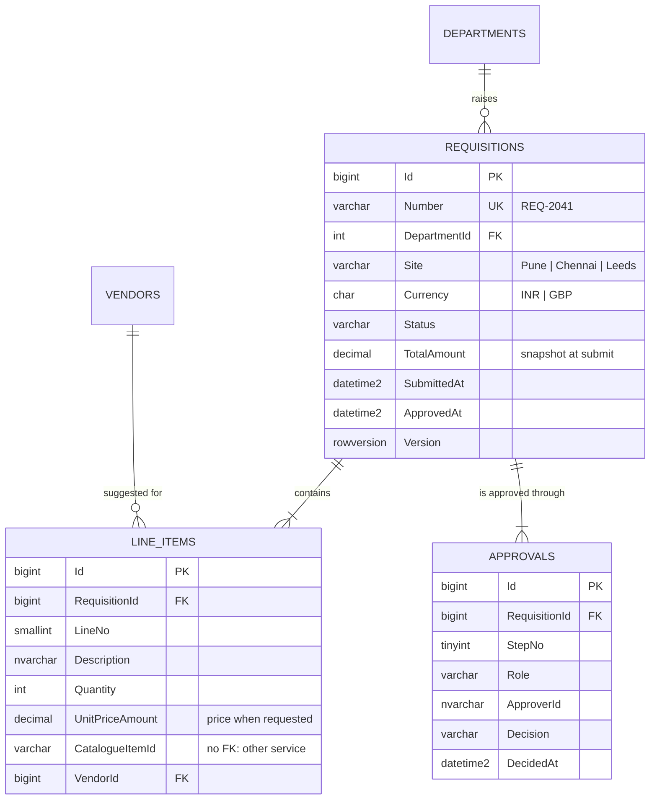

# Lecture Script: Data Layer: SQL Server and Data Access

> **Instructor reference.** Phase 2: Decide and build (Focus area 2), Module 8 | Duration: 5 hours (2 h concepts and demos, 3 h hands-on), run as Day 12 (4 h, Segments 1–10) and Day 13 (1 h, Segments 11–12) | Previous script: [Module 7 — Backend Implementation: C#, .NET and REST APIs](Module-07-Backend-Implementation-CSharp-REST-APIs.md)

## Session overview

**Goal.** Learners give ProcureFlow a production data layer: a reviewed schema per service with audit tables, EF Core configurations, repositories and migrations, 10,000 seeded requisitions, optimistic concurrency that stops two approvers overwriting each other, and a spend query tuned with evidence from the execution plan (Capstone increment CI-8).

**Learner profile at this point.** Learners have the domain model and glossary (Module 1), stories and NFRs including NFR-AUD-01 (Module 2), a guarded repo whose starter kit runs SQL Server in a container (Module 3), ADR-0005 choosing Azure SQL Database with archive storage for old audit records (Module 4), the platform and dependency guardrails (Module 5), the screens and BFF (Module 6), and Module 7's domain model (`Requisition`, `LineItem`, `Vendor`, `Approval`), the Catalogue service with its own schema, and the Request API's idempotency records. So far their persistence has been the starter kit's or whatever EF Core produced by default. Today introduces the first genuinely new idea of the data layer: **data outlives code: its shape, its history and its speed are designed and proven, not left to the ORM's defaults.**

**Key outcome.** Every learner can draw an ER model from an aggregate, choose keys and normalise to third normal form (and say where they deliberately didn't), split data per service; write joins, grouping, CTEs and window functions; choose indexes, transactions and isolation levels; use `rowversion` for optimistic concurrency; configure EF Core, spot and fix an N+1 problem, and ship migrations as bundles; choose EF Core or Dapper for a query; read an execution plan, use Query Store and recognise parameter sniffing; and design append-only audit tables with a retention and archive plan.

**Case for this session.** ProcureFlow at Meridian Components, continued. Volumes from Module 1: 3,000 requisitions a month; 1,200 requesters and 150 approvers; Pune, Chennai and Leeds; +30% growth. Seed data is **10,000 requisitions** (about three months at today's volume). Eight years of data would be about 288,000 requisitions (3,000 × 12 × 8), so the tuning lab also offers an instructor-prepared eight-year database. **Audit retention is 8 years** for Meridian (NFR-AUD-01, Module 2). The program syllabus quotes a generic 7-year requirement; ProcureFlow follows its own client's NFR, and learners should notice that the client's figure wins. The **spend report** is new today: Priya's finance controllers want approved spend by department and vendor, per month. That needs a **department** on each requisition, recorded at submission. Log it in the RAID log as an assumption: departments come from Meridian's directory, and for now they're seeded. The trainer plays the tech lead, with one message from Meridian's internal auditor in the opening.

**Note on tool versions.** SQL Server 2022 or later in the starter kit's container (Developer edition: for development only, not production), and Azure SQL Database in the cloud environments. EF Core 8 or later, Dapper, Bogus and `Microsoft.Data.SqlClient`. For plans, use SQL Server Management Studio, or the MSSQL extension for VS Code if your version shows actual execution plans. (Azure Data Studio was retired in 2026; check the current recommendation.) **Azure SQL Database turns on Read Committed Snapshot Isolation (RCSI) by default; a fresh SQL Server container doesn't.** Make local match the cloud (Segment 7). Check `--help` and docs for every tool on the day.

**Note on licences.** Every new package goes through the Module 5 package gate. At the time of writing, Dapper is Apache-2.0 and Bogus is MIT. The SQL Server container image has its own licence terms: Developer edition is free for development and test only. Re-check on the day.

**Note on AI output.** AI-generated schemas, seed scripts and tuning advice vary run to run; examples are marked **illustrative**. Timings, logical reads and plan shapes depend on the machine and data, so all measured output in this script is also illustrative.

## Timing breakdown

| Segment | Duration | Cumulative | Kind |
| --- | --- | --- | --- |
| SEGMENT 1: Opening — Relational Design and Database per Service | 20 min | 0:20 | Concept + demo |
| SEGMENT 2: SQL Essentials | 15 min | 0:35 | Concept + demo |
| SEGMENT 3: Audit Tables, Retention and Archiving | 10 min | 0:45 | Concept + demo |
| SEGMENT 4: Lab 1 — Schema per Service, With Audit Tables | 50 min | 1:35 | Hands-on |
| **BREAK** | 10 min | — |  |
| SEGMENT 5: EF Core in Practice | 20 min | 1:55 | Concept + demo |
| SEGMENT 6: Lab 2 — Repositories, Migrations and 10,000 Seeded Requisitions | 50 min | 2:45 | Hands-on |
| **BREAK** | 10 min | — |  |
| SEGMENT 7: Indexes, Transactions, Isolation and Rowversion | 20 min | 3:05 | Concept + demo |
| SEGMENT 8: Lab 3 — Two Approvers, One Requisition | 30 min | 3:35 | Hands-on |
| SEGMENT 9: Dapper for Reporting | 10 min | 3:45 | Concept + demo |
| SEGMENT 10: Query Optimisation | 15 min | 4:00 | Concept + demo |
| **END OF DAY 12** | — | — |  |
| SEGMENT 11: Lab 4 — Tune the Spend Query | 35 min | 4:35 | Hands-on |
| SEGMENT 12: CI-8 Review and Wrap-Up | 25 min | 5:00 | Hands-on + close |

Concepts and demos: 20 + 15 + 10 + 20 + 20 + 10 + 15 + 10 (close) = 120 min (40%). Labs and CI-8 review: 50 + 50 + 30 + 35 + 15 = 180 min (60%). Total 300 min = 5 h, matching the module's 2 h / 3 h split. Day 12: Segments 1–10 = 240 min; Day 13: Segments 11–12 = 60 min. Breaks are not counted.

## SEGMENT 1: Opening — Relational Design and Database per Service (20 min)

### The Hook (6 min)

**Show one slide: "Month-end, the data edition".**

> 1. The finance controller's **spend report** for March took 40 seconds, then timed out.
> 2. Its totals **didn't match SAP**: it priced old requisitions with *today's* catalogue prices.
> 3. **REQ-2155**: the line manager and her delegate both approved the same step within a second. The audit shows two approvals for one step.
> 4. The approvals dashboard runs **51 database queries** to show 50 requisitions.
> 5. Someone added a column by hand in the test database. The production deploy failed at 11 p.m.
> 6. Meridian's internal auditor: *"Show me every change to REQ-2096 since January, and prove nobody has edited that history."*

**Say:** *"Six problems, one root: we let the database happen to us. EF Core created whatever tables it liked, and we never looked."*

**Ask:** *"Which of these would you fix in C#, and which can only be fixed in the database's design?"*

**Do:** Take 4–5 answers.

**Respond to likely answers:**

- *"Number 2: use the price from the requisition."* → *"Right. So the line must store the price it was requested at. Is that duplication, or a fact?"*
- *"Number 3: check in code that the step isn't decided."* → *"Module 7's aggregate does. Both approvers loaded it before either saved. What does the code see?"*
- *"Number 6: we have logs."* → *"Logs are kept 90 days and anyone with access can delete them. The auditor wants eight years and proof."*
- *"Number 1: add an index."* → *"Which one? And how will you prove it helped?"*

**Write on board, large, and leave it up all day:**

> **Design for the truth, guard every write, prove every read.**

### Relational Design in Six Minutes (6 min)

**Say:** *"Four ideas carry most of relational design."*

| Idea | Means | ProcureFlow example |
| --- | --- | --- |
| ER model | Entities, their attributes, and how they relate (one-to-many, many-to-many) | A requisition has many lines and many approval steps |
| Keys | **Primary key**: identifies a row. **Foreign key**: points to another table's row. **Natural vs surrogate**: a business value or a generated one | `Id bigint` (surrogate, clustered) plus `Number 'REQ-2041'` (unique, shown to users) |
| Normalisation | Each fact stored once: no repeating groups (1NF); every column depends on the whole key (2NF) and on nothing but the key (3NF) | Department name lives in `org.Departments`, not copied onto every requisition |
| Deliberate exceptions | Storing something "twice" because it's a different fact | The line's unit price **at the time of request**; the requisition's total, safe because lines can't change after submit (Module 7 invariant) |

**Say:** *"Complaint 2 isn't a normalisation failure; it's a missing fact. 'The catalogue price today' and 'the price this requester asked for in March' are different facts. Store both."*

### Live Demo: From Aggregate to Tables (4 min)

**Say:** *"Module 7's aggregate, drawn as tables. One aggregate root, one table; its children, one table each, pointing at the root."*



**Say:** *"Point at `CatalogueItemId`: a plain column, no foreign key. The catalogue is another service's database since Module 7. Which brings us to the last idea."*

### Database per Service (2 min)

**Say:** *"Each service owns its data, and no other service reads its tables. The Catalogue service has its own database. The Request API, our modular monolith, has one database with **one schema per module**: `req`, `sup`, `org`, plus `ops` for idempotency records and `audit`. If another service needs Catalogue data, it calls the Catalogue's API (Module 7), or keeps a snapshot, like the line's description and price."*

### Comprehension Check (2 min)

1. *"Is `TotalAmount` on the requisition a normalisation violation?"* (It's derived, but safe: lines can't change after submit, so the total can't go stale. Document it.)
2. *"Why no foreign key from `LineItems.CatalogueItemId` to the catalogue table?"* (It's in another service's database; database per service means no cross-database constraints.)

**Common misconception:** "normalised means never storing anything twice." (Snapshots of historical facts, like a requested price, are different facts, not duplicates.)

**Re-teach trigger:** if learners can't explain complaint 2, ask: *"If the catalogue price changes tomorrow, what should last March's requisition say it cost?"*

**Transition — Say:** *"Tables are only useful if you can ask them questions. Four SQL tools answer most of ProcureFlow's."*

## SEGMENT 2: SQL Essentials (15 min)

### Four Tools (3 min)

| Tool | Answers | ProcureFlow question |
| --- | --- | --- |
| Joins | "Combine rows from related tables" | Requisitions with their department and lines |
| Grouping (`GROUP BY`, `HAVING`) | "Totals per something" | Approved spend per department |
| CTEs (`WITH … AS`) | "Name a step so the query reads top to bottom" | Monthly spend first, then compare months |
| Window functions (`OVER`) | "Compare a row with its neighbours without collapsing rows" | Running total; change from last month; rank of each department |

### Live Demo: Three Queries (9 min)

**1. Join and group (3 min):**

```sql
SELECT d.Name AS Department, r.Currency, SUM(r.TotalAmount) AS ApprovedSpend, COUNT(*) AS Requisitions
FROM req.Requisitions AS r
JOIN org.Departments AS d ON d.Id = r.DepartmentId
WHERE r.Status = 'Approved'
GROUP BY d.Name, r.Currency
HAVING SUM(r.TotalAmount) > 0
ORDER BY d.Name, r.Currency;
```

**Say:** *"Notice `Currency` in the `GROUP BY`. Never add rupees to pounds. Every money total in ProcureFlow is per currency."*

**2. A window function replaces Module 3's bug fix (3 min).** *"Remember Module 3's Bug 1: requisitions above ₹50,000 appeared twice in the list, and the fix used `OUTER APPLY (SELECT TOP 1 …)`. Here's the same idea with a window function:"*

```sql
WITH ranked AS (
    SELECT a.RequisitionId, a.Role, a.Decision, a.DecidedAt,
           ROW_NUMBER() OVER (PARTITION BY a.RequisitionId ORDER BY a.StepNo DESC) AS rn
    FROM req.Approvals AS a
    WHERE a.Decision IS NOT NULL
)
SELECT r.Number, ranked.Role AS LastDecisionBy, ranked.Decision, ranked.DecidedAt
FROM req.Requisitions AS r
JOIN ranked ON ranked.RequisitionId = r.Id AND ranked.rn = 1;
```

**3. A CTE plus running totals and month-on-month change (3 min):**

```sql
WITH monthly AS (
    SELECT r.DepartmentId, r.Currency,
           DATEFROMPARTS(YEAR(r.ApprovedAt), MONTH(r.ApprovedAt), 1) AS MonthStart,
           SUM(r.TotalAmount) AS Spend
    FROM req.Requisitions AS r
    WHERE r.Status = 'Approved'
    GROUP BY r.DepartmentId, r.Currency, DATEFROMPARTS(YEAR(r.ApprovedAt), MONTH(r.ApprovedAt), 1)
)
SELECT d.Name, m.Currency, m.MonthStart, m.Spend,
       SUM(m.Spend) OVER (PARTITION BY m.DepartmentId, m.Currency ORDER BY m.MonthStart
                          ROWS UNBOUNDED PRECEDING)                                   AS RunningSpend,
       m.Spend - LAG(m.Spend) OVER (PARTITION BY m.DepartmentId, m.Currency ORDER BY m.MonthStart) AS ChangeFromLastMonth,
       RANK() OVER (PARTITION BY m.MonthStart, m.Currency ORDER BY m.Spend DESC)      AS RankInMonth
FROM monthly AS m
JOIN org.Departments AS d ON d.Id = m.DepartmentId
ORDER BY d.Name, m.MonthStart;
```

**Say:** *"`GROUP BY` collapses rows into one per group. A window function keeps every row and adds a calculation across its 'window'. That's why the running total and the rank can sit next to each month's spend. Priya's finance team will ask for exactly this report."*

### Comprehension Check (3 min)

1. *"Approved spend per vendor, but only vendors above ₹10 lakh: `WHERE` or `HAVING`?"* (`HAVING`: it filters groups after the sum.)
2. *"What does `LAG` return for a department's first month?"* (`NULL`: there's no previous row.)
3. *"Why must every spend query group by currency?"* (Pune and Chennai spend rupees; Leeds spends pounds. Adding them gives a meaningless number.)

**Common misconception:** "window functions are just `GROUP BY` with extra steps." (They don't collapse rows; you get the detail and the calculation together.)

**Re-teach trigger:** if learners confuse `ROW_NUMBER` and `RANK`, run both on two departments with equal spend and compare the output.

**Transition — Say:** *"One table today doesn't serve a query at all. It serves the auditor, for eight years."*

## SEGMENT 3: Audit Tables, Retention and Archiving (10 min)

### Audit Is Not Logging (3 min)

**Ask:** *"Complaint 6: the auditor wants every change to REQ-2096, with proof. Why don't application logs answer that?"*

| | Application logs (`LOGGING.md`, Module 3) | Audit records (NFR-AUD-01) |
| --- | --- | --- |
| Purpose | Diagnose problems | Prove who did what, when, to which business record |
| Kept | 90 days | **8 years** (Meridian; the program's generic figure is 7) |
| Editable? | Rotated and deleted routinely | Never: append-only |
| Written | Best effort | **In the same transaction** as the change; no change without its audit record |
| Contains | Technical events, correlation IDs | Business actions: submitted, approved, rejected, withdrawn |

### Live Demo: An Append-Only Audit Table (4 min)

```sql
CREATE TABLE audit.AuditEntries (
    Id            bigint IDENTITY PRIMARY KEY,
    OccurredAt    datetime2(3)  NOT NULL,        -- UTC
    ActorId       nvarchar(64)  NOT NULL,        -- directory object ID, not a name or email
    Action        varchar(50)   NOT NULL,        -- 'RequisitionApproved', …
    EntityType    varchar(50)   NOT NULL,        -- 'Requisition'
    EntityKey     varchar(50)   NOT NULL,        -- 'REQ-2096'
    CorrelationId varchar(64)   NULL,            -- links to logs (Module 5)
    DataJson      nvarchar(max) NULL             -- what changed; never bank details (NFR-SEC-03)
);
CREATE INDEX IX_AuditEntries_Entity ON audit.AuditEntries (EntityType, EntityKey, OccurredAt);

-- The application's database user can add audit rows, never change them
DENY UPDATE, DELETE ON SCHEMA::audit TO procureflow_app;
```

**Do:** As `procureflow_app`, try `UPDATE audit.AuditEntries SET Action = 'X' WHERE Id = 1;`. Show the permission error.

**Say:** *"That's 'not editable' in NFR-AUD-01, enforced by the database, not by good intentions. Two stronger options to know: **temporal tables** keep every version of a row automatically, which answers 'what did REQ-2096 look like on 3 March?'; and **ledger tables** in Azure SQL and SQL Server 2022 or later add cryptographic tamper-evidence for 'prove nobody edited it'. Both have limits; check the docs before choosing."*

### Retention and Archiving (2 min)

**Say:** *"Eight years in the live database makes it bigger, slower to back up and costlier, for data almost nobody reads. ADR-0005 already decided: archive old audit records to storage. The MVP: keep a recent window in SQL (a teaching choice; confirm the window with Priya and the auditor), export older rows on a schedule to Azure Blob Storage with an immutability (time-based retention) policy until year 8, then delete them from SQL in small batches. At larger scale, partition the table by month and switch old partitions out. The scheduled job itself is built with a timer trigger in Module 10."*

### Comprehension Check (1 min)

*"The approval succeeds but the audit insert fails. What should the user see?"* (A failure: both are in one transaction, so the approval rolls back too. No change without its audit record.)

**Common misconception:** "audit = turn on verbose logging." (Logs are short-lived and editable; audit is a business record with its own retention and protection.)

**Re-teach trigger:** if learners put audit writes in a background job "for speed", ask: *"If the job crashes, which approvals have no audit? Can you prove it to the auditor?"*

**Transition — Say:** *"Now design both schemas, with AI drafting and a partner reviewing."*

## SEGMENT 4: Lab 1 — Schema per Service, With Audit Tables (50 min)

**Say:** *"Design the production schema for the Request API database and the Catalogue database. Let the AI draft it from your Module 7 domain model, then make it right: keys, types, constraints, indexes on foreign keys, schemas per module, and audit tables. Then swap with another pair and review theirs line by line."*

### Instructions (read aloud, step by step)

1. **AI draft (10 min).** Give the AI the prompt below with your Module 7 domain classes and the Catalogue contract. Save the output to `docs/data/schema-draft.sql`. It's a draft for review; the real schema will come from EF Core migrations in Lab 2.
2. **Fix the draft (15 min).** Work through the review checklist below. Draw the result as a Mermaid `erDiagram` in `docs/data/schema.md`.
3. **Audit tables (10 min).** Add `audit.AuditEntries` (Segment 3) and the `DENY` for the application user. List which actions get audited: at least submitted, approved, rejected, withdrawn, and catalogue price changed (Catalogue database).
4. **Pair review (12 min).** Swap with the pair to your left. Review their `schema.md` against the checklist. Leave comments as a PR review. Fix what they found.
5. **Record decisions (3 min).** In `docs/data/schema.md`, list each deliberate denormalisation and why it's safe.

### The AI Prompt (give to learners)

```
From these C# domain classes (Module 7) and the Catalogue OpenAPI contract, draft SQL
Server DDL for two databases: the Request API (schemas req, sup, org, ops, audit) and the
Catalogue service (schema cat). Rules: bigint IDENTITY surrogate keys plus a unique business
number where users see one; decimal(18,2) for money with a separate currency column;
datetime2 in UTC; CHECK constraints for statuses and positive quantities; an index on every
foreign key; no foreign keys across databases; snapshot the description and unit price on
each line; a rowversion column on each aggregate root; an append-only audit table.
Use glossary names. List every assumption you made.
```

### Review Checklist

| Check | Pass if |
| --- | --- |
| Keys | Every table has a primary key; business numbers (`REQ-…`, `CAT-…`) are unique |
| Types | Money is `decimal(18,2)` plus currency; dates are `datetime2` UTC or `date`; no `float` |
| Constraints | `NOT NULL` where required; `CHECK` on status, quantity > 0, price ≥ 0 |
| Foreign keys indexed | SQL Server doesn't index foreign keys automatically; each has an index |
| Database per service | No cross-database foreign keys; catalogue data in requisitions is a snapshot |
| Sensitive data | Vendor bank details in their own table (`sup.VendorBankDetails`) so permissions can be tighter (NFR-SEC-03) |
| Personal data | Actor and requester columns hold directory IDs, not names or emails |
| Audit | Append-only table; `DENY UPDATE, DELETE` for the app user; written in the same transaction |
| Concurrency | `rowversion` on `Requisitions` and `CatalogueItems` |

### What the AI Draft Typically Gets Wrong (show learners)

| AI draft does this (illustrative — varies by run) | Fix |
| --- | --- |
| `Amount float` | `decimal(18,2)` plus `Currency char(3)` |
| `uniqueidentifier` primary keys with `NEWID()` as the clustered key | `bigint IDENTITY` clustered; random GUIDs fragment the clustered index |
| Foreign key from `LineItems` to the Catalogue's table | No cross-database FK; snapshot instead |
| No indexes on foreign keys | Add them |
| `Status nvarchar(max)` | `varchar(20)` with a `CHECK` constraint |
| Audit table with `UpdatedBy`, `UpdatedAt` columns | Audit rows are never updated; remove them, and deny updates |
| Requester name and email stored on every requisition | Directory ID only; names come from the directory |

### Reference Solution (instructor, partial)

```sql
CREATE TABLE req.Requisitions (
    Id             bigint IDENTITY CONSTRAINT PK_Requisitions PRIMARY KEY,
    Number         varchar(12)    NOT NULL CONSTRAINT UQ_Requisitions_Number UNIQUE,
    RequesterId    nvarchar(64)   NOT NULL,
    DepartmentId   int            NOT NULL CONSTRAINT FK_Requisitions_Departments REFERENCES org.Departments (Id),
    Site           varchar(10)    NOT NULL CONSTRAINT CK_Requisitions_Site CHECK (Site IN ('Pune', 'Chennai', 'Leeds')),
    Currency       char(3)        NOT NULL CONSTRAINT CK_Requisitions_Currency CHECK (Currency IN ('INR', 'GBP')),
    Justification  nvarchar(1000) NOT NULL,
    NeededBy       date           NOT NULL,
    Status         varchar(20)    NOT NULL CONSTRAINT CK_Requisitions_Status
                                  CHECK (Status IN ('AwaitingApproval', 'Approved', 'Rejected', 'Withdrawn')),
    TotalAmount    decimal(18,2)  NOT NULL,
    SubmittedAt    datetime2(3)   NOT NULL,
    ApprovedAt     datetime2(3)   NULL,
    UpdatedAt      datetime2(3)   NOT NULL,
    Version        rowversion     NOT NULL
);
CREATE INDEX IX_Requisitions_DepartmentId ON req.Requisitions (DepartmentId);

CREATE TABLE req.LineItems (
    Id              bigint IDENTITY CONSTRAINT PK_LineItems PRIMARY KEY,
    RequisitionId   bigint        NOT NULL CONSTRAINT FK_LineItems_Requisitions REFERENCES req.Requisitions (Id),
    LineNo          smallint      NOT NULL,
    Description     nvarchar(200) NOT NULL,
    Quantity        int           NOT NULL CONSTRAINT CK_LineItems_Quantity CHECK (Quantity > 0),
    UnitPriceAmount decimal(18,2) NOT NULL CONSTRAINT CK_LineItems_Price CHECK (UnitPriceAmount >= 0),
    CatalogueItemId varchar(20)   NULL,     -- snapshot reference; Catalogue is another service
    VendorId        bigint        NULL CONSTRAINT FK_LineItems_Vendors REFERENCES sup.Vendors (Id),
    CONSTRAINT UQ_LineItems_Line UNIQUE (RequisitionId, LineNo)
);
CREATE INDEX IX_LineItems_VendorId ON req.LineItems (VendorId);
-- RequisitionId is already the leading column of UQ_LineItems_Line, which serves as its index
```

**Say:** *"Two notes for the room. `Currency` can be worked out from `Site`, so strictly it breaks third normal form. We keep it because every spend query groups by it, and the CHECK constraints stop nonsense. That's a deliberate, documented exception. And the status list will grow: Module 9 adds `Draft` for requisitions saved but not submitted. Changing a CHECK constraint is a migration, which is exactly what Lab 2 sets up."*

### Instructor Circulates

- **Schema accepted from the AI unread:** *"Show me the checklist row this table passed."*
- **One database for everything, including the Catalogue:** database per service; the Catalogue has its own.
- **`nvarchar(max)` everywhere:** size columns for what they hold; `max` columns can't be index keys.
- **Audit written by a trigger that the app user can disable:** triggers are an option, but the `DENY` and the same-transaction rule still apply; check who can alter them.
- **Review comments like "looks good":** each reviewer must name at least one checklist failure or state that all rows pass.

**Success check:** `docs/data/schema.md` with an ER diagram for both databases; every checklist row passes; audit table with `DENY` and a list of audited actions; at least two review comments addressed; denormalisations documented.

**Extension (fast teams):** make `req.Requisitions` a system-versioned temporal table with a history retention period, and write the query that shows REQ-2096 as it was on 3 March.

### BREAK (10 min)

*Suggested break prompt:* *"Your dashboard shows 50 requisitions with their line counts. Guess how many SQL queries EF Core runs to draw it. We'll count after the break."*

## SEGMENT 5: EF Core in Practice (20 min)

### DbContext and Configuration (5 min)

**Say:** *"`DbContext` is a unit of work: it tracks the objects you load, and `SaveChanges` writes every change in one transaction. Keep it scoped, one per request (Module 7's lifetimes). Configure each entity in its own class, in Infrastructure, so the domain stays free of EF attributes."*

```csharp
// api/src/Requisitioning/Infrastructure/RequisitionConfiguration.cs
public sealed class RequisitionConfiguration : IEntityTypeConfiguration<Requisition>
{
    public void Configure(EntityTypeBuilder<Requisition> b)
    {
        b.ToTable("Requisitions", "req");
        b.Property<long>("DbId").HasColumnName("Id");               // shadow surrogate key (bigint IDENTITY)
        b.HasKey("DbId");
        b.Property(r => r.Id).HasColumnName("Number").HasMaxLength(12) // domain identity: REQ-2041
            .HasConversion(id => id.Value, value => new RequisitionId(value));
        b.HasIndex(r => r.Id).IsUnique();
        b.Property(r => r.Status).HasConversion<string>().HasMaxLength(20);
        b.Property(r => r.Site).HasConversion(s => s.Name, n => Site.FromName(n)).HasMaxLength(10);
        b.Property<byte[]>("Version").IsRowVersion();               // shadow concurrency token (Segment 7)
        b.HasMany(r => r.Lines).WithOne().HasForeignKey("RequisitionId");
        b.HasMany(r => r.Approvals).WithOne().HasForeignKey("RequisitionId");
        b.Navigation(r => r.Lines).UsePropertyAccessMode(PropertyAccessMode.Field); // private List<LineItem> _lines
    }
}
```

**Say:** *"Shadow properties (`DbId`, `Version`) exist in the database and in EF, but not on the domain class. The domain keeps its business identity, `REQ-2041`; the database keeps a narrow clustered key. Mapping value objects like `Money` with two columns uses EF Core's complex types or owned types; check which your EF version supports for structs."*

### Change Tracking (3 min)

**Say:** *"Tracked queries remember every entity they load so `SaveChanges` can find changes. That's what you want when you load an aggregate to change it. For read-only screens, it's wasted memory and CPU."*

```csharp
var requisition = await db.Requisitions.Include(r => r.Lines).Include(r => r.Approvals)
                          .SingleAsync(r => r.Id == id, ct);                  // tracked: we'll change it
var list = await db.Requisitions.AsNoTracking().Where(…).Select(…).ToListAsync(ct); // read-only: projection
```

**Do:** Show `db.ChangeTracker.DebugView.LongView` after an `Approve` call: one `Approval` modified, the `Requisition` modified.

### Live Demo: The N+1 Problem (6 min)

**Say:** *"Complaint 4. Turn on EF Core's SQL logging and count."*

```csharp
// WRONG: one query for the list, then one per requisition
var requisitions = await db.Requisitions.AsNoTracking().Where(r => r.Status == RequisitionStatus.AwaitingApproval)
                           .OrderBy(r => r.SubmittedAt).Take(50).ToListAsync(ct);
var rows = new List<DashboardRow>();
foreach (var r in requisitions)
{
    var lineCount = await db.LineItems.CountAsync(l => EF.Property<long>(l, "RequisitionId") == EF.Property<long>(r, "DbId"), ct);
    rows.Add(new DashboardRow(r.Id, r.Status, lineCount));
}
```

**Example output (illustrative — log format varies by EF Core version):** 51 `Executed DbCommand` entries for one page.

```csharp
// RIGHT: one query, shaped for the screen
var rows = await db.Requisitions.AsNoTracking()
    .Where(r => r.Status == RequisitionStatus.AwaitingApproval)
    .OrderBy(r => r.SubmittedAt).Take(50)
    .Select(r => new DashboardRow(r.Id, r.Status, r.Lines.Count))
    .ToListAsync(ct);
```

**Say:** *"One query. N+1 hides in three places: loops that query, lazy loading (off by default in EF Core, so leave it off), and loops that call another service per item, which is the same bug over HTTP. The opposite trap is loading a big aggregate with several `Include`s, which multiplies rows; `AsSplitQuery()` sends one query per collection instead."*

### Migrations and Bundles (4 min)

```bash
dotnet tool install --global dotnet-ef          # pin the version in a tool manifest in practice
dotnet ef migrations add InitialSchema --project api/src/ProcureFlow.Infrastructure --startup-project api/src/ProcureFlow.Api
dotnet ef migrations script --idempotent -o artifacts/migrate.sql   # for review in the PR
dotnet ef migrations bundle --self-contained -r linux-x64 -o artifacts/efbundle
./artifacts/efbundle --connection "$PROCUREFLOW_DB"                 # run by the pipeline before the app deploys
```

**Say:** *"Complaint 5 dies here. Every schema change is a migration in the repo, reviewed in the PR as SQL, and applied by the pipeline: the same migrations to dev, test and production, in order. A **migration bundle** is a single executable containing the migrations, so the deploy job needs no .NET SDK and no source code. Don't call `Database.Migrate()` at app startup in production: two instances starting together will race, and the app's identity would need permission to change the schema. And read every generated migration: when EF Core prints 'An operation was scaffolded that may result in the loss of data', a rename may have become a drop and an add."*

### Comprehension Check (2 min)

1. *"Why `AsNoTracking` on the dashboard query?"* (Read-only data; tracking costs memory and CPU for nothing.)
2. *"What does the pipeline run before deploying the new API version?"* (The migration bundle, against that environment's database, with a migration identity, not the app's.)

**Common misconception:** "EF Core writes good SQL, so we don't need to look at it." (It writes the SQL you asked for, including 51 queries; log it and read it.)

**Re-teach trigger:** if learners can't spot the N+1, turn on logging for their own dashboard query and count `Executed DbCommand` lines together.

**Transition — Say:** *"Build the repositories and migrations, then fill the database with 10,000 realistic requisitions."*

## SEGMENT 6: Lab 2 — Repositories, Migrations and 10,000 Seeded Requisitions (50 min)

**Say:** *"Turn Lab 1's schema into EF Core configurations and migrations, write the repository for the requisition aggregate and the query service for screens, and seed 10,000 requisitions with Bogus. The AI drafts the seed script; you make sure every seeded requisition obeys the domain rules."*

### Instructions (read aloud, step by step)

1. **Configurations (15 min).** One `IEntityTypeConfiguration<T>` per entity, matching `docs/data/schema.md`: schemas, keys, conversions, lengths, `CHECK` constraints (`ToTable(t => t.HasCheckConstraint(…))`), indexes, the `Version` rowversion. Do the same in the Catalogue service. Module 7's aggregate gains four persisted properties today: `DepartmentId` (passed to `Requisition.Submit`), `TotalAmount` (stored at submit; safe because lines can't change), `Currency` (from the site) and `ApprovedAt` (set when the last step is approved). `UpdatedAt` arrives in Lab 3.
2. **Repository and queries (8 min).** `RequisitionRepository : IRequisitionRepository` (Module 5's port): `GetAsync(id)` loads the whole aggregate tracked; `AddAsync`; saving is `SaveChangesAsync`. Screen queries live in `RequisitionQueries` with `AsNoTracking` projections (Module 7). No generic `Repository<T>`.
3. **Migrations and bundle (8 min).** `InitialSchema` migration for each database. Generate the idempotent script and read it. Add a CI job that builds the bundle as an artefact, and a deploy step that runs it against dev before the app deploys.
4. **Seed with Bogus, AI-assisted (14 min).** Use the AI prompt below. Seed through the domain: create requisitions with `Requisition.Submit` and approve them with `Approve`, so every row obeys Module 7's invariants. Write the matching audit rows. Use a fixed random seed so every team's data is identical.
5. **N+1 check (5 min).** Write an integration test that runs the approvals-dashboard query and asserts it issues exactly one SQL command (count with a `DbCommandInterceptor`).

### The AI Prompt (give to learners)

```
Write a C# seeder for ProcureFlow using Bogus with a fixed seed (8). Create 10,000
requisitions through the domain factory Requisition.Submit(...) and the Approve/Reject/
Withdraw methods (code attached), never by setting properties directly.
Distribution (teaching data): sites Pune 55%, Chennai 35%, Leeds 10%; 1–5 lines each;
most totals under ₹50,000, about 20% between ₹50,000 and ₹5 lakh, about 5% above;
submitted over the last 12 months; requesters drawn from 1,200 IDs, approvers from 150;
about 70% approved, 10% rejected, 5% withdrawn, 15% awaiting approval.
Insert in batches of 1,000, clearing the change tracker between batches.
Write one audit entry per action. Explain how you guarantee every requisition is valid.
```

### Starter: Seeder Skeleton

```csharp
// tools/ProcureFlow.Seed/Program.cs (excerpt)
var faker = new Faker { Random = new Randomizer(8) };          // same data for every team
var sites = new[] { (Site.Pune, 0.55f), (Site.Chennai, 0.35f), (Site.Leeds, 0.10f) };

for (var batch = 0; batch < 10; batch++)
{
    for (var i = 0; i < 1_000; i++)
    {
        var site = faker.Random.WeightedRandom(sites.Select(s => s.Item1).ToArray(), sites.Select(s => s.Item2).ToArray());
        var lines = Enumerable.Range(0, faker.Random.Int(1, 5)).Select(_ => FakeLine(faker, site)).ToList();
        var submitted = Requisition.Submit(faker.PickRandom(requesterIds), faker.PickRandom(departmentIds),
                                           site, lines, routingFactory.For(site));
        // TODO: drive Approve / Reject / Withdraw by the status mix, using a fake TimeProvider for dates
        db.Add(submitted.Value!);
    }
    await db.SaveChangesAsync();
    db.ChangeTracker.Clear();
}
```

**Example output (illustrative — timing depends on the machine):**

```
Seeded 10,000 requisitions, 29,9xx lines, 16,4xx approval steps, 3x,xxx audit entries in 41 s
```

### Reference Solution (instructor): Verify the Seed

```sql
SELECT Site, Status, COUNT(*) AS Requisitions
FROM req.Requisitions GROUP BY Site, Status ORDER BY Site, Status;

-- Every requisition above ₹5 lakh must have a CFO step (PF-012)
SELECT COUNT(*) AS MissingCfoStep
FROM req.Requisitions AS r
WHERE r.Currency = 'INR' AND r.TotalAmount > 500000
  AND NOT EXISTS (SELECT 1 FROM req.Approvals a WHERE a.RequisitionId = r.Id AND a.Role = 'Cfo');
```

**Say:** *"The second query must return 0. If the AI's seeder set statuses directly instead of calling `Approve`, you'll find approved requisitions with no approvals and big ones with no CFO. Seed data that breaks your own rules makes every later test lie."*

### Instructor Circulates

- **Seeder sets `Status = Approved` directly:** call the domain methods; that's how the data stays valid.
- **`Random` without a seed:** teams get different data and different tuning results; use the fixed seed.
- **One `SaveChanges` for 10,000 aggregates:** batch and clear the tracker, or memory balloons.
- **Migration with `nvarchar(max)` everywhere:** lengths weren't configured; check against `schema.md`.
- **`Database.Migrate()` in `Program.cs`:** move it to the pipeline's bundle step.
- **Generic repository wrapping `DbSet`:** repositories are per aggregate; queries use projections.

**Success check:** both databases created only from migrations; bundle built in CI; 10,000 requisitions seeded deterministically, with the verification queries returning the expected mix and 0 missing CFO steps; the dashboard query issues one SQL command.

**Extension (fast teams):** add a seeding option for eight years of data (about 288,000 requisitions) and time it; compare with the instructor's prepared backup.

### BREAK (10 min)

*Suggested break prompt:* *"REQ-2155: two approvers clicked Approve within a second. Draw what each one's DbContext saw, step by step."*

## SEGMENT 7: Indexes, Transactions, Isolation and Rowversion (20 min)

### Indexes (6 min)

**Say:** *"An index is a sorted copy of some columns that lets SQL Server find rows without reading the whole table. Every index speeds some reads and slows every write to that table. Five rules."*

| Rule | Why | ProcureFlow example |
| --- | --- | --- |
| Narrow, ever-increasing clustered key | The clustered index *is* the table; every other index carries its key | `Id bigint IDENTITY` |
| Index every foreign key | SQL Server doesn't do it for you; joins and deletes scan without one | `IX_LineItems_VendorId` |
| Equality columns first, then range | The index is sorted left to right | `(Status, Site, ApprovedAt)` for "approved, Pune, in March" |
| `INCLUDE` to cover a query | The query finds everything in the index; no lookups into the table | `INCLUDE (DepartmentId, Currency)` |
| Filtered index for a small hot subset | Smaller, cheaper to maintain | Approval steps `WHERE Decision IS NULL` (the approvers' queue) |

### Transactions and Isolation Levels (6 min)

**Say:** *"A transaction makes several changes all-or-nothing. `SaveChanges` already wraps its changes in one. Isolation levels decide what one transaction can see of another's work."*

| Level | Prevents | Allows | Notes |
| --- | --- | --- | --- |
| Read uncommitted (`NOLOCK`) | Nothing | Dirty reads | Never for financial data |
| Read committed | Dirty reads | Non-repeatable reads, phantoms | SQL Server default |
| Read committed snapshot (RCSI) | Dirty reads, readers blocking writers | Same as read committed | **On by default in Azure SQL Database**; off in a fresh SQL Server container |
| Repeatable read | + non-repeatable reads | Phantoms | More locking |
| Snapshot | Reads a consistent snapshot for the whole transaction | Update conflicts are detected | Needs enabling |
| Serializable | Everything | Nothing | Most blocking; rarely needed here |

**Say:** *"Make local match the cloud: `ALTER DATABASE ProcureFlow SET READ_COMMITTED_SNAPSHOT ON;` in the container's setup script. Otherwise blocking you see locally won't happen in Azure, and the reverse."*

**Say:** *"None of these levels stops complaint 3. Both approvers read the requisition, both see the step undecided, both save. That's a **lost update**: the second write silently replaces the first. Locking for the whole time an approver has the screen open isn't an option. So we detect it instead: optimistic concurrency."*

### Live Demo: Lost Update, Then Rowversion (6 min)

**Say:** *"`rowversion` is a number SQL Server changes automatically every time a row is updated. EF Core adds it to the `WHERE` clause of every update. If someone else changed the row since you read it, zero rows match, and EF Core throws."*

```sql
-- What EF Core sends when Version is a concurrency token (shape; parameter names vary)
UPDATE req.Requisitions SET Status = @p0, ApprovedAt = @p1, UpdatedAt = @p2
WHERE Id = @p3 AND Version = @p4;     -- 0 rows affected → DbUpdateConcurrencyException
```

**Do:** In a test with two `DbContext`s, both load REQ-2155, both call `Approve`, the first saves, the second throws `DbUpdateConcurrencyException`.

**Say:** *"One catch. The token is on the `Requisitions` row, but an approval changes an `Approvals` row. If the root row doesn't change, its version doesn't change. So every change through the aggregate stamps the root: `UpdatedAt = clock.GetUtcNow()` inside `Approve`, `Reject` and `Withdraw`. Now any change to the aggregate bumps its version. The concurrency token belongs to the aggregate root."*

### Comprehension Check (2 min)

1. *"Why not fix REQ-2155 with `SERIALIZABLE`?"* (The two reads happen in separate requests seconds apart; a transaction can't span a user looking at a screen. Optimistic concurrency detects the clash at save time.)
2. *"The spend report uses `WITH (NOLOCK)` 'for speed'. What's the risk?"* (Dirty reads: totals that include rolled-back changes, or rows counted twice or missed. Wrong numbers for finance.)

**Common misconception:** "transactions prevent all concurrency bugs." (A transaction protects one unit of work; lost updates across separate requests need optimistic concurrency.)

**Re-teach trigger:** if learners can't explain the lost update, act it out: two learners each copy the same sticky note, change it, and stick their copy back. Which change survives?

**Transition — Say:** *"Reproduce REQ-2155, then stop it."*

## SEGMENT 8: Lab 3 — Two Approvers, One Requisition (30 min)

**Say:** *"Prove the bug exists with a failing test, add `rowversion` properly, and turn the conflict into a clear 409 for the second approver. Then check a second race: an approval and a withdrawal at the same moment."*

### Instructions (read aloud, step by step)

1. **Reproduce (8 min).** Integration test against the SQL Server container: two `DbContext`s load the same requisition; the line manager and her delegate (PF-013) both approve the same step; both save. Assert the second save fails. Run it: it should fail (both saves succeed), proving the bug.
2. **Add the token (7 min).** Shadow `Version` property with `IsRowVersion()` (if Lab 2 didn't already). In the domain, `Approve`, `Reject` and `Withdraw` set `UpdatedAt` from `TimeProvider`. Add a migration if needed. Re-run: the test passes.
3. **Map the conflict (8 min).** In the unit of work, catch `DbUpdateConcurrencyException`. Reload the aggregate and re-run the domain check, so the second approver gets a specific message: *"Already approved by [role] at [time]. No action needed."* Return it as `ErrorKind.Conflict` → 409 ProblemDetails. Never retry the write automatically.
4. **Second race (7 min).** Test: requester withdraws while the approver approves, saved in both orders. Expected: whichever saves second gets 409, and the requisition ends either Withdrawn or Approved, never both, with exactly one matching audit entry.

### Starter: The Failing Test

```csharp
[Fact]
public async Task Second_approver_on_the_same_step_gets_a_conflict()
{
    var number = await SeedAwaitingApprovalAsync(total: 40_000m);        // one line-manager step

    await using var dbA = _factory.CreateDbContext();
    await using var dbB = _factory.CreateDbContext();
    var asManager  = await new RequisitionRepository(dbA).GetAsync(number, default);
    var asDelegate = await new RequisitionRepository(dbB).GetAsync(number, default);

    asManager!.Approve("manager-oid", ApproverRole.LineManager, _clock);
    asDelegate!.Approve("delegate-oid", ApproverRole.LineManager, _clock);

    await dbA.SaveChangesAsync();
    await Assert.ThrowsAsync<DbUpdateConcurrencyException>(() => dbB.SaveChangesAsync());
}
```

### Reference Solution (instructor, partial)

```csharp
public async Task<Result<Unit>> SaveAsync(Requisition requisition, CancellationToken ct)
{
    try
    {
        await db.SaveChangesAsync(ct);
        return Result<Unit>.Ok(Unit.Value);
    }
    catch (DbUpdateConcurrencyException)
    {
        db.ChangeTracker.Clear();
        var current = await GetAsync(requisition.Id, ct);                 // what actually happened
        var last = current!.Approvals.Where(a => a.Decision is not null).MaxBy(a => a.DecidedAt);
        var message = current.Status switch
        {
            RequisitionStatus.Withdrawn => "The requester withdrew this requisition. No action needed.",
            _ when last is not null     => $"Already {last.Decision!.Value.ToString().ToLowerInvariant()} by {last.Role} at {last.DecidedAt:HH:mm}. No action needed.",
            _                           => "This requisition was changed by someone else. Reload to see the latest.",
        };
        return Result<Unit>.Fail(new Error("requisition.concurrent_change", message, ErrorKind.Conflict));
    }
}
```

**Say:** *"Why never retry automatically? Because a retry would re-run 'approve' against a requisition someone else has just rejected or withdrawn. The person needs to see the new state and decide. The database's job is to refuse the stale write; the message's job is to make the refusal useful."*

### Instructor Circulates

- **Test passes before the fix:** the two contexts must load before either saves; check the order.
- **`Version` on `Approvals` only:** works for same-step clashes, misses approve versus withdraw; put the token on the root.
- **Catch-all `catch (Exception)`:** catch `DbUpdateConcurrencyException` only; other failures are real errors.
- **Retry loop on conflict:** no automatic retry of a business decision.
- **Audit entry written for the losing save:** it's in the same transaction, so it rolls back; check there's exactly one.

**Success check:** the REQ-2155 test fails before the fix and passes after; approve-versus-withdraw ends in exactly one final state with exactly one audit entry; the API returns 409 ProblemDetails with a specific message.

**Extension (fast teams):** carry the version through HTTP: return it as an `ETag` on `GET /v1/requisitions/{id}` and require `If-Match` on the approvals POST, so an approver who has had the screen open for an hour is refused before the domain even runs.

## SEGMENT 9: Dapper for Reporting (10 min)

### Two Tools, Two Jobs (3 min)

| | EF Core | Dapper |
| --- | --- | --- |
| What it is | Full ORM: tracking, migrations, LINQ to SQL | A thin layer that maps SQL results to objects |
| Best for | Loading and saving aggregates; most queries | Hand-written, hand-tuned reporting and bulk reads |
| You write | LINQ | SQL |
| ProcureFlow | Repositories, screens, migrations | The spend report; heavy exports later (Module 9) |

**Say:** *"Not either/or. EF Core owns the schema and every write. Dapper reads, where we want exact control of the SQL, like a finance report we'll tune line by line. EF Core can also run raw SQL into unmapped types (`SqlQuery<T>`), so a single report doesn't force a new package. We add Dapper because reports are a growing family, and it passes the package gate."*

### Live Demo: The Spend Report With Dapper (5 min)

```csharp
public sealed class SpendReport(IOptions<DatabaseOptions> options) : ISpendReport
{
    public async Task<IReadOnlyList<SpendRow>> ByDepartmentAndVendorAsync(SpendQuery q, CancellationToken ct)
    {
        await using var connection = new SqlConnection(options.Value.ConnectionString);
        var rows = await connection.QueryAsync<SpendRow>(new CommandDefinition(
            SpendSql.ByDepartmentAndVendor,
            new { q.From, q.To, Site = new DbString { Value = q.Site, IsAnsi = true, Length = 10 } },
            cancellationToken: ct));
        return rows.AsList();
    }
}
```

**Say:** *"Three details. `CommandDefinition` carries the cancellation token, Module 7's rule. Parameters, always: never build SQL by concatenating strings, which is SQL injection. And `DbString` with `IsAnsi = true`: Dapper sends .NET strings as `nvarchar` by default. Our `Site` column is `varchar`, and a type mismatch can force SQL Server to convert every row, which can stop it using an index. Match the parameter type to the column."*

### Comprehension Check (2 min)

*"A teammate wants to switch the whole Request API to Dapper 'for speed'. What do you lose?"* (Change tracking, the unit of work for aggregates, LINQ, and migrations; the speed difference rarely matters outside heavy reads.)

**Common misconception:** "Dapper is always faster, so it's better." (It's faster at mapping; most time is spent in the database, so the SQL and the indexes matter far more.)

**Re-teach trigger:** if learners can't say when to choose each, sort five ProcureFlow queries (load to approve, dashboard list, spend report, catalogue search, export) into two columns together.

**Transition — Say:** *"That spend query is the one that timed out. Before you tune it tomorrow, learn how to see what SQL Server actually does."*

## SEGMENT 10: Query Optimisation (15 min)

### Reading an Execution Plan (5 min)

**Say:** *"An execution plan is SQL Server's recipe for a query. Read it right to left, and follow the thick arrows: they're the most rows."*

| What you see | Means | Usually |
| --- | --- | --- |
| Clustered Index **Scan** on a big table | Reading the whole table | A missing index, or a predicate that can't use one |
| Index **Seek** | Jumping straight to matching rows | Good |
| Key Lookup, many times | Found rows in an index, then fetched other columns from the table, row by row | Add `INCLUDE` columns |
| Estimated rows far from actual rows | The optimiser guessed wrong | Stale statistics, or parameter sniffing |
| Warning: implicit conversion | Types don't match | Fix the parameter or column type |

**Say:** *"Numbers beat pictures. `SET STATISTICS IO, TIME ON;` prints logical reads (pages read) and CPU time per query. Logical reads are the steadiest measure on a laptop; elapsed time jumps around with everything else your machine is doing."*

### Query Store (3 min)

**Say:** *"Query Store is SQL Server's flight recorder: it keeps each query's plans and runtime statistics over time. It's on by default in Azure SQL Database and for new databases in SQL Server 2022. Two reports you'll use: **Top Resource Consuming Queries**, to find what to tune, and **Regressed Queries**, to spot a query that got slower after a change. It can also force a known good plan while you fix the real cause."*

```sql
ALTER DATABASE CURRENT SET QUERY_STORE = ON;   -- if it isn't already (check sys.database_query_store_options)
```

### Parameter Sniffing (4 min)

**Say:** *"SQL Server compiles a plan for the first parameter values it sees, caches it, and reuses it. Usually great. But our data is skewed: Pune has over half the requisitions, Leeds a tenth. Compile the spend query for Leeds, and the cached plan may suit a few hundred rows; reuse it for Pune with thousands, and it can be badly wrong. That's parameter sniffing."*

| Fix | What it does | Cost |
| --- | --- | --- |
| A better index | Makes one plan good for all values | Usually the real fix |
| `OPTION (RECOMPILE)` | New plan every run | CPU per execution; fine for a report run a few times a day |
| `OPTIMIZE FOR` a typical value | Plans for that value always | Wrong if the data changes |
| Parameter Sensitive Plan optimisation | SQL Server 2022 or later (compatibility level 160) can keep several plans for one query | Automatic, with limits; check the docs |
| Force a plan in Query Store | Pins a known good plan | A sticking plaster; fix the cause |

### Comprehension Check (3 min)

1. *"The plan shows a Key Lookup executed 9,000 times. What do you try first?"* (Add the looked-up columns as `INCLUDE` columns on the index that found the rows.)
2. *"The spend report is fast for Leeds and slow for Pune, using the same query. Suspect?"* (Parameter sniffing on skewed data.)
3. *"Why compare logical reads rather than seconds on your laptop?"* (Reads are stable; elapsed time varies with machine load and caching.)

**Common misconception:** "add an index for every slow query." (Each index slows every write and costs storage; check the plan, then add the one index that serves the query family.)

**Re-teach trigger:** if learners can't read the plan, open one together and trace the thickest arrow from right to left, naming each operator.

**Transition — Say:** *"Tomorrow's first hour: you'll find out exactly why the spend report timed out, and prove you fixed it."*

### END OF DAY 12

*Overnight prompt:* *"Write down your guess: which part of the spend query is slow, and what index would fix it? We'll check it against the plan."*

## SEGMENT 11: Lab 4 — Tune the Spend Query (35 min)

**Say (Day 13 opening, first minute):** *"Yesterday's line: design for the truth, guard every write, prove every read. Today is 'prove every read'. Find the slow spend query's problem in the plan, ask the AI for a fix, believe nothing until the plan and the numbers agree, and record before and after."*

### Instructions (read aloud, step by step)

1. **Baseline (8 min).** Restore the instructor's eight-year database (about 288,000 requisitions) or use your 10,000. Run the slow query below with `SET STATISTICS IO, TIME ON` and the **actual** execution plan, for `@Site = 'Pune'`, March. Run it three times; record the third run's logical reads per table, CPU and elapsed time. Save the plan file.
2. **Ask the AI (5 min).** Give it the query, the table definitions and the plan (as XML or a screenshot description) with the prompt below.
3. **Validate and apply (12 min).** For each AI suggestion, predict what the plan should show, then test it. Keep only what the plan and numbers support. Add indexes **through an EF Core migration**, not by hand (complaint 5). Rewrite the query in `SpendSql`.
4. **Prove it (7 min).** Re-run three times; record the same numbers. Compare plans. Check Query Store's runtime statistics for the old and new query. Run the tuned query for Leeds as well, to check for parameter sniffing.
5. **Record (3 min).** Fill `docs/data/spend-query-tuning.md` from the template.

### The Slow Query (in the repo as `SpendSql.ByDepartmentAndVendor_Slow`)

```sql
DECLARE @Site nvarchar(10) = N'Pune', @Year int = 2026, @Month int = 3;

SELECT d.Name AS Department, v.Name AS Vendor, r.Currency,
       SUM(l.Quantity * l.UnitPriceAmount) AS Spend,
       COUNT(DISTINCT r.Id) AS Requisitions
FROM req.Requisitions AS r
JOIN req.LineItems    AS l ON l.RequisitionId = r.Id
JOIN org.Departments  AS d ON d.Id = r.DepartmentId
LEFT JOIN sup.Vendors AS v ON v.Id = l.VendorId
WHERE r.Status = 'Approved'
  AND r.Site = @Site
  AND YEAR(r.ApprovedAt) = @Year AND MONTH(r.ApprovedAt) = @Month
GROUP BY d.Name, v.Name, r.Currency
ORDER BY Spend DESC;
```

### The AI Prompt (give to learners)

```
This SQL Server query is slow. Here are the table definitions, existing indexes and the
actual execution plan. Suggest changes to the query and indexes. For each suggestion,
say what you expect to change in the execution plan and in logical reads. Don't suggest
NOLOCK or other changes to isolation; this is a finance report. Keep results identical.
```

### Expected Findings (instructor debrief)

| Problem in the slow version | Evidence in the plan | Fix |
| --- | --- | --- |
| `YEAR(ApprovedAt) = … AND MONTH(ApprovedAt) = …` wraps the column in functions | Scan on `Requisitions`; the date predicate appears as a residual filter | A range: `ApprovedAt >= @From AND ApprovedAt < @To` |
| No index for `Status`, `Site`, `ApprovedAt` | Clustered index scan; high logical reads | `(Status, Site, ApprovedAt) INCLUDE (DepartmentId, Currency)` |
| Lines fetched without covering columns | Key Lookups on `LineItems` | `(RequisitionId) INCLUDE (Quantity, UnitPriceAmount, VendorId)` |
| `@Site nvarchar` against a `varchar` column | Implicit conversion warning (depending on collation) | `varchar(10)` parameter; Dapper `DbString { IsAnsi = true }` |

**Tuned query:**

```sql
DECLARE @Site varchar(10) = 'Pune', @From datetime2(3) = '2026-03-01', @To datetime2(3) = '2026-04-01';

SELECT d.Name AS Department, COALESCE(v.Name, N'(no vendor)') AS Vendor, r.Currency,
       SUM(l.Quantity * l.UnitPriceAmount) AS Spend,
       COUNT(DISTINCT r.Id) AS Requisitions
FROM req.Requisitions AS r
JOIN req.LineItems    AS l ON l.RequisitionId = r.Id
JOIN org.Departments  AS d ON d.Id = r.DepartmentId
LEFT JOIN sup.Vendors AS v ON v.Id = l.VendorId
WHERE r.Status = 'Approved'
  AND r.Site = @Site
  AND r.ApprovedAt >= @From AND r.ApprovedAt < @To
GROUP BY d.Name, v.Name, r.Currency
ORDER BY Spend DESC;
```

**Indexes, as an EF Core migration:**

```csharp
b.HasIndex("Status", "Site", "ApprovedAt")                       // in RequisitionConfiguration
 .HasDatabaseName("IX_Requisitions_Status_Site_ApprovedAt")
 .IncludeProperties("DepartmentId", "Currency");

b.HasIndex("RequisitionId")                                       // in LineItemConfiguration
 .HasDatabaseName("IX_LineItems_RequisitionId_Covering")
 .IncludeProperties("Quantity", "UnitPriceAmount", "VendorId");
```

**Example before / after (illustrative — eight-year dataset, one laptop; your numbers will differ):**

| Measure | Before | After |
| --- | --- | --- |
| `Requisitions` access | Clustered index scan | Index seek on `IX_Requisitions_Status_Site_ApprovedAt` |
| `LineItems` access | Scan, or seek plus key lookups | Seek on the covering index; no lookups |
| Logical reads (`Requisitions` + `LineItems`) | Thousands of pages | Tens to low hundreds |
| CPU / elapsed | Hundreds of ms | Single-digit to low tens of ms |

**Say (debrief):** *"Look at what the AI got right and wrong. Most drafts spot the `YEAR()`/`MONTH()` problem and suggest an index. Many propose the index columns in the wrong order (range column first), suggest `NOLOCK` despite being told not to, or suggest an indexed view that's heavy for this need. The plan settled each one, not the AI's confidence. On 10,000 rows, elapsed time barely moves; logical reads tell the truth. That's why we record them."*

### Starter Template

```markdown
# docs/data/spend-query-tuning.md
## Query and parameters
## Dataset
10,000 seeded / 8-year (≈288,000) · date · machine
## Before (third run)
| Table | Logical reads |  CPU ms | Elapsed ms | Plan: main operators |
## AI suggestions
| Suggestion | Predicted plan change | Tested result | Kept? |
## After (third run)
| Table | Logical reads |  CPU ms | Elapsed ms | Plan: main operators |
## Parameter sniffing check (Leeds vs Pune)
## Migration
Name of the EF Core migration that adds the indexes
```

### Instructor Circulates

- **Index created by hand in SSMS:** drop it; add it through a migration so every environment gets it.
- **Comparing estimated plans:** use the **actual** plan; estimates don't show real row counts.
- **Comparing the first run with a warm third run:** compare like with like; third run each time.
- **`NOLOCK` or `READ UNCOMMITTED` kept from the AI:** reject; record why.
- **Results changed after tuning:** compare the result sets; tuning must not change the answer.

**Success check:** the tuning record shows the actual plan's main operators and logical reads before and after; indexes added by a migration; the result set is identical; Leeds and Pune both use a sensible plan; at least one AI suggestion recorded as rejected with evidence.

**Extension (fast teams):** use Query Store to force the slow plan on a copy of the database, show the "Regressed Queries" report, then un-force it.

## SEGMENT 12: CI-8 Review and Wrap-Up (25 min)

### CI-8 Peer Review — Quick Swap (15 min)

**Say:** *"Swap repos with the team to your left. Fifteen minutes. Drop their dev database, run their migration bundle and seeder from scratch, then run their tuned query. Check every item. One strength, one gap."*

**CI-8 checklist (put on screen):**

**Production schema**

- [ ] Request API database (schemas `req`, `sup`, `org`, `ops`, `audit`) and Catalogue database, documented in `docs/data/schema.md` with an ER diagram and reviewed in pairs
- [ ] Keys, types, `CHECK` constraints and foreign-key indexes as in the review checklist; denormalisations documented

**Migrations**

- [ ] Both databases built only from EF Core migrations; idempotent script reviewed in the PR
- [ ] Migration bundle built in CI and run by the pipeline before the app deploys; no `Database.Migrate()` at startup

**Repositories**

- [ ] Per-aggregate repository with tracked loads; `AsNoTracking` projections for screens; dashboard query proven to be one SQL command
- [ ] `rowversion` on aggregate roots; concurrent approvals return 409 with a specific message; tests for both races
- [ ] 10,000 requisitions seeded deterministically through the domain, verified by query

**Audit tables**

- [ ] Append-only `audit.AuditEntries` written in the same transaction as each change; `DENY UPDATE, DELETE` for the app user
- [ ] Retention and archive approach stated for 8 years (NFR-AUD-01, ADR-0005)

**Tuned spend query**

- [ ] `docs/data/spend-query-tuning.md`: before and after actual plans and numbers; indexes added by migration; AI suggestions validated; Dapper parameters typed to match columns

**Say (during the swap):** *"Running their bundle and seeder from an empty database is the honest test. If it only works on their machine, that's complaint 5."*

### What We Covered Today (2 min)

- ER models, keys, normalisation and deliberate snapshots; database per service, schema per module
- Joins, grouping, CTEs and window functions, always grouped by currency
- Audit is not logging: append-only, same transaction, 8 years, archived to immutable storage
- EF Core: configuration, change tracking, N+1, migrations and bundles
- Indexes, transactions, isolation levels (RCSI locally and in Azure), lost updates and `rowversion`
- Dapper for reporting, with typed parameters
- Execution plans, Query Store and parameter sniffing; proving a fix in numbers

### Back to the Opening (3 min)

**Show the "Month-end, the data edition" slide again.** For each complaint, ask which part of today fixes it.

(Expected: 1. Spend report timeout → sargable date range, covering indexes, proven with the plan. 2. Totals not matching SAP → line price and description snapshot at request time. 3. Double approval → `rowversion` on the aggregate root; 409 for the second approver. 4. 51 queries → one projection; the N+1 test. 5. Hand-made column → migrations and bundles through the pipeline. 6. Auditor's proof → append-only audit table in the same transaction, `DENY` on update and delete, temporal or ledger tables as options, archive for 8 years.)

**Point at the board:** *"Design for the truth: 2 and 6. Guard every write: 3 and 5. Prove every read: 1 and 4."*

### Exit Ticket (3 min, written, one per learner)

> *"An AI suggests adding `WITH (NOLOCK)` and `OPTION (RECOMPILE)` to the spend query. For each, say whether you'd accept it, and what evidence you'd want first."*

**Expected answer:** `NOLOCK`: reject. It allows dirty reads, so finance totals could include rolled-back or double-counted rows; RCSI already stops readers blocking writers. `OPTION (RECOMPILE)`: possibly acceptable for a report run a few times a day, but only if the actual plans show parameter sniffing (different plans or wildly wrong estimates for Pune and Leeds) and a better index doesn't solve it; check the CPU cost per run.

**Re-teach trigger:** if more than a quarter accept `NOLOCK`, open Module 9 with a 3-minute dirty-read demonstration in two query windows.

### Bridge to What Comes Next (2 min)

**Say:** *"Yesterday, six data problems at month-end. Now the schema says what's true, every write is guarded, and every read has numbers behind it. Remember: design for the truth, guard every write, prove every read. Next, in **Module 9 — Server-Side Programming**, we put work behind the request: a background worker that tidies abandoned drafts (so the `Draft` status arrives, through a migration), real-time status updates, and caching. Caching only works if you know when the data changes, and today you made the database tell you."*

### Homework / Self-Practice

1. **Close the gap.** Fix the peer-review gap through a PR, with a migration if the schema changes.
2. **ADR-0008: audit retention and archiving.** Write `docs/adr/0008-audit-retention-and-archiving.md`: what is audited, where, for how long (8 years, NFR-AUD-01), how it's protected (permissions; temporal or ledger tables considered), the hot window in SQL, the archive to immutable storage, and "revisit if".
3. **Concurrency end to end.** Show the 409 message in Module 6's approvals screen: the second approver sees "Already approved by …" and the list refreshes. Add a Playwright test with two browser contexts approving the same requisition.

## Q&A & Doubt Solving

**Likely questions and suggested answers:**

**Q: Why `bigint IDENTITY` and not GUIDs as keys?** → Random GUIDs as the clustered key scatter inserts across the index and make every other index wider. A narrow, increasing key is cheaper. Keep a separate business number for users. If you need IDs generated before insert, sequential GUIDs are an option, but SQL Server sorts `uniqueidentifier` in its own byte order, so check that "sequential" really is sequential for SQL Server.

**Q: Should the Catalogue service and the Request API share one database server?** → Sharing a server (or an Azure SQL elastic pool) to save cost is fine; sharing tables isn't. Database per service is about ownership and boundaries, not hardware. Price both options in the calculator on the day.

**Q: Why not seed with SQL scripts instead of the domain?** → Scripts are faster, but they skip the domain's rules, so seeded data can contain states the app could never create. Seed through the domain for realistic data; use scripts only for reference data like departments.

**Q: Temporal table, audit table or ledger table?** → Different questions. The audit table records business actions (who approved, why). A temporal table records every version of a row (what it looked like on a date). A ledger table proves rows weren't tampered with. NFR-AUD-01 needs the first; the others are worth an ADR.

**Q: Can't EF Core do the spend report?** → Yes: LINQ with `GroupBy`, or `SqlQuery<T>` with raw SQL. Dapper is our choice for the reporting family because we tune the SQL by hand. Either way, read the generated SQL and the plan.

**Q: Is `Database.Migrate()` at startup ever OK?** → For a local dev loop or a single-instance tool, yes. For shared environments, no: multiple instances race, and the app's identity would need schema-change rights. Use the bundle in the pipeline.

**Q: How do we index for the approvals queue?** → A filtered index on `req.Approvals` where `Decision IS NULL`, keyed by role and requisition. It stays small because most steps are decided. Check the plan: filtered indexes have rules about matching predicates in parameterised queries.

## Instructor Notes

- **Prepare the eight-year database** (about 288,000 requisitions, same seeder, fixed seed) as a backup file or `.bacpac`, and test restoring it into the container on a learner-spec laptop. On 10,000 rows, elapsed time barely changes after tuning; the eight-year data makes the difference visible.
- **Container setup:** the starter kit's SQL Server container should enable RCSI and Query Store in its init script, and create two logins: `procureflow_migrator` (schema changes) and `procureflow_app` (data only, with `DENY UPDATE, DELETE` on `audit`).
- **Run the package gate in advance** for Dapper, Bogus and the EF Core design and tools packages; pin `dotnet-ef` in a tool manifest.
- **Plan viewer:** check that SSMS, or your VS Code MSSQL extension version, shows **actual** execution plans and `STATISTICS IO` output on every learner machine before Day 12.
- **Say the 8-year versus 7-year point out loud.** The program syllabus says 7; Meridian's NFR-AUD-01 says 8. Client requirements win; that's the FDE habit.
- **Log the department assumption** in the RAID log at the start.
- **Common mistake:** seeding by setting properties directly, creating data that breaks the domain's rules.
- **Common mistake:** concurrency token on a child table only, missing races that touch different rows of the same aggregate.
- **Common mistake:** indexes added by hand during tuning and never put in a migration.
- **Engagement tip:** the strongest moments are the failing REQ-2155 test turning green, and the plan flipping from scan to seek. Pause for both, and have someone read the numbers aloud.
- **Time check:** Day 12 is tight. If Lab 2 overruns, hand out the seeder and keep the N+1 test; the seed must be done before Lab 3.
- **Materials to prepare:** opening slide; eight-year database backup; container init script; reference configurations and seeder; slow query in the repo; tuning record template.

## Common Mistakes — Quick Reference

| Mistake | Symptom | Fix |
| --- | --- | --- |
| `float` for money; summing across currencies | Rounding errors; meaningless totals | `decimal(18,2)` plus currency; group by currency |
| Catalogue price looked up at report time | Totals don't match SAP | Snapshot price and description on the line |
| Foreign keys without indexes | Slow joins; slow deletes | Index every foreign key |
| Cross-database foreign keys | Services can't deploy or scale apart | Database per service; snapshots and API calls |
| Audit written outside the change's transaction, or editable | Missing or alterable audit history | Same transaction; append-only; `DENY UPDATE, DELETE` |
| Loop that queries per row | N+1: dozens of queries per page | One projection query; test the command count |
| `Database.Migrate()` at startup | Racing instances; app needs DDL rights | Migration bundle in the pipeline |
| Concurrency token missing, or on a child only | Lost updates: double approvals | `rowversion` on the root; every change stamps the root |
| `NOLOCK` on financial queries | Dirty, inconsistent totals | RCSI; tune the query instead |
| Functions on indexed columns in `WHERE` | Scans instead of seeks | Rewrite as ranges |
| `nvarchar` parameter against `varchar` column | Implicit conversion; index not used | Match types; Dapper `DbString { IsAnsi = true }` |
| Index added by hand | Works in one environment only | Add through a migration |

## Timing Contingencies

| Situation | Action |
| --- | --- |
| AI schema drafts unusable in Lab 1 | Hand out the reference DDL for `req`; teams design `sup`, `org`, `audit` and the Catalogue database themselves |
| Lab 2 running long | Hand out the reference seeder; keep configurations, migrations and the N+1 test |
| Container or migrations failing on some machines | Pair those learners with a working machine; fix environments after the session |
| Running 10 min behind before Segment 9 | Shorten Dapper to the code demo and the type-mismatch point; keep Segment 10 whole |
| Eight-year database won't restore | Tune on the 10,000-row seed and compare logical reads only |
| Day 13 starts late | Cut the CI-8 review to the bundle-and-seed run plus the tuning record; finish the checklist as homework |
| Advanced team finishes early | Temporal table for requisitions with retention; or Query Store plan forcing |

## End-of-Session Quiz (5 Questions)

1. A line stores `UnitPriceAmount` even though the catalogue has the item's price. Explain why this isn't a normalisation mistake, and name one column in the schema that *is* a deliberate exception to third normal form.
2. Write a query that returns, for each department and currency, each month's approved spend and the change from the previous month.
3. Two approvers approve the same step of REQ-2155 at the same moment. Explain why a transaction alone doesn't prevent the problem, and how `rowversion` does, including why the token must be on the aggregate root.
4. Give two reasons not to call `Database.Migrate()` at application startup in production, and say what the pipeline runs instead.
5. The tuned spend query is fast for Leeds but slow for Pune. Name the likely cause, how you'd confirm it, and two possible fixes with their costs.

**Answer key (instructor):**

1. The line's price is a different fact: the price at the time of request, which must not change when the catalogue does (complaint 2). `Currency` on `Requisitions` is derivable from `Site`, so it breaks 3NF; it's kept for reporting, protected by CHECK constraints, and documented. (`TotalAmount` is also acceptable as an answer: derived, but safe because lines can't change after submit.)
2. A CTE grouping approved requisitions by `DepartmentId`, `Currency` and month (`DATEFROMPARTS(YEAR(ApprovedAt), MONTH(ApprovedAt), 1)`), then `Spend - LAG(Spend) OVER (PARTITION BY DepartmentId, Currency ORDER BY MonthStart)`.
3. Each approver's read and write happen in separate requests; neither transaction sees a conflict, so the second write silently overwrites the first (a lost update). With `rowversion` as a concurrency token, EF Core's `UPDATE … WHERE Version = @original` affects 0 rows for the second save and throws `DbUpdateConcurrencyException`, mapped to 409. The token must be on the root, and every aggregate change must update the root row (`UpdatedAt`), because races can touch different child rows (approval versus withdrawal).
4. Multiple instances starting together race to apply migrations; the app's identity would need schema-change permissions; a failed migration takes the app down at startup. The pipeline runs the EF Core migration bundle with a migration identity before deploying the app.
5. Parameter sniffing on skewed data (Pune has far more rows). Confirm by comparing actual plans and estimated-versus-actual rows for both values, or Query Store's plans for the query. Fixes: a better covering index (usually best; write cost), `OPTION (RECOMPILE)` (CPU per run), `OPTIMIZE FOR` (wrong if data shifts), Parameter Sensitive Plan optimisation on SQL Server 2022+ (automatic, with limits), or forcing a plan (a sticking plaster).

## Homework Rubric

| Criterion | Excellent (4) | Good (3) | Needs Work (2) | Incomplete (1) |
| --- | --- | --- | --- | --- |
| Gap fixed | Fixed via PR with a reviewed migration; bundle and seed still run from empty | Fixed; migration or verification slightly incomplete | Fixed by hand in a database, not through a migration | Not attempted |
| ADR-0008 | Covers what, where, how long (8 years), protection, hot window, archive and "revisit if"; links NFR-AUD-01 and ADR-0005 | Complete; one area thin | Decision without options or consequences | Not attempted |
| Concurrency end to end | 409 message shown in the UI; list refreshes; two-browser Playwright test passes | Message shown; test missing or flaky | Generic error shown; no test | Not attempted |

**Total:** /12. Pass threshold: 8/12.

## Materials Checklist

- [ ] Opening slide: "Month-end, the data edition"
- [ ] Starter kit SQL Server container with RCSI, Query Store and the two logins (`procureflow_migrator`, `procureflow_app`)
- [ ] Eight-year database backup (≈288,000 requisitions), restore tested on a learner-spec laptop
- [ ] Package gate results for Dapper, Bogus and EF Core tools; `dotnet-ef` pinned in a tool manifest
- [ ] SSMS or the VS Code MSSQL extension showing actual plans on every machine
- [ ] Reference DDL, EF Core configurations and seeder as fallbacks
- [ ] Slow spend query committed as `SpendSql.ByDepartmentAndVendor_Slow`
- [ ] Tuning record template `docs/data/spend-query-tuning.md`
- [ ] Department assumption logged in the RAID log
- [ ] AI assistant access tested
- [ ] Timer visible for all labs
