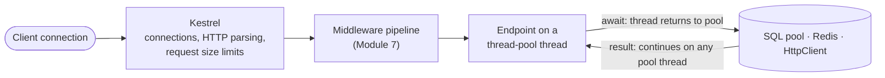
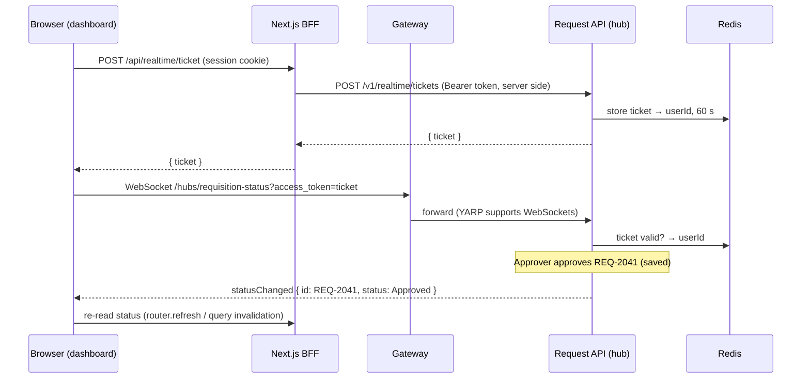

# Lecture Script: Server-Side Programming

> **Instructor reference.** Phase 3: Server-side and serverless programming (Focus area 3), Module 9 | Duration: 5 hours (2 h concepts and demos, 3 h hands-on), run as Day 13 (3 h, Segments 1–8) and Day 14 (2 h, Segments 9–14) | Previous script: [Module 8 — Data Layer: SQL Server and Data Access](../Phase-2/Module-08-Data-Layer-SQL-Server.md)

## Session overview

**Goal.** Learners make ProcureFlow's servers do work beyond the request: a background worker that expires abandoned drafts and shuts down cleanly, real-time approval status pushed to the requester's dashboard with SignalR, Redis cache-aside and output caching on the catalogue with measured latency, a requisition form submitted through a Next.js server action, and a large CSV export streamed end to end. Along the way, they use AI to hunt thread-safety and caching bugs and prove or disprove each claim with a load run (Capstone increment CI-9).

**Learner profile at this point.** Learners have built ProcureFlow through Phase 2: domain and requirements (Modules 1–2), guardrails (Module 3), architecture and ADRs (Module 4), the platform (Module 5), Next.js screens and BFF (Module 6), the Request API, Catalogue service and YARP gateway with resilience (Module 7), and a production schema with migrations, `rowversion` concurrency, audit tables and 10,000 seeded requisitions (Module 8). Every piece so far answers a request and stops. Today introduces the first genuinely new idea of Phase 3: **a server's job doesn't end with the response: work happens before, after and between requests, and it has to stay correct when many things happen at once.**

**Key outcome.** Every learner can explain how Kestrel, the pipeline and the thread pool handle a request and where connection limits bite; design stateless services that scale out; build a `BackgroundService` with graceful shutdown and choose between it, a worker service, Hangfire or Quartz; push updates with SignalR and choose between WebSockets and server-sent events; apply in-memory, distributed and output caching with an invalidation plan; find and fix race conditions with locks, concurrent collections and `Channel<T>`; stream large uploads and exports; and use Next.js server components, server actions and route handlers on the right runtime.

**Case for this session.** ProcureFlow at Meridian Components, continued. Volumes: 1,200 requesters, 150 approvers, 3,000 requisitions a month, about 140 concurrent users at month-end (assumption). Hosting: App Service in an India region (ADR-0004), now planned with **two instances** per service for availability. Two additions today, each through change control (Module 3): **PF-022 "Requester saves a draft and submits later"**, with new statuses `Draft` and `Expired` (Module 8 promised the migration); and a **finance export** of requisitions as CSV for Meridian's finance controllers and auditors. The draft expiry age is a setting; this script uses **30 days as a teaching value**, so confirm the real figure with Priya. The trainer plays the tech lead, opening with feedback from the month-end pilot.

**Note on tool versions.** .NET 8 or later; ASP.NET Core SignalR and `@microsoft/signalr`; Redis 7 or later in the starter kit's Docker Compose; `Microsoft.Extensions.Caching.StackExchangeRedis`; ASP.NET Core output caching (with the Redis output-cache store, .NET 8 or later); `HybridCache` (.NET 9 or later) as an alternative to hand-written cache-aside; k6 for load runs; `dotnet-counters` for runtime metrics; Next.js 15 or later. **Redis licensing changed in 2024 and 2025**, and Azure's managed Redis offerings have changed too. Check the current licence and service options on the day, and price any managed cache in the calculator, dated. Valkey is a BSD-licensed fork if the licence is a problem.

**Note on licences.** Every new package goes through the Module 5 package gate. At the time of writing, Quartz.NET is Apache-2.0 and **Hangfire's core is LGPL-3.0**, which `DEPENDENCIES.md` lists as "needs approval". **k6 is AGPL-3.0**. It's a tool we run, not code we ship, but check whether `DEPENDENCIES.md` covers tools as well as dependencies. Re-check everything on the day.

**Note on AI output.** AI code reviews and suggestions vary run to run; examples are marked **illustrative**. Load-test numbers, counter values and timings depend on the machine, so all measured output here is illustrative too.

## Timing breakdown

| Segment | Duration | Cumulative | Kind |
| --- | --- | --- | --- |
| SEGMENT 1: Opening — How a Server Handles Requests | 15 min | 0:15 | Concept + demo |
| SEGMENT 2: Stateless, Stateful and Scaling Out | 10 min | 0:25 | Concept + demo |
| SEGMENT 3: Background Work and Graceful Shutdown | 15 min | 0:40 | Concept + demo |
| SEGMENT 4: Lab 1 — Draft Expiry Worker | 45 min | 1:25 | Hands-on |
| **BREAK** | 10 min | — |  |
| SEGMENT 5: Real-Time: SignalR, WebSockets and Server-Sent Events | 15 min | 1:40 | Concept + demo |
| SEGMENT 6: Lab 2 — Real-Time Approval Status | 35 min | 2:15 | Hands-on |
| **BREAK** | 10 min | — |  |
| SEGMENT 7: Server-Side Caching | 15 min | 2:30 | Concept + demo |
| SEGMENT 8: Lab 3A — Cache-Aside and Output Caching for the Catalogue | 30 min | 3:00 | Hands-on |
| **END OF DAY 13** | — | — |  |
| SEGMENT 9: Concurrency and Thread Safety | 15 min | 3:15 | Concept + demo |
| SEGMENT 10: Lab 3B — AI Hunts Thread-Safety and Caching Bugs | 20 min | 3:35 | Hands-on |
| SEGMENT 11: Large Files and Streaming | 10 min | 3:45 | Concept + demo |
| SEGMENT 12: Server-Side Next.js: Actions, Handlers and Runtimes | 15 min | 4:00 | Concept + demo |
| SEGMENT 13: Lab 4 — Server Action Submit and Streamed CSV Export | 35 min | 4:35 | Hands-on |
| SEGMENT 14: CI-9 Review and Wrap-Up | 25 min | 5:00 | Hands-on + close |

Concepts and demos: 15 + 10 + 15 + 15 + 15 + 15 + 10 + 15 + 10 (close) = 120 min (40%). Labs and CI-9 review: 45 + 35 + 30 + 20 + 35 + 15 = 180 min (60%). Total 300 min = 5 h, matching the module's 2 h / 3 h split. Day 13: Segments 1–8 = 180 min; Day 14: Segments 9–14 = 120 min (Module 10 takes Day 14's other 2 hours). Breaks are not counted. Lab 3 is split into 3A and 3B across the two days, as Module 5 split its Lab 1.

## SEGMENT 1: Opening — How a Server Handles Requests (15 min)

### The Hook (6 min)

**Show one slide: "Month-end pilot: what the servers told us".**

> 1. Requesters refresh their dashboard every 30 seconds to see if they're approved. That's 1,200 people polling, and approvals still show up late.
> 2. Catalogue search took 1.8 seconds at month-end. The database spent most of its CPU on the same twenty searches, over and over.
> 3. 4,000 abandoned drafts clutter "My requisitions". A developer wrote a clean-up script and runs it by hand when someone complains.
> 4. A deploy restarted the API while that script was half-way through. Nobody knew which drafts were done.
> 5. A finance controller exported a year of requisitions. The API's memory climbed past 2 GB and the instance restarted.
> 6. The admin page's "searches today" counter is wrong under load, and occasionally the API throws an error nobody can reproduce.

**Ask:** *"Which of these happen during a request, which happen between requests, and which happen because many requests run at once?"*

**Do:** Take 4–5 answers. Sort them into three columns on the board: *during*, *between*, *at once*.

**Respond to likely answers:**

- *"Number 1 is a frontend problem."* → *"The frontend asks every 30 seconds because the server never tells it anything. Whose job is telling?"*
- *"Number 3: schedule the script with cron."* → *"Closer. Where does it run, with two API instances? And what about number 4?"*
- *"Number 5: give it more memory."* → *"How much is enough for eight years of data? What if the server never held the whole file at all?"*
- *"Number 6 is random."* → *"Bugs that only show under load are rarely random. They're usually two threads touching the same thing."*

**Write on board, large, and leave it up all day:**

> **Push, don't poll. Cache, don't repeat. Stream, don't hold. Stop cleanly.**

### A Request's Journey (4 min)

**Say:** *"Before fixing anything, know what's underneath. In ASP.NET Core, **Kestrel** is the web server: it accepts connections and parses HTTP. Each request goes through the middleware pipeline from Module 7 to an endpoint. The code runs on **thread-pool** threads, a shared pool .NET grows slowly when it's short of threads. While your code `await`s a database or an HTTP call, the thread goes back to the pool to serve someone else."*



| Limit | Default to know | ProcureFlow risk |
| --- | --- | --- |
| Kestrel request body size | About 30 MB | Large uploads fail with 413 unless configured per endpoint |
| SQL connection pool | 100 per connection string, per instance | Slow queries hold connections; requests queue waiting for one |
| Thread pool | Grows gradually under sustained blocking | Sync-over-async (`.Result`) starves it: Module 7's warning |
| Outbound connections | App Service limits outbound (SNAT) connections per instance; check current docs | `new HttpClient()` per call exhausts them; Module 7's factory avoids it |
| Long-lived connections | Each WebSocket holds a connection for as long as the user is connected | Real-time features need their own capacity plan |

### Live Demo: Watch the Thread Pool (3 min)

**Do:** Run the API with a deliberately blocking endpoint (`Thread.Sleep(500)` inside the handler) and a normal `await Task.Delay(500)` endpoint. Put 100 concurrent requests on each with k6, while running:

```bash
dotnet-counters monitor --name ProcureFlow.Api --counters System.Runtime
```

**Example output (illustrative — counter names and values vary by .NET version and machine):** on the blocking endpoint, *ThreadPool Queue Length* climbs and *ThreadPool Thread Count* creeps up; on the async endpoint, both stay low while throughput is far higher.

**Say:** *"Same 500 milliseconds of waiting. One version holds a thread the whole time; the other gives it back. That's the difference between 140 month-end users being fine and the whole API slowing down."*

### Comprehension Check (2 min)

1. *"A slow SQL query holds its connection for 5 seconds. What runs out first at month-end: threads or SQL connections?"* (Likely the connection pool: 100 per instance, so requests queue for a connection even though threads are free.)
2. *"Why does `await` help throughput if it doesn't make one request faster?"* (The thread serves other requests while this one waits.)

**Common misconception:** "more threads means more throughput." (Blocked threads do no work; async code needs fewer threads for the same load.)

**Re-teach trigger:** if learners can't explain the demo, redraw the pool as five chairs: blocking code sits in a chair while waiting; async code stands up and comes back.

**Transition — Say:** *"Now multiply by two: two instances of every service. What breaks when a server remembers things?"*

## SEGMENT 2: Stateless, Stateful and Scaling Out (10 min)

### Where State Lives (4 min)

**Say:** *"A **stateless** server keeps nothing between requests that another instance would need. Any instance can serve any request, so scaling out is just adding instances. A **stateful** server remembers things in its own memory: sessions, caches, open connections. Then the second instance doesn't know what the first one knows."*

| State | Stateful version (breaks at two instances) | Stateless version |
| --- | --- | --- |
| User session | In-memory session; needs sticky sessions (App Service "ARR affinity") | Claims in the token or cookie; anything else in Redis or SQL |
| Cache | `IMemoryCache` on each instance: two copies, invalidated separately | Redis (shared), or memory with a short TTL and accepted staleness |
| Cookie and anti-forgery keys | ASP.NET Core Data Protection keys per instance: a cookie issued by one instance fails on the other | Keys shared: Blob storage plus Key Vault, or similar |
| Real-time connections | A SignalR connection lives on one instance; a message sent from the other never arrives | A backplane: Azure SignalR Service, or Redis |
| Next.js server actions | Each instance's own encryption key for action IDs and closures | Set `NEXT_SERVER_ACTIONS_ENCRYPTION_KEY` the same on every instance (Segment 12) |

### Live Demo: Two Instances, One Counter (3 min)

**Do:** Run two copies of the Catalogue service behind the gateway (two YARP destinations). Call an endpoint that increments an in-memory counter 20 times. Show each instance reporting about half.

**Say:** *"Harmless for a demo counter. Not harmless for a cached price, a session or a SignalR message. Today, every feature gets the two-instance test."*

### Comprehension Check (3 min)

1. *"Why not just turn on ARR affinity and keep in-memory state?"* (An instance restart or scale-in loses its users' state; load spreads unevenly; failover breaks sessions.)
2. *"Users get random 'invalid anti-forgery token' errors after we add a second instance. Cause?"* (Data Protection keys aren't shared; each instance can't read the other's tokens.)
3. *"Is a SignalR connection state?"* (Yes: it lives on one instance, so sending to it from another needs a backplane.)

**Common misconception:** "stateless means no state." (State lives somewhere shared and durable instead of in one process's memory.)

**Re-teach trigger:** if learners can't place session state, draw two boxes for instances and one for Redis, and have them move each row of the table into the right box.

**Transition — Say:** *"Complaints 3 and 4: work that should happen between requests, and stop cleanly when the server does."*

## SEGMENT 3: Background Work and Graceful Shutdown (15 min)

### Five Ways to Run Work Later (4 min)

| Option | What it is | Fits | Watch out for |
| --- | --- | --- | --- |
| `BackgroundService` in the API | A hosted loop inside the web app's process | Small periodic jobs tied to this service | Runs on **every** instance; dies with the process |
| Worker service | The same hosted-service model, as its own process with no HTTP | Heavier or independent jobs; scale separately | Another thing to deploy and monitor |
| Quartz.NET | A scheduler library: cron-style triggers, clustering with a database | Many schedules; one-run-per-cluster needs | Its own tables and configuration |
| Hangfire | A job library with persistent queues, retries and a dashboard | Fire-and-forget and scheduled jobs that must survive restarts | LGPL-3.0 core (needs approval); storage tables |
| Azure Functions (timer, queue) | Serverless triggers | Event-driven or occasional work | Module 10 |

**Say:** *"For draft expiry, a `BackgroundService` in the Request API is enough: one small periodic job. But it runs on both instances. So it must be safe to run twice at the same time, which is why we'll write it to be idempotent and use Module 8's `rowversion` to settle any race."*

### Live Demo: A Periodic Worker (7 min)

```csharp
// api/src/Requisitioning/Infrastructure/DraftExpiryWorker.cs
public sealed class DraftExpiryWorker(
    IServiceScopeFactory scopes,                     // the worker is a singleton; DbContext is scoped (Module 7)
    IOptionsMonitor<DraftExpiryOptions> options,
    TimeProvider clock,
    ILogger<DraftExpiryWorker> logger) : BackgroundService
{
    protected override async Task ExecuteAsync(CancellationToken stoppingToken)
    {
        using var timer = new PeriodicTimer(options.CurrentValue.Interval, clock);
        try
        {
            do
            {
                try
                {
                    var expired = await ExpireDueDraftsAsync(stoppingToken);
                    logger.LogInformation("Draft expiry run finished: {Expired} drafts expired", expired);
                }
                catch (Exception ex) when (ex is not OperationCanceledException)
                {
                    logger.LogError(ex, "Draft expiry run failed; will retry next interval");
                }
            }
            while (await timer.WaitForNextTickAsync(stoppingToken));
        }
        catch (OperationCanceledException) when (stoppingToken.IsCancellationRequested)
        {
            logger.LogInformation("Draft expiry worker stopping");
        }
    }

    private async Task<int> ExpireDueDraftsAsync(CancellationToken ct)
    {
        var cutoff = clock.GetUtcNow() - options.CurrentValue.ExpireAfter;
        var total = 0;
        while (!ct.IsCancellationRequested)                          // check between batches
        {
            await using var scope = scopes.CreateAsyncScope();
            var drafts = scope.ServiceProvider.GetRequiredService<IDraftExpiry>();
            var count = await drafts.ExpireBatchAsync(cutoff, batchSize: 100, ct);
            total += count;
            if (count < 100) break;                                  // nothing left
        }
        return total;
    }
}
```

**Say:** *"Four habits in one class. A new scope per batch, so each batch gets a fresh `DbContext`. Small batches, checking the token between them, so a shutdown waits for at most one batch. A failed run is logged and retried next time, so it never kills the loop. And `TimeProvider`, so a test can jump 30 days in a millisecond."*

### Graceful Shutdown (2 min)

**Say:** *"When App Service restarts an instance for a deploy, the host signals the token, waits up to its shutdown timeout for hosted services to finish (check the default for your .NET version and set `HostOptions.ShutdownTimeout` deliberately), then stops. Our worker finishes the current batch, commits it, and exits. Complaint 4 becomes 'batch 37 of 40 done, the rest next run', which is fine, because each batch is a complete transaction."*

### Comprehension Check (2 min)

1. *"Both instances run the worker at the same moment. What stops a draft being expired twice?"* (The domain's `Expire` refuses a non-draft; if both load the same draft, `rowversion` makes the second save fail, and the worker skips it.)
2. *"Why `IServiceScopeFactory` instead of injecting the `DbContext`?"* (The worker is a singleton; a scoped `DbContext` captured for its lifetime is Module 7's captive dependency.)

**Common misconception:** "`Task.Run` in a controller is a background job." (It's untracked work that dies silently on restart and ignores shutdown.)

**Re-teach trigger:** if learners can't explain the double-run safety, act it out: two learners "expire" the same sticky note; the second finds it already changed.

**Transition — Say:** *"Build it, prove it stops cleanly, and prove two copies can run together."*

## SEGMENT 4: Lab 1 — Draft Expiry Worker (45 min)

**Say:** *"Add drafts to ProcureFlow, then a background worker that expires drafts nobody has touched for 30 days (a setting). It must audit each expiry, stop cleanly mid-run, and stay correct with two instances running at once."*

### Instructions (read aloud, step by step)

1. **Story and migration (8 min).** Add PF-022 to the backlog through change control. In a migration, extend the status `CHECK` constraint with `Draft` and `Expired` (Module 8). Drafts can have zero lines; submitted requisitions still need at least one (Module 7's invariant moves from creation to `Submit`).
2. **Domain (7 min).** `Requisition.SaveDraft(...)`, `Submit()` from a draft, and `Expire(TimeProvider)`: only from `Draft`, stamps `UpdatedAt` (Module 8's root-version rule), raises `RequisitionExpired`. An audit entry is written in the same transaction.
3. **Worker (12 min).** `DraftExpiryWorker` from the demo, with `DraftExpiryOptions { Interval, ExpireAfter }` validated at startup. `ExpireBatchAsync` loads up to 100 drafts with `UpdatedAt < cutoff`, oldest first, calls `Expire`, saves, and skips any that throw `DbUpdateConcurrencyException`.
4. **Graceful-shutdown test (8 min).** Integration test: seed 1,000 old drafts; start the host; stop it while the worker is mid-run. Assert: no partly saved batch, every expired draft has exactly one audit entry, and the log shows "stopping".
5. **Two-instance test (7 min).** Run two worker instances against the same database at once (two hosts in one test, or two processes). Assert: every due draft is `Expired` exactly once, with exactly one audit entry each.
6. **Settings and logs (3 min).** Interval and age in `appsettings.json`; one log line per run with the count and duration; no requester data in logs (`LOGGING.md`).

### Starter: Batch Expiry

```csharp
public sealed class DraftExpiry(ProcureFlowDbContext db, TimeProvider clock, ILogger<DraftExpiry> logger) : IDraftExpiry
{
    public async Task<int> ExpireBatchAsync(DateTimeOffset cutoff, int batchSize, CancellationToken ct)
    {
        var drafts = await db.Requisitions
            .Where(r => r.Status == RequisitionStatus.Draft && r.UpdatedAt < cutoff)
            .OrderBy(r => r.UpdatedAt)
            .Take(batchSize)
            .ToListAsync(ct);

        foreach (var draft in drafts) draft.Expire(clock);          // domain rule + audit event

        try
        {
            await db.SaveChangesAsync(ct);                             // one transaction per batch
            return drafts.Count;
        }
        catch (DbUpdateConcurrencyException ex)
        {
            // TODO: the other instance (or the requester) got there first.
            // Detach the conflicting entries, retry the save for the rest, and log how many were skipped.
            throw;
        }
    }
}
```

**Note:** an index on `(Status, UpdatedAt)` keeps this query cheap as drafts grow. Add it through a migration (Module 8), and check the plan.

### Reference Solution (instructor, partial)

```csharp
catch (DbUpdateConcurrencyException ex)
{
    foreach (var entry in ex.Entries) entry.State = EntityState.Detached;   // someone else changed these
    var saved = await db.SaveChangesAsync(ct);                               // save the rest of the batch
    logger.LogInformation("Draft expiry: {Skipped} drafts changed concurrently and were skipped", ex.Entries.Count);
    return drafts.Count - ex.Entries.Count;
}
```

**Say:** *"Notice the race we haven't handled yet: a requester editing a draft at the exact moment it expires. The `rowversion` decides: whoever saves second loses. If the worker loses, the draft lives on, which is right: the requester just touched it. If the requester loses, they get Module 8's 409 with a clear message. Neither side gets silently overwritten."*

**Note:** the retry after detaching can still hit a new conflict in theory; keep it to one retry and let the next run pick up anything left.

### Instructor Circulates

- **`ExecuteUpdateAsync` to expire all drafts in one SQL statement:** fast, but it skips the domain rule and the audit entry. Use it only if the audit row is written in the same statement; discuss the trade-off.
- **Injected `DbContext` in the worker's constructor:** captive dependency; use a scope.
- **`Task.Delay` loop with no cancellation:** shutdown waits for the whole delay; use `PeriodicTimer` with the token.
- **One huge batch:** shutdown can't stop part-way; keep batches small.
- **No two-instance test:** *"Your App Service plan runs two instances. Prove it's safe."*

**Success check:** drafts exist and expire after the configured age; each expiry has one audit entry; the shutdown test shows no partial batch; the two-instance test shows no double expiry; one log line per run.

**Extension (fast teams):** move the worker into a separate worker-service project scaffolded from the `pf-service` template (without HTTP endpoints), and compare deployment and monitoring effort in two lines in `docs/adr/`.

### BREAK (10 min)

*Suggested break prompt:* *"Complaint 1: 1,200 people polling every 30 seconds. How many requests an hour is that, and how many of them return 'no change'?"* (1,200 × 120 = 144,000 an hour, almost all "no change".)

## SEGMENT 5: Real-Time: SignalR, WebSockets and Server-Sent Events (15 min)

### Three Ways to Push (4 min)

**Ask:** *"Your break question: how many polling requests an hour?"* (144,000; nearly all wasted.)

| Technique | Direction | How | Fits |
| --- | --- | --- | --- |
| Polling | Client asks repeatedly | Timer plus GET | Very rare updates; simplest; wasteful at scale |
| Server-sent events (SSE) | Server → client | One long-lived HTTP response streaming events; built-in browser `EventSource` with reconnect | One-way updates: status, progress |
| WebSockets | Both ways | A persistent two-way connection after an HTTP upgrade | Chat, collaboration, high-frequency two-way traffic |
| SignalR | Both ways, with fallbacks | A library over WebSockets (falls back to SSE or long polling), with hubs, groups, users and reconnect | .NET backends that want push without hand-built protocols; ProcureFlow's choice |

**Say:** *"For approval status, the server only talks; SSE would work. We use SignalR because it handles transports, reconnects, 'send to this user' and scale-out for us, and it's first-class in ASP.NET Core. One rule overrides everything: a pushed message is a **hint**, not the truth. Connections drop. When a hint arrives, or after a reconnect, the client re-reads the status from the API."*

### How It Fits ProcureFlow (5 min)



**Say:** *"Module 6's rule: the API's bearer token never reaches the browser. So the browser gets a **ticket**: random, valid for 60 seconds, usable only to open this hub as this user. SignalR's client sends whatever its `accessTokenFactory` returns, so we return the ticket. A stolen ticket opens a read-only status feed for one minute; a stolen API token could approve requisitions. Note this exception in Module 6's 'no browser request to the API host' test: hub connections with a ticket are allowed; nothing else is."*

### Live Demo: A Hub and a Push (4 min)

```csharp
// The hub: server-to-client only
[Authorize(AuthenticationSchemes = RealtimeTicketDefaults.Scheme)]
public sealed class RequisitionStatusHub : Hub;

// The push, behind a port (Module 5's dependency rule)
public sealed class SignalRStatusNotifier(IHubContext<RequisitionStatusHub> hub) : IStatusNotifier
{
    public Task StatusChangedAsync(string requesterId, RequisitionId id, RequisitionStatus status, CancellationToken ct) =>
        hub.Clients.User(requesterId).SendAsync("statusChanged", new { id = id.Value, status = status.ToString() }, ct);
}

// Program.cs
builder.Services.AddSignalR();
app.MapHub<RequisitionStatusHub>("/hubs/requisition-status");
```

**Do:** Open the dashboard as a requester in one browser and the approvals page as the approver in another. Approve. Show the requester's status change without a refresh.

**Say:** *"`Clients.User(requesterId)` reaches every tab and device that requester has open, on this instance. With two instances, a backplane carries the message to the other one: Azure SignalR Service in production (a managed service, so price it in the calculator), or the Redis backplane, since we're adding Redis today anyway."*

### Comprehension Check (2 min)

1. *"The requester's laptop sleeps through an approval. What do they see when it wakes?"* (SignalR reconnects; on reconnect the client re-reads status from the API, so they see the truth even though the message was missed.)
2. *"Why send the push after `SaveChanges`, not before?"* (If the save fails, you'd have told the user something that never happened.)

**Common misconception:** "real-time messages are reliable." (They're best effort; the API is the source of truth.)

**Re-teach trigger:** if learners want to put the status only in the message, unplug the network in the demo for 30 seconds, approve, reconnect, and ask what the requester sees.

**Transition — Say:** *"Build it end to end, from the approval to the requester's screen."*

## SEGMENT 6: Lab 2 — Real-Time Approval Status (35 min)

**Say:** *"Push status changes to the requester's dashboard with SignalR. Tickets, not tokens, in the browser; push after commit; refresh from the API on every hint and every reconnect; and a backplane so it works with two instances."*

### Instructions (read aloud, step by step)

1. **Hub and tickets (8 min).** Add `RequisitionStatusHub` and the ticket authentication handler (starter below) to the Request API. Add `POST /v1/realtime/tickets` (a normal authenticated endpoint) to the contract first, then the code. Add the hub route to the gateway, with WebSockets allowed.
2. **Push after save (8 min).** In the approve, reject, withdraw and expire handlers, call `IStatusNotifier.StatusChangedAsync` after a successful save. A failed push is logged as a warning and never fails the request.
3. **Client (12 min).** In the web app, add a BFF route `POST /api/realtime/ticket` and a client hook that connects with `accessTokenFactory` calling it. On `statusChanged` and on reconnect, call `router.refresh()` so the dashboard's server components re-render (Module 6). Show a small "Live" / "Reconnecting…" indicator with `role="status"`.
4. **Scale-out (4 min).** Add the Redis backplane (`AddSignalR().AddStackExchangeRedis(...)`, package gate first) and run two Request API instances behind the gateway.
5. **Test (3 min).** Two browsers: approve as the approver; the requester's status updates within a second or two, whichever instance each is connected to.

### Starter: Ticket Authentication

```csharp
public sealed class RealtimeTicketHandler(
    IOptionsMonitor<AuthenticationSchemeOptions> options, ILoggerFactory logger, UrlEncoder encoder,
    IDistributedCache cache) : AuthenticationHandler<AuthenticationSchemeOptions>(options, logger, encoder)
{
    protected override async Task<AuthenticateResult> HandleAuthenticateAsync()
    {
        // SignalR sends the factory's value as ?access_token= on WebSocket/SSE and as a Bearer header on negotiate
        var ticket = Request.Query["access_token"].ToString();
        if (string.IsNullOrEmpty(ticket) && Request.Headers.Authorization.ToString() is { } h && h.StartsWith("Bearer "))
            ticket = h["Bearer ".Length..];
        if (string.IsNullOrEmpty(ticket)) return AuthenticateResult.NoResult();

        var userId = await cache.GetStringAsync($"rt-ticket:{ticket}", Context.RequestAborted);
        if (userId is null) return AuthenticateResult.Fail("Invalid or expired ticket");

        var identity = new ClaimsIdentity([new Claim(ClaimTypes.NameIdentifier, userId)], Scheme.Name);
        return AuthenticateResult.Success(new AuthenticationTicket(new ClaimsPrincipal(identity), Scheme.Name));
    }
}

// Issuing a ticket (authenticated with the normal API scheme)
app.MapPost("/v1/realtime/tickets", async (ClaimsPrincipal user, IDistributedCache cache, CancellationToken ct) =>
{
    var ticket = Base64Url.EncodeToString(RandomNumberGenerator.GetBytes(32));
    await cache.SetStringAsync($"rt-ticket:{ticket}", user.GetUserId(),
        new DistributedCacheEntryOptions { AbsoluteExpirationRelativeToNow = TimeSpan.FromSeconds(60) }, ct);
    return Results.Ok(new { ticket });
}).RequireAuthorization();
```

**Note:** `Base64Url` is in .NET 9 or later (`System.Buffers.Text`); on .NET 8, use `WebEncoders.Base64UrlEncode` from `Microsoft.AspNetCore.WebUtilities`. Tickets in query strings can appear in access logs: they expire in 60 seconds, but still exclude the `access_token` query value from request logging (`LOGGING.md`).

```ts
// web/src/features/realtime/useStatusUpdates.ts
"use client";
import { useEffect, useState } from "react";
import { useRouter } from "next/navigation";
import { HubConnectionBuilder, HubConnectionState } from "@microsoft/signalr";

export function useStatusUpdates() {
  const router = useRouter();
  const [state, setState] = useState<"live" | "reconnecting" | "offline">("offline");

  useEffect(() => {
    const connection = new HubConnectionBuilder()
      .withUrl(`${process.env.NEXT_PUBLIC_REALTIME_URL}/hubs/requisition-status`, {
        accessTokenFactory: async () => (await (await fetch("/api/realtime/ticket", { method: "POST" })).json()).ticket,
      })
      .withAutomaticReconnect()
      .build();

    connection.on("statusChanged", () => router.refresh());        // a hint: re-read the truth
    connection.onreconnecting(() => setState("reconnecting"));
    connection.onreconnected(() => { setState("live"); router.refresh(); });
    connection.onclose(() => setState("offline"));
    connection.start().then(() => setState("live")).catch(() => setState("offline"));

    return () => { void connection.stop(); };
  }, [router]);

  return state;
}
```

### Instructor Circulates

- **API bearer token used as the SignalR access token:** that's Module 6's complaint 6; use the ticket.
- **Status shown from the message body only:** treat it as a hint; re-read from the API.
- **Push before `SaveChanges`:** move it after a successful save.
- **Exceptions from the push failing approvals:** catch, log a warning, carry on.
- **Works with one instance, not two:** backplane missing, or the gateway not forwarding WebSockets.
- **Connection opened per component:** one connection per page, shared.

**Success check:** the requester sees approve, reject and expire changes within a couple of seconds without refreshing; it works with two Request API instances; no API bearer token in the browser; status is correct after a 30-second network drop.

**Extension (fast teams):** implement the same feed as server-sent events from a BFF route handler (a `ReadableStream` response with `text/event-stream`) and compare the code and connection counts with SignalR.

### BREAK (10 min)

*Suggested break prompt:* *"Complaint 2: the same twenty catalogue searches, hundreds of times. If you cached them, what's the worst thing a stale result could cause?"*

## SEGMENT 7: Server-Side Caching (15 min)

### Three Layers (3 min)

| Cache | Lives | Fits | ProcureFlow |
| --- | --- | --- | --- |
| In-memory (`IMemoryCache`) | One process | Tiny, rarely changing data; fastest | Category list, with a short TTL |
| Distributed (Redis via `IDistributedCache`) | Shared by all instances | Data many instances need; survives restarts | Catalogue search results (cache-aside) |
| Output caching | Whole HTTP responses, in memory or Redis | Identical responses for identical requests | `GET /v1/catalogue/items` |
| `HybridCache` (.NET 9 or later) | Memory in front of Redis, with stampede protection | A ready-made two-level cache-aside | An alternative to hand-written cache-aside |

**Ask:** *"Your break question: what's the worst a stale catalogue result could do?"* (Show yesterday's price in search: mild. But if the Request API's price lookup (Module 7) were cached and stale, a requisition would record the wrong price. So the price lookup isn't cached, or is cached very briefly.)

**Say:** *"Every cache decision is a staleness decision. Ask: how stale can this be, and who's hurt if it is?"*

### Live Demo: Cache-Aside as a Decorator (5 min)

```csharp
// Module 5's Decorator pattern, wrapped around the catalogue search handler
public sealed class CachedCatalogueSearch(
    IQueryHandler<SearchCatalogue, PagedResult<CatalogueItemDto>> inner,
    IDistributedCache cache,
    ILogger<CachedCatalogueSearch> logger) : IQueryHandler<SearchCatalogue, PagedResult<CatalogueItemDto>>
{
    public async Task<Result<PagedResult<CatalogueItemDto>>> HandleAsync(SearchCatalogue q, CancellationToken ct)
    {
        string? key = null;
        try
        {
            var generation = await cache.GetStringAsync("catalogue:generation", ct) ?? "0";
            key = $"catalogue:{generation}:search:{q.Search?.Trim().ToLowerInvariant()}:{q.Category}:{q.Page}:{q.PageSize}";
            if (await cache.GetStringAsync(key, ct) is { } hit)
                return Result<PagedResult<CatalogueItemDto>>.Ok(JsonSerializer.Deserialize<PagedResult<CatalogueItemDto>>(hit)!);
        }
        catch (Exception ex) when (ex is not OperationCanceledException)
        {
            logger.LogWarning(ex, "Catalogue cache read failed; using the database");   // Redis down ≠ search down
        }

        var result = await inner.HandleAsync(q, ct);
        if (result.IsSuccess && key is not null)
        {
            try
            {
                await cache.SetStringAsync(key, JsonSerializer.Serialize(result.Value),
                    new DistributedCacheEntryOptions { AbsoluteExpirationRelativeToNow = TimeSpan.FromMinutes(10) }, ct);
            }
            catch (Exception ex) when (ex is not OperationCanceledException)
            {
                logger.LogWarning(ex, "Catalogue cache write failed");
            }
        }
        return result;
    }
}
```

**Say:** *"Cache-aside: look in the cache; on a miss, ask the database and store the answer. The generation number is our invalidation trick: when an admin changes an item, we write a new generation, so every old key is simply never read again and expires on its own. And if Redis is down, search still works, just slower. A cache must never become a single point of failure."*

### Output Caching, and Its Trap (3 min)

**Say:** *"Output caching stores the whole response. By default, ASP.NET Core **won't cache responses to authenticated requests**, a safe default, because those are usually per-user. Every catalogue request carries a token, so the default caches nothing. The catalogue is the same for every user, so we write a policy that says so explicitly. That's safe here and dangerous anywhere the response depends on who's asking."*

```csharp
builder.Services.AddOutputCache(o => o.AddPolicy("catalogue", new SharedCatalogueCachePolicy()));
builder.Services.AddStackExchangeRedisOutputCache(o => o.Configuration = builder.Configuration.GetConnectionString("Redis"));

app.UseAuthentication();
app.UseAuthorization();
app.UseOutputCache();          // after authorisation: only authorised requests reach the cache
```

### Invalidation (2 min)

| Approach | How | ProcureFlow |
| --- | --- | --- |
| Time (TTL) | Expire after N minutes | Every cache entry has one, as a safety net |
| Tags | Evict every entry with a tag | Output cache: `EvictByTagAsync("catalogue")` on `PUT` |
| Generation keys | New key prefix on change | Redis cache-aside search results |
| Events | Invalidate when a change event arrives | Across services, via Service Bus (Module 10) |

### Comprehension Check (2 min)

1. *"Why does the custom output-cache policy have to come after `UseAuthorization`?"* (Otherwise an unauthenticated request could be served a cached 200.)
2. *"Should the Request API's price lookup use the 10-minute search cache?"* (No: a stale price is recorded on the requisition; use no cache or a very short TTL plus invalidation.)

**Common misconception:** "caching is free speed." (Every cache adds staleness, invalidation work, memory and a new failure mode.)

**Re-teach trigger:** if learners can't decide what to cache, fill a two-column table together: *how stale can it be?* and *who's hurt if it is?*, for five ProcureFlow reads.

**Transition — Say:** *"Measure first, then cache, then measure again."*

## SEGMENT 8: Lab 3A — Cache-Aside and Output Caching for the Catalogue (30 min)

**Say:** *"Measure catalogue search under load, add Redis cache-aside and output caching, then measure again. The number that matters is p95 latency and database load, not 'it feels faster'."*

### Instructions (read aloud, step by step)

1. **Redis (3 min).** Add Redis to the starter kit's `docker-compose.yml`. Package gate for `Microsoft.Extensions.Caching.StackExchangeRedis` and the Redis output-cache package.
2. **Baseline (6 min).** Run the k6 script below against `GET /v1/catalogue/items` through the gateway: 50 virtual users for 60 seconds. Record p95, requests per second, and the database's query count for the run (Query Store or a counter, Module 8).
3. **Cache-aside (8 min).** Add the `CachedCatalogueSearch` decorator. On `PUT /v1/catalogue/items/{id}`, write a new `catalogue:generation`.
4. **Output caching (7 min).** Add the `SharedCatalogueCachePolicy` (starter below) to the search endpoint with the tag `catalogue`; evict the tag on `PUT`. Prove an unauthenticated request still gets 401.
5. **Measure again (6 min).** Re-run the same k6 script. Record the same numbers in `docs/perf/catalogue-caching.md`. Then change one price and check the next search shows it.

### Starter Files

```js
// perf/catalogue-search.js (k6)
import http from "k6/http";
import { check } from "k6";

export const options = {
  vus: 50,
  duration: "60s",
  thresholds: { http_req_duration: ["p(95)<500"] },   // the program's read-API benchmark; NFR-PERF-01 covers submit/approve
};

const terms = ["gloves", "paper", "toner", "cable", "tape", "helmet", "label", "battery"];

export default function () {
  const term = terms[Math.floor(Math.random() * terms.length)];
  const res = http.get(`${__ENV.BASE_URL}/v1/catalogue/items?search=${term}&page=1&pageSize=20`, {
    headers: { Authorization: `Bearer ${__ENV.TOKEN}` },
  });
  check(res, { "status is 200": (r) => r.status === 200 });
}
```

```bash
k6 run -e BASE_URL=http://localhost:5100 -e TOKEN="$TOKEN" perf/catalogue-search.js
```

```csharp
// A shared (not per-user) output-cache policy for catalogue reads
public sealed class SharedCatalogueCachePolicy : IOutputCachePolicy
{
    public ValueTask CacheRequestAsync(OutputCacheContext ctx, CancellationToken ct)
    {
        var isGet = HttpMethods.IsGet(ctx.HttpContext.Request.Method);
        ctx.EnableOutputCaching = true;
        ctx.AllowCacheLookup = isGet;
        ctx.AllowCacheStorage = isGet;
        ctx.AllowLocking = true;                                  // one request rebuilds; the rest wait (stampede protection)
        ctx.ResponseExpirationTimeSpan = TimeSpan.FromMinutes(5);
        ctx.CacheVaryByRules.QueryKeys = "*";                     // vary by search, category, page, pageSize
        ctx.Tags.Add("catalogue");
        return ValueTask.CompletedTask;
    }

    public ValueTask ServeFromCacheAsync(OutputCacheContext ctx, CancellationToken ct) => ValueTask.CompletedTask;

    public ValueTask ServeResponseAsync(OutputCacheContext ctx, CancellationToken ct)
    {
        if (ctx.HttpContext.Response.StatusCode != StatusCodes.Status200OK) ctx.AllowCacheStorage = false;
        return ValueTask.CompletedTask;
    }
}
```

### Reference Results (instructor debrief)

**Example output (illustrative — depends on machines, data and settings):**

| Measure | No cache | Cache-aside (Redis) | Plus output cache |
| --- | --- | --- | --- |
| p95 latency | Hundreds of ms under load | Noticeably lower | Lowest: most requests skip the handler |
| Requests per second | Baseline | Higher | Highest |
| Database queries during the run | One per request | About one per distinct search per 10 min | Fewer still |

**Say:** *"Two things to notice. The database query count falls more dramatically than latency, and that's what fixes complaint 2: the database gets its CPU back for approvals. And the output cache sits in front of the Redis cache; with both, you've got two places to invalidate. That's fine because both are wired to the same `PUT`, but write it down."*

### Instructor Circulates

- **No baseline recorded:** stop; measure first.
- **Output cache before `UseAuthorization`:** test a request with no token.
- **Cache key missing a query parameter:** page 2 returns page 1's results; include every parameter.
- **Redis exceptions breaking search:** wrap cache calls; fall back to the database.
- **Price lookup endpoint output-cached too:** exclude it, or give it a very short TTL with tag eviction.

**Success check:** before-and-after p95, throughput and query count recorded; search still works with Redis stopped; a price change appears in the next search; unauthenticated requests get 401.

**Extension (fast teams):** replace the hand-written decorator with `HybridCache` and compare code size and stampede behaviour.

### END OF DAY 13

*Overnight prompt:* *"Find one place in our code where two requests could change the same thing at the same time. Bring it tomorrow."*

## SEGMENT 9: Concurrency and Thread Safety (15 min)

### Live Demo: A Race in Ten Lines (6 min)

**Ask:** *"Your overnight prompt: where can two requests change the same thing?"* Collect two or three answers.

**Say:** *"Complaint 6's counter, reduced to its essence. A singleton service, a plain dictionary, many requests."*

```csharp
public sealed class SearchStats            // registered as a singleton
{
    private readonly Dictionary<string, int> _counts = new();
    public void Record(string term) => _counts[term] = _counts.GetValueOrDefault(term) + 1;
    public int Total => _counts.Values.Sum();
}
```

**Do:** Fire 10,000 requests with k6 across 8 terms. Compare `Total` with 10,000.

**Example output (illustrative — varies every run):** `Total` comes out below 10,000; on some runs the API also throws `InvalidOperationException` from the dictionary, the "error nobody can reproduce".

**Say:** *"Read-modify-write: two threads read 41, both write 42. One count is lost. Worse, `Dictionary` isn't built for concurrent writes, so its internals can corrupt. This is a **race condition**: the result depends on timing."*

### Tools for Shared State (5 min)

| Tool | Use when | Example |
| --- | --- | --- |
| Don't share | Almost always the best fix | Scoped services; state in the database |
| `Interlocked` | A single number | `Interlocked.Increment(ref _total)` |
| `ConcurrentDictionary` | A shared map | `_counts.AddOrUpdate(term, 1, (_, n) => n + 1)` |
| `lock` (or `System.Threading.Lock` in .NET 9 or later) | Several fields must change together; **no `await` inside** | Updating a count and a timestamp together |
| `SemaphoreSlim` | Mutual exclusion around `await` | Only one rebuild of a cache entry at a time |
| `Channel<T>` | Producer/consumer between threads, with back-pressure | Requests enqueue notifications; one background reader sends them |
| Idempotency and `rowversion` | Races across processes and instances | Module 7's keys; Module 8's concurrency tokens |

**Say:** *"Two warnings. `ConcurrentDictionary.GetOrAdd` is safe for the dictionary, but its factory can still run twice under a race, so don't put side effects in it. And `lock` protects one process only. With two instances, races between them need the database (`rowversion`, unique constraints) or a distributed lock."*

### Channel<T> in Two Minutes (2 min)

```csharp
var channel = Channel.CreateBounded<StatusChange>(new BoundedChannelOptions(1_000)
{
    FullMode = BoundedChannelFullMode.Wait,      // back-pressure instead of unbounded memory
});
// Request side:    await channel.Writer.WriteAsync(change, ct);
// BackgroundService: await foreach (var change in channel.Reader.ReadAllAsync(stoppingToken)) await notifier.SendAsync(change, stoppingToken);
```

**Say:** *"A bounded channel decouples the request from slow work, with a limit, so a burst can't eat all the memory. But it's in memory: a restart loses whatever is queued. For anything that must not be lost, like an approval notification email, use a durable queue: Service Bus, Module 10."*

### Comprehension Check (2 min)

1. *"Why can't you `await` inside a `lock` block, and what do you use instead?"* (The compiler forbids it; the continuation may run on another thread, which wouldn't hold the lock. Use `SemaphoreSlim.WaitAsync`.)
2. *"A `lock` fixes the counter on one instance. Is it fixed in production?"* (Each instance has its own counter; for a true total, use Redis `INCR` or the database.)

**Common misconception:** "async code is single-threaded, so it can't race." (Continuations run on any thread-pool thread; many requests run at the same time.)

**Re-teach trigger:** if learners can't see the lost update, write the two threads' steps in two columns on the board, interleaved, and count.

**Transition — Say:** *"Now let an AI loose on some deliberately bad server code, then check whether it was right."*

## SEGMENT 10: Lab 3B — AI Hunts Thread-Safety and Caching Bugs (20 min)

**Say:** *"`seeded/CatalogueStatsService.cs` has several thread-safety and caching bugs, plus code that looks suspicious but is fine. Ask the AI to find the issues. Then, for each claim, write a prediction and run a load test that proves or disproves it. A claim without evidence doesn't count either way."*

### Instructions (read aloud, step by step)

1. **AI review (6 min).** Give the AI the file and the prompt below. Copy its findings into `docs/perf/seeded-review.md`, one row each.
2. **Predict and prove (10 min).** For each finding, write what a load run should show if the AI is right. Run `perf/seeded-stats.js` (k6, provided) with the matching scenario. Mark each claim *confirmed*, *disproved* or *not testable by load* (then say how else you'd test it).
3. **Record (4 min).** Note which claims the AI got right, which it invented, and which real bug it missed. Don't fix anything yet; fixes go in the homework PR.

### The AI Prompt (give to learners)

```
Review this ASP.NET Core service for thread-safety, concurrency and caching problems.
It is registered as a singleton and called by many concurrent requests on two instances.
For each problem: the line, what goes wrong under load, how to reproduce it with a load
test, and the fix. Also list anything that looks risky but is actually safe, and why.
```

### The Seeded Code (instructor reference: issues marked)

```csharp
// seeded/CatalogueStatsService.cs — registered with AddSingleton
public sealed class CatalogueStatsService(CatalogueDbContext db, IDistributedCache cache, IHttpClientFactory http)
{                                                                                       // [A] scoped DbContext captured by a singleton
    private static readonly Dictionary<string, int> SearchCounts = new();              // [B] unsynchronised shared map
    private static int _totalSearches;
    private List<PopularItem>? _popular;

    public void RecordSearch(string term)
    {
        SearchCounts[term] = SearchCounts.GetValueOrDefault(term) + 1;                 // [B] lost updates; possible corruption
        Interlocked.Increment(ref _totalSearches);                                     // [decoy] correct
    }

    public async Task<IReadOnlyList<PopularItem>> PopularAsync(CancellationToken ct)
    {
        _popular ??= await db.CatalogueItems.OrderByDescending(i => i.SearchCount)    // [C] stampede: many builds at once
            .Take(10).Select(i => new PopularItem(i.Id, i.Name)).ToListAsync(ct);      // [D] never refreshed: stale forever
        return _popular;
    }

    public async Task<DashboardSummary> SummaryAsync(string userId, CancellationToken ct)
    {
        var json = await cache.GetStringAsync("dashboard-summary", ct);                // [E] key not per user: data leak
        if (json is not null) return JsonSerializer.Deserialize<DashboardSummary>(json)!;
        var summary = await BuildSummaryAsync(userId, ct);
        await cache.SetStringAsync("dashboard-summary", JsonSerializer.Serialize(summary), ct);  // [F] no expiry
        return summary;
    }

    public async Task<string> SupplierStatusAsync(string supplier, CancellationToken ct) =>
        await http.CreateClient("suppliers").GetStringAsync($"status/{supplier}", ct); // [decoy] factory clients are fine

    public async void WarmUp() => await PopularAsync(CancellationToken.None);          // [G] async void: crashes the process on error
}
```

### Expected Evidence (instructor debrief)

| Issue | Load-run evidence | Fix |
| --- | --- | --- |
| [A] Captive `DbContext` | Under concurrency: "A second operation was started on this context instance before a previous operation completed" | Scoped service, or `IDbContextFactory` per call |
| [B] Shared `Dictionary` | Sum of counts below requests sent; occasional exceptions | `ConcurrentDictionary.AddOrUpdate`, or Redis `INCR` for a cross-instance total |
| [C] Stampede | Many identical queries in the first second (Query Store, logs) | `SemaphoreSlim`, `HybridCache`, or output-cache locking |
| [D] Never refreshed | Popular list unchanged after the data changes | TTL |
| [E] Shared key for per-user data | Script with two users' tokens: user B receives user A's summary | Key by user ID, or don't cache per-user data in a shared cache |
| [F] No expiry | Keys never leave Redis (`TTL` returns −1) | Always set an expiry |
| [G] `async void` | Not shown by load alone; an exception in it terminates the process (test with a forced fault) | `async Task`, awaited, or a hosted service |
| Decoys | `Interlocked` total exact; factory clients fine under load | No change |

**Say (debrief):** *"Most AI reviews find [B] and [G] quickly. Many miss [E], the most dangerous one: a data leak only a two-user test reveals. And many flag the `HttpClientFactory` line as unsafe, which the load run disproves. That's the point of the checkpoint: the AI's confidence isn't evidence; the run is."*

### Instructor Circulates

- **Claims accepted without a run:** *"What did the load test show?"*
- **Single-user test for [E]:** the leak needs two different users.
- **Fixing before recording:** record first; the review is the deliverable.
- **[G] "proved" with a load run:** it's not a load bug; it needs a forced exception.

**Success check:** `docs/perf/seeded-review.md` lists every AI claim with a prediction, the run's evidence and a verdict; at least one disproved claim and one missed bug identified.

## SEGMENT 11: Large Files and Streaming (10 min)

### Uploads Without Holding the File (3 min)

**Say:** *"Two ways to take a big upload. Buffered: the server keeps the whole file in memory or a temp file, then you process it. Streamed: you read it as it arrives and pass it on, for example straight to Blob storage. For anything large, stream it, and set explicit size limits per endpoint, because Kestrel's default body limit (about 30 MB) is a guard, not a design. Check the content type and size before you trust anything in it. The catalogue's CSV bulk upload, a stretch feature, would follow this path."*

### Live Demo: A Streamed CSV Export (5 min)

```csharp
app.MapGet("/v1/requisitions/export.csv", async (
    DateOnly from, DateOnly to, HttpResponse response, ProcureFlowDbContext db, CancellationToken ct) =>
{
    response.ContentType = "text/csv; charset=utf-8";
    response.Headers.ContentDisposition = $"attachment; filename=requisitions-{from:yyyyMMdd}-{to:yyyyMMdd}.csv";

    await using var writer = new StreamWriter(response.Body, new UTF8Encoding(false), bufferSize: 16 * 1024);
    await writer.WriteLineAsync("Number,Site,Status,Currency,Total,SubmittedAt");

    var rows = db.Requisitions.AsNoTracking()
        .Where(r => r.SubmittedAt >= from.ToDateTime(TimeOnly.MinValue) && r.SubmittedAt < to.ToDateTime(TimeOnly.MinValue))
        .OrderBy(r => r.SubmittedAt)
        .Select(r => new { r.Id, r.Site, r.Status, r.Currency, r.TotalAmount, r.SubmittedAt })
        .AsAsyncEnumerable();

    await foreach (var r in rows.WithCancellation(ct))
        await writer.WriteLineAsync(string.Join(',',
            Csv.Text(r.Id.Value), Csv.Text(r.Site.Name), Csv.Text(r.Status.ToString()), Csv.Text(r.Currency.ToString()),
            r.TotalAmount.ToString(CultureInfo.InvariantCulture), r.SubmittedAt.ToString("O")));
}).RequireAuthorization(Policies.CanExportRequisitions);

static class Csv
{
    // Quote when needed; neutralise spreadsheet formulas in text cells (CSV injection)
    public static string Text(string? value)
    {
        var v = value ?? "";
        if (v.Length > 0 && "=+-@\t\r".Contains(v[0])) v = "'" + v;
        return v.IndexOfAny([',', '"', '\n', '\r']) >= 0 ? $"\"{v.Replace("\"", "\"\"")}\"" : v;
    }
}
```

**Say:** *"Rows go from the database to the network one at a time; memory stays flat whether it's a month or eight years: complaint 5. And `Csv.Text` does two jobs: correct quoting, and stopping CSV injection. A justification that starts with `=` would otherwise run as a formula when a finance controller opens the file in a spreadsheet. Only text cells get that treatment; numbers stay numbers."*

### Comprehension Check (2 min)

1. *"Why `AsAsyncEnumerable()` rather than `ToListAsync()` for the export?"* (It streams rows as they're read; `ToListAsync` holds every row in memory first.)
2. *"A requester types `=HYPERLINK(…)` as their justification. What does `Csv.Text` do?"* (Prefixes it with `'`, so the spreadsheet treats it as text.)

**Common misconception:** "the export is fine because it worked for one month in test." (Memory grows with the date range; test with the eight-year dataset from Module 8.)

**Re-teach trigger:** if learners can't explain flat memory, run the export with `dotnet-counters` showing GC heap size for one month and for eight years, side by side.

**Transition — Say:** *"Last stop: the Next.js server, which is also a server, and has its own versions of all of this."*

## SEGMENT 12: Server-Side Next.js: Actions, Handlers and Runtimes (15 min)

### Four Server-Side Tools (4 min)

| Tool | What it is | ProcureFlow use |
| --- | --- | --- |
| Server components | Components rendered on the server; no client JavaScript (Module 6) | Dashboards, approvals list |
| Server actions | Async functions marked `"use server"` that the client can call; Next.js turns each into a POST endpoint | Submitting the requisition form |
| Route handlers | `route.ts` HTTP endpoints (Module 6's BFF) | Ticket endpoint; streaming the CSV through; anything a non-React caller uses |
| Runtimes | Node.js (full Node APIs) or Edge (a restricted, Web-standard runtime) | Node.js everywhere; see below |

**Say:** *"Use server actions for mutations from our own React UI; use route handlers for everything else. And remember every server action is a public POST endpoint: anyone can call it, with any input. It must check the session and validate with Zod inside the action itself, every time."*

### Live Demo: The Form Through a Server Action (6 min)

```ts
// web/src/features/requisitions/actions.ts
"use server";
import { z } from "zod";
import { revalidatePath } from "next/cache";
import { requireSession } from "@/server/session";
import { serverApi } from "@/server/api";
import { submitRequisitionSchema } from "./schema";

export type SubmitResult =
  | { ok: true; id: string }
  | { ok: false; fieldErrors?: Record<string, string[] | undefined>; message?: string };

export async function submitRequisition(idempotencyKey: string, input: unknown): Promise<SubmitResult> {
  await requireSession();                                             // public endpoint: authenticate every call
  const parsed = submitRequisitionSchema.safeParse(input);            // and validate every input
  if (!parsed.success) return { ok: false, fieldErrors: z.flattenError(parsed.error).fieldErrors };

  const api = await serverApi();
  const { data, error } = await api.POST("/v1/requisitions", {
    body: parsed.data,
    params: { header: { "Idempotency-Key": idempotencyKey } },       // Module 7's homework, end to end
  });
  if (error) return { ok: false, message: `${error.title ?? "Couldn't submit"} Reference: ${error.correlationId ?? "none"}` };

  revalidatePath("/");                                                // dashboard shows the new requisition
  return { ok: true, id: data.id };
}
```

```tsx
// In RequisitionForm (client component): React Hook Form still validates in the browser first
const [idempotencyKey] = useState(() => crypto.randomUUID());      // one key per form, not per click
const onSubmit = async (values: SubmitRequisitionForm) => {
  const result = await submitRequisition(idempotencyKey, values);
  if (!result.ok) mapErrors(result, setError);                     // Module 6's error mapping
  else setCreated(result.id);
};
```

**Say:** *"The Module 6 `POST /api/requisitions` route handler can now go: one less endpoint to secure. Two scale-out details from Segment 2. Next.js checks that a server action's `Origin` matches the host; behind the gateway, you may need to list allowed origins in `next.config` (check where the `serverActions.allowedOrigins` setting lives in your version). And with two web instances, set the same `NEXT_SERVER_ACTIONS_ENCRYPTION_KEY` on both, from Key Vault, or actions fail on whichever instance didn't render the page."*

### Edge Versus Node.js Runtime (3 min)

| | Node.js runtime | Edge runtime |
| --- | --- | --- |
| APIs | Full Node.js: file system, most npm packages | Web-standard APIs only; many packages won't run |
| Where it runs | Your server (App Service, India region) | On a global edge network **when the host provides one**; on App Service, the same server, with fewer APIs |
| ProcureFlow | **Use it** | No benefit on App Service; and on a global edge host, code (and data it handles) could run outside India: NFR-SEC-04 |

**Say:** *"The edge runtime is for hosts with a global edge network and for code that needs no data residency. ProcureFlow has neither. We stay on Node.js and say so in ADR-0006."*

### Comprehension Check (2 min)

1. *"Why must `submitRequisition` call `requireSession()` when only signed-in pages show the form?"* (Every server action is a public POST endpoint; anyone can call it directly.)
2. *"Users intermittently get 'Failed to find Server Action' after we add a second web instance. Cause?"* (Different encryption keys, or different builds, across instances; set `NEXT_SERVER_ACTIONS_ENCRYPTION_KEY` and deploy the same build to both.)

**Common misconception:** "server actions are private functions." (They're HTTP endpoints with generated IDs; treat them like any API.)

**Re-teach trigger:** if learners skip the session check, call the action directly with `curl` using the action ID from the browser's network tab.

**Transition — Say:** *"Put the form on a server action, and stream eight years of CSV through the BFF without the server holding it."*

## SEGMENT 13: Lab 4 — Server Action Submit and Streamed CSV Export (35 min)

**Say:** *"Two jobs. Submit the requisition form through a server action with Zod validation and the idempotency key. Then build the streamed CSV export: contract first, API endpoint, and a BFF route handler that passes the stream through without buffering. Prove memory stays flat on eight years of data."*

### Instructions (read aloud, step by step)

1. **Contract (4 min).** Add `GET /v1/requisitions/export.csv?from&to` to `contracts/requests.v1.yaml` (`text/csv` response; 403 for roles without the export policy). Merge before coding (Module 7).
2. **Server action (13 min).** Add `submitRequisition` (Segment 12). Switch `RequisitionForm` to it, keeping React Hook Form's browser validation. One idempotency key per form instance. Delete the old `POST /api/requisitions` route handler. Test: a double-click creates one requisition; calling the action without a session fails.
3. **Streaming endpoint (10 min).** Add the export endpoint (Segment 11) with a `CanExportRequisitions` policy (finance controllers and auditors). Use `Csv.Text` for every text cell.
4. **Stream through the BFF and measure (8 min).** Add `GET /api/exports/requisitions` as a route handler that returns the API's body as a stream (starter below). Restore Module 8's eight-year database. Export eight years while watching the API with `dotnet-counters` (GC heap size) and the web server's memory. Record both in `docs/perf/csv-export.md`.

### Starter: Stream Through the BFF

```ts
// web/src/app/api/exports/requisitions/route.ts
import { type NextRequest } from "next/server";
import { getAccessToken } from "@/server/session";

export async function GET(req: NextRequest) {
  const token = await getAccessToken();
  if (!token) return new Response(null, { status: 401 });

  const upstream = await fetch(`${process.env.API_URL}/v1/requisitions/export.csv?${req.nextUrl.searchParams}`, {
    headers: { Authorization: `Bearer ${token}` },
  });

  return new Response(upstream.body, {                       // pass the stream through; never await .text()
    status: upstream.status,
    headers: {
      "Content-Type": upstream.headers.get("Content-Type") ?? "text/csv; charset=utf-8",
      "Content-Disposition": upstream.headers.get("Content-Disposition") ?? "attachment",
    },
  });
}
```

### Reference Results (instructor debrief)

**Example output (illustrative — depends on machine and data):**

| Export | Rows | API GC heap during export | Web server memory |
| --- | --- | --- | --- |
| One month | ~3,000 | Flat | Flat |
| Eight years | ~288,000 | Flat (same as one month) | Flat |
| Buffered version (`ToListAsync`, `await res.text()`) for comparison | ~288,000 | Climbs with row count | Climbs with file size |

**Say:** *"Flat lines on both servers mean the bytes flowed through: database to API to BFF to browser, never held. That's complaint 5 fixed for any date range."*

### Instructor Circulates

- **`await upstream.text()` or `arrayBuffer()` in the route handler:** that buffers the whole file in the web server.
- **`ToListAsync` in the export:** buffers in the API; use `AsAsyncEnumerable`.
- **Server action without `requireSession()`:** call it with `curl` to show why it's needed.
- **New idempotency key per click:** the double-click test fails; one key per form.
- **Formula injection guard applied to numbers:** negative totals become text; text cells only.
- **Export endpoint added without a contract change:** contract first.

**Success check:** the form submits through a server action with one requisition per double-click; the old route handler is gone; an eight-year export downloads with flat memory on both servers; formula-looking text is neutralised; the contract test passes with the export endpoint.

**Extension (fast teams):** add `Content-Length`-free progress in the UI: show rows exported so far using a small SSE side-channel, or simply the bytes received from the `fetch` stream reader.

## SEGMENT 14: CI-9 Review and Wrap-Up (25 min)

### CI-9 Peer Review — Gallery Walk (15 min)

**Say:** *"Swap with the team to your left. Run their stack with two instances of the Request API. Approve something and watch their requester's dashboard; stop Redis and search the catalogue; stop an API instance mid-expiry run. Check every item. One strength, one gap."*

**CI-9 checklist (put on screen):**

**Background worker**

- [ ] `Draft` and `Expired` statuses added by migration (PF-022 through change control); expiry age and interval in validated settings
- [ ] `DraftExpiryWorker`: scoped `DbContext` per batch, small batches, audit entry per expiry, one log line per run
- [ ] Graceful-shutdown test (no partial batch) and two-instance test (no double expiry) pass

**Real-time status updates**

- [ ] SignalR hub with ticket authentication; no API bearer token in the browser
- [ ] Push after a successful save for approve, reject, withdraw and expire; failures logged, never fatal
- [ ] Dashboard refreshes from the API on each hint and after reconnect; works with two instances (backplane)

**Distributed and output caching**

- [ ] Redis cache-aside on catalogue search with TTL and generation invalidation; search survives Redis being down
- [ ] Output caching with an explicit shared policy, after authorisation; tag eviction on catalogue updates; 401 still returned without a token
- [ ] `docs/perf/catalogue-caching.md` with before-and-after p95, throughput and database query counts

**Also from today's labs**

- [ ] `docs/perf/seeded-review.md`: each AI claim with load-run evidence and a verdict
- [ ] Form submitted through a server action (session check, Zod, idempotency key); CSV export streamed end to end with flat memory recorded

**Say (during the walk):** *"Stopping Redis is the honest test of their cache, and stopping an instance mid-run is the honest test of their worker."*

### What We Covered Today (2 min)

- Kestrel, the pipeline and the thread pool; the limits that bite first
- Stateless services and the state that must be shared to scale out
- `BackgroundService`, worker services, Quartz and Hangfire; graceful shutdown; safe double runs
- SignalR, WebSockets and SSE; push as a hint, the API as the truth; tickets, not tokens
- In-memory, Redis and output caching; staleness decisions; invalidation by TTL, tag and generation
- Race conditions; `Interlocked`, concurrent collections, `SemaphoreSlim`, `Channel<T>`
- Streaming uploads and exports; CSV injection
- Server components, server actions, route handlers; Node.js over edge for ProcureFlow

### Back to the Opening (3 min)

**Show the "Month-end pilot" slide again.** For each complaint, ask which part of today fixes it.

(Expected: 1. Polling → SignalR push with refresh on hint. 2. Repeated searches → Redis cache-aside and output caching, measured. 3. Abandoned drafts → the expiry worker. 4. Half-finished script on restart → small transactional batches and graceful shutdown. 5. Export memory → streaming from database to browser. 6. Wrong counter and random errors → race conditions fixed with concurrent types, and the AI review's evidence.)

**Point at the board:** *"Push, don't poll: 1. Cache, don't repeat: 2. Stream, don't hold: 5. Stop cleanly: 3 and 4. And 6 is what happens when you forget that all of it runs at once."*

### Exit Ticket (3 min, written, one per learner)

> *"ProcureFlow now runs two instances of the Request API. List three things that would break if we'd kept state in each instance's memory, and how today's design avoids each."*

**Expected answer (any three):** SignalR messages sent from the other instance (backplane); catalogue cache copies diverging or invalidated on one instance only (Redis and tag eviction shared); realtime tickets stored in one instance's memory (Redis); the draft worker running twice (idempotent domain rule plus `rowversion`); Data Protection or Next.js action keys differing (shared keys); in-memory counters (Redis or database).

**Re-teach trigger:** if more than a quarter name fewer than two, open Module 10 with the two-instance counter demo from Segment 2.

### Bridge to What Comes Next (2 min)

**Say:** *"This morning, six complaints about work that happened at the wrong time, in the wrong place, or all at once. Now the server pushes, caches, streams and stops cleanly. Remember: push, don't poll; cache, don't repeat; stream, don't hold; stop cleanly. Next, in **Module 10 — Serverless Programming with Azure Functions**, some of this work moves out of our servers entirely: notifications from Service Bus events, a Durable escalation after 48 hours, and the nightly spend report, with a cost comparison to decide where each piece belongs."*

### Homework / Self-Practice

1. **Fix the seeded bugs.** In a PR, fix every confirmed issue from Lab 3B, with the load run re-done as evidence, and close the peer-review gap.
2. **ADR-0009: shared state for scale-out.** Write `docs/adr/0009-shared-state-and-scale-out.md`: what state ProcureFlow keeps (sessions, caches, SignalR connections, tickets, Data Protection keys, Next.js action keys), where each lives, the backplane choice (Azure SignalR Service or Redis) with a dated cost from the calculator, and "revisit if".
3. **Measure month-end.** Run the catalogue k6 script at 140 virtual users (Meridian's month-end assumption) against two instances, with Redis on and off. Record p95 and database load in `docs/perf/catalogue-caching.md`.

## Q&A & Doubt Solving

**Likely questions and suggested answers:**

**Q: Why not use Hangfire for the draft expiry? It has a dashboard and retries.** → It's a good tool. For one small periodic job, a `BackgroundService` adds no dependency, no tables and no licence question (Hangfire's core is LGPL-3.0, which needs approval). If ProcureFlow grows many scheduled and fire-and-forget jobs, revisit with an ADR, alongside Quartz and Module 10's Functions.

**Q: Should the worker run only on one instance?** → It's simpler to make it safe on all instances (idempotent, small batches, `rowversion`). Leader election or a distributed lock adds moving parts. If the job were expensive, move it to a separate worker service with one instance, or to a timer function (Module 10).

**Q: Azure SignalR Service or the Redis backplane?** → Azure SignalR Service in production: it holds the client connections for you and scales separately. The Redis backplane is fine for development and smaller deployments. Price the service in the calculator and record it in ADR-0009.

**Q: Isn't the realtime ticket just another token in the browser?** → Yes, but a very narrow one: 60 seconds, one hub, receive-only for one user's status. The Module 6 rule protects the API's bearer token, which can approve and change data. Document the exception.

**Q: When should we use `HybridCache` instead of writing cache-aside ourselves?** → On .NET 9 or later, usually: it gives memory plus Redis, stampede protection and tag-based invalidation with less code. Writing it by hand once, as today, makes clear what it does for you.

**Q: Can we output-cache the dashboard?** → Not with a shared policy: it's per user. Per-user output caching (varying by user) is possible but rarely worth it; dashboards change often and are cheap with good queries. Measure first.

**Q: Why remove the BFF's `POST /api/requisitions` route handler?** → Nothing else calls it after the server action, and every endpoint is something to secure and test. If another client needs it later, add it back deliberately.

## Instructor Notes

- **Prepare the starter kit additions:** Redis in `docker-compose.yml`; a second Request API and Catalogue instance in the gateway config for two-instance tests; the eight-year database from Module 8.
- **Seeded code:** `seeded/CatalogueStatsService.cs` wired to a `/debug/stats` endpoint (development only) and `perf/seeded-stats.js` with scenarios for [B], [C], [E] (two users' tokens) and the decoys. Test every scenario the day before; [B] and [E] must show their failure reliably.
- **Test tokens:** two requesters, an approver and a finance controller, for the two-user leak test and the export policy.
- **Run the package gate in advance** for the Redis caching and output-cache packages, the SignalR Redis backplane and `@microsoft/signalr`. Note Hangfire (LGPL-3.0) and k6 (AGPL-3.0) licence points; re-check Redis's current licence.
- **Change control:** have PF-022 and the finance export written as change requests, so the opening isn't spent on process.
- **Common mistake:** API bearer token used as the SignalR access token.
- **Common mistake:** output caching that never caches (default policy with authenticated requests), or caches per-user data with a shared policy.
- **Common mistake:** buffering in the BFF (`await res.text()`) after carefully streaming in the API.
- **Engagement tip:** the strongest moments are the requester's status changing in the other browser, the k6 query count collapsing, and user B seeing user A's dashboard in Lab 3B. Pause for each.
- **Time check:** Day 13 ends exactly at 3:00. If Lab 2 runs over, cut Lab 3A's output-cache step to a demo and keep the cache-aside measurement.
- **Materials to prepare:** opening slide; seeded code and k6 scripts; Redis and two-instance compose files; eight-year database; change requests for PF-022 and the export.

## Common Mistakes — Quick Reference

| Mistake | Symptom | Fix |
| --- | --- | --- |
| Blocking calls in request code | Thread-pool queue grows; everything slows at month-end | Async all the way (Module 7) |
| State in one instance's memory | Works with one instance, flaky with two | Redis, database, backplane, shared keys |
| `Task.Run` or a loop without cancellation for background work | Lost or half-done work on restart; slow shutdown | `BackgroundService` with `PeriodicTimer`, small batches, the stopping token |
| Worker unsafe to run twice | Double expiry; double audit rows | Domain rule plus `rowversion`; skip conflicts |
| Push treated as the truth | Wrong status after a dropped connection | Refresh from the API on hint and on reconnect |
| API token used for SignalR | Powerful token in the browser | Short-lived, hub-only ticket |
| Cache without expiry or invalidation | Stale data forever | TTL always; tags or generation keys on change |
| Shared cache key for per-user data | One user sees another's data | Key by user, or don't share-cache it |
| Output cache before authorisation | Cached 200 served without a token | `UseOutputCache` after `UseAuthorization`; test 401 |
| Shared mutable collections in singletons | Lost updates; random exceptions | Concurrent types, `Interlocked`, or no shared state |
| `await` needed inside a critical section | Compiler error, or `.Result` hacks | `SemaphoreSlim.WaitAsync` |
| Buffering large exports | Memory climbs with the date range | `AsAsyncEnumerable` and pass-through streams |
| Server action without session check | Anyone can submit as anyone | Authenticate and validate inside every action |

## Timing Contingencies

| Situation | Action |
| --- | --- |
| Lab 1 running long | Hand out the batch-expiry reference; keep the shutdown test, make the two-instance test homework |
| SignalR or gateway WebSockets failing | Connect directly to the Request API for the lab; fix the gateway route as homework |
| Redis won't start on some machines | Pair up; or use the in-memory `IDistributedCache` for the logic and measure on a working machine |
| k6 not installed | Use the instructor's machine for runs; learners predict and read results |
| Day 13 running over | Make Lab 3A's output-cache step a 5-minute instructor demo |
| Day 14 starts late | In Lab 4, do the streaming export and memory measurement; make the server action homework |
| Advanced team finishes early | SSE version of the status feed; or `HybridCache` replacing the decorator |

## End-of-Session Quiz (5 Questions)

1. A handler calls `catalogueClient.GetPriceAsync(id).Result`. Describe what happens to the thread pool and to unrelated endpoints when 140 users hit it at month-end, and which `dotnet-counters` signal shows it.
2. Name three kinds of state that must be shared when the Request API runs on two instances, and where each lives in ProcureFlow.
3. Explain why the draft expiry worker is safe when both instances run it at the same moment, and what it does when the host shuts down mid-run.
4. Why does the default output-cache policy cache nothing on the catalogue endpoint, what does the custom policy change, and what must be true of the response for that to be safe?
5. A user double-clicks Submit on the requisition form, which now uses a server action. Trace why exactly one requisition is created, and say what stops someone calling the action directly without signing in.

**Answer key (instructor):**

1. Each request blocks a pool thread for the whole call; the pool grows slowly, so queued work waits, and every endpoint (including ones that don't use the catalogue) slows down. *ThreadPool Queue Length* rises and *ThreadPool Thread Count* climbs.
2. Any three: SignalR connections (backplane: Azure SignalR Service or Redis); cache entries (Redis, output cache in Redis); realtime tickets (Redis); Data Protection keys (shared storage); Next.js server-action encryption key (the same environment variable on both web instances); counters (Redis or database).
3. `Expire` only works on drafts; each batch is one transaction; if both instances load the same draft, `rowversion` makes the second save fail and that instance skips it. On shutdown the stopping token is checked between batches, so the current batch commits and the worker stops; the rest is picked up next run.
4. By default, requests with authentication aren't cached, and every catalogue request carries a token. The custom policy explicitly allows lookup and storage for GETs, varies by query, tags entries and sets a TTL. It's safe only because the catalogue response is identical for every user; it must be placed after authorisation so unauthenticated requests are still refused.
5. The form generates one idempotency key per form instance; both clicks call the action with the same key; the API stores the key with the first result and returns the stored result for the second (Module 7). The action calls `requireSession()` and validates with Zod on every call, because a server action is a public POST endpoint.

## Homework Rubric

| Criterion | Excellent (4) | Good (3) | Needs Work (2) | Incomplete (1) |
| --- | --- | --- | --- | --- |
| Seeded bugs fixed | Every confirmed issue fixed; load run re-done as evidence for each; decoys left alone | Most fixed with evidence | Fixes without evidence, or decoys "fixed" | Not attempted |
| ADR-0009 | All six kinds of state placed; backplane choice with a dated calculator cost; clear "revisit if" | Complete; cost or one state missing | Lists technologies without reasons | Not attempted |
| Month-end measurement | 140-VU runs with Redis on and off, two instances; p95 and DB load recorded and explained | Runs done; explanation thin | One run only | Not attempted |

**Total:** /12. Pass threshold: 8/12.

## Materials Checklist

- [ ] Opening slide: "Month-end pilot: what the servers told us"
- [ ] Starter kit: Redis in Docker Compose; two-instance gateway config
- [ ] Module 8's eight-year database for the export measurement
- [ ] `seeded/CatalogueStatsService.cs`, `/debug/stats` endpoint and `perf/seeded-stats.js` scenarios, tested the day before
- [ ] k6 and `dotnet-counters` installed on learner machines (or the instructor's machine as fallback)
- [ ] Test tokens: two requesters, an approver, a finance controller
- [ ] Change requests for PF-022 (drafts) and the finance export
- [ ] Package gate results for Redis, output-cache, SignalR backplane and `@microsoft/signalr` packages; licences re-checked
- [ ] AI assistant access tested
- [ ] Timer visible for all labs
