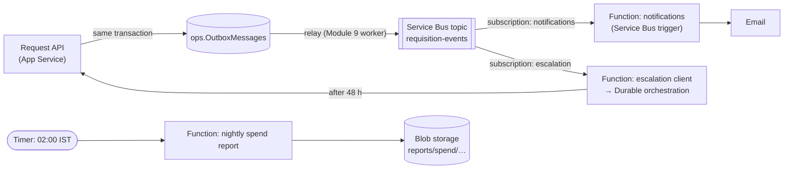
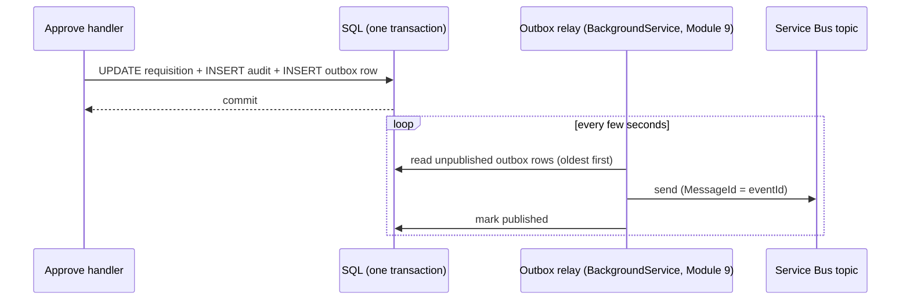

# Lecture Script: Serverless Programming with Azure Functions

> **Instructor reference.** Phase 3: Server-side and serverless programming (Focus area 3), Module 10 | Duration: 7 hours (3 h concepts and demos, 4 h hands-on), run as Day 14 (2 h, Segments 1–6), Day 15 (4 h, Segments 7–14) and Day 16 (1 h, Segments 15–16) | Previous script: [Module 9 — Server-Side Programming](Module-09-Server-Side-Programming.md)

## Session overview

**Goal.** Learners move ProcureFlow's "after the request" work into Azure Functions: a notification function triggered by requisition events on Service Bus, with retries, de-duplication and dead-lettering; a Durable Functions escalation that waits for each approval and escalates after 48 hours; and a nightly spend report written to Blob storage. They then run the same report endpoint as a server API and as a function, compare cold start, latency and monthly cost, and record the decision in an ADR (Capstone increment CI-10).

**Learner profile at this point.** Learners have ProcureFlow's Phase 2 build (Modules 4–8: architecture, platform, screens, APIs, gateway, data layer with audit and a tuned spend query) and Module 9's server-side work: a background worker, SignalR status updates, Redis and output caching, a server-action form and a streamed export. In Module 9, everything still ran inside our own always-on servers. Today introduces the first genuinely new idea of serverless: **the request records what happened; separate code reacts to that event later, reliably and at least once, and you pay only while it runs.**

**Key outcome.** Every learner can explain functions as a service, event-driven design, pay-per-execution and scale to zero; structure a .NET isolated-worker function app and choose a hosting plan within its limits; use HTTP, timer, Service Bus, Blob and Cosmos DB triggers and bindings; build Durable orchestrations (chaining, fan-out/fan-in, human interaction with timeouts); make functions reliable with retries, idempotency, poison-message handling and dead-lettering; reason about cold starts, concurrency and scaling, and say when serverless is the wrong choice; secure functions with managed identity, keys and network rules; develop and test locally with Core Tools, Azurite and the Service Bus emulator; map the design to AWS and to serverless containers; and model cost at different volumes.

**Case for this session.** ProcureFlow at Meridian Components, continued. In Module 1, Priya described requisitions waiting **nine days** for approval. Today's functions address that directly: approvers are notified, and an approval step that waits **48 hours** escalates (the syllabus figure, a calendar-hours teaching value; confirm with Priya whether weekends and the UK/India time difference should count). Who receives an escalation is a **RAID assumption** for this module: the approver again, plus their own manager from Meridian's directory. The syllabus names events *RequestSubmitted*, *RequestApproved* and *RequestRejected*; ProcureFlow's glossary says *requisition*, so the events are `RequisitionSubmitted`, `RequisitionApproved`, `RequisitionRejected`, plus `ApprovalStepDecided` and `RequisitionWithdrawn`. Service Bus already appears in ADR-0005 for SAP; today adds a **topic** for requisition events. Hosting must stay in an **India region** (NFR-SEC-04). The trainer plays the tech lead and, in the opening, relays a message from Priya.

**Note on tool versions.** Azure Functions with the **.NET isolated worker model** (.NET 8 or later); the in-process model reached end of support on 10 November 2026, so new work is isolated only. Azure Functions Core Tools v4, Azurite, and the Azure Service Bus emulator (a Docker image; check its current status, supported features and configuration format). Durable Functions for the isolated worker (`Microsoft.Azure.Functions.Worker.Extensions.DurableTask`). Hosting plans, their limits and their **availability in India regions** change: check Flex Consumption, Consumption and Premium availability in your target region on the day. Check `--help` and current docs for every tool.

**Note on prices.** This script never quotes a price. Cost modelling uses formulas with placeholders; learners take every figure from the Azure pricing calculator (and the AWS calculator for the cross-cloud comparison) on the day, for an India region, and date it.

**Note on licences.** Every new package goes through the Module 5 package gate. Azure SDKs, the Functions worker packages and Durable Task packages are MIT at the time of writing; re-check on the day.

**Note on AI output.** AI-generated triggers, bindings and orchestrations vary run to run; examples are marked **illustrative**. Local run output, delivery counts and timings also vary.

## Timing breakdown

| Segment | Duration | Cumulative | Kind |
| --- | --- | --- | --- |
| SEGMENT 1: Opening — Serverless and Event-Driven Design | 25 min | 0:25 | Concept + demo |
| SEGMENT 2: The Isolated Worker, Hosting Plans and Limits | 20 min | 0:45 | Concept + demo |
| **BREAK** | 10 min | — |  |
| SEGMENT 3: Triggers and Bindings | 15 min | 1:00 | Concept + demo |
| SEGMENT 4: Local Development and Testing | 10 min | 1:10 | Concept + demo |
| SEGMENT 5: Reliability: Retries, Idempotency and Poison Messages | 20 min | 1:30 | Concept + demo |
| SEGMENT 6: Lab 1A — Notification Function: Trigger and Local Run | 30 min | 2:00 | Hands-on |
| **END OF DAY 14** | — | — |  |
| SEGMENT 7: Lab 1B — Notification Function: Retries, Dead-Lettering and the Outbox | 30 min | 2:30 | Hands-on |
| SEGMENT 8: Durable Functions | 30 min | 3:00 | Concept + demo |
| **BREAK** | 10 min | — |  |
| SEGMENT 9: Lab 2 — Escalation With Durable Functions | 70 min | 4:10 | Hands-on |
| **BREAK** | 10 min | — |  |
| SEGMENT 10: Security for Functions | 10 min | 4:20 | Concept + demo |
| SEGMENT 11: Lab 3 — Nightly Spend Report Function | 60 min | 5:20 | Hands-on |
| SEGMENT 12: Cold Starts, Scaling, and When Serverless Is Wrong | 20 min | 5:40 | Concept + demo |
| SEGMENT 13: Serverless Across Clouds | 10 min | 5:50 | Concept |
| SEGMENT 14: Cost Modelling | 10 min | 6:00 | Concept + demo |
| **END OF DAY 15** | — | — |  |
| SEGMENT 15: Lab 4 — Server Versus Serverless Experiment | 35 min | 6:35 | Hands-on |
| SEGMENT 16: CI-10 Review and Wrap-Up | 25 min | 7:00 | Hands-on + close |

Concepts and demos: 25 + 20 + 15 + 10 + 20 + 30 + 10 + 20 + 10 + 10 + 10 (close) = 180 min (43%). Labs and CI-10 review: 30 + 30 + 70 + 60 + 35 + 15 = 240 min (57%). Total 420 min = 7 h, matching the module's 3 h / 4 h split. Day 14: Segments 1–6 = 120 min; Day 15: Segments 7–14 = 240 min; Day 16: Segments 15–16 = 60 min. Breaks are not counted. Lab 1 is split into 1A and 1B across two days, as Module 5 split its Lab 1.

## SEGMENT 1: Opening — Serverless and Event-Driven Design (25 min)

### The Hook (7 min)

**Show one slide: a message from Priya.**

> *"Three things from the pilot. One: approvers say they never knew a requisition was waiting; I found one that sat for nine days, just like before ProcureFlow. Two: my finance controller emails IT every Monday for the spend report, and a developer runs it by hand. Three: last Tuesday the email server was slow, and approving a requisition took twenty seconds. On Wednesday it was down, and approvals failed completely. Why does an email server stop my approvals?"*

**Ask:** *"For each of Priya's three problems: does the user need to wait for the work to finish? And what must happen if that work fails?"*

**Do:** Take 4–5 answers. Write two columns: *must the user wait?* and *what if it fails?*

**Respond to likely answers:**

- *"Send the email in a background thread."* → *"Module 9's worker would do it. What happens to the email if the instance restarts with it in memory?"*
- *"Put it in a queue."* → *"Good. Who reads the queue, and what do they do with a message they can't process?"*
- *"Run the report on a schedule."* → *"Where? On both API instances? At what time, in which time zone?"*
- *"Check approvals every hour for anything overdue."* → *"That works. What if there are a thousand open requisitions, each with its own 48-hour clock?"*

**Say:** *"The approver doesn't need to wait for the email. Priya doesn't need anyone to wait for the report. Nobody should wait 48 hours for anything. But all three must happen, even when something fails. Here's today's line:"*

**Write on board, large, and leave it up all day:**

> **Don't make the user wait for it; make sure it still happens.**

### What Serverless Means (6 min)

| Idea | Means | ProcureFlow example |
| --- | --- | --- |
| Functions as a service | You deploy functions; the platform runs, scales and patches the hosts | `NotifyOnRequisitionEvent`, `NightlySpendReport` |
| Event-driven | Code runs because something happened: a message, a timer, a file, an HTTP call | "A requisition was approved" → notify the requester |
| Pay per execution | Billed for executions and resources while running (plan-dependent) | The spend report runs once a night: seconds a day |
| Scale to zero | No traffic, no running instances (on consumption-style plans) | No notifications at 3 a.m., no cost at 3 a.m. |
| Scale out automatically | More events, more instances | Month-end bursts of approvals |

**Say:** *"Serverless doesn't mean no servers. It means they're not your problem until they are: cold starts, limits and cost surprises are still yours to understand. That's this afternoon."*

### Event-Driven ProcureFlow (6 min)



**Say:** *"The Request API stops doing other people's work. It records the change and an event, in one transaction, and returns. The topic fans each event out to every subscription, so notifications and escalation each get their own copy and can fail independently. The syllabus describes the notification function as a queue trigger; a topic **subscription** behaves exactly like a queue for its reader (same trigger, same retries, same dead-letter queue), and it lets a second consumer join without changing the sender."*

### Live Demo: A Function in Four Minutes (4 min)

```bash
func init functions/ProcureFlow.Functions --worker-runtime dotnet-isolated --target-framework net8.0
cd functions/ProcureFlow.Functions
func new --name Ping --template "HTTP trigger"
func start
# in another terminal: curl http://localhost:7071/api/Ping
```

**Say:** *"Init, add a function, start it locally. That's the whole loop. The rest of today is making functions that are worth deploying."*

### Comprehension Check (2 min)

1. *"Why does a topic suit requisition events better than a queue?"* (Several independent consumers each need every event; a topic gives each subscription its own copy.)
2. *"Which of Priya's three problems is about time rather than events?"* (The spend report: a schedule, so a timer trigger.)

**Common misconception:** "serverless is always cheaper." (It's cheaper for spiky or low volumes; at steady high volume, always-on servers can cost less. Segment 14.)

**Re-teach trigger:** if learners still want the API to send emails, unplug the "email server" in the demo and approve: the approval fails. Then show the event version: the approval succeeds and the email waits in the subscription.

**Transition — Say:** *"Before triggers, the shape of a function app and where it runs."*

## SEGMENT 2: The Isolated Worker, Hosting Plans and Limits (20 min)

### Live Demo: Project Structure (6 min)

**Do:** Open the app from Segment 1 and walk the files.

```csharp
// Program.cs (isolated worker, ASP.NET Core-style builder; check the template your Core Tools version generates)
var builder = FunctionsApplication.CreateBuilder(args);
builder.ConfigureFunctionsWebApplication();                 // HTTP triggers use ASP.NET Core types
builder.Services.AddApplicationInsightsTelemetryWorkerService();
builder.Services.AddSingleton<IEmailSender, AcsEmailSender>(); // normal DI, as in Module 7
builder.Build().Run();
```

| File | Job |
| --- | --- |
| `Program.cs` | Host, DI and middleware for the worker process |
| `host.json` | Runtime settings for the whole app: logging, extension settings (Service Bus concurrency, Durable task hub) |
| `local.settings.json` | Local app settings and connection strings; **never committed** (it's in `.gitignore` by default) |
| `*.cs` with `[Function]` | The functions themselves: plain classes with constructor injection |

**Say:** *"Isolated means our code runs in its own .NET process, separate from the Functions host. We choose the .NET version, use normal DI, middleware and the platform's packages from Module 5. The old in-process model has reached end of support; isolated is the only choice for new work."*

### Hosting Plans (8 min)

| Plan | Scales to zero? | Cold starts | Networking | Billing (shape only; prices from the calculator) | ProcureFlow fit |
| --- | --- | --- | --- | --- | --- |
| Consumption | Yes | Yes | Limited | Per execution and resource use; monthly free grant | Cheapest for tiny volumes; check its current status and region availability |
| Flex Consumption | Yes (optional always-ready instances) | Yes, reduced with always-ready | Virtual network integration | On-demand use plus any always-ready baseline | Likely default: event-driven, network-capable; **check India-region availability** |
| Premium (Elastic Premium) | No (minimum warm instances) | Pre-warmed: no cold starts | Full virtual network | Per instance, always on | Latency-critical functions; costs like servers |
| Dedicated (App Service plan) | No | None | As App Service | The App Service plan you already pay for | Run functions on ProcureFlow's existing plan if it has spare capacity |
| Container Apps | Yes | Yes | Full | Per use of containers | Serverless containers (Segment 13) |

**Say:** *"The plan decides cold starts, networking and the shape of the bill, so it's an ADR decision, not a default. For ProcureFlow, the first question isn't speed or cost; it's NFR-SEC-04: is the plan available in our India region?"*

### Limits Worth Knowing (3 min)

| Limit | Why it matters | ProcureFlow |
| --- | --- | --- |
| Execution timeout (plan-dependent; short on Consumption) | Long work is cut off | The spend report must finish well inside it |
| HTTP response time (about 230 s through the platform's front end) | Long HTTP calls fail regardless of plan | Long work goes async (Durable, queues), not long HTTP |
| Memory per instance (plan-dependent) | Large in-memory work fails | Stream the report (Module 9), don't buffer it |
| Scale-out maximum (plan-dependent) | Bursts are capped; downstream systems get hit | SQL connections (Module 9's pool of 100) limit how far scale-out helps |

**Say:** *"Exact numbers change by plan and over time; check the current limits page before you design around one."*

### Comprehension Check (3 min)

1. *"Why must `local.settings.json` never be committed?"* (It holds local secrets and connection strings; Module 3's `SECURITY.md` and secret scanning apply.)
2. *"Which plan removes cold starts, and what does it cost you in billing shape?"* (Premium, or Dedicated: you pay for always-on instances, like servers.)
3. *"Before choosing Flex Consumption for ProcureFlow, what must you check first?"* (That it's available in the India region: NFR-SEC-04.)

**Common misconception:** "a function app is one function." (It's a deployment and scaling unit containing several functions sharing settings and host configuration.)

**Re-teach trigger:** if learners can't place `host.json` versus `local.settings.json`, sort five settings (Service Bus connection, max concurrent calls, log level, email API key, Durable hub name) into the two files together.

**Transition — Say:** *"Functions run because something triggers them. Here are the triggers we'll use, and the bindings that save us code."*

### BREAK (10 min)

*Suggested break prompt:* *"For each of Priya's three problems, name the trigger you'd use: HTTP, timer, queue/topic, or blob."*

## SEGMENT 3: Triggers and Bindings (15 min)

### Triggers and Bindings (5 min)

**Say:** *"A **trigger** starts the function: exactly one per function. A **binding** connects the function to data declaratively: an input to read, an output to write. Bindings save code; when you need control, use the SDK client through DI instead."*

| Trigger | Fires when | Typical bindings | ProcureFlow |
| --- | --- | --- | --- |
| HTTP | A request arrives | — | The experiment's report endpoint (Lab 4) |
| Timer | An NCRONTAB schedule says so | Blob output | Nightly spend report |
| Service Bus queue / topic subscription | A message arrives | — | Notifications; escalation client |
| Blob | A file appears or changes | — | Catalogue CSV bulk upload (stretch feature) |
| Cosmos DB | Documents change (change feed) | Cosmos DB input/output | Not in ProcureFlow's stack; know it exists for event-sourced or NoSQL designs |
| Durable (orchestration, activity) | An orchestration schedules work | — | Escalation (Segment 8) |

### Live Demo: A Service Bus Trigger and a Blob Output (7 min)

```csharp
public sealed class EchoEvent(ILogger<EchoEvent> logger)
{
    [Function(nameof(EchoEvent))]
    [BlobOutput("audit-copies/{rand-guid}.json", Connection = "Storage")]
    public string Run(
        [ServiceBusTrigger("requisition-events", "debug", Connection = "ServiceBus")] ServiceBusReceivedMessage message)
    {
        logger.LogInformation("Event {Type} {EventId} received (delivery {Count})",
            message.ApplicationProperties["type"], message.MessageId, message.DeliveryCount);
        return message.Body.ToString();                    // the return value goes to the blob output binding
    }
}
```

**Do:** Send one event to the emulator's topic; show the log line and the blob appearing in Azurite.

**Say:** *"Two things to notice. The trigger gives us `DeliveryCount`; we'll need it when messages start failing. And the output binding wrote a blob with no storage code. For the spend report, we'll use the Blob SDK instead, because we want a predictable file name and to overwrite it on a re-run."*

### Comprehension Check (3 min)

1. *"Can a function have two triggers?"* (No: exactly one trigger; any number of bindings.)
2. *"When would you choose the SDK client over an output binding?"* (When you need control: naming, overwrite rules, metadata, conditional writes, error handling.)
3. *"The nightly report must run at 02:00 India time. What does the timer schedule assume about time zones?"* (Schedules run in UTC unless the plan supports a time-zone setting; check, or express the schedule in UTC: 20:30 the previous day.)

**Common misconception:** "bindings are always the better way." (They hide behaviour; for anything that needs careful naming, idempotency or error handling, use the SDK.)

**Re-teach trigger:** if learners confuse triggers and bindings, label the demo function's attributes on the board: one "why it runs", one "where the output goes".

**Transition — Say:** *"Before building, set up the loop that lets you build without Azure at all."*

## SEGMENT 4: Local Development and Testing (10 min)

### The Local Toolchain (4 min)

| Tool | Stands in for | Notes |
| --- | --- | --- |
| Azure Functions Core Tools (`func`) | The Functions host | `func start` runs the app locally |
| Azurite | Azure Storage: blobs, queues, tables | Durable Functions' default state store and timer leases also use storage |
| Azure Service Bus emulator | Service Bus namespaces, queues, topics, subscriptions | Configured from a JSON file; check which features it supports (some management operations differ from Azure) |
| Unit tests | — | Functions are plain classes: construct them with fakes |

```yaml
# docker-compose.functions.yml (excerpt — check each image's current name, tags and required settings)
services:
  azurite:
    image: mcr.microsoft.com/azure-storage/azurite
    ports: ["10000:10000", "10001:10001", "10002:10002"]
  servicebus:
    image: mcr.microsoft.com/azure-messaging/servicebus-emulator
    volumes: ["./servicebus/Config.json:/ServiceBus_Emulator/ConfigFiles/Config.json"]
    # the emulator needs a SQL backing container and licence acceptance; see its documentation
```

### Live Demo: Testing a Function Without Azure (4 min)

```csharp
[Fact]
public async Task Approved_event_sends_one_email_to_the_requester()
{
    var email = new FakeEmailSender();
    var function = new NotifyOnRequisitionEvent(email, new InMemoryNotificationLog(), new FakeDirectory(), NullLogger<NotifyOnRequisitionEvent>.Instance);
    var message = ServiceBusModelFactory.ServiceBusReceivedMessage(
        body: BinaryData.FromString("""{"eventId":"e1","type":"RequisitionApproved","requisitionNumber":"REQ-2041","requesterId":"req-oid"}"""),
        messageId: "e1",
        properties: new Dictionary<string, object> { ["type"] = "RequisitionApproved" });
    var actions = Substitute.For<ServiceBusMessageActions>();          // mocking library through the package gate

    await function.Run(message, actions, CancellationToken.None);

    Assert.Single(email.Sent);
    await actions.Received(1).CompleteMessageAsync(message, Arg.Any<CancellationToken>());
}
```

**Say:** *"`ServiceBusModelFactory` builds a received message for tests. The function is just a class, so the test needs no host, no emulator and no Azure. Use the emulator to watch retries and dead-lettering for real; use unit tests for the logic."*

### Comprehension Check (2 min)

*"Your function works with `func start` and the emulator. What still isn't proven?"* (Behaviour on the real plan: identity-based connections, networking, scale-out, cold starts and real limits.)

**Common misconception:** "if it runs locally, it'll run in Azure." (Authentication, networking and plan limits differ; local proves logic and message handling.)

**Re-teach trigger:** if learners can't say what each emulator replaces, draw the local stack next to the Azure stack and connect matching boxes.

**Transition — Say:** *"Now the part that makes functions trustworthy: what happens when they fail."*

## SEGMENT 5: Reliability: Retries, Idempotency and Poison Messages (20 min)

### At-Least-Once Delivery (5 min)

**Say:** *"Service Bus gives each message to a reader with a **lock**. If the function finishes, the message is completed and removed. If the function throws, or the lock expires, the message goes back and is delivered again. After `MaxDeliveryCount` deliveries (10 by default; we'll set it lower locally), it moves to the subscription's **dead-letter queue**. That's **at-least-once** delivery: every message is processed one or more times, never zero, if you handle it right."*

| Failure | Example | What to do |
| --- | --- | --- |
| Transient | Email service times out; SQL is briefly unavailable | Throw: let Service Bus redeliver. Inside the function, a short retry for the one call is fine (Module 7's resilience) |
| Permanent | Event body can't be parsed; requester no longer exists | Dead-letter it immediately with a reason: retrying won't help |
| Duplicate | Same event delivered twice (redelivery, or the outbox sent it twice) | De-duplicate by event ID |

**Say:** *"Service Bus triggers don't use the Functions retry-policy feature; they rely on the message lock and `MaxDeliveryCount`. Check which triggers support function-level retry policies in the current docs."*

### Idempotency, Again (4 min)

**Say:** *"Module 7: idempotency keys for POSTs. Module 8: `rowversion`. Module 9: a worker safe to run twice. Same idea here: processing the same event twice must have the same effect as once. Every event carries an `eventId`. The function records the IDs it has handled, in its own store (Table storage), and skips repeats. Service Bus **duplicate detection** on the topic also drops repeats with the same `MessageId` within a time window; use it, but don't rely on it alone."*

**Say:** *"One honest limit: email isn't transactional. If the function sends the email, then crashes before recording the event ID, the retry sends it again. At-least-once means a rare duplicate email is possible; a lost approval notice isn't. That's the right trade."*

### Live Demo: A Poison Message (5 min)

**Do:** With the emulator's `notifications` subscription set to `MaxDeliveryCount: 3`, send a message whose body is `not json`, to a function that simply throws on bad input. Show the log: delivery 1, 2, 3. Then show the message in the dead-letter queue with `DeadLetterReason: MaxDeliveryCountExceeded`.

**Say:** *"Three wasted attempts and a vague reason. Now the better version: catch the parse error, dead-letter immediately with `InvalidPayload` and the error message. One attempt, a clear reason, and support can see exactly what was wrong. Dead-lettered messages are a support queue, not a bin: someone must look at them (Module 15's runbook)."*

### The Outbox (4 min)

**Say:** *"One gap left: how does the event get onto the topic? If the Request API saves the approval, then crashes before sending the event, the approver is never notified. If it sends first and the save fails, we notify about an approval that never happened."*



**Say:** *"The **transactional outbox**: write the event to an outbox table in the same transaction as the change (Module 8's rule, same as audit). A background relay (Module 9's worker pattern) publishes and marks them. If it crashes between send and mark, the event is sent twice, and the consumers' de-duplication handles it. Every piece we've built since Module 7 meets here."*

### Comprehension Check (2 min)

1. *"An email provider returns 'mailbox does not exist'. Throw or dead-letter?"* (Dead-letter with a reason: it's permanent; retrying won't change it.)
2. *"Why does the outbox make duplicates possible, and why is that acceptable?"* (The relay can crash after sending and before marking; consumers de-duplicate by event ID, while a lost event would be unrecoverable.)

**Common misconception:** "exactly-once delivery is available if we configure it right." (Across a network, practical systems give at-least-once; you build exactly-once *effects* with idempotency.)

**Re-teach trigger:** if learners can't say why the outbox is needed, act out the crash: one learner "saves" (writes on the board), then "crashes" before "sending" (passing a note). Who gets told?

**Transition — Say:** *"Build the notification function: trigger, local run, and a test."*

## SEGMENT 6: Lab 1A — Notification Function: Trigger and Local Run (30 min)

**Say:** *"Build the function that tells people what happened: the approver when a requisition is submitted, the requester when it's approved or rejected. Write the event contract first, set up the emulator, let the AI generate the trigger and bindings, then run it locally and watch it work."*

### Instructions (read aloud, step by step)

1. **Event contract (6 min).** Write `contracts/events/requisition-events.v1.md` (or AsyncAPI, if your team prefers a machine-readable format): common fields `eventId`, `type`, `occurredAt`, `requisitionNumber`, `correlationId`; per-type fields; and the rule that `type` is also an application property for subscription filters. Contract first, as in Module 7.
2. **Emulator configuration (6 min).** In `servicebus/Config.json`: topic `requisition-events` with duplicate detection; subscriptions `notifications` (filter: `type IN ('RequisitionSubmitted','RequisitionApproved','RequisitionRejected')`, `MaxDeliveryCount` 3 locally) and `escalation`. Start Azurite and the emulator.
3. **AI-generated function (8 min).** Use the AI prompt below. Review every line before running: trigger attribute, connection name, settlement calls.
4. **Run it (7 min).** `func start`. Send one event of each type with the provided `tools/send-event` script. Check the fake email sender's output folder: right recipient, right template, no personal data in logs.
5. **First test (3 min).** The unit test from Segment 4 for `RequisitionApproved`.

### The AI Prompt (give to learners)

```
Write an Azure Functions .NET isolated-worker function NotifyOnRequisitionEvent.
Trigger: Service Bus topic "requisition-events", subscription "notifications", connection
setting "ServiceBus", AutoCompleteMessages = false, using ServiceBusMessageActions to
complete or dead-letter. Parse the body using this event contract: <paste>.
Inject IEmailSender, INotificationLog (has AlreadySentAsync / MarkSentAsync by eventId)
and IDirectory (looks up email addresses by directory ID). Templates per event type.
Transient errors: throw. Permanent errors (bad payload, unknown user): dead-letter with
a reason. Log event type, eventId and correlationId only, never names or emails.
Include xUnit tests using ServiceBusModelFactory.
```

### Starter: Emulator Configuration (excerpt)

```json
{
  "UserConfig": {
    "Namespaces": [{
      "Name": "sbemulatorns",
      "Topics": [{
        "Name": "requisition-events",
        "Properties": { "RequiresDuplicateDetection": true, "DuplicateDetectionHistoryTimeWindow": "PT10M" },
        "Subscriptions": [
          { "Name": "notifications", "Properties": { "MaxDeliveryCount": 3, "LockDuration": "PT1M" },
            "Rules": [{ "Name": "relevant-types", "Properties": { "FilterType": "Sql",
              "SqlFilter": { "SqlExpression": "type IN ('RequisitionSubmitted','RequisitionApproved','RequisitionRejected')" } } }] },
          { "Name": "escalation", "Properties": { "MaxDeliveryCount": 5, "LockDuration": "PT1M" } }
        ]
      }]
    }]
  }
}
```

**Note:** this is the shape at the time of writing; check the emulator's documented configuration schema and supported properties, and fix field names if they differ.

### Reference Solution (instructor, partial)

```csharp
public sealed class NotifyOnRequisitionEvent(
    IEmailSender email, INotificationLog sentLog, IDirectory directory, ILogger<NotifyOnRequisitionEvent> logger)
{
    [Function(nameof(NotifyOnRequisitionEvent))]
    public async Task Run(
        [ServiceBusTrigger("requisition-events", "notifications", Connection = "ServiceBus", AutoCompleteMessages = false)]
        ServiceBusReceivedMessage message,
        ServiceBusMessageActions actions,
        CancellationToken ct)
    {
        if (!RequisitionEvent.TryParse(message, out var evt, out var parseError))
        {
            await actions.DeadLetterMessageAsync(message, deadLetterReason: "InvalidPayload",
                deadLetterErrorDescription: parseError, cancellationToken: ct);
            return;                                                         // permanent: don't retry
        }

        using var scope = logger.BeginScope(new Dictionary<string, object>
            { ["EventId"] = evt.EventId, ["CorrelationId"] = evt.CorrelationId });

        if (await sentLog.AlreadySentAsync(evt.EventId, ct))
        {
            logger.LogInformation("Duplicate {Type} ignored", evt.Type);
            await actions.CompleteMessageAsync(message, ct);
            return;
        }

        var recipient = await directory.FindEmailAsync(evt.RecipientId, ct);
        if (recipient is null)
        {
            await actions.DeadLetterMessageAsync(message, deadLetterReason: "UnknownRecipient", cancellationToken: ct);
            return;
        }

        await email.SendAsync(Templates.For(evt, recipient), ct);          // transient failure → exception → redelivery
        await sentLog.MarkSentAsync(evt.EventId, ct);
        await actions.CompleteMessageAsync(message, ct);
        logger.LogInformation("{Type} notification sent (delivery {Delivery})", evt.Type, message.DeliveryCount);
    }
}
```

**Say:** *"Every exit path settles the message deliberately: complete, dead-letter, or throw for a retry. A function that returns without settling, with auto-complete off, leaves the message locked until the lock expires, then redelivered: a slow, confusing retry."*

### Instructor Circulates

- **`local.settings.json` staged in Git:** unstage it; check `.gitignore`.
- **Email address or requester name in log messages:** IDs only (`LOGGING.md`).
- **AI used `AutoCompleteMessages = true` and also calls `CompleteMessageAsync`:** pick one; with manual settlement, turn auto-complete off.
- **Event contract skipped "because it's internal":** the topic is a contract between teams; write it.
- **Emulator configuration differs from Azure's names:** use the emulator's documented schema; keep the Azure version in infrastructure code later (Module 14).

**Success check:** the event contract is committed; the function runs locally against the emulator; each of the three event types produces one correct email in the fake sender; logs contain IDs only; the first unit test passes.

### END OF DAY 14

*Overnight prompt:* *"Write down what you expect to see if the email service is down for ten minutes while approvals keep happening. We'll test it in the morning."*

## SEGMENT 7: Lab 1B — Notification Function: Retries, Dead-Lettering and the Outbox (30 min)

**Say (Day 15 opening):** *"Yesterday's line: don't make the user wait for it; make sure it still happens. Yesterday the function worked when everything worked. This morning: make it right when things fail, watch retries and the dead-letter queue with your own eyes before you merge, and make the Request API publish its events through an outbox."*

### Instructions (read aloud, step by step)

1. **De-duplication (7 min).** Implement `INotificationLog` on Azure Table storage (Azurite locally): partition by date, row key = `eventId`. Test: the same event delivered twice sends one email.
2. **Permanent versus transient (8 min).** Make the fake email sender fail on demand (a setting). With it failing: send an approval event; watch deliveries 1–3 in the log, then the message in the dead-letter queue. Turn the failure off and confirm new events flow again. Then send an invalid body and confirm it's dead-lettered at once with `InvalidPayload`.
3. **Record what you saw (5 min).** In `docs/functions/reliability-observations.md`: delivery counts, timings between deliveries, dead-letter reasons, and how you'd inspect and resubmit a dead-lettered message. Compare with your overnight prediction.
4. **Outbox in the Request API (10 min).** Add `ops.OutboxMessages` through a migration (Module 8). In the approve, reject, submit and withdraw paths, add an outbox row in the same `SaveChanges`. Add an `OutboxRelay` `BackgroundService` (Module 9's pattern): every few seconds, publish unpublished rows oldest first, with `MessageId = eventId` and the `type` application property, then mark them published. Approve a requisition and watch the notification arrive end to end.

### Starter: Outbox Relay (excerpt)

```csharp
private async Task<int> PublishBatchAsync(CancellationToken ct)
{
    await using var scope = scopes.CreateAsyncScope();
    var db = scope.ServiceProvider.GetRequiredService<ProcureFlowDbContext>();

    var pending = await db.OutboxMessages.Where(m => m.PublishedAt == null)
        .OrderBy(m => m.Id).Take(50).ToListAsync(ct);

    foreach (var m in pending)
    {
        var message = new ServiceBusMessage(m.Payload) { MessageId = m.EventId, ContentType = "application/json" };
        message.ApplicationProperties["type"] = m.Type;
        await sender.SendMessageAsync(message, ct);       // may be sent again if we crash before saving below
        m.PublishedAt = clock.GetUtcNow();
    }
    await db.SaveChangesAsync(ct);
    return pending.Count;
}
```

**Note:** with two Request API instances (Module 9), both relays read the same table. Duplicate sends are absorbed by duplicate detection and consumer de-duplication. If the volume grows, claim rows first (for example with `UPDATE … OUTPUT` and a lock hint), so instances don't both work the same batch.

### Instructor Circulates

- **Retry loop written inside the function around everything:** short retry for the one call at most; let Service Bus redeliver the message.
- **Dead-letter queue observed in the code, not in reality:** the checkpoint is watching it happen locally before merging.
- **Outbox row saved in a separate `SaveChanges`:** same transaction, or the gap returns.
- **Relay sends without `MessageId`:** duplicate detection can't work.
- **No plan for dead-lettered messages:** write down who looks and how to resubmit.

**Success check:** a duplicated event sends one email; transient failures redeliver and then dead-letter after the configured count; invalid payloads dead-letter immediately with a reason; observations recorded; approving a requisition produces a notification through the outbox end to end.

## SEGMENT 8: Durable Functions (30 min)

### Why Durable (4 min)

**Say:** *"A normal function is one step. Escalation is a process: wait for an approval, maybe for days; if 48 hours pass, escalate; wait again; next step. Writing that with timers and database flags is where bugs breed. **Durable Functions** lets you write the process as ordinary C# with `await`, and the framework remembers where it was, across restarts, deployments and days."*

| Pattern | Shape | ProcureFlow example |
| --- | --- | --- |
| Function chaining | Step A, then B, then C, each an activity | Generate report → store → notify finance |
| Fan-out / fan-in | Start many activities in parallel, wait for all | Spend report per site (Pune, Chennai, Leeds), then combine |
| Human interaction with timeout | Wait for an external event or a timer, whichever comes first | Wait for an approval decision; escalate after 48 hours |
| Monitor | Poll periodically until a condition | Check SAP for a PO acknowledgement (later) |

### The Orchestrator's Rules (6 min)

**Say:** *"Durable remembers by **replay**. After each `await`, it records what happened. When the orchestrator wakes, it reruns the code from the top and replays the recorded results instead of redoing them. So the orchestrator's code must give the same decisions every time it runs."*

| Never in an orchestrator | Because | Use instead |
| --- | --- | --- |
| `DateTime.UtcNow`, `TimeProvider` | Differs on every replay | `context.CurrentUtcDateTime` |
| `Guid.NewGuid()`, `Random` | Differs on every replay | `context.NewGuid()`; randomness in an activity |
| I/O: HTTP, SQL, files, configuration reads | Repeats or changes on replay | An activity function |
| `Task.Delay`, `Thread.Sleep` | Not recorded | `context.CreateTimer(...)` |
| Logging with a normal logger | Logs repeat on every replay | `context.CreateReplaySafeLogger(...)` |

**Say:** *"Orchestrators decide; activities do. Every side effect (calling the API, sending an email, reading settings) is an activity, or is passed in as input."*

### Live Demo: Human Interaction With a Timeout (12 min)

```csharp
public sealed record EscalationInput(string RequisitionNumber, int Step, int TimeoutMinutes, int EscalationsSoFar);
public sealed record StepDecided(int NextStep, bool IsFinal);

[Function(nameof(ApprovalEscalation))]
public static async Task ApprovalEscalation([OrchestrationTrigger] TaskOrchestrationContext context)
{
    var input = context.GetInput<EscalationInput>()!;
    var log = context.CreateReplaySafeLogger(nameof(ApprovalEscalation));

    using var timeoutCts = new CancellationTokenSource();
    var deadline = context.CurrentUtcDateTime.AddMinutes(input.TimeoutMinutes);   // 2,880 in production (48 h)
    var decision = context.WaitForExternalEvent<StepDecided>("StepDecided");
    var timeout = context.CreateTimer(deadline, timeoutCts.Token);

    if (await Task.WhenAny(decision, timeout) == decision)
    {
        timeoutCts.Cancel();                                                      // always cancel the unused timer
        var d = decision.Result;
        if (d.IsFinal) return;                                                    // approved, rejected or withdrawn
        context.ContinueAsNew(input with { Step = d.NextStep, EscalationsSoFar = 0 });   // next step, fresh history
        return;
    }

    log.LogInformation("Step {Step} of {Number} overdue; escalating", input.Step, input.RequisitionNumber);
    await context.CallActivityAsync(nameof(EscalateStep), new EscalateStepInput(input.RequisitionNumber, input.Step));
    context.ContinueAsNew(input with { EscalationsSoFar = input.EscalationsSoFar + 1 });  // keep waiting, escalate again later
}
```

**Do:** Run locally with `TimeoutMinutes = 2`. Start an orchestration for REQ-2041. Let it time out once; show the escalation activity running. Then raise `StepDecided` with `IsFinal = true` and show the orchestration complete.

**Say:** *"Read it as the business rule: wait for the decision or 48 hours, whichever comes first. If it's the decision, move on. If it's the clock, escalate and keep waiting. Three details. The timeout comes in as **input**, not read from configuration, because reading configuration is I/O; that's also how we test with two minutes instead of 48 hours. We always cancel the unused timer, or the orchestration can't finish cleanly. And `ContinueAsNew` restarts the orchestration with fresh history for each step, so a requisition waiting weeks doesn't grow an endless replay log."*

### State and Storage (4 min)

**Say:** *"Durable keeps orchestration history in a storage backend: by default, Azure Storage (Azurite locally) in a **task hub**. Newer managed backends exist, including a Durable Task Scheduler service; check what's available and supported in your region before choosing. Two operational points. Each orchestration has an **instance ID**: we use `escalation-REQ-2041`, so starting it twice for the same requisition is detectable, which matters with at-least-once delivery. And external events raised before the orchestrator starts waiting are buffered, so a fast approval isn't lost."*

### Comprehension Check (4 min)

1. *"A teammate writes `var now = DateTime.UtcNow;` in the orchestrator to calculate the deadline. What goes wrong?"* (On replay, `now` changes, so the deadline changes; the orchestration's decisions can diverge from its recorded history. Use `context.CurrentUtcDateTime`.)
2. *"Why pass `TimeoutMinutes` in the input instead of reading it from settings inside the orchestrator?"* (Reading settings is I/O and could change between replays; input is recorded. It also makes testing with short timeouts easy.)
3. *"Why use the requisition number in the instance ID?"* (So a duplicate `RequisitionSubmitted` event doesn't start a second escalation: the client can check whether the instance already exists.)

**Common misconception:** "the orchestrator runs once, top to bottom." (It replays from the top every time it wakes; that's how it survives restarts.)

**Re-teach trigger:** if learners don't grasp replay, act it out: one learner reads the orchestrator aloud; at each `await`, another writes the result on the board; "restart", and the reader starts again from the top, reading results off the board instead of doing the steps.

**Transition — Say:** *"Build the escalation: AI drafts it, you hold it to these rules, and you watch it work on a two-minute clock."*

### BREAK (10 min)

*Suggested break prompt:* *"Which events from yesterday's contract should start, advance or end an escalation orchestration?"*

## SEGMENT 9: Lab 2 — Escalation With Durable Functions (70 min)

**Say:** *"Build the escalation for every approval step: start on `RequisitionSubmitted`, advance on `ApprovalStepDecided`, end on approval, rejection or withdrawal, and escalate after 48 hours (two minutes locally). The escalation itself calls the Request API, which records it in the audit trail and emits an event the notification function already knows how to handle."*

### Instructions (read aloud, step by step)

1. **AI draft (12 min).** Use the AI prompt below to generate the orchestrator, the Service Bus client function and the `EscalateStep` activity.
2. **Determinism review (8 min).** Check the draft against the orchestrator rules table, line by line. Record every violation the AI made in `docs/functions/escalation-review.md`.
3. **The escalation endpoint (15 min).** Contract first: `POST /v1/requisitions/{id}/escalations` in `contracts/requests.v1.yaml` (201; 409 if the step is already decided). Implement it in the Request API: audit entry, outbox event `ApprovalStepEscalated` (add it to the event contract and to the notification subscription's filter). The activity calls it with the API's typed client and a service identity (locally, a development token; managed identity in Azure, Segment 10).
4. **Local run: three scenarios (20 min).** With `TimeoutMinutes = 2`: (a) approve within two minutes: no escalation, orchestration completes; (b) wait: one escalation, then approve: completes; (c) withdraw while waiting: completes, no escalation. Watch each in the logs and the Durable instance history (Azurite tables, or the Durable monitoring tools available to you).
5. **Orchestrator unit test (10 min).** Test the decision logic: with a mocked `TaskOrchestrationContext`, the timer winning calls `EscalateStep`; the event winning with `IsFinal` doesn't. (Mocking the context needs a mocking library that has passed the package gate; if that's not possible today, extract the decision into a pure function and test that.)
6. **Record (5 min).** Scenario results and the AI review in `docs/functions/escalation-review.md`.

### The AI Prompt (give to learners)

```
Write a Durable Functions orchestration for Azure Functions .NET isolated worker:
ApprovalEscalation implements the human interaction pattern for one approval step.
Input: EscalationInput(RequisitionNumber, Step, TimeoutMinutes, EscalationsSoFar).
Wait for external event "StepDecided" (StepDecided(NextStep, IsFinal)) or a durable
timer at context.CurrentUtcDateTime + TimeoutMinutes, whichever first; cancel the unused
timer; on timeout call activity EscalateStep then ContinueAsNew; on a non-final decision
ContinueAsNew with the next step. Also write the client function: Service Bus trigger on
topic "requisition-events" subscription "escalation" that starts the orchestration with
instance ID "escalation-{RequisitionNumber}" on RequisitionSubmitted (only if no instance
exists) and raises "StepDecided" for ApprovalStepDecided, RequisitionApproved,
RequisitionRejected and RequisitionWithdrawn. Follow all orchestrator determinism rules.
```

### What the AI Draft Typically Gets Wrong (show learners)

| AI draft does this (illustrative — varies by run) | Rule broken | Fix |
| --- | --- | --- |
| `DateTime.UtcNow.AddHours(48)` for the deadline | Determinism | `context.CurrentUtcDateTime` |
| Reads the timeout from `IConfiguration` in the orchestrator | No I/O | Pass it in the input from the client function |
| Calls the Request API with `HttpClient` inside the orchestrator | No I/O | `EscalateStep` activity |
| Doesn't cancel the timer when the event wins | Clean completion | `timeoutCts.Cancel()` |
| `while (true)` loop for the steps | History grows forever | `ContinueAsNew` |
| Starts a new instance on every `RequisitionSubmitted` | At-least-once delivery | Check the instance first; fixed instance ID |
| Uses a normal `ILogger` in the orchestrator | Duplicate logs on replay | `CreateReplaySafeLogger` |

### Starter: The Client Function

```csharp
public sealed class EscalationEvents(IOptions<EscalationOptions> options, ILogger<EscalationEvents> logger)
{
    [Function(nameof(EscalationEvents))]
    public async Task Run(
        [ServiceBusTrigger("requisition-events", "escalation", Connection = "ServiceBus")] ServiceBusReceivedMessage message,
        [DurableClient] DurableTaskClient client,
        CancellationToken ct)
    {
        var evt = RequisitionEvent.Parse(message);
        var instanceId = $"escalation-{evt.RequisitionNumber}";

        switch (evt.Type)
        {
            case "RequisitionSubmitted":
                if (await client.GetInstanceAsync(instanceId, ct) is null)          // idempotent start
                    await client.ScheduleNewOrchestrationInstanceAsync(
                        nameof(ApprovalEscalation),
                        new EscalationInput(evt.RequisitionNumber, Step: 1, options.Value.TimeoutMinutes, EscalationsSoFar: 0),
                        new StartOrchestrationOptions(instanceId), ct);
                break;

            case "ApprovalStepDecided" or "RequisitionApproved" or "RequisitionRejected" or "RequisitionWithdrawn":
                // TODO: raise "StepDecided"; if the instance doesn't exist yet, throw so Service Bus redelivers later
                break;
        }
    }
}
```

### Reference Solution (instructor, partial)

```csharp
case "ApprovalStepDecided" or "RequisitionApproved" or "RequisitionRejected" or "RequisitionWithdrawn":
    if (await client.GetInstanceAsync(instanceId, ct) is null)
        throw new InvalidOperationException($"No escalation for {evt.RequisitionNumber} yet; retry later");
    var isFinal = evt.Type is not "ApprovalStepDecided";
    await client.RaiseEventAsync(instanceId, "StepDecided", new StepDecided(evt.NextStep ?? 0, isFinal), ct);
    break;
```

```csharp
[Function(nameof(EscalateStep))]
public async Task EscalateStep([ActivityTrigger] EscalateStepInput input, CancellationToken ct)
{
    var result = await requestApi.EscalateAsync(input.RequisitionNumber, input.Step, ct);   // typed client + resilience (Module 7)
    if (result.StatusCode == HttpStatusCode.Conflict)
        logger.LogInformation("Step {Step} of {Number} already decided; nothing to escalate", input.Step, input.RequisitionNumber);
    else result.EnsureSuccessStatusCode();
}
```

**Say:** *"Notice the 409 handling in the activity. The decision and the timer can race: the approver approves at hour 47:59, the event is still on its way when the timer fires. The API, the owner of the truth, says 'already decided' and the activity treats that as success. Every piece of Module 7 and 8's design pays off here."*

### Instructor Circulates

- **Timeout hard-coded to 48 hours locally:** nobody can test it; use the input setting.
- **Orchestrator calling the API directly:** activities only.
- **Instance started twice in scenario tests:** check the existing-instance guard.
- **Escalation not audited:** it must go through the Request API, not straight to email.
- **Notification for `ApprovalStepEscalated` missing:** add the type to the contract and the subscription filter.

**Success check:** all three scenarios behave as expected locally with a two-minute timeout; the escalation is audited by the Request API and notified by the notification function; the AI review lists at least three rule violations found and fixed; the decision logic has a passing test.

**Extension (fast teams):** fan-out/fan-in: a second orchestration that builds the spend report for Pune, Chennai and Leeds in parallel activities and combines them; compare with Lab 3's single timer function.

### BREAK (10 min)

*Suggested break prompt:* *"Your escalation activity calls the Request API. What credential does it use in Azure, and where is it stored?"*

## SEGMENT 10: Security for Functions (10 min)

### Three Layers (6 min)

**Ask:** *"Your break question: what credential, and where is it stored?"* (The best answer is "none stored": a managed identity.)

| Layer | Option | ProcureFlow choice |
| --- | --- | --- |
| Identity to other Azure services | **Managed identity** with identity-based connections; no connection strings or keys | Service Bus, Blob storage, SQL (Entra authentication) and the Request API, all by managed identity |
| Who can call an HTTP function | Function keys (shared secrets), or Entra ID authentication on the app, or the gateway in front | Keys only for simple internal webhooks; Entra or the gateway for anything that matters |
| Network | Access restrictions, virtual network integration, private endpoints (plan-dependent) | Plans with network integration where data stays private; check plan support in the India region |

**Say:** *"Function keys are passwords in URLs: fine for an internal webhook, not an identity. And Durable's built-in HTTP management endpoints can start and stop orchestrations; never expose them publicly. Module 12 goes deep on identity; today the rule is simple: no secrets in settings files, managed identity everywhere it works."*

### Live Demo: An Identity-Based Connection (2 min)

```json
// App settings in Azure (no secret anywhere)
"ServiceBus__fullyQualifiedNamespace": "procureflow-dev.servicebus.windows.net",
"Storage__blobServiceUri": "https://procureflowdevfuncs.blob.core.windows.net",
"AzureWebJobsStorage__accountName": "procureflowdevfuncs"
```

**Say:** *"`Connection = \"ServiceBus\"` in our trigger looks for a setting named `ServiceBus`. With the `__fullyQualifiedNamespace` suffix instead, it uses the app's managed identity, which needs a role assignment on the namespace (such as Azure Service Bus Data Receiver). Locally, the emulator still uses its connection string in `local.settings.json`, which is never committed."*

### Comprehension Check (2 min)

*"A teammate puts the email service's API key in `local.settings.json` and the same key in the Azure app settings. What's better in Azure?"* (Managed identity if the service supports it; otherwise a Key Vault reference in app settings, so the secret lives in Key Vault and rotates there.)

**Common misconception:** "function keys secure the API." (They're shared secrets; anyone with the URL can call it. Use real authentication for anything sensitive.)

**Re-teach trigger:** if learners can't say what a managed identity replaces, show one connection string, circle the key in it, and ask what happens when it leaks.

**Transition — Say:** *"Third function: the spend report finance has been asking for every Monday."*

## SEGMENT 11: Lab 3 — Nightly Spend Report Function (60 min)

**Say:** *"Build the nightly spend report: a timer function at 02:00 India time that runs Module 8's tuned spend query for the month to date, per site and currency, writes a CSV to Blob storage with a predictable name, and is safe to run twice. Use the AI for the trigger and bindings; you own the correctness."*

### Instructions (read aloud, step by step)

1. **Timer function, AI-assisted (10 min).** Generate `NightlySpendReport` with a timer trigger. The schedule is in UTC: 02:00 IST is 20:30 UTC the previous day, so `0 30 20 * * *`. Check the AI's cron: NCRONTAB has **six** fields, seconds first.
2. **Reuse the tuned query (12 min).** Reference Module 8's `SpendSql.ByDepartmentAndVendor` and Dapper repository through a shared reporting library, not a copy. Connect with a **read-only** identity (a read-only SQL user locally; Entra authentication with managed identity in Azure). Month to date, per site; results grouped by currency.
3. **Write to Blob, idempotently (10 min).** One file per run date: `reports/spend/{yyyy}/{MM}/{dd}/spend-by-department-vendor.csv`, using the Blob SDK with overwrite on. Reuse Module 9's `Csv.Text` for text cells.
4. **Tests (13 min).** Unit test the CSV building. Run locally three ways with Core Tools: trigger it manually (via the admin endpoint, or a temporary HTTP twin of the function), run it twice for the same date (one file, same content), and simulate a late run (`IsPastDue`: log a warning and still produce the report).
5. **Settings hygiene (8 min).** Identity-based connection settings documented for Azure; emulator and Azurite strings in `local.settings.json` only; nothing secret in `host.json` or Git.
6. **Retention (7 min).** Note in `docs/functions/spend-report.md` how long reports are kept and how: a Blob lifecycle rule (reports are derived from audit data and can be regenerated; confirm the period with Priya).

### Reference Solution (instructor, partial)

```csharp
public sealed class NightlySpendReport(
    ISpendReport report, BlobServiceClient blobs, TimeProvider clock, ILogger<NightlySpendReport> logger)
{
    private static readonly TimeZoneInfo India = TimeZoneInfo.FindSystemTimeZoneById("Asia/Kolkata");
    private static readonly string[] Sites = ["Pune", "Chennai", "Leeds"];

    [Function(nameof(NightlySpendReport))]
    public async Task Run([TimerTrigger("0 30 20 * * *")] TimerInfo timer, CancellationToken ct)   // 02:00 IST
    {
        if (timer.IsPastDue) logger.LogWarning("Spend report run is late; producing it now");

        var todayIst = DateOnly.FromDateTime(TimeZoneInfo.ConvertTime(clock.GetUtcNow(), India).DateTime);
        var from = new DateTime(todayIst.Year, todayIst.Month, 1, 0, 0, 0, DateTimeKind.Utc);  // month to date (UTC boundaries; document the choice)
        var to = todayIst.ToDateTime(TimeOnly.MinValue, DateTimeKind.Utc);

        var csv = new StringBuilder("Site,Department,Vendor,Currency,Spend,Requisitions\n");
        foreach (var site in Sites)
            foreach (var row in await report.ByDepartmentAndVendorAsync(new SpendQuery(site, from, to), ct))
                csv.AppendLine(string.Join(',', Csv.Text(site), Csv.Text(row.Department), Csv.Text(row.Vendor),
                    Csv.Text(row.Currency), row.Spend.ToString(CultureInfo.InvariantCulture), row.Requisitions));

        var blob = blobs.GetBlobContainerClient("reports")
            .GetBlobClient($"spend/{todayIst:yyyy/MM/dd}/spend-by-department-vendor.csv");
        await blob.UploadAsync(BinaryData.FromString(csv.ToString()), overwrite: true, ct);   // same name each run: idempotent

        logger.LogInformation("Spend report written for {Date}", todayIst);
    }
}
```

**Say:** *"Three choices to defend. The schedule is written in UTC because time-zone settings aren't supported on every plan; the comment says what it means in India. The report overwrites one file per date, so a retry or a manual re-run can't produce two different answers. And the time zone ID: `Asia/Kolkata` works on Linux and on recent .NET on Windows; check on your target. A month-end report has twelve rows per department at most, so building it in memory is fine here; Module 9's streaming is for exports that grow with history."*

**Note:** timer triggers use a storage lease so that only one instance runs a schedule at a time, even when the app scales out. That's why `AzureWebJobsStorage` must be set, even for an app with no blob bindings.

### Instructor Circulates

- **Five-field cron from the AI:** NCRONTAB needs six fields; `0 2 * * *` doesn't mean 02:00 here.
- **Schedule written as `0 0 2 * * *` assuming India time:** that's 02:00 UTC, 07:30 IST.
- **Spend SQL copied into the function project:** reference the shared reporting code; one tuned query, one place.
- **SQL login with write rights:** read-only identity for reporting.
- **New file name per run (`{rand-guid}`):** re-runs create duplicates; use the date.
- **`RunOnStartup = true` left on:** runs on every restart and scale-out event in Azure; leave it off.

**Success check:** the function runs on demand locally and writes one correct CSV per date; a re-run overwrites rather than duplicates; past-due runs log a warning and still complete; read-only identity used; settings hygiene documented; retention noted.

**Extension (fast teams):** emit a `SpendReportReady` event through the topic, and have the notification function email finance controllers a link to the report in ProcureFlow (not the file itself, and not a long-lived storage URL).

## SEGMENT 12: Cold Starts, Scaling, and When Serverless Is Wrong (20 min)

### What a Cold Start Is (6 min)

**Say:** *"When a scale-to-zero app gets a request with no instance running, the platform must allocate an instance, start the Functions host and your worker process, load your code and run startup. That delay is a **cold start**. Warm instances skip it."*

| Factor | Effect on cold start | ProcureFlow choice |
| --- | --- | --- |
| Plan | Consumption-style: yes; always-ready / pre-warmed / dedicated: largely avoided | Flex with always-ready only where latency matters |
| Package and dependencies | More to load, slower start | Keep the function app lean; no unused packages (Module 5's necessity check) |
| Startup work in `Program.cs` | Runs on every cold start | No network calls or heavy warm-up at startup |
| Trigger type | Users notice on HTTP; nobody notices on a queue or timer | Our three functions are queue and timer triggered: cold starts don't matter to users |

### Live Demo: Cold Versus Warm (4 min)

**Do:** Call the instructor's pre-deployed HTTP function (idle for more than 20 minutes) with `curl -w "%{time_total}\n"`. Call it again immediately. Then call the same endpoint on the App Service version.

**Example output (illustrative — depends on plan, region, package and time of day):** first function call several seconds; second call tens of milliseconds; App Service consistent.

**Say:** *"That first number is what an approver would feel if the approvals page called a cold function. For a 2 a.m. report, nobody feels it at all. Tomorrow's experiment measures it properly."*

### Concurrency and Scaling (5 min)

**Say:** *"Each instance processes several messages at once (`maxConcurrentCalls` and related settings for Service Bus in `host.json`), and the platform adds instances as the backlog grows. That's the strength, and the risk: 50 instances each opening SQL connections can overwhelm the database, or the email provider's rate limit. Cap concurrency and scale-out to what downstream systems can take. Serverless scales; your dependencies may not."*

```json
// host.json (excerpt — check setting names for your extension version)
{
  "version": "2.0",
  "extensions": {
    "serviceBus": { "maxConcurrentCalls": 8 },
    "durableTask": { "hubName": "ProcureFlowEscalations" }
  }
}
```

### When Serverless Is the Wrong Choice (3 min)

| Situation | Why | ProcureFlow example |
| --- | --- | --- |
| Steady, high, predictable load | Always-on instances often cost less | The Request API stays on App Service |
| User-facing latency with spiky traffic and no budget for always-ready | Cold starts land on users | The approvals page doesn't call functions synchronously |
| Long-running or stateful connections | Timeouts; connections don't fit per-execution billing | The SignalR hub (Module 9) stays on App Service |
| Heavy CPU or memory work | Plan limits; cost per GB-second | Large exports stay streamed from the API |
| Plan not available in a required region | Data residency | Check India-region availability before committing (NFR-SEC-04) |

### Comprehension Check (2 min)

1. *"Why don't cold starts matter for the notification function?"* (It's queue-triggered; a few seconds' delay on an email isn't felt by anyone.)
2. *"The function app scales to 40 instances during a month-end burst and SQL starts timing out. Why, and what do you change?"* (Each instance opens connections; cap scale-out and per-instance concurrency to match the database's capacity.)

**Common misconception:** "serverless scales infinitely, so capacity isn't my problem." (It scales your code; databases, email providers and APIs behind it still have limits.)

**Re-teach trigger:** if learners can't link scale-out to SQL pressure, multiply on the board: instances × concurrent calls × connections per call, against Module 9's 100-connection pool per instance.

**Transition — Say:** *"Not every client runs Azure. The same design maps to other clouds."*

## SEGMENT 13: Serverless Across Clouds (10 min)

### The Same Design, Other Names (6 min)

| Need | Azure | AWS | Google Cloud |
| --- | --- | --- | --- |
| Functions | Azure Functions | AWS Lambda | Cloud Run functions |
| HTTP front door | Functions HTTP trigger, API Management | Amazon API Gateway (or Lambda function URLs) | API Gateway, Cloud Run URL |
| Queue | Service Bus queue | Amazon SQS | Pub/Sub (pull) |
| Topic / fan-out | Service Bus topic | Amazon SNS (often with SQS), Amazon EventBridge | Pub/Sub topics |
| Scheduled trigger | Timer trigger | Amazon EventBridge Scheduler | Cloud Scheduler |
| Durable workflows | Durable Functions | AWS Step Functions | Workflows |
| Serverless containers, scale to zero | Azure Container Apps | (AWS Fargate runs containers without servers but doesn't scale to zero on its own) | Cloud Run |

**Say:** *"The concepts travel: at-least-once delivery, idempotency, dead-letter queues, cold starts, per-execution billing. The names and limits don't. An FDE should be able to sketch ProcureFlow's event design on any of these in a client meeting, then check the details in that provider's documentation."*

### Serverless Containers (2 min)

**Say:** *"Azure Container Apps runs containers that scale on events, including down to zero, using KEDA scale rules such as 'messages waiting in a Service Bus subscription'. It's the middle ground: container freedom (any language, any runtime, long-running processes), serverless billing and scaling. If a function outgrows its plan's limits, it's the natural next step without returning to always-on servers."*

### Comprehension Check (2 min)

*"A client on AWS asks for ProcureFlow's escalation. Which services replace the Service Bus topic and Durable Functions?"* (SNS or EventBridge with SQS for the events; Step Functions for the wait-with-timeout workflow.)

**Common misconception:** "serverless code is portable between clouds." (Triggers, bindings, SDKs and limits differ; the design is portable, the code needs adapting.)

**Re-teach trigger:** if learners struggle, map just one flow (approval event → notification) across the three columns together.

**Transition — Say:** *"Last concept for today: what all of this costs, at different volumes."*

## SEGMENT 14: Cost Modelling (10 min)

### The Shape of the Bill (5 min)

**Say:** *"Never memorise prices; they change. Learn the shape, then fill in today's numbers from the calculator."*

```
Server (App Service):      monthly ≈ instances × hourly rate × 730 h            (flat: same at 1,000 or 1,000,000 calls)

Consumption-style function: monthly ≈ max(0, executions − free executions) × price per execution
                                     + max(0, GB-seconds − free GB-seconds) × price per GB-second
                            where GB-seconds = executions × average duration (s) × memory (GB)

Flex Consumption:          on-demand instance memory × active time (shared by concurrent executions)
                            + executions charge + any always-ready baseline         (check the current pricing model)
```

**Say:** *"The server line is flat: you pay for capacity whether it's used or not. The function line starts near zero and grows with use. Somewhere they cross. Where depends on duration, memory, plan and today's prices, so we work it out, we don't guess."*

### Live Demo: Fill In the Worksheet (3 min)

**Do:** Open the Azure pricing calculator, India region. Fill in the App Service plan already in Module 4's cost estimate, and a Functions plan with the report endpoint's measured duration and memory (placeholders until tomorrow's measurement). Write each figure into the worksheet with the date.

### Comprehension Check (2 min)

*"The report endpoint is called 1,000 times a month. Which line is likely cheaper, and what single fact could change that?"* (Usually the function: little or no usage cost, possibly within a free grant. But if the function needs always-ready instances or Premium to avoid cold starts, its baseline can exceed the share of an App Service plan that's already paid for.)

**Common misconception:** "the function is free at low volume, so it's always cheaper to start there." (Free grants, plan baselines, networking add-ons, storage and monitoring all count; and the existing App Service plan may already have spare capacity.)

**Re-teach trigger:** if learners can't see the crossover, sketch both lines on axes (calls per month versus cost) and mark where they meet.

**Transition — Say:** *"Tomorrow, the first hour: measure it for real and decide."*

### END OF DAY 15

*Overnight prompt (and the instructor's preparation):* *"The instructor's deployed report function will sit idle tonight. Predict its first response time tomorrow morning, and the App Service version's."*

## SEGMENT 15: Lab 4 — Server Versus Serverless Experiment (35 min)

**Say:** *"The same spend-report endpoint is deployed twice in the dev environment, India region: once in the Request API on App Service, once as an HTTP-triggered function. Measure cold start and warm latency, model monthly cost at 1,000 and 1,000,000 calls, and write ADR-0010. Evidence first, opinion second."*

### Instructions (read aloud, step by step)

1. **Cold start (5 min).** The function has been idle overnight. Call each endpoint three times, one second apart, with `curl -w "%{time_total}\n"` (URLs and test token on screen). Record the first and the warm times. (One team's first call is the class's true cold start; share it.)
2. **Warm latency (10 min).** Run the k6 script below against each endpoint: 20 virtual users for 60 seconds. Record p50, p95 and errors.
3. **Cost worksheet (12 min).** Using the measured average duration and the function's memory, and today's prices from the calculator, fill in the worksheet for 1,000 and 1,000,000 calls a month, for both options. Include the server option's fixed cost (or its share of the plan already paid for, if you argue that), and note any free grant. Date every figure.
4. **ADR-0010 draft (8 min).** `docs/adr/0010-server-versus-serverless.md`: context (ProcureFlow's volumes, NFR-SEC-04, the three functions built), the measurements, the cost crossover, the decision for each workload (Request API, SignalR hub, notifications, escalation, spend report, report endpoint), and "revisit if".

### Starter Files

```js
// perf/report-endpoint.js (k6)
import http from "k6/http";
import { check } from "k6";
export const options = { vus: 20, duration: "60s" };
export default function () {
  const res = http.get(`${__ENV.URL}?site=Pune&month=2026-03`, { headers: { Authorization: `Bearer ${__ENV.TOKEN}` } });
  check(res, { "200": (r) => r.status === 200 });
}
```

```markdown
# docs/perf/server-vs-serverless.md
## Setup
Region · plans · memory · date · build versions
## Cold start (idle overnight)
| Endpoint | 1st call | 2nd | 3rd |
## Warm latency (k6, 20 VUs, 60 s)
| Endpoint | p50 | p95 | errors |
## Monthly cost (prices from the calculator, India region, dated)
| Option | 1,000 calls | 1,000,000 calls | Assumptions |
```

### Reference Analysis (instructor debrief)

**Example findings (illustrative — your measurements and today's prices decide):**

| Measure | App Service (Request API) | Function (scale to zero) |
| --- | --- | --- |
| First call after idle | Steady (Always On) | Seconds (cold start) |
| Warm p95 | Similar; both dominated by the SQL query (tuned in Module 8) | Similar once warm |
| Cost at 1,000 calls/month | Share of a plan we already pay for | Near zero; may fall within a free grant |
| Cost at 1,000,000 calls/month | Unchanged unless more instances are needed | Grows with executions × duration × memory |

**Expected decision (illustrative):** keep user-facing, steady endpoints (including this report endpoint, which finance opens interactively) on App Service; keep event- and schedule-driven work (notifications, escalation, nightly report) in Functions, where cold starts don't touch users and idle time costs nothing. Revisit if volumes change by an order of magnitude, the chosen plan isn't available in an India region, or always-ready pricing changes the crossover.

**Say:** *"The honest result is usually 'both, for different work'. The ADR's value is that the reasons and numbers are written down, so when someone says 'move everything to Functions, it's cheaper' in a year, the team can check whether anything has changed."*

### Instructor Circulates

- **Comparing the function's cold start with the server's warm time:** compare like with like, and report both.
- **Prices from memory or a blog post:** calculator only, India region, dated.
- **Ignoring the existing App Service plan:** marginal cost on a plan we already run is a legitimate argument; state it as an assumption.
- **ADR with a single decision for everything:** decide per workload.

**Success check:** cold and warm numbers recorded for both endpoints; a cost table at both volumes with dated calculator figures; ADR-0010 drafted with a decision per workload and "revisit if".

## SEGMENT 16: CI-10 Review and Wrap-Up (25 min)

### CI-10 Peer Review — Quick Swap (15 min)

**Say:** *"Swap with the team to your left. Run their function app locally with the emulators: send a duplicate event, a poison event and an approval; run their escalation on a two-minute timeout; trigger their spend report twice. Read their ADR-0010. Check every item. One strength, one gap."*

**CI-10 checklist (put on screen):**

**Notification function**

- [ ] Service Bus trigger on the `notifications` subscription for `RequisitionSubmitted`, `RequisitionApproved`, `RequisitionRejected` (and `ApprovalStepEscalated`), per the event contract
- [ ] De-duplication by `eventId`; permanent errors dead-lettered with a reason; transient errors redelivered; retry and poison behaviour observed locally and recorded
- [ ] Request API publishes through a transactional outbox with `MessageId = eventId`

**Escalation (Durable Functions)**

- [ ] Human-interaction orchestration per approval step: decision event or timeout, unused timer cancelled, `ContinueAsNew`
- [ ] Timeout passed as input (48 hours in production, minutes locally); idempotent start with `escalation-{number}` instance IDs
- [ ] Escalation recorded through the Request API (audited, 409-safe) and notified

**Spend report**

- [ ] Timer at 02:00 IST written as a six-field UTC schedule; Module 8's tuned query reused with a read-only identity
- [ ] One CSV per date in Blob storage, overwritten on re-run; past-due runs handled; retention noted

**Production-ready, with local tests**

- [ ] Unit tests for each function's logic; local runs with Core Tools, Azurite and the Service Bus emulator
- [ ] Identity-based connections documented for Azure; no secrets in Git; IDs only in logs

**ADR comparing server and serverless**

- [ ] ADR-0010 with cold-start, latency and dated cost evidence at 1,000 and 1,000,000 calls, and a decision per workload

**Say (during the swap):** *"The poison event is the honest test. If it loops forever or vanishes without a trace, that's the gap to write down."*

### What We Covered Today (2 min)

- Serverless: functions as a service, events, pay per execution, scale to zero
- The isolated worker; hosting plans, limits and region availability
- Triggers and bindings: HTTP, timer, Service Bus, Blob, Cosmos DB, Durable
- Local development with Core Tools, Azurite and the Service Bus emulator; unit-testing functions
- At-least-once delivery, idempotency, poison messages, dead-lettering, the transactional outbox
- Durable Functions: chaining, fan-out/fan-in, human interaction with timeouts; replay and determinism
- Managed identity, function keys and network restrictions
- Cold starts, concurrency and downstream limits; when serverless is wrong
- AWS and Google equivalents; Container Apps; cost modelling and the crossover

### Back to the Opening (3 min)

**Show Priya's message again.** For each problem, ask which part of the last three days fixes it.

(Expected: 1. Nine-day waits → notifications on submit, and Durable escalation after 48 hours. 2. Monday report requests → the nightly timer function writing to Blob storage. 3. Email server stopping approvals → the API writes an outbox event and returns; the notification function sends later, with retries and a dead-letter queue, so a slow or broken email server never touches an approval.)

**Point at the board:** *"Don't make the user wait for it: the outbox and the topic. Make sure it still happens: at-least-once delivery, de-duplication, dead-lettering, durable timers."*

### Exit Ticket (3 min, written, one per learner)

> *"The email provider is down for an hour during month-end. Trace one approval from the approver's click to the requester's email, and say what happens at each step during the outage and after it ends."*

**Expected answer:** The approve request saves the approval, audit entry and outbox row in one transaction and returns at once (approvals unaffected). The relay publishes the event to the topic. The notification function's send fails; it throws, and Service Bus redelivers after each lock expiry until `MaxDeliveryCount`, so messages arriving during a long outage end in the dead-letter queue. After the outage, new events flow normally; dead-lettered ones are inspected and resubmitted by support (runbook), and de-duplication by `eventId` stops any double email. (Credit also for proposing a longer delivery count or a scheduled retry for known outages.)

**Re-teach trigger:** if more than a quarter say the approval fails or waits, open Module 11 with the outbox sequence diagram and a 3-minute replay of the email-down demo.

### Bridge to What Comes Next (2 min)

**Say:** *"Three days ago, Priya's approvals depended on an email server and her reports on a developer's Monday. Now ProcureFlow reacts to events, reliably, without making anyone wait. Remember: don't make the user wait for it; make sure it still happens. But look how many places one approval now touches: the web app, the gateway, the API, SQL, the outbox, Service Bus, two functions and an orchestration. When something goes wrong, how will you find it? Next, in **Module 11 — Logging, Log File Analysis and Observability**, we follow one request across all of them."*

### Homework / Self-Practice

1. **Close the gap.** Fix the peer-review gap through a PR, with the poison-message and duplicate tests re-run as evidence.
2. **Finish ADR-0010.** Review it with your whole team and the trainer's comments; add the cost of always-ready instances or Premium if your decision depends on avoiding cold starts.
3. **Dead-letter runbook.** Add a section to `docs/runbook.md` (Module 15 builds on it): how support finds dead-lettered messages for each subscription, reads the reason, fixes or discards, and resubmits safely (relying on de-duplication), with who owns it.

## Q&A & Doubt Solving

**Likely questions and suggested answers:**

**Q: Why not keep notifications in Module 9's `BackgroundService` with a `Channel<T>`?** → An in-memory channel loses queued messages on restart, and it runs inside the API's instances. Service Bus makes the work durable, retried and observable, and the function scales independently. Module 9's channel is fine for hints like SignalR pushes, where losing one is harmless.

**Q: Can we use Durable Functions for the whole approval workflow, not just escalation?** → You could, but the Request API's aggregate already owns approval rules, audit and concurrency. Keep the business decisions in the API and use Durable for what it's best at: waiting and timing across days. Two sources of truth for approval state would be worse.

**Q: Why a topic with subscriptions, when the syllabus says queue?** → Two independent consumers (notifications and escalation) need every event. A topic gives each its own subscription, which behaves like a queue for its reader. Adding a consumer later (for example, the SAP integration) needs no change to the sender.

**Q: What happens to running escalations when we deploy a new version?** → Durable resumes them from their history. Changing an orchestrator's logic can break replay for in-flight instances; use versioning (new orchestrator name, or the versioning features in your Durable version) for breaking changes, and check the docs before changing a live orchestration.

**Q: Is the Service Bus emulator the same as Azure?** → Close for queues, topics, subscriptions and settlement, but not identical; some management operations and features differ. Use it for local development and tests, and verify on a real namespace in the dev environment.

**Q: Should the spend report be a Durable fan-out instead of a timer?** → At three sites, a simple timer function is enough. Fan-out pays off when each part is slow or there are many parts; it's this lab's extension so you can compare.

**Q: How do we stop someone triggering the report function's admin endpoint?** → Admin endpoints require the master key in Azure; never share it, keep it in Key Vault, and restrict network access. For a deliberate on-demand run, add a properly authenticated HTTP endpoint instead.

## Instructor Notes

- **Pre-provision for Lab 4 (the day before Day 16):** deploy the spend-report endpoint twice in the dev subscription, India region: in the Request API on App Service (Always On) and as an HTTP-triggered function on a scale-to-zero plan. Confirm plan availability in the region first. Make sure the function is left idle overnight before Day 16. Share URLs and a test token.
- **Emulators:** test the Service Bus emulator image, its SQL dependency and its `Config.json` schema on a learner-spec laptop the week before; fix the starter config's field names if the schema has changed.
- **Run the package gate in advance** for the Functions worker, Service Bus, Durable Task, Blob, Tables and Application Insights packages, and any mocking library for orchestrator tests.
- **Fake email sender:** provide one that writes `.eml` files to a folder and can be switched to fail, so the outage scenario is reproducible.
- **Say the assumptions out loud:** 48 hours is the syllabus's figure in calendar hours; the escalation recipient is an assumption; log both in the RAID log.
- **Common mistake:** orchestrators calling I/O or `DateTime.UtcNow`.
- **Common mistake:** five-field cron expressions, or schedules written in local time.
- **Common mistake:** `local.settings.json` committed.
- **Engagement tip:** the strongest moments are watching delivery 1, 2, 3 and then the dead-letter queue, the escalation firing on a two-minute clock, and the overnight cold start. Pause for each.
- **Time check:** Lab 2 is the longest. If it overruns, hand out the client function and activity, and keep the orchestrator, the determinism review and scenario (b).
- **Materials to prepare:** Priya's message slide; docker-compose for Azurite and the Service Bus emulator with config; event-sending script; fake email sender; reference function app; Lab 4 deployments, URLs and token; cost worksheet template.

## Common Mistakes — Quick Reference

| Mistake | Symptom | Fix |
| --- | --- | --- |
| Side work done inside the request | Approvals slow or fail when email is slow or down | Outbox event; function reacts later |
| Event sent outside the change's transaction | Lost or phantom notifications | Transactional outbox |
| No de-duplication | Duplicate emails after redelivery | Record handled `eventId`s; duplicate detection on the topic |
| Throwing on permanent errors | Ten wasted deliveries, vague dead-letter reason | Dead-letter immediately with a clear reason |
| Messages never settled with auto-complete off | Slow, confusing redeliveries | Complete, dead-letter or throw on every path |
| Nobody owns the dead-letter queue | Silent loss of notifications | Runbook and an owner |
| I/O, clocks or GUIDs in an orchestrator | Replay errors; inconsistent behaviour | Activities; `context.CurrentUtcDateTime`; inputs |
| Unused durable timer not cancelled | Orchestration doesn't complete cleanly | Cancel the timer when the event wins |
| Endless loop in an orchestrator | History grows; slow replays | `ContinueAsNew` |
| Five-field or local-time cron | Report runs at the wrong time | Six-field NCRONTAB in UTC, commented |
| Connection strings and keys in settings | Secrets to leak and rotate | Managed identity and identity-based connections |
| Unbounded scale-out | Database or provider overwhelmed | Cap concurrency and instances |
| HTTP user flows on cold functions | Seconds of delay for users | Keep them on always-on hosting, or pay for always-ready |

## Timing Contingencies

| Situation | Action |
| --- | --- |
| Service Bus emulator won't start on some machines | Pair up; or use a shared dev namespace in Azure with per-team subscriptions |
| Lab 1A running long | Hand out the reference function; keep the contract and the local run |
| Lab 2 running long | Hand out the client function and activity; keep the orchestrator, determinism review and scenario (b) |
| Durable unit test blocked by mocking setup | Extract the decision logic into a pure function and test that |
| Lab 4 deployments unavailable | Use the instructor's recorded measurements; do the cost worksheet and ADR live |
| Day 15 running long | Shorten Segment 13 to the mapping table; move the comprehension check into the exit ticket |
| Advanced team finishes early | Fan-out/fan-in spend report; or `SpendReportReady` notifications to finance |

## End-of-Session Quiz (5 Questions)

1. Explain at-least-once delivery for a Service Bus subscription trigger, and describe what the notification function does for a duplicate event, a transient email failure and an unparseable message.
2. Why does the Request API write events to an outbox table instead of sending them to Service Bus directly after saving? What new problem does the outbox create, and how is it handled?
3. Name four things an orchestrator must never do, and what to use instead of each.
4. The nightly report must run at 02:00 India time. Write the timer schedule and explain the choice. Then explain why re-running it for the same date doesn't produce two reports.
5. Give two workloads in ProcureFlow that should stay on App Service and two that belong in Functions, with one reason each, using cold starts and cost.

**Answer key (instructor):**

1. Each message is delivered with a lock; it's removed only when completed. If the function throws or the lock expires, it's redelivered, up to `MaxDeliveryCount`, then dead-lettered, so it's processed one or more times. Duplicate: the `eventId` is already in the notification log, so the function completes the message without sending. Transient failure: throw, and Service Bus redelivers. Unparseable: dead-letter immediately with `InvalidPayload`.
2. Sending after saving can lose the event if the process crashes in between; sending before saving can announce a change that never committed. The outbox row is written in the same transaction, and a relay publishes it. The relay may send an event twice (crash after send, before marking); duplicate detection (`MessageId = eventId`) and consumer de-duplication handle it.
3. Any four: read the clock (`context.CurrentUtcDateTime`); create GUIDs or random numbers (`context.NewGuid()`, or an activity); do I/O such as HTTP, SQL or configuration reads (activities, or pass values in the input); sleep or `Task.Delay` (`context.CreateTimer`); log with a normal logger (`CreateReplaySafeLogger`).
4. `0 30 20 * * *`: six-field NCRONTAB in UTC; 20:30 UTC is 02:00 IST the next day, written in UTC because time-zone settings aren't supported on every plan. The blob name is based on the run date and uploaded with overwrite, so a re-run replaces the same file.
5. App Service: the Request API (steady load; user-facing latency; no cold starts) and the SignalR hub (long-lived connections); also acceptable: the interactive report endpoint. Functions: notifications and escalation (event-driven; cold starts unnoticed; idle costs nothing) and the nightly report (runs once a day; pay only for seconds).

## Homework Rubric

| Criterion | Excellent (4) | Good (3) | Needs Work (2) | Incomplete (1) |
| --- | --- | --- | --- | --- |
| Gap fixed | Fixed via PR; poison and duplicate tests re-run with recorded evidence | Fixed; evidence thin | Fixed without re-running the tests | Not attempted |
| ADR-0010 | Team-reviewed; decision per workload; measurements and dated costs at both volumes; always-ready or Premium cost considered where relevant; clear "revisit if" | Complete; one area thin | Single decision without per-workload reasons | Not attempted |
| Dead-letter runbook | Per subscription: find, read reason, fix or discard, resubmit safely; owner named | Steps clear; owner or resubmission safety missing | Describes the DLQ without steps | Not attempted |

**Total:** /12. Pass threshold: 8/12.

## Materials Checklist

- [ ] Opening slide: Priya's message
- [ ] Docker Compose for Azurite and the Service Bus emulator, with `Config.json` tested on a learner-spec laptop
- [ ] Event-sending script and sample events (valid, duplicate, poison)
- [ ] Fake email sender (writes `.eml` files; switchable failure)
- [ ] Reference function app (notifications, escalation, spend report)
- [ ] Lab 4: two deployments in the dev subscription, India region (plan availability confirmed); idle overnight; URLs and test token
- [ ] Cost worksheet template and calculator access
- [ ] Package gate results for Functions, Service Bus, Durable, Blob, Tables and test packages
- [ ] 48-hour and escalation-recipient assumptions logged in the RAID log
- [ ] AI assistant access tested
- [ ] Timer visible for all labs
