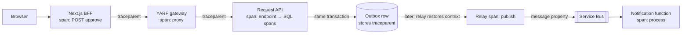

# Lecture Script: Logging, Log File Analysis and Observability

> **Instructor reference.** Phase 4: Log files, security and non-functional testing (Focus area 5), Module 11 | Duration: 6 hours (2.5 h concepts and demos, 3.5 h hands-on), run as Day 16 (3 h, Segments 1–8) and Day 17 (3 h, Segments 9–15) | Previous script: [Module 10 — Serverless Programming with Azure Functions](../Phase-3/Module-10-Serverless-Azure-Functions.md)

## Session overview

**Goal.** Learners make ProcureFlow explainable. They rewrite `LOGGING.md` as a full standard and implement it in the platform packages, find the root cause of a seeded month-end incident from 200 MB of raw log files and again with KQL, follow one requisition across every component in a single distributed trace, find a memory leak in a running container from a dump, and build a RED dashboard with an SLO alert linked to a runbook (Capstone increment CI-11).

**Learner profile at this point.** Learners have built ProcureFlow end to end: screens and BFF (Module 6), APIs, gateway and resilience (Module 7), the data layer with audit tables (Module 8), background work, SignalR and caching (Module 9), and Service Bus events, Durable escalation and a nightly report in Functions (Module 10). Logging so far: `LOGGING.md` drafted in Module 3, correlation IDs and structured logging in the Module 5 platform, and "IDs only" rules in every lab since. One approval now touches the web app, the gateway, the Request API, SQL, the outbox, Service Bus and two functions. Today introduces the first genuinely new idea of Phase 4: **observability: designing the system so that someone who didn't build it can answer "what happened, and why?" from evidence alone.**

**Key outcome.** Every learner can decide what to log at which level with event IDs and message templates; apply the rules for application, audit, security and access logs; configure `ILogger` (and know Serilog) in .NET, and log properly in Next.js and Azure Functions; choose formats, rotation, retention and archival; keep personal data, secrets and tokens out of logs; build an incident timeline from raw files with `grep`, `jq`, `awk` and `Select-String`; query centralised logs with KQL; trace a request across services, queues and functions with OpenTelemetry; design RED and USE dashboards with log- and SLO-based alerts; capture and analyse a memory dump from a container; and run a 5 Whys analysis into a blameless postmortem.

**Case for this session.** ProcureFlow at Meridian Components, continued. Relevant facts: NFR-PERF-01 (95% of submit and approve actions under 2 seconds at 140 concurrent users), NFR-AVL-01 (99.5% availability, 08:00 IST to 18:00 UK time on business days), NFR-SUP-01 (month-end approval outage: response within 1 hour), NFR-AUD-01 (audit records kept 8 years, in the database since Module 8). The program's NFRs add: **application logs kept 90 days, no personal data in logs, and a distributed trace across UI, gateway, services, queue, functions and database for every request.** Users are in India and the UK, so personal data falls under India's Digital Personal Data Protection Act 2023 and the UK GDPR. Confirm Meridian's obligations, and the retention for security logs, with its data protection lead and the CISO (log both as open questions). The trainer plays the tech lead and, in the opening, Priya on the phone.

**Note on tool versions.** .NET 8 or later with `Microsoft.Extensions.Logging`, the source-generated `[LoggerMessage]`, and .NET's compliance redaction packages (`Microsoft.Extensions.Compliance.Redaction`, `Microsoft.Extensions.Telemetry`). OpenTelemetry .NET with the Azure Monitor OpenTelemetry distro; OpenTelemetry for Node.js in Next.js (`instrumentation.ts`); OpenTelemetry support in the Azure Functions isolated worker (check its current status and host settings). Locally, the standalone .NET Aspire dashboard (a container) shows logs, traces and metrics over OTLP. `jq`, `awk` and `grep` (Git Bash or WSL on Windows), PowerShell 7, `dotnet-counters`, `dotnet-dump`, `dotnet-trace`. Some OpenTelemetry instrumentation packages are still pre-release; check status before depending on one. Check `--help` and current docs on the day.

**Note on licences and prices.** Every new package goes through the Module 5 package gate. Centralised-logging products differ: OpenSearch is Apache-2.0; Grafana Loki is AGPL-3.0; Elasticsearch's licensing has changed more than once; Seq is commercial with a free tier. Re-check before recommending one. Log ingestion and retention are billed by volume: never quote a price; use the calculator and date it.

**Note on AI output.** AI hypotheses and summaries vary run to run; examples are marked **illustrative**. Dataset counts, timings and dump statistics depend on the seeded data and machine; all such output here is illustrative.

## Timing breakdown

| Segment | Duration | Cumulative | Kind |
| --- | --- | --- | --- |
| SEGMENT 1: Opening — Logging Design | 20 min | 0:20 | Concept + demo |
| SEGMENT 2: Log Types, Rules and Protecting Log Content | 15 min | 0:35 | Concept + demo |
| SEGMENT 3: Logging in .NET, Next.js and Functions; Formats and Retention | 15 min | 0:50 | Concept + demo |
| SEGMENT 4: Lab 1 — LOGGING.md, Implemented in the Platform | 45 min | 1:35 | Hands-on |
| **BREAK** | 10 min | — |  |
| SEGMENT 5: Reading Raw Log Files | 15 min | 1:50 | Concept + demo |
| SEGMENT 6: Root-Cause Analysis: Timelines, 5 Whys, Blameless Postmortems | 10 min | 2:00 | Concept + demo |
| SEGMENT 7: Centralised Logging and KQL | 15 min | 2:15 | Concept + demo |
| SEGMENT 8: Lab 2 — Log File Forensics | 45 min | 3:00 | Hands-on |
| **END OF DAY 16** | — | — |  |
| SEGMENT 9: Distributed Tracing With OpenTelemetry | 20 min | 3:20 | Concept + demo |
| SEGMENT 10: Lab 3 — One Requisition, One Trace | 40 min | 4:00 | Hands-on |
| **BREAK** | 10 min | — |  |
| SEGMENT 11: Remote Debugging and Diagnostics | 15 min | 4:15 | Concept + demo |
| SEGMENT 12: Lab 4 — Find the Leak | 35 min | 4:50 | Hands-on |
| **BREAK** | 10 min | — |  |
| SEGMENT 13: Metrics, Dashboards and Alerts | 15 min | 5:05 | Concept + demo |
| SEGMENT 14: Lab 5 — RED Dashboard and SLO Alert | 30 min | 5:35 | Hands-on |
| SEGMENT 15: CI-11 Review and Wrap-Up | 25 min | 6:00 | Hands-on + close |

Concepts and demos: 20 + 15 + 15 + 15 + 10 + 15 + 20 + 15 + 15 + 10 (close) = 150 min (42%). Labs and CI-11 review: 45 + 45 + 40 + 35 + 30 + 15 = 210 min (58%). Total 360 min = 6 h, matching the module's 2.5 h / 3.5 h split. Day 16: Segments 1–8 = 180 min; Day 17: Segments 9–15 = 180 min. Breaks are not counted.

## SEGMENT 1: Opening — Logging Design (20 min)

### The Hook (7 min)

**Do:** Play Priya on the phone, reading from a card.

> *"Approvals failed for about twenty minutes this morning, right at month-end. My CFO wants to know three things by lunch: what happened, who was affected, and will it happen again."*

**Show one slide: "What the team found in the first hour".**

> 1. Six places to look: App Service logs (switched off), the gateway's access log, the Request API's console output, the Catalogue's, the Functions portal, and SQL.
> 2. The Request API logs plain text; the Catalogue logs JSON; the functions log in a different time zone.
> 3. "Error processing request" appears 4,000 times with no requisition number and no correlation ID.
> 4. The notification function's logs can't be connected to the approval that caused them.
> 5. One log line contains a requester's email address. Another contains a full bearer token.
> 6. After three hours, the best answer anyone has is "probably the database".

**Ask:** *"You have one hour, not three. What would you need to have been true **this morning, before the incident**, to answer Priya's three questions quickly?"*

**Do:** Take 4–5 answers. Write them on the board.

**Respond to likely answers:**

- *"More logs."* → *"We had 4,000 lines of 'Error processing request'. Was the problem quantity?"*
- *"A correlation ID."* → *"Module 5 gave us one. Why didn't it reach the function?"*
- *"Logs in one place."* → *"Yes. And in one format, one time zone, searchable."*
- *"Remove the token from the log."* → *"Today, yes. How do we stop the next one being written?"*

**Write on board, large, and leave it up all day:**

> **Log for the person reading it at 2 a.m.: structured, safe, connected.**

### What to Log, at Which Level (5 min)

| Level | Means | ProcureFlow example | In production |
| --- | --- | --- | --- |
| Trace / Debug | Developer detail | Cache key computed; SQL parameters | Off (switch on per service, briefly) |
| Information | A business or lifecycle event worth counting | Requisition REQ-2041 approved at step 2 | On |
| Warning | Something unexpected; the system coped | Catalogue cache read failed; used the database | On; watched |
| Error | An operation failed | Approval save failed; ProblemDetails 500 returned | On; alert on rate |
| Critical | The service can't do its job | Can't reach SQL at startup | On; page someone |

**Say:** *"Three rules beat any list. Log **events**, not narration: 'approved', not 'entering method Approve'. Log each failure **once**, where it's handled, not at every layer it passes through. And give every event a stable **event ID**, so you can count it, alert on it and find it, even when someone rewords the message."*

### Live Demo: Text Versus Structure (6 min)

```csharp
// Before: a string, built by hand
logger.LogInformation($"Requisition {number} approved by {approverEmail} at step {step}");

// After: an event with an ID, a message template and named properties (source-generated, no allocation when disabled)
public static partial class RequisitionLog
{
    [LoggerMessage(EventId = 1202, Level = LogLevel.Information,
        Message = "Requisition {RequisitionNumber} approved at step {Step} by approver {ApproverId}")]
    public static partial void Approved(ILogger logger, string requisitionNumber, int step, string approverId);
}

RequisitionLog.Approved(logger, requisition.Id.Value, step, approverId);
```

**Do:** Show both in the JSON console output side by side.

**Example output (illustrative — field names depend on the formatter):**

```json
{"Timestamp":"2026-03-31T04:35:12.481Z","EventId":1202,"LogLevel":"Information",
 "Category":"ProcureFlow.Requisitioning.Application.ApproveRequisitionHandler",
 "Message":"Requisition REQ-2041 approved at step 2 by approver 3f9c…",
 "State":{"RequisitionNumber":"REQ-2041","Step":2,"ApproverId":"3f9c…",
          "{OriginalFormat}":"Requisition {RequisitionNumber} approved at step {Step} by approver {ApproverId}"},
 "Scopes":[{"CorrelationId":"4bf92f3577b34da6a3ce929d0e0e4736"}]}
```

**Say:** *"The first version gives you a sentence. The second gives you fields: you can filter `RequisitionNumber == 'REQ-2041'`, count event 1202 per minute, and group by step. Notice the string interpolation `$\"...\"` is gone: it builds the string even when the level is off, and it throws the structure away. And the approver is an ID, not an email address. That's rule 5 on the slide, fixed at the source."*

### Comprehension Check (2 min)

1. *"The Catalogue cache read fails and the code falls back to the database. Which level?"* (Warning: unexpected, handled.)
2. *"An exception is caught and logged in the repository, the handler and the middleware. What's wrong?"* (One failure, three log entries; log it once, where it's handled.)

**Common misconception:** "more logging is safer." (Unstructured volume hides the signal and raises cost; the right events, structured, are what help.)

**Re-teach trigger:** if learners can't pick levels, sort six ProcureFlow events onto the level table together.

**Transition — Say:** *"Not all logs are the same kind, and some must never contain certain things. That's rule 5 on the slide."*

## SEGMENT 2: Log Types, Rules and Protecting Log Content (15 min)

### Four Kinds of Log (5 min)

| Type | Question it answers | Written by | ProcureFlow retention | Rules |
| --- | --- | --- | --- | --- |
| Application | What did the software do? | Every service, via `ILogger` | 90 days (program NFR) | Structured; IDs not personal data; sampled at high volume, never errors |
| Audit | Who did what to which business record? | The domain, in the same transaction (Module 8) | 8 years, in SQL then archive (NFR-AUD-01) | Append-only; never sampled; not in the application log pipeline |
| Security | Who tried to do what they shouldn't? | Auth, authorisation, admin actions | Confirm with the CISO (open question) | Never sampled; alerts on patterns (Module 12 builds them) |
| Access | Which requests came in, from where, how fast? | Gateway, App Service front end | 90 days | No query-string secrets; client IPs are personal data in many laws |

**Say:** *"Each type has its own reader, its own retention and its own rules. Mixing them is how audit evidence ends up deleted after 90 days, or how a security event gets sampled away."*

### Protecting Log Content (5 min)

**Say:** *"Logs travel further than any database: to the central store, to support tools, to screenshots in chat, to vendors. Treat every log line as something a stranger might read."*

| Never log | Why | Instead |
| --- | --- | --- |
| Tokens, passwords, API keys, connection strings, realtime tickets | Anyone reading logs gets access | Nothing; at most "token present: yes" |
| Full request or response bodies | They contain everything below | Selected fields, by ID |
| Names, email addresses, phone numbers | Personal data under DPDP Act and UK GDPR | Directory object IDs |
| Vendor bank details, tax IDs | NFR-SEC-03; financial data | Vendor ID |
| Free text typed by users (justifications) | May contain anything | Length, or nothing |

**Say:** *"Two defences. The first is design: log IDs, never values, so there's nothing to mask. The second is a safety net: **redaction** in the platform, so a classified field is masked even when a developer slips. .NET has it built in: you classify data, and the logging pipeline redacts it for every log provider. An HMAC redactor even replaces a value with a consistent hash, so you can see that two log lines involve the same email without seeing the email."*

### Live Demo: Classify and Redact (3 min)

```csharp
// A classification for ProcureFlow personal data
public sealed class PersonalDataAttribute() : DataClassificationAttribute(ProcureFlowTaxonomy.PersonalData);

[LoggerMessage(EventId = 3101, Level = LogLevel.Warning,
    Message = "Notification to {RecipientEmail} failed for {EventId}")]
public static partial void NotificationFailed(ILogger logger, [PersonalData] string recipientEmail, string eventId);

// Platform registration (check the redaction APIs for your package version)
builder.Logging.EnableRedaction();
builder.Services.AddRedaction(r => r.SetRedactor<ErasingRedactor>(new DataClassificationSet(ProcureFlowTaxonomy.PersonalData)));
```

**Do:** Trigger the warning. Show the email replaced by an empty value in the output.

### Comprehension Check (2 min)

1. *"A developer logs the whole `SubmitRequisitionRequest` object 'for debugging'. Which two rules does that break?"* (Full bodies; user free text, the justification.)
2. *"Why keep audit records out of the application log pipeline?"* (Different retention, protection and reader; application logs are sampled and deleted after 90 days.)

**Common misconception:** "masking makes it safe to log anything." (Masking is a net; data you never log can't leak.)

**Re-teach trigger:** if learners log emails "for support", ask: *"What does support do with the email that they couldn't do with the directory ID?"*

**Transition — Say:** *"Now, the tools in each part of our stack."*

## SEGMENT 3: Logging in .NET, Next.js and Functions; Formats and Retention (15 min)

### ILogger and Serilog (5 min)

**Say:** *"In .NET, code always logs through `ILogger<T>`. What happens to the events is the **provider's** job: console, file, OpenTelemetry, or a library like **Serilog**, which adds rich enrichment, many sinks, and the compact JSON format our incident files use today."*

```csharp
// Serilog as the provider (an alternative; package gate first)
builder.Services.AddSerilog((services, cfg) => cfg
    .ReadFrom.Configuration(builder.Configuration)
    .Enrich.FromLogContext()
    .Enrich.WithProperty("Service", "procureflow-request-api")
    .WriteTo.Console(new Serilog.Formatting.Compact.RenderedCompactJsonFormatter())
    .WriteTo.File(new Serilog.Formatting.Compact.CompactJsonFormatter(), "logs/request-api-.json",
                  rollingInterval: RollingInterval.Day, retainedFileCountLimit: 14));
```

**Say:** *"ProcureFlow's platform uses the built-in pieces: `ILogger`, JSON console output, .NET redaction and OpenTelemetry export. Fewer dependencies, and redaction applies to every provider the same way. Serilog is a strong, common choice; if a team prefers it, it goes through the package gate and an ADR, and it must keep the same fields and redaction. Whichever you choose, code depends on `ILogger`, never on the provider."*

### Next.js and Functions (4 min)

| Where | How | Watch out for |
| --- | --- | --- |
| Next.js server (route handlers, server actions, server components) | A JSON logger such as pino with its `redact` paths; include the trace ID | `console.log` of objects that include cookies or tokens; logging from client components ends up in the browser, not your logs |
| Azure Functions (isolated) | `ILogger<T>` through DI, as in any .NET service | Log levels in `host.json`; Application Insights **sampling** can drop log lines; exclude errors and security events from sampling |
| Browser | Only what's needed for support (errors, with the trace ID), via a telemetry SDK | Never personal data; it all crosses the internet |

### Formats, Rotation, Retention and Archival (4 min)

| Format | Example | Use |
| --- | --- | --- |
| JSON (one object per line) | `{"@t":"2026-03-31T04:35:12Z","@mt":"…","RequisitionNumber":"REQ-2041"}` | Machine-readable: `jq`, central stores |
| Plain text | `2026-03-31 10:05:12 ERR Approval failed …` | Humans only; hard to query |
| Web access log (combined format) | `10.1.2.3 - - [31/Mar/2026:10:05:12 +0530] "POST /v1/… HTTP/1.1" 500 312 …` | Gateways and web servers |

**Say:** *"Containers and App Service: write to standard output and let the platform collect it; rotation is the platform's job. Files on disk (local tools, some on-premises servers) need **rotation** by size or day and a **retention** limit, or the disk fills at month-end. Central stores need a retention setting per table: 90 days interactive for application logs; anything longer moves to cheaper archive tiers, priced in the calculator."*

### Comprehension Check (2 min)

1. *"Why must code depend on `ILogger<T>` rather than Serilog's `Log.Information`?"* (So providers can change without touching code, and tests can capture logs.)
2. *"The function's logs are missing some warnings in Application Insights. First suspect?"* (Sampling.)

**Common misconception:** "JSON logs are for machines, so humans can't read them." (Every viewer renders them; `jq` makes them readable in a terminal.)

**Re-teach trigger:** if learners confuse API and provider, draw `ILogger` as a socket and the providers as plugs.

**Transition — Say:** *"Write the standard, and make the platform enforce it."*

## SEGMENT 4: Lab 1 — LOGGING.md, Implemented in the Platform (45 min)

**Say:** *"Module 3's `LOGGING.md` was a first draft. Rewrite it as the standard you'd want at 2 a.m., then make the platform packages implement it, so every service gets it right by default, Module 5's line. Tests prove the masking works."*

### Instructions (read aloud, step by step)

1. **Rewrite `LOGGING.md` (12 min).** Use the skeleton below: levels with ProcureFlow examples, required fields, event ID ranges per module, the four log types with retention, the never-log list, sampling rules, and the time rule (UTC everywhere; display converts).
2. **Platform: format and correlation (10 min).** In `ProcureFlow.Platform.Logging`: JSON console output with scopes; `Service`, `Version` and `Environment` on every entry; and the correlation ID set from the current trace ID (`Activity.Current.TraceId`) when no valid incoming `X-Correlation-ID` exists, so logs and traces share one ID from today.
3. **Platform: redaction (10 min).** Add ProcureFlow's data classifications (`PersonalData`, `Secret`, `Financial`) and enable redaction. Tests: an email, a token and a bank account number classified with these attributes never appear in captured log output.
4. **Event IDs (8 min).** Convert the Requisitioning module's logs to `[LoggerMessage]` methods with IDs in its range. Remove every interpolated log string in that module.
5. **Next.js and Functions (5 min).** Next.js: a JSON logger with redact paths for `authorization`, `cookie` and `token`, and the trace ID on each line. Functions: check `host.json` log levels and exclude errors from sampling. Release the platform as a MINOR version.

### Starter: LOGGING.md Skeleton

```markdown
# LOGGING.md — ProcureFlow

## Levels
| Level | Use for | Example |
## Required fields (every entry)
Timestamp (UTC) · Level · EventId · Service · Version · Environment · TraceId / CorrelationId · message template + properties
## Event ID ranges
1000–1999 Requisitioning · 2000–2999 Catalogue · 3000–3999 Notifications · 4000–4999 Escalation ·
5000–5999 Reporting · 8000–8999 Platform · 9000–9999 Security (Module 12)
## Log types and retention
Application 90 days · Access 90 days · Security: <confirm with CISO> · Audit: 8 years in SQL + archive (not in this pipeline)
## Never log
Tokens · passwords · keys · connection strings · realtime tickets · request/response bodies ·
names · emails · phone numbers · bank details · tax IDs · user free text
## Sampling
Information may be sampled at high volume. Never sample Warning and above, or any security event.
## Time
UTC in every log. Convert to IST / UK time only for display.
```

### Reference Solution (instructor, partial)

```csharp
public static IHostApplicationBuilder AddProcureFlowLogging(this IHostApplicationBuilder builder)
{
    builder.Logging.ClearProviders();
    builder.Logging.AddJsonConsole(o =>
    {
        o.IncludeScopes = true;
        o.UseUtcTimestamp = true;
        o.TimestampFormat = "yyyy-MM-ddTHH:mm:ss.fffZ";
    });
    builder.Logging.EnableRedaction();
    builder.Services.AddRedaction(r =>
    {
        r.SetRedactor<ErasingRedactor>(new DataClassificationSet(ProcureFlowTaxonomy.PersonalData, ProcureFlowTaxonomy.Secret));
        r.SetRedactor<ErasingRedactor>(new DataClassificationSet(ProcureFlowTaxonomy.Financial));
    });
    builder.Logging.Configure(o => o.ActivityTrackingOptions =
        ActivityTrackingOptions.TraceId | ActivityTrackingOptions.SpanId);   // trace and span IDs on every entry
    return builder;
}
```

```csharp
[Fact]
public void Personal_and_secret_data_never_reaches_the_log()
{
    var sink = new FakeLogCollector();                     // Microsoft.Extensions.Diagnostics.Testing (package gate)
    var logger = TestLoggerFactory.WithPlatformRedaction(sink).CreateLogger("test");

    NotificationLog.NotificationFailed(logger, recipientEmail: "anita.rao@meridian.example", eventId: "e1");

    var line = sink.LatestRecord.ToString();
    Assert.DoesNotContain("anita.rao", line);
    Assert.Contains("e1", line);
}
```

**Say:** *"The test is the point. A masking rule without a test is a hope. And when someone adds a new sensitive field next month, the classification attribute is the one-line change, and the test pattern shows how to prove it."*

**Note:** the exact names of the redaction, enrichment and fake-logger test APIs have moved between package versions; use the samples for your version, and keep the test even if the setup code changes.

### Instructor Circulates

- **"Never log" list without a test:** add the test before moving on.
- **Correlation ID still a fresh GUID:** use the trace ID, so tomorrow's traces and today's logs join on one value.
- **Event IDs reused across modules:** ranges per module, recorded in `LOGGING.md`.
- **Local time in timestamps:** UTC everywhere; the incident lab shows why.
- **Next.js logging whole request objects:** they contain cookies; log selected fields.
- **Platform change released as PATCH:** it adds behaviour, so it's MINOR (Module 5).

**Success check:** `LOGGING.md` merged with every skeleton section filled; the platform emits structured JSON with service, version, environment, trace and correlation IDs; redaction tests pass for personal, secret and financial data; Requisitioning uses event-ID logging only; Next.js and Functions conform; platform MINOR released.

**Extension (fast teams):** switch the Financial classification to an HMAC redactor and show that two log lines for the same vendor share a hash without showing the bank details (check whether the HMAC redactor is marked experimental in your version).

### BREAK (10 min)

*Suggested break prompt:* *"You get 200 MB of log files and one question: when did it start? What's the first command you'd type?"*

## SEGMENT 5: Reading Raw Log Files (15 min)

### Four Tools (4 min)

**Ask:** *"Your break question: the first command?"* (Expect `grep -c "Error"`, or "open it in an editor": 200 MB won't open comfortably.)

| Tool | Best at | Example |
| --- | --- | --- |
| `grep` | Finding and counting lines with text | `grep -c "connection from the pool" request-api/*.json` |
| `jq` | Filtering and reshaping JSON lines | `jq -r 'select(.["@l"]=="Error") \| .["@t"]' request-api/*.json` |
| `awk` | Columns in text logs (access logs) | `awk '{print $9}' access.log \| sort \| uniq -c` |
| PowerShell `Select-String` | The same on Windows without extra tools | `Select-String -Path .\request-api\*.json -Pattern 'pool' \| Measure-Object` |

### Live Demo: From 200 MB to a Timeline (8 min)

**Do:** In the incident folder from today's lab (a smaller copy for the demo), build the first lines of a timeline live. The files use Serilog's compact JSON (`@t` time in UTC, `@mt` template, `@l` level, absent for Information, `@x` exception).

```bash
# 1. When did errors start, per minute (UTC)?
jq -r 'select(.["@l"]=="Error") | .["@t"][0:16]' request-api/*.json | sort | uniq -c | head -20

# 2. What were they? Group by the exception's first line
jq -r 'select(.["@l"]=="Error") | (.["@x"] // .["@mt"]) | split("\n")[0]' request-api/*.json | sort | uniq -c | sort -rn | head

# 3. Which requests were slow at the gateway? (combined log format; last field = duration in seconds; times are IST!)
awk '$NF > 5 { split($7, p, "?"); print substr($4, 14, 5), p[1] }' gateway/access.log | sort | uniq -c | sort -k2 | head -30
```

**Example output (illustrative — counts depend on the seeded dataset):**

```
   3 2026-03-31T04:34
  41 2026-03-31T04:35
 612 2026-03-31T04:36
...
1874 System.InvalidOperationException: Timeout expired. The timeout period elapsed prior to obtaining a connection from the pool.
...
  12 10:02 /v1/requisitions/export.csv
  19 10:03 /v1/requisitions/export.csv
```

**Say:** *"Stop and look at the times. The API logs say 04:35 **UTC**. The gateway's access log says 10:02 in **IST**, which is 04:32 UTC. If you don't convert, the slow exports seem to start half an hour **after** the errors, and the timeline lies. Convert everything to UTC before you put a single line on the timeline. That's why `LOGGING.md` now says UTC everywhere."*

### Comprehension Check (3 min)

1. *"`jq` shows the first errors at 04:35 UTC; the access log shows slow exports from 10:02 IST. Which came first?"* (The exports: 10:02 IST is 04:32 UTC.)
2. *"Why group by the exception's first line rather than the whole message?"* (Stack traces and IDs make every message unique; the first line groups the same failure together.)

**Common misconception:** "the first error in the log is the cause." (It's the first *symptom* logged; causes often show as warnings, slow requests or a change minutes earlier.)

**Re-teach trigger:** if learners skip the time-zone step, put two lines on the board, one IST and one UTC, and ask which happened first.

**Transition — Say:** *"Counts and times are evidence. Turning evidence into a cause takes a method."*

## SEGMENT 6: Root-Cause Analysis: Timelines, 5 Whys, Blameless Postmortems (10 min)

### Timeline First (3 min)

**Say:** *"Every investigation starts with a timeline in one time zone: what changed, what users saw, what the system logged, what people did. Changes go on it too: deploys, configuration, a new scheduled job at Meridian. Most incidents start with a change."*

### 5 Whys, Worked Example (3 min)

**Say:** *"5 Whys: ask 'why?' about the impact until you reach something you can fix that stops the whole chain. Use the evidence at each step; never guess a 'why'."*

| Why? | Answer (from a different, past incident) | Evidence |
| --- | --- | --- |
| Why did approvers see errors? | The approve endpoint returned 500 | Gateway access log, 500s on `/approvals` |
| Why 500s? | SQL commands timed out | Request API exceptions |
| Why timeouts? | A new query scanned the whole `LineItems` table | Query Store; execution plan |
| Why did it scan? | A migration dropped an index during a rename | Migration diff in the release |
| Why wasn't it caught? | Migration SQL wasn't reviewed; no plan check in CI | PR history |

**Say:** *"The last 'why' is usually about the system of work, not a person: a missing check, a missing test, a missing alert. That's where the best fix lives."*

### Blameless Postmortems (2 min)

**Say:** *"Blameless doesn't mean nobody is accountable. It means we assume people acted sensibly with what they knew, and we fix the conditions that made the mistake easy. If the report says 'developer X forgot', the next person will forget too. If it says 'migrations weren't reviewed as SQL', we can fix that."*

### Comprehension Check (2 min)

*"A 5 Whys ends with 'because the developer made a mistake'. What's the next 'why'?"* (Why did the system let that mistake reach production: which review, test or check was missing?)

**Common misconception:** "root cause means the single person or line responsible." (Most incidents have contributing factors; the useful answer is the fixable condition.)

**Re-teach trigger:** if learners stop at a technical symptom, ask "why?" once more out loud until a process or design condition appears.

**Transition — Say:** *"Raw files work anywhere. A central store makes the same questions take seconds."*

## SEGMENT 7: Centralised Logging and KQL (15 min)

### The Options (5 min)

| Option | What it is | Fits | Notes |
| --- | --- | --- | --- |
| Azure Application Insights (Azure Monitor) | Managed logs, traces and metrics; KQL queries | Azure-hosted apps; ProcureFlow's choice (Module 4) | Billed by data ingested and retained; sampling options |
| Seq | A structured-log server, great for development and small teams | Local and small deployments | Commercial with a free tier; check terms |
| ELK / OpenSearch | Search-based log platforms (Elasticsearch or OpenSearch, with ingest and dashboards) | Large self-hosted estates | Licensing differs between them; operational effort |
| Grafana Loki | Log store indexed by labels; pairs with Grafana | Kubernetes-heavy, cost-sensitive teams | AGPL-3.0 |
| .NET Aspire dashboard (standalone) | A local OTLP viewer for logs, traces and metrics | Local development | Not for production |

**Say:** *"ProcureFlow: Application Insights in the cloud, because we're on Azure and it holds logs, traces and metrics together; the Aspire dashboard locally, because it speaks OpenTelemetry and needs no account. Clients on other stacks will have Loki or OpenSearch; the skills transfer, the query language changes."*

### Live Demo: KQL on the Incident (7 min)

**Do:** Open the instructor's workspace, which holds the same incident's telemetry as today's raw files.

```kusto
// Requests per minute around the incident: volume, failures, p95 (times in UTC)
requests
| where timestamp between (datetime(2026-03-31 04:20) .. datetime(2026-03-31 05:20))
| summarize total = count(), failed = countif(success == false), p95_ms = percentile(duration, 95)
    by bin(timestamp, 1m), name
| order by timestamp asc
```

```kusto
// What failed, grouped, with one sample operation to follow
exceptions
| where timestamp between (datetime(2026-03-31 04:20) .. datetime(2026-03-31 05:20))
| summarize count(), sample_operation = any(operation_Id) by type, outerMessage
| order by count_ desc
```

**Say:** *"`operation_Id` is the trace ID. Paste it into the transaction search and you see every service that request touched: tomorrow's subject. Table names depend on where you query: in the Application Insights resource they're `requests`, `exceptions`, `traces`; in the underlying Log Analytics workspace they're `AppRequests`, `AppExceptions`, `AppTraces`, with slightly different column names."*

### Comprehension Check (3 min)

1. *"Write the KQL idea for 'which endpoints got slower after 04:30?'"* (Filter `requests` by time, `summarize percentile(duration, 95) by name, bin(timestamp, 5m)`, compare before and after.)
2. *"Why might Application Insights show fewer log lines than the raw files?"* (Sampling, or ingestion limits; check the sampling settings before trusting counts.)

**Common misconception:** "a central log store means we never need raw files." (Agents fail, sampling drops lines, retention expires, clients send you files: raw-file skills stay essential.)

**Re-teach trigger:** if learners can't read the KQL, rewrite the first query line by line as English on the board.

**Transition — Say:** *"Now the real thing: 200 MB, a month-end incident, and Priya's three questions."*

## SEGMENT 8: Lab 2 — Log File Forensics (45 min)

**Say:** *"`incident-2026-03-31/` holds 200 MB of raw logs from a seeded month-end incident: the Request API, the Catalogue, the gateway's access log, the functions and the SQL error log. Find the root cause with `grep`, `jq` and `awk` first. Ask an AI for a hypothesis, but accept a cause only with log evidence. Then answer the same questions in KQL, timed, and compare. Write it up as a blameless incident report."*

### Instructions (read aloud, step by step)

1. **Raw files (15 min).** Build a timeline in UTC: first symptom, peak, recovery, and anything that changed just before. Answer: what failed, which users were affected (by role and count, not by name), and when.
2. **AI hypothesis (5 min).** Give the AI the prompt below with 50–100 representative log lines you chose (redacted already, by design). Record its hypothesis.
3. **Verify (5 min).** For each claim in the hypothesis, find supporting or contradicting log lines. Mark it *confirmed*, *contradicted* or *unproven*.
4. **KQL, timed (10 min).** Answer the same three questions in the instructor's workspace. Time yourselves. Note anything KQL showed that the files didn't, and the reverse.
5. **Report (10 min).** Write `docs/incidents/2026-03-31-month-end-approvals.md` from the template: impact, timeline, root cause with evidence, 5 Whys, contributing factors, actions, and the raw-files-versus-KQL comparison.

### The AI Prompt (give to learners)

```
Here are log lines from a procurement system's month-end incident (times are UTC unless
marked IST). Propose the most likely root cause and up to two alternatives. For each,
list the exact log lines that support it, the log lines that would contradict it, and
the next query you would run to confirm it. Do not assume facts not in the lines.
```

### Starter Template

```markdown
# Incident: approvals failing at month-end (2026-03-31)
## Impact
Who (roles, counts), what they saw, for how long
## Timeline (UTC)
| Time | Source | Event | Evidence (file / query) |
## Root cause
## 5 Whys
## Contributing factors
## What went well
## Actions (owner, due date)
## Raw files versus KQL
| Question | Raw files (time, commands) | KQL (time, query) | Notes |
## AI hypothesis
Claim · verdict (confirmed / contradicted / unproven) · evidence
```

### Reference Solution (instructor only — the seeded incident)

**Root cause:** from 10:02 IST (04:32 UTC), a Meridian finance script began calling `GET /v1/requisitions/export.csv` for full-year ranges, once a minute, retrying on timeout. Module 9's export streams correctly, but each export holds one SQL connection for its whole duration (minutes for a year of data). By 04:35 UTC, about 100 concurrent exports held the Request API instance's connection pool (100 by default per connection string, per instance). Approvals, submits and status reads then waited for a connection and failed with *"Timeout expired … prior to obtaining a connection from the pool"*. The script's retries made it worse. It recovered at 04:56 UTC when the script was stopped.

**Decoys planted in the data:** Redis timeout warnings at 04:41 UTC (a symptom: thread-pool pressure from blocked requests), and a SignalR reconnect burst (clients reconnecting during the slowdown).

**Expected 5 Whys:** approvals failed → no SQL connection available → pool exhausted by long exports → no limit on concurrent exports, and exports share the pool with user traffic → the export was designed for occasional human use, and the workload wasn't reviewed against Module 1's month-end peak.

**Expected actions:** a concurrency limit on exports (ASP.NET Core rate limiting, a concurrency limiter for that endpoint); a separate connection string (separate pool), or a read replica, for exports; point the finance team to the nightly report (Module 10) or a scheduled export; an alert on pool wait time or SQL connection timeouts; a load test with exports running during month-end traffic (Module 13).

**Example AI hypothesis (illustrative — varies by run):** often "Redis outage caused slow catalogue lookups" (contradicted: the Redis warnings start after the SQL pool timeouts, and approvals don't use the catalogue), or "database server overloaded" (partly: CPU is moderate; the bottleneck is the client-side pool). It rarely spots the export pattern unless the access-log lines are included, which is a lesson in choosing evidence.

### Instructor Circulates

- **Timeline mixing IST and UTC:** convert before plotting.
- **"Redis was down" accepted from the AI:** *"Which line came first, the pool timeout or the Redis warning?"*
- **Root cause stated without a log line:** every claim cites a file and a line or query.
- **Report names a person:** rewrite blamelessly; name conditions and checks.
- **Users listed by name or email:** roles and counts only.

**Success check:** a UTC timeline with evidence for each line; root cause confirmed by log lines (pool exhaustion from concurrent long exports); decoys identified as symptoms; AI hypothesis marked claim by claim; KQL comparison timed; blameless report with actions committed.

### END OF DAY 16

*Overnight prompt:* *"In your incident, which request did the notification function's failure belong to? How would you prove it?"*

## SEGMENT 9: Distributed Tracing With OpenTelemetry (20 min)

### Traces, Spans and Context (5 min)

**Ask:** *"The overnight prompt: how would you prove which request a function's failure belonged to?"* (Expect: a shared ID across all components.)

**Say:** *"A **trace** is one request's whole journey. It's made of **spans**: one per unit of work (an HTTP call, a SQL command, a message send), each with a start, a duration and a parent. **Context propagation** carries the trace ID from one process to the next: in HTTP, the W3C `traceparent` header; in Service Bus, a message property. **OpenTelemetry** is the vendor-neutral standard: instrument once, export anywhere."*

### Setting It Up (5 min)

```csharp
// Platform: one call for every .NET service (Azure Monitor distro in the cloud; OTLP locally)
builder.Services.AddOpenTelemetry()
    .ConfigureResource(r => r.AddService(serviceName: "procureflow-request-api", serviceVersion: version))
    .WithTracing(t => t.AddSource("ProcureFlow.*"))       // our own spans (outbox relay, workers)
    .UseAzureMonitor();                                     // includes ASP.NET Core, HttpClient, SQL and Azure SDK instrumentation

// Locally: export over OTLP to the Aspire dashboard instead
// OTEL_EXPORTER_OTLP_ENDPOINT=http://localhost:4317  (with .UseOtlpExporter())
```

```ts
// web/instrumentation.ts — Next.js runs this once on the server
export async function register() {
  if (process.env.NEXT_RUNTIME === "nodejs") {
    const { useAzureMonitor } = await import("@azure/monitor-opentelemetry");   // or the OpenTelemetry Node SDK with OTLP locally
    useAzureMonitor();
  }
}
```

**Say:** *"Check what each piece instruments for your versions: some instrumentation is still pre-release, and outgoing `fetch` from Next.js may need its own instrumentation before it sends `traceparent`. Verify by looking at the gateway's incoming headers, not by trusting the setup code."*

### Where Traces Break (5 min)



**Say:** *"HTTP hops propagate automatically. Two places break the chain. First, the **outbox**: the relay publishes seconds later, on a background thread, with no current request. So we store the `traceparent` on the outbox row and start the relay's span as its child. Second, **asynchronous consumers**: the function must continue the trace from the message's properties. The Service Bus SDK and the Functions OpenTelemetry integration handle that, if they're enabled."*

```csharp
// Writing the outbox row (same transaction as the change)
outbox.Add(new OutboxMessage(evt.EventId, evt.Type, payload) { TraceParent = Activity.Current?.Id });

// Relay: continue the original trace
private static readonly ActivitySource Source = new("ProcureFlow.Outbox");
using var activity = Source.StartActivity("outbox publish", ActivityKind.Producer, parentId: message.TraceParent);
await sender.SendMessageAsync(sbMessage, ct);    // Azure SDK stamps the current context onto the message
```

### Live Demo: One Trace (3 min)

**Do:** In the Aspire dashboard, open a trace for a submitted requisition: Next.js span → gateway → Request API → SQL spans → outbox insert. Then show the separate, unconnected trace for the relay and the function: the break the lab will fix.

### Comprehension Check (2 min)

1. *"Why does the outbox break the trace, and what fixes it?"* (The relay runs later without the request's context; store `traceparent` with the row and start the publish span with it as parent.)
2. *"What's the difference between the correlation ID and the trace ID in ProcureFlow from today?"* (None: the platform sets the correlation ID from the trace ID, so logs and traces join on one value; the header stays for compatibility.)

**Common misconception:** "installing OpenTelemetry gives end-to-end traces automatically." (Asynchronous hops, background work and some libraries need explicit context propagation.)

**Re-teach trigger:** if learners can't explain propagation, pass a sticky note with a trace ID from learner to learner ("services"); one learner puts it in a drawer ("outbox") and another takes it out later.

**Transition — Say:** *"Make the whole journey one trace."*

## SEGMENT 10: Lab 3 — One Requisition, One Trace (40 min)

**Say:** *"Follow one requisition from the Next.js server through the gateway, the Request API, SQL, the outbox, Service Bus and the notification function, in a single trace. Where the trace breaks, fix it or document why it can't be joined."*

### Instructions (read aloud, step by step)

1. **.NET services (10 min).** Add OpenTelemetry to the platform (Segment 9): Request API, Catalogue, gateway. Locally, export over OTLP to the Aspire dashboard container. Confirm the gateway's span sits between the BFF and the API.
2. **Next.js (8 min).** Add `instrumentation.ts`. Submit a requisition; check that the gateway receives a `traceparent` header from the BFF (log it at Debug once, then remove). If not, add fetch instrumentation.
3. **Outbox, Service Bus and the function (12 min).** Store `TraceParent` on outbox rows (migration); start the relay's publish span from it; enable Azure SDK tracing; enable OpenTelemetry in the function app (check the Functions host and worker settings for your version). Approve a requisition and find the notification function's span in the same trace.
4. **Follow it and record (10 min).** Screenshot or export the whole trace into `docs/observability/trace-walkthrough.md`. Label each span. List any remaining gap (for example, Durable orchestration replays, or the browser) and what it would take to close it.

### Starter: Aspire Dashboard Locally

```yaml
# docker-compose.observability.yml (check the image name and ports for the current version)
services:
  aspire-dashboard:
    image: mcr.microsoft.com/dotnet/aspire-dashboard
    ports: ["18888:18888", "4317:18889"]     # UI on 18888; OTLP gRPC on 4317
    environment:
      DOTNET_DASHBOARD_UNSECURED_ALLOW_ANONYMOUS: "true"   # local development only
```

### Reference Trace (instructor debrief)

**Example (illustrative — span names and durations vary):**

```
POST /api/requisitions/REQ-2041/approve          procureflow-web           310 ms
└─ POST /v1/requisitions/{id}/approvals          procureflow-gateway       288 ms
   └─ POST /v1/requisitions/{id}/approvals       procureflow-request-api   270 ms
      ├─ SELECT … FROM req.Requisitions          sql                         9 ms
      └─ UPDATE … ; INSERT audit … ; INSERT outbox   sql                    14 ms
   … 2.1 s later …
   └─ outbox publish                             procureflow-request-api    18 ms
      └─ send requisition-events                 servicebus                 15 ms
         └─ NotifyOnRequisitionEvent             procureflow-functions     420 ms
            └─ POST (email provider)             http                      380 ms
```

**Say:** *"One trace ID, every hop. And the 2.1-second gap is honest: that's the relay's polling interval, visible for the first time. If Priya asks why notifications take two seconds, this picture is the answer, and the setting to change."*

### Instructor Circulates

- **Function span in its own trace:** check the Service Bus SDK tracing switch and the Functions OpenTelemetry settings.
- **Relay span not linked:** `TraceParent` not stored, or not passed as the parent.
- **Duplicate HTTP spans:** two instrumentations for the same library; remove one.
- **Request bodies or SQL parameters captured as span attributes:** the same never-log rules apply to traces; turn that capture off.
- **Durable orchestrations look odd:** replays can produce confusing spans; document it as a known gap if it can't be fixed today.

**Success check:** one trace shows the BFF, gateway, Request API, SQL, outbox publish, Service Bus and notification function; the walkthrough is labelled; remaining gaps are documented with a plan; no sensitive data in span attributes.

**Extension (fast teams):** add the browser: initialise a browser telemetry SDK that starts the trace on the click and sends `traceparent` to the BFF, with no personal data.

### BREAK (10 min)

*Suggested break prompt:* *"The Catalogue service's memory grows by 50 MB an hour and it restarts every night. Logs show nothing wrong. Where would you look?"*

## SEGMENT 11: Remote Debugging and Diagnostics (15 min)

### When Logs Aren't Enough (5 min)

| Tool | Captures | Use when | Cost to the running app |
| --- | --- | --- | --- |
| `dotnet-counters` | Live runtime metrics: GC heap, allocations, thread pool | First look: is memory growing? Is the pool starved? (Module 9) | Very low |
| `dotnet-trace` | CPU and event traces over a period | "Why is it slow?" | Low to moderate, while running |
| `dotnet-dump` | The whole managed heap at one moment | "What is holding all this memory?" | Pauses the process while writing; large file |
| Snapshot debugging (Application Insights) | Variables at the moment of an exception, in production | Exceptions you can't reproduce | Low; check support for your hosting |
| Remote debugger | Step through live code | Non-production only, with approval | High: pauses requests |

**Say:** *"Dumps contain everything in memory: tokens, personal data, connection strings. Treat a dump like a production database backup: approval to take it, encrypted storage, deleted when done. That goes in the runbook."*

### Getting Into a Container (5 min)

**Say:** *"Production images don't contain diagnostic tools, and they shouldn't. So we bring the tools in a separate container that shares the target's process space and its `/tmp` folder, where .NET's diagnostic socket lives."*

```bash
# Docker (local or a VM): the app container shares a /tmp volume via the diagnostics override
docker run --rm -it --pid=container:procureflow-catalogue -v pf-diag-tmp:/tmp \
  mcr.microsoft.com/dotnet/sdk:8.0 bash
# inside: install the tools, then the app is PID 1 in the shared process space
dotnet tool install -g dotnet-dump && dotnet tool install -g dotnet-counters
export PATH="$PATH:/root/.dotnet/tools"

# Kubernetes (Module 14): an ephemeral debug container targeting the app container
kubectl debug -it pod/catalogue-7d9f… --image=mcr.microsoft.com/dotnet/sdk:8.0 --target=catalogue
```

### Live Demo: Reading a Dump (3 min)

```text
$ dotnet-dump analyze /tmp/catalogue.dmp
> dumpheap -stat                  # objects by type, sorted by total size
> dumpheap -mt <method table>     # instances of the suspicious type
> gcroot <address>                # what keeps this object alive
```

**Say:** *"Three commands. Which type is huge? Show me some instances. What's holding one alive? The answer to the last question is almost always a static field, an event subscription, or a cache with no eviction."*

### Comprehension Check (2 min)

1. *"Why not just install `dotnet-dump` in the production image?"* (Bigger image, larger attack surface; tools come in only when needed, in a separate container.)
2. *"`gcroot` ends at a static `ConcurrentDictionary`. What's the likely bug?"* (An unbounded cache or map: entries added and never removed.)

**Common misconception:** "a memory leak can't happen in a garbage-collected language." (Anything still referenced, such as a static collection or an event handler, is never collected.)

**Re-teach trigger:** if learners can't read `gcroot`, draw the chain on the board: static field → dictionary → entry → object.

**Transition — Say:** *"Find it for real."*

## SEGMENT 12: Lab 4 — Find the Leak (35 min)

**Say:** *"The Catalogue container on branch `seeded/memory-leak` grows under load and never shrinks. Confirm it with counters, attach a diagnostics container, take a dump, and name the object that leaks and what holds it. Then fix it and prove the fix."*

### Instructions (read aloud, step by step)

1. **Reproduce (8 min).** Start the stack with the diagnostics override (shared `/tmp`). Run Module 9's catalogue k6 script for five minutes. In the diagnostics container, watch `dotnet-counters monitor -p 1 --counters System.Runtime`: GC heap size and gen-2 size. Record the trend.
2. **Attach and dump (7 min).** `dotnet-dump collect -p 1 -o /tmp/catalogue.dmp`. Note the dump's size, and that it now contains whatever was in memory.
3. **Analyse (12 min).** `dumpheap -stat`, then `dumpheap -mt` on the suspicious type, then `gcroot` on one instance. Name the leaking type, the root, and the source line. Record the commands and output in `docs/observability/leak-analysis.md`.
4. **Fix and verify (8 min).** Fix the code. Re-run the same k6 load; show the heap levelling off. Delete the dump file (and say so in the analysis).

### Starter: Diagnostics Override

```yaml
# docker-compose.diagnostics.yml (local only)
services:
  catalogue:
    container_name: procureflow-catalogue
    volumes: ["pf-diag-tmp:/tmp"]
volumes:
  pf-diag-tmp: {}
```

### Reference Solution (instructor)

**The seeded leak:** a "debugging aid" added to the Catalogue search handler:

```csharp
private static readonly ConcurrentDictionary<string, PagedResult<CatalogueItemDto>> LastResultByCorrelationId = new();
// …
LastResultByCorrelationId[correlationId] = result;     // one entry per request, never removed
```

**Example `dumpheap -stat` (illustrative — counts depend on the load run):** `CatalogueItemDto` and `PagedResult<CatalogueItemDto>` near the top with tens of thousands of instances; `gcroot` on one result leads through a `ConcurrentDictionary<String, PagedResult<…>>` to the static field `CachedCatalogueSearch.LastResultByCorrelationId`.

**Fix:** delete it. The correlation ID already links the request to its logs and trace; storing results per request was never needed. (If a per-request lookup were truly needed, it would be a bounded cache with expiry, which is Module 9's rule.)

**Say:** *"The always-on rule from the very first module was 'no unbounded collections'. This is what it looks like in production: no error, no warning, just a heap that grows until the platform restarts the container at 3 a.m."*

### Instructor Circulates

- **Dump taken but not analysed:** the deliverable is the named type and root.
- **Fix by restarting more often:** that hides it; remove the cause.
- **Dump left on disk or committed:** delete it; dumps hold secrets.
- **Counters not compared before and after the fix:** same load, same counters.

**Success check:** heap growth shown under load; leaking type, root and source line named with `dotnet-dump` output; fix merged; heap stable under the same load; dump deleted.

**Extension (fast teams):** capture a 30-second `dotnet-trace` during the k6 run before the fix, and see where allocation time goes.

### BREAK (10 min)

*Suggested break prompt:* *"NFR-PERF-01 says 95% of approvals under 2 seconds. How would you know, at 10 a.m. on the last day of the month, whether we're meeting it right now?"*

## SEGMENT 13: Metrics, Dashboards and Alerts (15 min)

### RED and USE (5 min)

**Ask:** *"Your break question: how would you know right now?"* (Expect: a dashboard of approval latency.)

| Method | For | Measures | ProcureFlow examples |
| --- | --- | --- | --- |
| **RED** | Request-driven services | **R**ate, **E**rrors, **D**uration | Approvals per minute; failed approvals; p95 approval latency |
| **USE** | Resources | **U**tilisation, **S**aturation, **E**rrors | SQL CPU and connection-pool waits; thread-pool queue length; Service Bus subscription backlog; Redis memory |

**Say:** *"RED tells you users are hurting. USE tells you which resource is the cause. Yesterday's incident would have shown on both: approval errors rising (RED) while SQL pool waits hit the ceiling (USE)."*

### SLOs and Error Budgets (5 min)

**Say:** *"An **SLO** turns an NFR into a measurable target over a window. The **error budget** is how much failure the target allows."*

| NFR | SLO | Error budget |
| --- | --- | --- |
| NFR-PERF-01 | 95% of submit and approve requests complete successfully in under 2 s, per business day | 5% of those requests may be slow or failed |
| NFR-AVL-01 | 99.5% of requests succeed during business hours (08:00 IST – 18:00 UK time) | 0.5% may fail |

**Say:** *"Alert on how fast the budget is burning, not on every error. A common pattern: alert when the last hour's error rate would use the budget many times faster than sustainable, and the last five minutes confirm it's still happening. For the 99.5% availability SLO, a fast-burn threshold of 14.4 times the budget rate means alerting when both windows show more than about 7.2% failures (14.4 × 0.5%). Tune it with real data."*

### Alerts That Help (3 min)

| Alert type | Fires on | ProcureFlow example |
| --- | --- | --- |
| Metric alert | A metric crossing a threshold | Service Bus `notifications` dead-letter count > 0 |
| Log-based alert | A KQL query result on a schedule | Event 8012 "SQL pool timeout" more than 10 times in 5 minutes |
| SLO burn-rate alert | Error budget consumed too fast | Approvals availability fast burn |

**Say:** *"Every alert has three things or it isn't finished: a clear title that says what's wrong for users, a severity, and a link to the runbook section that says what to do. The program's NFR says it plainly: a runbook for every alert."*

### Comprehension Check (2 min)

1. *"Which RED and USE signals would have caught yesterday's incident earliest?"* (USE: SQL connection-pool waits rising; RED: approval error rate and p95.)
2. *"Why alert on burn rate instead of 'any error'?"* (Single errors are normal noise; burn rate alerts when users are meaningfully affected, and stays quiet otherwise.)

**Common misconception:** "a dashboard is monitoring." (Nobody watches dashboards at 2 a.m.; alerts with runbooks are monitoring, dashboards are for investigation.)

**Re-teach trigger:** if learners mix RED and USE, sort eight signals into the two methods together.

**Transition — Say:** *"Build the dashboard and the alert, and make the alert point somewhere useful."*

## SEGMENT 14: Lab 5 — RED Dashboard and SLO Alert (30 min)

**Say:** *"In the dev environment's Application Insights (or Grafana over Azure Monitor), build a RED dashboard for the Request API, Catalogue and notification function, add USE tiles for SQL and Service Bus, and create an SLO alert for approvals that links to a runbook section. Then make it fire."*

### Instructions (read aloud, step by step)

1. **RED (12 min).** One row per service: rate, errors and p95 duration, per endpoint or function. Use KQL tiles in an Azure Workbook, or Grafana panels.
2. **USE (6 min).** SQL CPU and connection-pool waits (or timeouts, from event 8012), thread-pool queue length (from the runtime metrics), Service Bus subscription active and dead-letter counts.
3. **SLO alert (8 min).** A scheduled log alert on approval requests implementing the NFR-PERF-01 SLO (query below). Severity, title written for users, and the runbook URL in the description.
4. **Runbook and test (4 min).** Add `docs/runbook.md#approvals-slo-breach` (what it means, first three checks, who to call; Module 15 extends it). Fire the alert on purpose with a load run against a deliberately slowed endpoint, and confirm the notification arrives with the link.

### Starter: SLO Query

```kusto
// NFR-PERF-01: share of submit/approve requests that succeeded in under 2 s (last hour)
requests
| where timestamp > ago(1h)
| where name has "/v1/requisitions" and (name startswith "POST")
| summarize total = count(), good = countif(success == true and duration < 2000)
| extend good_ratio = todouble(good) / todouble(total)
| where total > 50 and good_ratio < 0.95        // fire only with enough traffic to be meaningful
```

**Note:** request names and dimensions depend on how your instrumentation names routes; check a few real rows before writing filters. Scheduled query alerts are billed per rule and evaluation frequency: check the calculator.

### Instructor Circulates

- **Dashboard of averages:** use p95; averages hide the slow tail.
- **Alert with no runbook link:** not finished.
- **Alert that fires on two requests at 2 a.m.:** add a minimum traffic condition.
- **Alerts on the dev environment going to the whole team at night:** route dev alerts to the team channel only.

**Success check:** a dashboard with RED for three components and USE tiles for SQL and Service Bus; an SLO alert with severity, a user-focused title and a runbook link; the alert fired on purpose and the notification received; runbook section committed.

## SEGMENT 15: CI-11 Review and Wrap-Up (25 min)

### CI-11 Peer Review — Quick Swap (15 min)

**Say:** *"Swap with the team to your left. Read their `LOGGING.md`, then grep their service logs for an email address, a token and an interpolated string. Approve a requisition and find its trace from the trace ID in the response. Open their dashboard, read their incident report, and check their alert's runbook link works. One strength, one gap."*

**CI-11 checklist (put on screen):**

**Logging standard implemented**

- [ ] `LOGGING.md` covers levels, required fields, event ID ranges, log types with retention, the never-log list, sampling and UTC
- [ ] Platform MINOR release: structured JSON, service/version/environment, trace-based correlation IDs, redaction with passing tests
- [ ] Event-ID logging in Requisitioning; Next.js and Functions conform; no personal data, secrets or tokens in logs

**Centralised logs**

- [ ] Every service, the gateway, the web app and the functions send logs to Application Insights (dev) and the Aspire dashboard (local); sampling never drops warnings, errors or security events

**End-to-end traces**

- [ ] One trace from the Next.js server through the gateway, Request API, SQL, outbox, Service Bus and notification function; walkthrough and remaining gaps documented

**Dashboards and alerts**

- [ ] RED dashboard for three components with USE tiles for SQL and Service Bus
- [ ] SLO alert for approvals with severity, a user-focused title and a runbook link; fired on purpose

**Log analysis report**

- [ ] `docs/incidents/2026-03-31-month-end-approvals.md`: UTC timeline with evidence, root cause, 5 Whys, actions, raw-files-versus-KQL comparison, AI hypothesis verdicts; blameless

**Also from today's labs**

- [ ] `docs/observability/leak-analysis.md` with the dump analysis and the fix verified under load

**Say (during the swap):** *"Grepping their logs for an email address takes ten seconds. If you find one, that's the most valuable comment you'll write today."*

### What We Covered Today (2 min)

- Levels, event IDs, message templates and structured logging
- Application, audit, security and access logs, each with its own rules and retention
- Never logging secrets or personal data; redaction as a tested safety net
- `ILogger`, Serilog, Next.js and Functions logging; formats, rotation, retention
- `grep`, `jq`, `awk` and `Select-String`; timelines in UTC; 5 Whys; blameless postmortems
- Centralised logging options; KQL in Application Insights
- OpenTelemetry traces across HTTP, the outbox, Service Bus and functions
- `dotnet-counters`, `dotnet-dump`, `dotnet-trace`; diagnostics containers; dumps as sensitive data
- RED and USE, SLOs and error budgets, alerts with runbooks

### Back to the Opening (3 min)

**Show "What the team found in the first hour" again.** For each finding, ask which part of today fixes it.

(Expected: 1. Six places to look → centralised logs and one trace view. 2. Mixed formats and time zones → `LOGGING.md`: JSON, UTC. 3. 4,000 vague errors → event IDs, templates, properties, log once. 4. Function logs unconnected → trace-based correlation, `traceparent` through the outbox. 5. Email and token in logs → never-log list, IDs at source, redaction with tests. 6. "Probably the database" after three hours → timeline, evidence, 5 Whys, and an alert that would have fired first.)

**Point at the board:** *"Structured: 2 and 3. Safe: 5. Connected: 1, 4 and 6."*

### Exit Ticket (3 min, written, one per learner)

> *"Priya calls: 'Some approvers didn't get their email this morning.' List, in order, the first four things you'd look at in ProcureFlow's observability, and what each would tell you."*

**Expected answer (in a sensible order):** (1) the notification function's RED tiles and the `notifications` subscription's active and dead-letter counts (did it fail, back up or dead-letter?); (2) a KQL query for event IDs in the 3000 range by result (which events failed, and why); (3) a trace for one affected approval via its trace ID (did the event leave the outbox, reach Service Bus, reach the function?); (4) the outbox table for unpublished rows (did the relay stall?). Credit any order that moves from symptom to evidence.

**Re-teach trigger:** if more than a quarter start by "reading the code" or "restarting the function", open Module 12 with a two-minute replay of the trace walkthrough.

### Bridge to What Comes Next (2 min)

**Say:** *"Yesterday morning, three hours to say 'probably the database'. Now ProcureFlow explains itself: structured, safe, connected, in minutes. Remember: log for the person reading it at 2 a.m. Some of those readers will be attackers: someone trying approval IDs that aren't theirs, someone probing for SQL injection. Next, in **Module 12 — Application Security and DevSecOps**, we lock the doors properly, and the security log you planned today records every knock."*

### Homework / Self-Practice

1. **Close the gap.** Fix the peer-review gap through a PR; if it's a logging leak, add a redaction test that would have caught it.
2. **Runbook for every alert.** For each alert you created, a `docs/runbook.md` section: what it means for users, the first three checks with the exact queries, how to mitigate, and who to escalate to (NFR-SUP-01: one-hour response at month-end).
3. **Log volume and cost.** Estimate ProcureFlow's monthly log and trace ingestion at month-end volume (Module 1's numbers, your own measured log lines per request), price it in the calculator for 90 days' retention, dated, and add sampling rules to `LOGGING.md` that cut cost without dropping warnings, errors or security events.

## Q&A & Doubt Solving

**Likely questions and suggested answers:**

**Q: Should we use Serilog or the built-in logging?** → Both work; code always depends on `ILogger`. ProcureFlow's platform uses built-in pieces plus .NET redaction for fewer dependencies and uniform masking. If a team wants Serilog's sinks and enrichers, it's a reasonable ADR, provided fields and redaction stay identical and tested.

**Q: Isn't the correlation ID redundant now we have trace IDs?** → In ProcureFlow they're now the same value. We keep the `X-Correlation-ID` header because users quote it to support and external callers may send one; the platform validates it and falls back to the trace ID.

**Q: How long should we keep security logs?** → It depends on Meridian's policy and legal obligations; it's an open question for the CISO. Many organisations keep them longer than application logs. Whatever the answer, put it in `LOGGING.md` and configure the store to match.

**Q: Can we put user emails in logs if access to the logs is restricted?** → Avoid it. Access lists change, logs are exported and screenshotted, and personal-data law asks you to minimise. Directory IDs give support everything they need through the directory.

**Q: Is it safe to give log extracts to an AI assistant?** → Only through the approved tools in `docs/ai-usage-policy.md` (Module 3), and only redacted extracts, which is easy when logs never contained personal data in the first place.

**Q: Why not alert on every error?** → Alert fatigue: people stop reading alerts. Alert on user impact (SLO burn) and on known dangerous signals (dead letters, pool timeouts); investigate other errors through dashboards and daily review.

**Q: When is it acceptable to remote-debug production?** → Almost never: it pauses real users' requests. Prefer logs, traces, counters, snapshots and dumps, with approval for dumps. If a debugger is unavoidable, use a staging copy with production-like data that's been masked.

## Instructor Notes

- **Prepare the incident dataset** (`incident-2026-03-31/`, about 200 MB): generate it by running ProcureFlow in a staging environment under month-end load with the seeded finance export script, Application Insights on, and Serilog compact-JSON files on disk. Include the Redis and SignalR decoys, and gateway access logs in IST with the duration as the last field. Keep the same telemetry in a shared workspace for the KQL part, with read access for every learner.
- **Seed `seeded/memory-leak`** on the Catalogue service and test the diagnostics-container steps on a learner-spec laptop (Docker Desktop or WSL), including the shared `/tmp` volume.
- **Local observability:** pre-pull the Aspire dashboard image; check the Functions OpenTelemetry settings work with your Core Tools version.
- **Dev environment:** Application Insights for every component, with permission for learners to create workbooks and alert rules; dev alerts routed to team channels only.
- **Run the package gate in advance** for OpenTelemetry, Azure Monitor distro, redaction and testing packages, the Node OpenTelemetry packages and pino.
- **Say the open questions out loud:** security-log retention (CISO) and personal-data obligations (Meridian's data protection lead); log both.
- **Common mistake:** timelines built from mixed time zones.
- **Common mistake:** accepting the AI's hypothesis without a log line.
- **Common mistake:** traces "working" for HTTP only, with the outbox and function in separate traces.
- **Engagement tip:** the strongest moments are the IST/UTC reveal, finding the export script in the access log, and the function's span appearing in the same trace. Pause for each.
- **Time check:** Day 16 ends at 3:00 exactly. If Lab 1 overruns, hand out the reference platform code and keep the redaction tests.
- **Materials to prepare:** Priya's card and the opening slide; the incident dataset and workspace; the leak branch; docker-compose overrides; report and walkthrough templates.

## Common Mistakes — Quick Reference

| Mistake | Symptom | Fix |
| --- | --- | --- |
| Interpolated log strings | No fields to filter; work done even when the level is off | Message templates; `[LoggerMessage]` with event IDs |
| Same failure logged at every layer | Error counts inflated; noise | Log once, where handled |
| Personal data or tokens in logs | Compliance and security exposure | IDs at source; redaction with tests |
| Audit records in the application log | Deleted after 90 days; sampled | Audit in SQL (Module 8) |
| Mixed time zones | Timelines in the wrong order | UTC everywhere |
| Trusting the first error as the cause | Fixing a symptom | Timeline with changes; 5 Whys with evidence |
| Sampling errors away | Missing evidence in incidents | Never sample warnings, errors or security events |
| Trace breaks at the outbox or queue | Unconnected traces for async work | Store `traceparent`; enable SDK and Functions tracing |
| Sensitive data in span attributes | Same exposure as logs | Turn off body and parameter capture |
| Dumps left on disk | Secrets and personal data exposed | Approval, encrypted storage, delete after analysis |
| Unbounded static collections | Slow memory growth; nightly restarts | Remove, or bound with expiry |
| Averages on dashboards | Slow tail hidden | p95 and p99 |
| Alerts without runbooks | Alerts ignored or mishandled | Severity, user-focused title, runbook link |

## Timing Contingencies

| Situation | Action |
| --- | --- |
| Lab 1 running long | Hand out the reference logging setup; keep `LOGGING.md` and the redaction tests |
| `jq` or `awk` unavailable on Windows machines | Use Git Bash or WSL; or PowerShell `ConvertFrom-Json` and `Select-String` equivalents from the cheat sheet |
| Workspace access fails for KQL | Instructor drives the KQL part on screen; learners write the queries |
| Function spans won't join the trace | Document as a known gap with the attempted settings; continue |
| Diagnostics container won't attach | Instructor demonstrates; learners analyse the provided dump file |
| Day 17 running long | In Lab 5, build RED for the Request API only plus the SLO alert; finish other rows as homework |
| Advanced team finishes early | Browser tracing; HMAC redaction; `dotnet-trace` allocation analysis |

## End-of-Session Quiz (5 Questions)

1. Rewrite `logger.LogError($"Approval failed for {email} on {number}: {ex}")` to follow `LOGGING.md`, and name three things that were wrong with it.
2. For each of ProcureFlow's four log types, give its retention and one rule that applies to it.
3. The gateway access log shows slow exports from 10:02; the Request API logs show pool timeouts from 04:35. Explain the trap and what actually happened first.
4. Explain why the outbox breaks a distributed trace and exactly how ProcureFlow reconnects it.
5. Name the RED and USE signals you would put on an alert for NFR-AVL-01, describe a burn-rate alert for the 99.5% SLO, and say what every alert must link to.

**Answer key (instructor):**

1. A `[LoggerMessage]` method, for example `ApprovalFailed(logger, ex, requisitionNumber, approverId)`, with an event ID in the Requisitioning range, a template such as "Approval of {RequisitionNumber} by {ApproverId} failed", the exception passed as the exception parameter. Wrong: interpolation (no structure, always evaluated); personal data (email); exception concatenated into the message instead of logged as an exception; no event ID.
2. Application: 90 days; structured, IDs only, may be sampled but never warnings or errors. Access: 90 days; no secrets in query strings; IPs are personal data. Audit: 8 years in SQL then archive (NFR-AUD-01); append-only, same transaction, never sampled. Security: retention to confirm with the CISO; never sampled; alerted on.
3. The access log is in IST, the API logs in UTC; 10:02 IST is 04:32 UTC, so the exports started three minutes before the pool timeouts. Normalise to UTC before building a timeline.
4. The relay publishes later, on a background thread, with no current request context, so a new trace starts. ProcureFlow stores `Activity.Current.Id` (the `traceparent`) on the outbox row in the same transaction, and the relay starts its publish span with that as the parent; the Service Bus SDK then stamps the context on the message, and the function continues it.
5. RED: approval request rate, error rate and p95 duration; USE: SQL connection-pool waits or timeouts, SQL CPU, thread-pool queue. Burn rate: fire when the failure rate over the last hour and the last five minutes both exceed about 7.2% (14.4 × the 0.5% budget), with a minimum traffic condition. Every alert links to its runbook section.

## Homework Rubric

| Criterion | Excellent (4) | Good (3) | Needs Work (2) | Incomplete (1) |
| --- | --- | --- | --- | --- |
| Gap fixed | Fixed via PR with a test that would have caught it | Fixed; test thin | Fixed without a test | Not attempted |
| Runbook sections | One per alert: user impact, three checks with exact queries, mitigation, escalation within NFR-SUP-01 | Complete; queries or escalation thin | Describes alerts without actions | Not attempted |
| Log volume and cost | Ingestion estimated from measured lines per request and Module 1 volumes; dated calculator cost; sampling rules protect warnings, errors and security events | Estimate and cost; sampling rules vague | Guess without measurement or date | Not attempted |

**Total:** /12. Pass threshold: 8/12.

## Materials Checklist

- [ ] Priya's call card and the "first hour" slide
- [ ] `incident-2026-03-31/` dataset (about 200 MB) and the matching workspace with learner read access
- [ ] `seeded/memory-leak` branch and `docker-compose.diagnostics.yml`, tested on a learner-spec laptop
- [ ] `docker-compose.observability.yml` with the Aspire dashboard; image pre-pulled
- [ ] `jq`, Git Bash or WSL, PowerShell 7, `dotnet-counters`, `dotnet-dump` available on every machine
- [ ] Dev-environment Application Insights for all components; permissions for workbooks and alert rules
- [ ] Package gate results for OpenTelemetry, Azure Monitor, redaction, testing, Node OpenTelemetry and pino packages
- [ ] Incident report, trace walkthrough and leak analysis templates
- [ ] Open questions (security-log retention; personal-data obligations) logged in the RAID log
- [ ] AI assistant access tested
- [ ] Timer visible for all labs
