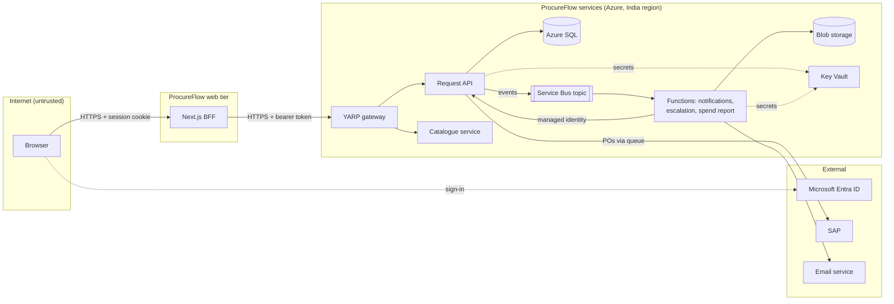
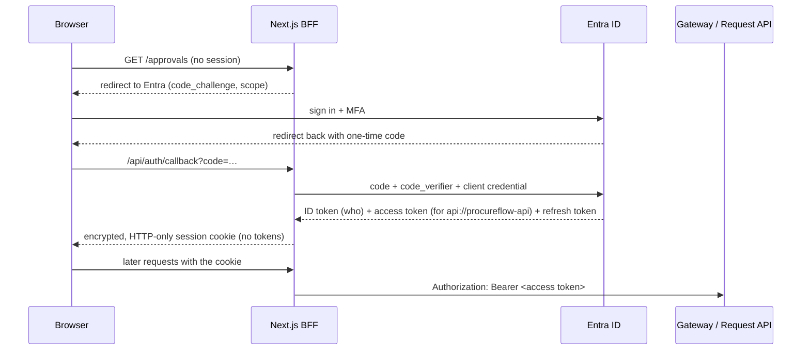
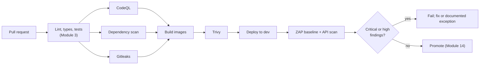

# Lecture Script: Application Security and DevSecOps

> **Instructor reference.** Phase 4: Log files, security and non-functional testing (Focus area 5), Module 12 | Duration: 6 hours (2.5 h concepts and demos, 3.5 h hands-on), run as Day 17 (1 h, Segments 1–3), Day 18 (4 h, Segments 4–15) and Day 19 (1 h, Segments 16–17) | Previous script: [Module 11 — Logging, Log File Analysis and Observability](Module-11-Logging-and-Observability.md)

## Session overview

**Goal.** Learners secure ProcureFlow end to end and prove it with evidence. They threat-model the architecture with STRIDE (functions and message queue included), set up SSO with MFA through Microsoft Entra ID with every API and function validating tokens, enforce roles and the self-approval policy with every authorisation failure logged, replace connection strings with managed identity and Key Vault, then exploit and fix a seeded IDOR and SQL injection and add CodeQL, Trivy and ZAP to the pipeline (Capstone increment CI-12).

**Learner profile at this point.** Learners have built the whole of ProcureFlow (Modules 4–10) and made it observable (Module 11). Security has appeared in every module as a rule: `SECURITY.md` and secret scanning (Module 3), NFR-SEC-01 to NFR-SEC-04 (Module 2), the package gate (Module 5), the BFF keeping tokens out of the browser (Module 6), the self-approval policy and aggregate rule (Modules 5 and 7), the audit table's `DENY` (Module 8), realtime tickets (Module 9), managed identity mentioned for functions (Module 10), and redaction (Module 11). Sign-in so far has been the starter kit's development setup. Today introduces the first genuinely new idea of the security module: **security is a property you prove with evidence (a threat model, tests and scans), not a feature you add at the end.**

**Key outcome.** Every learner can map the OWASP Top 10 and the OWASP API Security Top 10 to ProcureFlow; build a STRIDE threat model and turn threats into security stories; explain OAuth 2.0 authorisation code with PKCE and client credentials, OpenID Connect, tokens and scopes; validate JWTs correctly and name the common mistakes; set up SSO with MFA and conditional access in Entra ID (and know Keycloak); implement RBAC, claims, policies and resource-based checks; manage secrets with Key Vault and managed identity; choose encryption and hashing correctly; secure APIs and functions with CORS, rate limiting, validation, headers, keys and network isolation; log and alert on security events; and run SAST, SCA, secret scanning, container scanning and DAST in a pipeline.

**Case for this session.** ProcureFlow at Meridian Components, continued. The security NFRs from Module 2: **NFR-SEC-01** Microsoft sign-in only; **NFR-SEC-02** a requester cannot approve their own requisition; **NFR-SEC-03** vendor bank details visible to AP roles only; **NFR-SEC-04** hosted in an India region. The program adds: **MFA for all users**, and **zero critical or high findings** in code, dependency, image and ZAP scans. Roles, as Entra app roles: `Requester`, `Approver`, `Buyer`, `Warehouse`, `APClerk`, `FinanceController`, `Auditor`, `Admin` (Module 6's assumption). This is Sprint 4's release theme, "Secure and proven". The trainer plays the tech lead and, in the opening, reads a letter from Meridian's CISO.

**Note on ethics.** Every attack in this module runs only against your own team's ProcureFlow environment, which you are authorised to test. Running the same techniques against systems you don't own or haven't been authorised to test is illegal in most countries, including India and the UK. Say it out loud before Lab 5A.

**Note on tool versions and licences.** Microsoft Entra ID in a **training tenant** provided by the instructor (conditional access needs an Entra ID P1 licence; security defaults are the free alternative). `Microsoft.Identity.Web` or ASP.NET Core JWT bearer authentication; Auth.js (or your starter kit's library) in Next.js; Azure Key Vault and managed identity; GitHub code scanning with CodeQL (free for public repositories; private repositories need GitHub's paid security features: check current terms), Trivy (Apache-2.0), OWASP ZAP (Apache-2.0), Gitleaks (MIT; its GitHub Action needs a licence key for organisation accounts, so running the CLI is the simple option). The OWASP Top 10 had a new edition in 2025: verify the final category names and numbering on owasp.org on the day. Check `--help` and current docs for every tool.

**Note on prices.** Key Vault operations, Entra ID licences, Defender and GitHub security features are all priced; never quote a price; use the calculator or vendor pricing pages and date the figure.

**Note on AI output.** AI-generated threat models and code reviews vary run to run; examples are marked **illustrative**. Scan results depend on today's rules and advisories; scan output here is illustrative too.

## Timing breakdown

| Segment | Duration | Cumulative | Kind |
| --- | --- | --- | --- |
| SEGMENT 1: Opening — OWASP Top 10 Mapped to ProcureFlow | 20 min | 0:20 | Concept + demo |
| SEGMENT 2: Threat Modelling With STRIDE; Security in User Stories | 15 min | 0:35 | Concept + demo |
| SEGMENT 3: Lab 1 — STRIDE Threat Model, AI-Assisted | 25 min | 1:00 | Hands-on |
| **END OF DAY 17** | — | — |  |
| SEGMENT 4: OAuth 2.0 and OpenID Connect | 20 min | 1:20 | Concept + demo |
| SEGMENT 5: JWTs: Structure, Validation and Common Mistakes | 10 min | 1:30 | Concept + demo |
| SEGMENT 6: SSO, MFA and Conditional Access | 10 min | 1:40 | Concept + demo |
| SEGMENT 7: Lab 2 — SSO With MFA; APIs and Functions Validate JWTs | 50 min | 2:30 | Hands-on |
| **BREAK** | 10 min | — |  |
| SEGMENT 8: Authorisation: Roles, Claims, Policies and Resources | 10 min | 2:40 | Concept + demo |
| SEGMENT 9: Lab 3 — Roles, the Self-Approval Policy and Security Logging | 35 min | 3:15 | Hands-on |
| **BREAK** | 10 min | — |  |
| SEGMENT 10: Secrets and Encryption | 15 min | 3:30 | Concept + demo |
| SEGMENT 11: Lab 4 — Managed Identity, Key Vault and Secret Scanning | 35 min | 4:05 | Hands-on |
| **BREAK** | 10 min | — |  |
| SEGMENT 12: API and Serverless Security | 15 min | 4:20 | Concept + demo |
| SEGMENT 13: Security Logging and Monitoring | 10 min | 4:30 | Concept + demo |
| SEGMENT 14: The DevSecOps Pipeline | 15 min | 4:45 | Concept + demo |
| SEGMENT 15: Lab 5A — Attack: IDOR and SQL Injection | 15 min | 5:00 | Hands-on |
| **END OF DAY 18** | — | — |  |
| SEGMENT 16: Lab 5B — Fix, and Scan in the Pipeline | 35 min | 5:35 | Hands-on |
| SEGMENT 17: CI-12 Review and Wrap-Up | 25 min | 6:00 | Hands-on + close |

Concepts and demos: 20 + 15 + 20 + 10 + 10 + 10 + 15 + 15 + 10 + 15 + 10 (close) = 150 min (42%). Labs and CI-12 review: 25 + 50 + 35 + 35 + 15 + 35 + 15 = 210 min (58%). Total 360 min = 6 h, matching the module's 2.5 h / 3.5 h split. Day 17: Segments 1–3 = 60 min; Day 18: Segments 4–15 = 240 min; Day 19: Segments 16–17 = 60 min. Breaks are not counted. Lab 5 is split into 5A and 5B across two days.

## SEGMENT 1: Opening — OWASP Top 10 Mapped to ProcureFlow (20 min)

### The Hook (6 min)

**Do:** Read the letter as Meridian's CISO.

> *"Before ProcureFlow goes near production, my team spent half a day poking at your dev environment. Six findings:*
> *1. A requester changed REQ-2041 to REQ-2042 in the address bar and read someone else's requisition, justification and all.*
> *2. Adding `;WAITFOR DELAY '0:0:5'--` to the catalogue's sort parameter made the response take exactly five seconds.*
> *3. A database connection string with a password is in your Git history, from a development settings file.*
> *4. There's no MFA. One approver's password appears in a public breach list.*
> *5. `/debug/stats` answers on the dev environment and lists search terms.*
> *6. One account produced 2,000 '403 Forbidden' responses last Tuesday. Nobody noticed.*
> *I need to see these fixed, and I need to see how you'll know if they come back."*

**Ask:** *"Which of these six would any test or check we have today have caught?"*

**Do:** Take 4–5 answers.

**Respond to likely answers:**

- *"Number 3: secret scanning from Module 3."* → *"It scans new commits. What about history, and the development file someone added before the hook?"*
- *"Number 1: we have authorisation policies."* → *"For approving. Who checks reading?"*
- *"Number 6: Module 11's logs."* → *"We log the 403s now. Who's alerted?"*
- *"None of them."* → *"Honest. By tomorrow, each will have a test or a scan, and an alert."*

**Write on board, large, and leave it up all day:**

> **Every request proves who it is and what it may touch, and leaves a trail.**

### Live Demo: Change the Number (2 min)

**Do:** On the `seeded/security` branch, signed in as requester A, call `GET /v1/requisitions/REQ-2042` (requester B's). Show the 200 with B's justification.

**Say:** *"That's the most common serious vulnerability in APIs, and it needs no hacking tools: just curiosity and a URL."*

### The OWASP Top 10, Mapped (5 min)

**Say:** *"OWASP's Top 10 lists the most important web application risk categories. The 2025 edition reorganised the list; check the final names and numbers on owasp.org. Here's how its categories land on ProcureFlow."*

| OWASP Top 10 (2025) category | ProcureFlow example | Where we handle it |
| --- | --- | --- |
| Broken access control | Finding 1: reading another requester's requisition | Today, Lab 3 and Lab 5 |
| Security misconfiguration | Finding 5: debug endpoint on; missing security headers | Segment 12 |
| Software supply chain failures | A compromised or AI-suggested package; unpinned GitHub Actions | Module 5's package gate; Segment 14 |
| Cryptographic failures | Bank details readable in a backup; weak TLS | Segment 10 |
| Injection | Finding 2: SQL injection in sort | Lab 5 |
| Insecure design | No limit on exports (Module 11's incident) | Segment 12 |
| Authentication failures | Finding 4: no MFA | Lab 2 |
| Software or data integrity failures | Unsigned or unverified build artefacts; tampered messages | Modules 10 and 14 |
| Security logging and alerting failures | Finding 6: nobody noticed 2,000 403s | Segment 13 |
| Mishandling of exceptional conditions | Stack traces in error responses | Module 5's ProblemDetails |

### The OWASP API Security Top 10 (2023), Mapped (5 min)

| Risk | ProcureFlow example |
| --- | --- |
| API1 Broken object level authorisation (BOLA, also called IDOR) | `GET /v1/requisitions/{id}` without an ownership check |
| API2 Broken authentication | Tokens accepted without audience or expiry checks |
| API3 Broken object property level authorisation | Vendor bank details returned to non-AP roles (NFR-SEC-03) |
| API4 Unrestricted resource consumption | Unlimited `pageSize` or concurrent exports (Module 11 incident) |
| API5 Broken function level authorisation | A requester calling `PUT /v1/catalogue/items/{id}` |
| API6 Unrestricted access to sensitive business flows | A script submitting hundreds of requisitions a minute |
| API7 Server-side request forgery | Any feature that fetches a user-supplied URL (none yet: keep it that way) |
| API8 Security misconfiguration | Open CORS; verbose errors; debug endpoints |
| API9 Improper inventory management | Forgotten `/v0` routes, `/debug/stats`, undocumented endpoints |
| API10 Unsafe consumption of APIs | Trusting SAP's or the Catalogue's responses without validation |

### Comprehension Check (2 min)

1. *"Finding 1 is which risk in each list?"* (Broken access control; API1, BOLA/IDOR.)
2. *"Module 11's month-end export incident: which API risk?"* (API4, unrestricted resource consumption.)

**Common misconception:** "authentication means the API is secure." (Knowing who someone is doesn't decide what they may touch; most API breaches are authorisation failures.)

**Re-teach trigger:** if learners can't map findings to categories, map the six CISO findings together on the board before moving on.

**Transition — Say:** *"Lists tell you what usually goes wrong. A threat model tells you what could go wrong in **our** system."*

## SEGMENT 2: Threat Modelling With STRIDE; Security in User Stories (15 min)

### STRIDE (5 min)

| Threat | Violates | Question to ask | ProcureFlow example |
| --- | --- | --- | --- |
| **S**poofing | Authentication | Can someone pretend to be someone else? | A forged token; a fake message on Service Bus |
| **T**ampering | Integrity | Can someone change data or code in transit or at rest? | Changing a line price in the request; editing audit rows |
| **R**epudiation | Non-repudiation | Can someone deny they did it? | An approver claims they never approved (audit, NFR-AUD-01) |
| **I**nformation disclosure | Confidentiality | Can someone see what they shouldn't? | IDOR; bank details; tokens in logs |
| **D**enial of service | Availability | Can someone stop others working? | Concurrent exports; message floods |
| **E**levation of privilege | Authorisation | Can someone do more than their role allows? | Requester calls admin endpoints |

### Live Demo: The Data-Flow Diagram (4 min)

**Say:** *"Threat modelling starts with a data-flow diagram and its **trust boundaries**: every line where data crosses from something we trust less to something we trust more. Threats live on those lines."*



**Say:** *"Five boundaries to go over: browser to BFF, BFF to gateway, services to data stores, the queue to the functions, and anything to the outside world. Note the queue: a message arriving at the notification function is input, just like an HTTP request. Who can put messages on that topic?"*

### Security in User Stories (3 min)

**Say:** *"Each real threat becomes work in the backlog: a **security story** with acceptance criteria, or an **abuse case** written from the attacker's side."*

```markdown
**Abuse case:** As a curious requester, I change the requisition number in the URL
to read other people's requisitions.
**Acceptance criteria**
- Given I am requester A, when I request REQ-2042 (requester B's), then I get 404
  and the response doesn't reveal whether REQ-2042 exists.
- Then a security event 9001 is logged with my user ID, the resource and the policy.
- Given 20 such events from one user in 5 minutes, then the security alert fires.
```

### Comprehension Check (3 min)

1. *"Someone with access to the Service Bus namespace sends a fake `RequisitionApproved` event. Which STRIDE letter, and what limits it?"* (Spoofing and tampering; managed identities with send rights only for the Request API, receive only for functions; consumers act on IDs and re-read from the API, not on trusted payload data.)
2. *"Which STRIDE threat does the audit table's `DENY UPDATE, DELETE` address?"* (Repudiation, and tampering with audit evidence.)

**Common misconception:** "a threat model is a one-off document for the auditors." (It's a living file, updated whenever the architecture changes, and every mitigation should link to the test or scan that proves it.)

**Re-teach trigger:** if learners struggle with trust boundaries, ask at each arrow: *"Do we control who sends this?"*

**Transition — Say:** *"Build ProcureFlow's threat model. The AI drafts; you decide what's real."*

## SEGMENT 3: Lab 1 — STRIDE Threat Model, AI-Assisted (25 min)

**Say:** *"Threat-model ProcureFlow as it is today, including the functions and the message queue. Let the AI draft threats per element; you rate each one, reject what doesn't apply, and add what it missed. Every mitigation will need evidence by tomorrow: a test, a scan or a configuration you can show."*

### Instructions (read aloud, step by step)

1. **Data-flow diagram (7 min).** Copy the Segment 2 diagram into `docs/security/threat-model.md` and correct it for your build (your functions, your queues, your storage). Mark trust boundaries.
2. **AI draft (6 min).** Use the prompt below. Paste the output under "AI draft".
3. **Review and rate (8 min).** For each threat: *real*, *not applicable* (with reason) or *duplicate*. Rate real ones high, medium or low (likelihood times impact, in a sentence). Add at least two threats the AI missed. For each real threat, name the mitigation and the evidence you'll produce (test name, scan, configuration screenshot), even if it doesn't exist yet.
4. **Security stories (4 min).** Turn the two highest-rated threats into abuse cases with acceptance criteria in `docs/requirements/stories/`, through the usual PR.

### The AI Prompt (give to learners)

```
Here is the data-flow diagram and component list of ProcureFlow, a procure-to-pay system
(Next.js BFF, YARP gateway, .NET APIs, Azure SQL, Service Bus topic, Azure Functions,
Blob storage, Key Vault, Entra ID, SAP, email). For each element and each trust-boundary
crossing, list STRIDE threats specific to this system. For each: the threat, the
attacker, the impact, a likelihood estimate, a mitigation, and how to verify the
mitigation with a test or a scan. Don't list generic threats that don't apply here.
```

### What the AI Draft Typically Gets Wrong (show learners)

| AI draft does this (illustrative — varies by run) | Fix |
| --- | --- |
| Generic threats ("attacker may perform XSS") with no location | Name the element, the input and the boundary |
| Misses the message queue as an input boundary | Add spoofed or replayed messages; consumers' trust in payloads |
| Misses the escalation function calling the API with its own identity | Add: over-privileged service identity; app role scoped to escalation only |
| Proposes mitigations we already have, as if missing | Link to the existing control (Module 8's `DENY`, Module 6's BFF) |
| "Encrypt everything" without saying where or how | Name the data, the store and the mechanism |
| No verification method | Every mitigation needs a test, scan or configuration check |

### Reference Solution (instructor, excerpt)

| Element / boundary | STRIDE | Threat | Rating | Mitigation | Evidence (by Day 19) |
| --- | --- | --- | --- | --- | --- |
| Request API: `GET /v1/requisitions/{id}` | I | IDOR: any user reads any requisition | High | Resource-based `CanViewRequisition` policy; 404 when not visible | Lab 5 test; ZAP finding gone |
| Catalogue search | T, I | SQL injection via `sort` | High | Allowlisted sort columns; parameters | Lab 5 test; CodeQL clean |
| Service Bus topic | S, T | Forged events | Medium | Send rights for the Request API's identity only; consumers re-read from the API | RBAC assignment listing |
| Escalation function → Request API | E | Function identity can do more than escalate | Medium | App role `Service.Escalate` only on the escalations endpoint | Lab 2 negative test |
| Exports | D | Concurrent exports exhaust the pool (Module 11) | High | Concurrency limiter; separate pool | Segment 12 configuration; load test (Module 13) |
| Logs and dumps | I | Personal data or secrets in logs or dumps | Medium | Redaction (Module 11); dump handling rule | Redaction tests |

### Instructor Circulates

- **No queue or function threats:** *"Who can put a message on that topic?"*
- **Every threat rated high:** ratings need a sentence of reasoning; not everything is high.
- **Mitigations with no evidence plan:** add the test, scan or configuration that will prove it.
- **AI output pasted as the final model:** the reviewed table is the deliverable; the draft stays only as a record.

**Success check:** `docs/security/threat-model.md` with a corrected diagram and trust boundaries; at least 10 rated threats covering the BFF, gateway, APIs, SQL, Service Bus, functions and Key Vault; AI suggestions marked accepted or rejected; two abuse cases in the backlog.

### END OF DAY 17

*Overnight prompt:* *"When you sign in to ProcureFlow, how many different tokens exist, who holds each, and which one does the Request API see?"*

## SEGMENT 4: OAuth 2.0 and OpenID Connect (20 min)

### The Four Roles (4 min)

**Ask:** *"Your overnight question: how many tokens?"* (Expect confusion; that's the point.)

| OAuth 2.0 role | Means | ProcureFlow |
| --- | --- | --- |
| Resource owner | The user whose data or rights are involved | Priya, an approver, a requester |
| Client | The application asking for access on the user's behalf | The Next.js BFF (a confidential client: it runs on our server) |
| Authorisation server | Issues tokens after checking the user | Microsoft Entra ID |
| Resource server | The API that accepts tokens | The Request API, the Catalogue service |

**Say:** *"**OAuth 2.0** is about **authorisation**: getting an access token to call an API. **OpenID Connect (OIDC)** adds **authentication** on top: an ID token that tells the client who signed in. Two different tokens for two different readers. The API should never accept an ID token as if it were an access token."*

### Two Flows ProcureFlow Uses (5 min)

| Flow | For | How it works | ProcureFlow |
| --- | --- | --- | --- |
| Authorisation code with PKCE | Users signing in through an app | The browser is redirected to Entra; the user signs in (with MFA); Entra returns a one-time code; the BFF exchanges it, plus a PKCE verifier and its own credential, for tokens | Every user, through the BFF |
| Client credentials | Services acting as themselves, with no user | The service proves its own identity and gets a token for an API | The escalation function calling the Request API, via its **managed identity** |

**Say:** *"PKCE (Proof Key for Code Exchange) stops a stolen authorisation code being used by anyone else: the client sends a hashed secret at the start and the original at the exchange. It's required for public clients like mobile apps and recommended for every client, including our BFF. The old implicit flow, which put tokens in the browser's URL, is no longer recommended."*

### The Tokens in ProcureFlow (5 min)



**Say:** *"Three tokens, all held by the BFF on the server: the ID token (who you are, for the BFF), the access token (for the API), and the refresh token (to get new access tokens without signing in again). The browser holds only an encrypted session cookie. That's Module 6's rule, now real."*

### Scopes and Roles (4 min)

| | Scope | App role |
| --- | --- | --- |
| Answers | What may this **client** do on the user's behalf? | What may this **user** (or service) do in this API? |
| Example | `api://procureflow-api/Requisitions.ReadWrite` | `Approver`, `APClerk`, `Admin`, `Service.Escalate` |
| In the token | `scp` claim | `roles` claim |
| Checked by | The API: is the token for us, with the right scope? | The API's policies |

### Comprehension Check (2 min)

1. *"The escalation function has no user. Which flow, and which credential?"* (Client credentials, using its managed identity; no secret to store.)
2. *"Why must the Request API reject an ID token sent as a bearer token?"* (It's meant for the client; its audience is the BFF, not the API.)

**Common misconception:** "OAuth is a login protocol." (OAuth grants access to APIs; OIDC is the login layer on top.)

**Re-teach trigger:** if learners mix up the tokens, give three learners a card each (ID, access, refresh) and have them say who reads it and what for.

**Transition — Say:** *"The API receives an access token: a JWT. What exactly must it check?"*

## SEGMENT 5: JWTs: Structure, Validation and Common Mistakes (10 min)

### Structure (3 min)

**Do:** Decode a training-tenant access token locally (never paste real tokens into websites) with a short script, and show the three parts.

```json
// header
{ "alg": "RS256", "kid": "…", "typ": "JWT" }
// payload (excerpt)
{ "iss": "https://login.microsoftonline.com/<tenant>/v2.0", "aud": "<api client id>",
  "exp": 1774950000, "nbf": 1774946100, "oid": "3f9c…", "scp": "Requisitions.ReadWrite",
  "roles": ["Approver"] }
// signature: RS256 over header.payload, verified with Entra's public keys (JWKS)
```

**Say:** *"A JWT is signed, not encrypted: anyone holding it can read the payload. So no secrets or personal data in claims beyond what's needed, and never log tokens (Module 11)."*

### Validation (4 min)

```csharp
builder.Services.AddAuthentication(JwtBearerDefaults.AuthenticationScheme)
    .AddJwtBearer(o =>
    {
        o.Authority = $"https://login.microsoftonline.com/{tenantId}/v2.0";   // issuer and signing keys discovered
        o.Audience = apiClientId;                                              // check aud in a real token: ID or URI
        o.MapInboundClaims = false;                                            // keep "roles", "oid" as issued
        o.TokenValidationParameters = new TokenValidationParameters
        {
            ValidateIssuer = true, ValidateAudience = true, ValidateLifetime = true,
            ClockSkew = TimeSpan.FromMinutes(2), RoleClaimType = "roles", NameClaimType = "oid",
        };
    });
```

**Say:** *"Four checks, every request: **signature** with Entra's published keys, **issuer**, **audience** (this token is for **us**), and **lifetime**. `Microsoft.Identity.Web` wraps this with Entra-specific defaults; either is fine, as long as you can say what's validated."*

### Common Mistakes (2 min)

| Mistake | Result |
| --- | --- |
| Decoding the payload without verifying the signature | Anyone can forge a token |
| Accepting `alg: none`, or letting the token choose the algorithm | Forged tokens accepted |
| Not checking the audience | A token for another API works on ours |
| Long-lived access tokens in the browser or local storage | Stolen by any script on the page |
| Trusting role claims from a token you didn't validate | Elevation of privilege |

### Comprehension Check (1 min)

*"A token for Meridian's HR API, from the same tenant, is sent to the Request API. Which check rejects it?"* (Audience.)

**Common misconception:** "JWTs are encrypted." (They're signed; the content is readable by anyone who has the token.)

**Re-teach trigger:** if learners skip the audience check, show a same-tenant token for another API being accepted when `ValidateAudience` is off.

**Transition — Say:** *"Now the sign-in itself: one account for everything, and a second factor."*

## SEGMENT 6: SSO, MFA and Conditional Access (10 min)

### Concepts (6 min)

| Term | Means | ProcureFlow |
| --- | --- | --- |
| Single sign-on (SSO) | One sign-in with the organisation's identity provider for many apps | Meridian staff use their Microsoft account (NFR-SEC-01) |
| Multi-factor authentication (MFA) | Something you know plus something you have or are: authenticator app, passkey, hardware key | Required for all users (program NFR); finding 4 |
| Conditional access | Rules for when and how sign-in is allowed: require MFA, block risky locations, require compliant devices | "MFA always for ProcureFlow"; stricter for `Admin` |
| Security defaults | A free, tenant-wide baseline that turns on MFA registration and prompts | Fallback if Meridian has no Entra ID P1 licences |

**Say:** *"MFA is the single biggest control against finding 4: a reused password alone no longer signs anyone in. Phishing-resistant methods (passkeys, FIDO2 keys) are stronger than codes. Meridian's identity team owns the tenant's policies; our job is to register the app correctly, request MFA for it, and ask for stronger rules for admins. That's a dependency for the RAID log."*

**Say:** *"**Keycloak** is the common open-source alternative when a client has no Microsoft tenant: an identity server you host, with the same OIDC flows and built-in one-time-password MFA. Same concepts, more to operate yourself."*

### Live Demo: Sign In With MFA (2 min)

**Do:** In the training tenant, sign in to the dev ProcureFlow as a test approver; show the MFA prompt and the `amr` claim (authentication methods) in the ID token.

### Comprehension Check (2 min)

*"Who should enforce MFA: ProcureFlow's code or Entra ID?"* (Entra ID, through conditional access or security defaults; the app can check the `amr` claim as defence in depth for sensitive actions.)

**Common misconception:** "SSO makes things less secure because one password opens everything." (SSO concentrates protection: one strong, MFA-protected, monitored sign-in instead of many weak ones.)

**Re-teach trigger:** if learners want MFA in app code, sketch who owns the account lifecycle (joiners, leavers, lost phones): Meridian's identity team, in Entra.

**Transition — Say:** *"Set it up for real: sign-in, MFA, and every API and function validating tokens."*

## SEGMENT 7: Lab 2 — SSO With MFA; APIs and Functions Validate JWTs (50 min)

**Say:** *"Register ProcureFlow in the training tenant, sign users in through the BFF with authorisation code and PKCE, with MFA required. Make the gateway, the Request API and the Catalogue validate access tokens properly; protect the HTTP function; and make the escalation function call the API with its managed identity and a narrowly scoped app role. Then prove the negatives: wrong audience, expired token, no token."*

### Instructions (read aloud, step by step)

1. **App registrations (12 min).** API registration `procureflow-api`: Application ID URI, the delegated scope `Requisitions.ReadWrite`, app roles for the eight user roles (member type: users and groups) and `Service.Escalate` (member type: applications). Web registration `procureflow-web`: redirect URI for the BFF's callback, a credential (certificate preferred; a secret in Key Vault after Lab 4), API permission for the scope. Assign test users to roles. (Use the instructor's scripts if your tenant role doesn't allow portal changes.)
2. **BFF sign-in (12 min).** Configure the BFF's auth library for Entra ID with PKCE and the API scope. Store tokens server-side only; the browser gets an encrypted, HTTP-only, `Secure`, `SameSite=Lax` session cookie. Confirm MFA is required (conditional access policy or security defaults, set by the instructor).
3. **APIs validate tokens (10 min).** Gateway, Request API and Catalogue: JWT bearer validation (Segment 5) with issuer, audience, lifetime and `roles` as the role claim. The gateway validates too (defence in depth) and forwards the token.
4. **Functions (10 min).** The HTTP report function (Module 10's experiment): App Service Authentication ("Easy Auth") on the function app, or token validation in worker middleware (check current guidance for the isolated worker). The escalation activity: get a token with its managed identity for `api://procureflow-api/.default`; the escalations endpoint requires the `Service.Escalate` app role and nothing else accepts it.
5. **Negative tests (6 min).** Integration tests for: no token → 401; token for another audience → 401; expired token → 401; valid user token on the escalations endpoint → 403; the escalation identity's token on any other endpoint → 403.

### Starter: Escalation Activity With Managed Identity

```csharp
public sealed class RequestApiTokenHandler(TokenCredential credential, IOptions<RequestApiOptions> options) : DelegatingHandler
{
    protected override async Task<HttpResponseMessage> SendAsync(HttpRequestMessage request, CancellationToken ct)
    {
        var token = await credential.GetTokenAsync(
            new TokenRequestContext([$"{options.Value.AppIdUri}/.default"]), ct);   // client credentials via managed identity
        request.Headers.Authorization = new AuthenticationHeaderValue("Bearer", token.Token);
        return await base.SendAsync(request, ct);
    }
}

// Program.cs (functions): DefaultAzureCredential uses the managed identity in Azure, your developer login locally
builder.Services.AddSingleton<TokenCredential>(new DefaultAzureCredential());
builder.Services.AddTransient<RequestApiTokenHandler>();
builder.Services.AddHttpClient<IRequestApi, RequestApiClient>().AddHttpMessageHandler<RequestApiTokenHandler>();
```

```csharp
// Request API: only the escalation identity may escalate
builder.Services.AddAuthorizationBuilder()
    .AddPolicy(Policies.CanEscalate, p => p.RequireRole("Service.Escalate"));

app.MapPost("/v1/requisitions/{id}/escalations", EscalateAsync).RequireAuthorization(Policies.CanEscalate);
```

**Note:** assigning an app role to a managed identity is done through Microsoft Graph or the Azure CLI, not the portal's usual role screens; use the instructor's script. Token caching: `DefaultAzureCredential` caches tokens, but keep one credential instance per app.

### Reference Solution (instructor, partial): Negative Test

```csharp
[Fact]
public async Task Token_for_another_api_is_rejected()
{
    var client = _factory.CreateClient();
    client.DefaultRequestHeaders.Authorization =
        new("Bearer", TestTokens.Issue(audience: "api://meridian-hr", roles: ["Approver"]));   // test issuer configured for tests

    var response = await client.GetAsync("/v1/approvals/pending");

    Assert.Equal(HttpStatusCode.Unauthorized, response.StatusCode);
}
```

**Say:** *"Tests use a test signing key and issuer configured only in the test host, so they can mint tokens with any audience, role or expiry. That's how you test the rejections, which are the parts attackers care about."*

### Instructor Circulates

- **Access token passed to the browser "just for the hub":** Module 9's ticket exists for exactly this.
- **`ValidateAudience = false` to make it work:** find the real `aud` value in a token and configure it.
- **Client secret in `appsettings.json`:** it moves to Key Vault in Lab 4; until then, user secrets locally.
- **`Service.Escalate` accepted everywhere because of a broad fallback policy:** require it on one endpoint, and make sure user policies don't accept it.
- **MFA "tested" by reading the policy:** sign in as a test user and see the prompt.

**Success check:** users sign in through the BFF with MFA; the browser holds only the session cookie; the gateway, Request API and Catalogue validate issuer, audience, lifetime and signature; the HTTP function rejects unauthenticated calls; the escalation function calls the API with its managed identity and is limited to escalation; five negative tests pass.

### BREAK (10 min)

*Suggested break prompt:* *"An auditor may read every requisition. A requester may read only their own. Where in the code should that difference live?"*

## SEGMENT 8: Authorisation: Roles, Claims, Policies and Resources (10 min)

### Four Ways to Decide (4 min)

| Approach | Decides on | ProcureFlow example |
| --- | --- | --- |
| Role-based (RBAC) | The user's roles | Only `Admin` may update catalogue items |
| Claims-based | Any claim in the token | The `amr` claim shows MFA for an admin action |
| Policy-based | A named rule combining requirements | `CanApproveRequisition` (Module 5) |
| Resource-based | The user **and the specific object** | `CanViewRequisition`: requester owns it, or approver is assigned, or role sees all |

**Ask:** *"Your break question: where does 'requester sees only their own' live?"* (In a resource-based policy, and in the list queries' filters.)

### Live Demo: Resource-Based Reading (4 min)

```csharp
public sealed class CanViewRequisitionHandler : AuthorizationHandler<CanViewRequisitionRequirement, RequisitionView>
{
    private static readonly string[] SeeAllRoles = ["Buyer", "APClerk", "FinanceController", "Auditor"];

    protected override Task HandleRequirementAsync(
        AuthorizationHandlerContext context, CanViewRequisitionRequirement requirement, RequisitionView requisition)
    {
        var userId = context.User.FindFirstValue("oid");
        if (requisition.RequesterId == userId
            || requisition.ApproverIds.Contains(userId)
            || SeeAllRoles.Any(context.User.IsInRole))
            context.Succeed(requirement);
        return Task.CompletedTask;
    }
}
```

**Say:** *"One policy, used by every endpoint that returns a single requisition. For lists, the same rule goes into the query's `Where`, so the database never returns rows the user can't see. Paging over filtered data, not filtering a page afterwards."*

### Comprehension Check (2 min)

1. *"Requester A asks for REQ-2042, which isn't theirs. 403 or 404?"* (404, so the response doesn't confirm the requisition exists; log it as a security event either way.)
2. *"Why is 'requester can't approve their own' both a domain rule and a policy?"* (Defence in depth: the domain refuses whatever the entry point; the policy refuses early and logs it as a security event.)

**Common misconception:** "hiding a button is access control." (The API decides; the UI only reflects the API's rules.)

**Re-teach trigger:** if learners put the check only in the UI, call the API directly with `curl` as the wrong user.

**Transition — Say:** *"Implement the roles and policies, and make every refusal leave a trail."*

## SEGMENT 9: Lab 3 — Roles, the Self-Approval Policy and Security Logging (35 min)

**Say:** *"Wire Entra app roles to ProcureFlow's policies: who reads, who approves, who sees bank details, who administers. Keep the self-approval rule in both places. And log every authorisation failure as a security event in the 9000 range Module 11 reserved, with enough context to investigate and nothing personal."*

### Instructions (read aloud, step by step)

1. **Roles in tokens (5 min).** Confirm test users' tokens carry the expected `roles`. Map each policy to roles in one place in the platform's auth package (Module 5).
2. **Policies (12 min).** `CanViewRequisition` (resource-based, Segment 8) on single reads; the same rule as a filter on list queries; `CanApproveRequisition` with the not-own-requisition requirement (NFR-SEC-02); `CanViewVendorBankDetails` for `APClerk` only (NFR-SEC-03), applied to the response shape, not just the endpoint; `CanMaintainCatalogue` for `Admin`; `CanExportRequisitions` for `FinanceController` and `Auditor`.
3. **Security logging (10 min).** Log every authorisation failure once, centrally: an `IAuthorizationMiddlewareResultHandler` for endpoint policies, and a helper for resource-based checks. Event IDs: 9001 access denied, 9002 authentication failed (from JWT bearer events), 9003 self-approval attempt. Fields: user `oid`, policy, resource type and ID, route, trace ID. No names, emails or tokens.
4. **Tests (8 min).** For each policy, one allowed and one denied test. For the denied ones, assert the security event was logged (using Module 11's fake log collector).

### Starter: Central Logging of Policy Failures

```csharp
public sealed class SecurityLoggingResultHandler(ILogger<SecurityLoggingResultHandler> logger) : IAuthorizationMiddlewareResultHandler
{
    private readonly AuthorizationMiddlewareResultHandler _default = new();

    public async Task HandleAsync(RequestDelegate next, HttpContext context, AuthorizationPolicy policy, PolicyAuthorizationResult result)
    {
        if (result.Forbidden)
            SecurityLog.AccessDenied(logger, context.User.FindFirstValue("oid") ?? "anonymous",
                context.GetEndpoint()?.DisplayName ?? context.Request.Path, string.Join(',',
                result.AuthorizationFailure?.FailedRequirements.Select(r => r.GetType().Name) ?? []));
        await _default.HandleAsync(next, context, policy, result);
    }
}

public static partial class SecurityLog
{
    [LoggerMessage(EventId = 9001, Level = LogLevel.Warning,
        Message = "Access denied for user {UserId} on {Resource}; failed {Requirements}")]
    public static partial void AccessDenied(ILogger logger, string userId, string resource, string requirements);
}
```

### Reference Solution (instructor, partial): Bank Details by Role

```csharp
app.MapGet("/v1/vendors/{id}", async (long id, IVendorQueries q, IAuthorizationService authz, ClaimsPrincipal user, CancellationToken ct) =>
{
    var vendor = await q.GetAsync(id, ct);
    if (vendor is null) return Results.NotFound();
    var canSeeBank = (await authz.AuthorizeAsync(user, Policies.CanViewVendorBankDetails)).Succeeded;
    return Results.Ok(canSeeBank ? vendor.WithBankDetails() : vendor.WithoutBankDetails());   // API3: property-level
});
```

**Say:** *"NFR-SEC-03 is a property-level rule: everyone with access sees the vendor, only AP sees the bank details. Two response shapes, one decision. Notice there's no security event here: not seeing an optional field isn't an attack. Log what's suspicious, not what's normal."*

### Instructor Circulates

- **Role checks scattered as `if (User.IsInRole(...))` in handlers:** named policies in one place.
- **List endpoints filtered after paging:** filter in the query, then page.
- **403 for unseen requisitions:** use 404 and log 9001.
- **Security events with email addresses:** `oid` only.
- **Every 404 logged as a security event:** only denials of existing resources.

**Success check:** every policy has allowed and denied tests; list queries filter by visibility; bank details appear only for `APClerk`; self-approval refused in both layers; every denial produces exactly one 9000-range security event with the required fields and no personal data.

### BREAK (10 min)

*Suggested break prompt:* *"List every secret ProcureFlow needs to run in the dev environment. Which of them could disappear entirely?"*

## SEGMENT 10: Secrets and Encryption (15 min)

### Secrets Management (5 min)

**Ask:** *"Your break question: which secrets could disappear?"* (Expect: SQL password, Service Bus and Storage connection strings, the web app's client secret, the email provider's key.)

| Approach | Use for | ProcureFlow |
| --- | --- | --- |
| **Managed identity** (no secret at all) | Azure services that support Entra authentication | SQL, Service Bus, Storage, Key Vault, the Request API (from functions) |
| **Key Vault** (secret stored, access by identity) | Secrets that must exist: third-party keys, certificates | Email provider key; the BFF's sign-in credential; `NEXT_SERVER_ACTIONS_ENCRYPTION_KEY` (Module 9) |
| App Service Key Vault references | Reading Key Vault secrets as app settings without code | `@Microsoft.KeyVault(SecretUri=…)` |
| Kubernetes Secrets | Secrets in a cluster (Module 14) | Base64-encoded, not encrypted by default; use the Key Vault CSI driver with workload identity |
| User secrets (`dotnet user-secrets`) | Local development only | Never committed |
| Secret scanning and push protection | Catching mistakes before and after they're committed | GitHub secret scanning plus Gitleaks in CI |

**Say:** *"The best secret is the one that doesn't exist. Every connection string with a password is a secret to store, rotate, leak and explain. With managed identity, the app proves who it is to Entra, and the database trusts Entra. Finding 3 can't happen to a password that was never created."*

### Live Demo: Passwordless Connections (4 min)

```text
Server=tcp:procureflow-dev.database.windows.net;Database=procureflow;Authentication=Active Directory Default;Encrypt=True
```

```sql
-- In Azure SQL (Entra admin): the API's managed identity becomes a database user
CREATE USER [procureflow-dev-api] FROM EXTERNAL PROVIDER;
ALTER ROLE db_datareader ADD MEMBER [procureflow-dev-api];
ALTER ROLE db_datawriter ADD MEMBER [procureflow-dev-api];
DENY UPDATE, DELETE ON SCHEMA::audit TO [procureflow-dev-api];     -- Module 8's rule, now for the real identity
```

```csharp
builder.Configuration.AddAzureKeyVault(new Uri(builder.Configuration["KeyVault:Uri"]!), new DefaultAzureCredential());
```

**Say:** *"`Active Directory Default` makes the SQL client use `DefaultAzureCredential`: managed identity in Azure, your developer login locally. Same code, no password, anywhere."*

### Encryption and Hashing (4 min)

| | Reversible? | Use | ProcureFlow |
| --- | --- | --- | --- |
| Encryption in transit (TLS 1.2 or later) | Yes, by the endpoints | Every connection | HTTPS only; `Encrypt=True` to SQL; HSTS on the web app |
| Encryption at rest | Yes, by the platform | Stored data | Azure SQL transparent data encryption and Storage encryption (on by default); Always Encrypted as an option for bank details |
| Hashing (SHA-256) | No | Integrity, fingerprints | Module 7's idempotency request hash |
| Password hashing (Argon2, bcrypt, PBKDF2) | No, and deliberately slow | Stored passwords | None: Entra holds passwords, which is the point |
| HMAC (keyed hash) | No | Proving a value without revealing it | Module 11's HMAC redaction |

**Say:** *"Personal data protection is mostly minimisation: don't collect it, don't copy it, don't log it. ProcureFlow stores directory IDs and looks names up. What we must store (bank details) gets the strongest protection and the narrowest access."*

### Comprehension Check (2 min)

1. *"A teammate base64-encodes the email API key in a Kubernetes Secret and calls it encrypted. What's wrong?"* (Base64 is encoding, not encryption; anyone with read access decodes it.)
2. *"Why can't we 'hash' the SAP password we need to send to SAP?"* (Hashing is one-way; we need the original value, so it's a secret in Key Vault, or better, an identity-based connection if SAP supports one.)

**Common misconception:** "a secret in a private repository is safe." (Repositories get cloned, forked, shared and breached; history keeps it forever.)

**Re-teach trigger:** if learners confuse hashing and encryption, ask: *"Will you ever need the original value back?"*

**Transition — Say:** *"Remove every password you can, vault the rest, and make the pipeline catch the next one."*

## SEGMENT 11: Lab 4 — Managed Identity, Key Vault and Secret Scanning (35 min)

**Say:** *"Make the dev environment passwordless wherever Azure allows, put the remaining secrets in Key Vault, and turn on scanning that would have stopped finding 3. Then deal with finding 3 itself: a secret in history is a leaked secret."*

### Instructions (read aloud, step by step)

1. **Managed identity everywhere (15 min).** Enable system-assigned managed identities for the Request API, Catalogue, gateway and function app. Grant least-privilege roles: SQL database users (demo SQL), Service Bus Data Sender for the Request API and Data Receiver for the functions, Storage Blob Data Contributor for the report function on its container only, Key Vault Secrets User where needed. Switch connection settings to identity-based (Module 10's `__fullyQualifiedNamespace` pattern). Remove the old connection strings.
2. **Key Vault for the rest (7 min).** Put the email provider key, the BFF's sign-in credential and the Next.js action encryption key in Key Vault; reference them from app settings. Locally: user secrets, never files in the repo.
3. **Secret scanning (8 min).** Turn on GitHub secret scanning and push protection for the repository (if available for your plan). Add a Gitleaks CLI step to CI that fails on any finding, with a reviewed allowlist for test fixtures. Run it over the full history once.
4. **Rotate what leaked (5 min).** For every real secret found in history (finding 3 included): rotate it at the source first, then decide whether to rewrite history (record the decision). Removing a secret from Git doesn't un-leak it.

### Starter: Gitleaks in CI

```yaml
# .github/workflows/ci.yml (step) — pin the version; check flags with gitleaks --help
- name: Secret scan
  run: |
    curl -sSL https://github.com/gitleaks/gitleaks/releases/download/v<version>/gitleaks_<version>_linux_x64.tar.gz | tar -xz gitleaks
    ./gitleaks detect --source . --redact --exit-code 1 --config .gitleaks.toml
```

### Reference Solution (instructor): Role Assignments

| Identity | Resource | Role | Why this and no more |
| --- | --- | --- | --- |
| Request API | Service Bus namespace (topic) | Azure Service Bus Data Sender | Publishes events; never reads |
| Function app | Service Bus subscriptions | Azure Service Bus Data Receiver | Reads events; never sends forged ones |
| Function app | Storage container `reports` | Storage Blob Data Contributor (container scope) | Writes reports; nothing else |
| Request API, Catalogue | Azure SQL | Database users, data reader/writer, `DENY` on `audit` | No schema changes (migrations use a separate identity, Module 8) |
| Web app, function app | Key Vault | Key Vault Secrets User | Reads secrets; can't change them |

**Say:** *"Each row is a STRIDE mitigation from Lab 1: the function can't forge events because it can't send. Link each row to its threat in the threat model."*

### Instructor Circulates

- **Owner or Contributor roles given to app identities "to make it work":** find the narrow data-plane role.
- **Connection string still in a settings file as a fallback:** remove it; fallbacks get used.
- **Secret deleted from Git but not rotated:** rotate first.
- **Gitleaks allowlist that ignores whole folders:** allowlist specific fixtures with comments.
- **Key Vault access by access policies when the vault uses RBAC (or the reverse):** check the vault's permission model.

**Success check:** no passwords or connection strings with keys in any dev app setting; services reach SQL, Service Bus, Storage and Key Vault by managed identity with least-privilege roles; remaining secrets referenced from Key Vault; Gitleaks in CI and green; any historical secret rotated and the decision recorded.

### BREAK (10 min)

*Suggested break prompt:* *"Your browser calls the BFF, the BFF calls the gateway. Which of them needs CORS rules, and why?"*

## SEGMENT 12: API and Serverless Security (15 min)

### Controls at the Edge (6 min)

| Control | Stops | ProcureFlow |
| --- | --- | --- |
| CORS | Other websites' scripts calling our APIs with the user's browser | The BFF is same-origin: the APIs need **no** CORS; only the SignalR hub allows the web app's origin. Never `*` with credentials |
| Rate limiting | Floods, scraping, brute force (API4, API6) | Per-user fixed window at the gateway; a concurrency limit on exports (Module 11's action) |
| Input validation | Injection and nonsense (Modules 6 and 7) | Zod and FluentValidation; allowlists for sort and filter fields |
| Security headers | Clickjacking, MIME sniffing, script injection | HSTS, `X-Content-Type-Options: nosniff`, `Referrer-Policy`, a Content Security Policy with `frame-ancestors 'none'` |
| Inventory | Forgotten endpoints (API9) | Remove `/debug/stats` (finding 5); every route in a contract |
| Function keys | Casual access to HTTP functions | Not authentication; Entra or the gateway for anything that matters (Module 10) |
| Network isolation | Direct access to back-end services | Private endpoints or access restrictions so services accept traffic only from the gateway; plan-dependent |

**Ask:** *"Your break question: who needs CORS?"* (Only endpoints the browser calls directly from another origin: here, just the hub.)

### Live Demo: Rate Limits and Headers (6 min)

```csharp
// Gateway: per-user limits; a tight concurrency limit for exports
builder.Services.AddRateLimiter(o =>
{
    o.RejectionStatusCode = StatusCodes.Status429TooManyRequests;
    o.AddPolicy("per-user", ctx => RateLimitPartition.GetFixedWindowLimiter(
        ctx.User.FindFirstValue("oid") ?? ctx.Connection.RemoteIpAddress?.ToString() ?? "anonymous",
        _ => new FixedWindowRateLimiterOptions { PermitLimit = 300, Window = TimeSpan.FromMinutes(1) }));   // teaching value
    o.AddConcurrencyLimiter("exports", c => { c.PermitLimit = 5; c.QueueLimit = 10; });                    // Module 11's incident
});
app.UseAuthentication();
app.UseRateLimiter();          // after authentication, so limits are per user
```

```js
// web/next.config.js (excerpt) — start the CSP in report-only mode; Next.js needs nonces for inline scripts (see its CSP guide)
async headers() {
  return [{ source: "/:path*", headers: [
    { key: "Strict-Transport-Security", value: "max-age=63072000; includeSubDomains" },
    { key: "X-Content-Type-Options", value: "nosniff" },
    { key: "Referrer-Policy", value: "strict-origin-when-cross-origin" },
    { key: "Content-Security-Policy-Report-Only", value: "default-src 'self'; frame-ancestors 'none'" },
  ]}];
}
```

**Say:** *"Limits are teaching values: measure normal use (Module 11's dashboards) and set limits well above it. Every 429 must be a ProblemDetails with `Retry-After`, so legitimate clients back off politely."*

### Comprehension Check (3 min)

1. *"Why put the export limit at the gateway as a concurrency limit rather than a rate limit?"* (The danger is how many run at once, each holding a connection, not how many start per minute.)
2. *"An HTTP function is protected by a function key in the URL. Is that enough for the spend report endpoint?"* (No: keys are shared secrets with no user identity; use Entra authentication.)

**Common misconception:** "CORS protects my API." (CORS is a browser rule; `curl` ignores it. Authentication and authorisation protect the API.)

**Re-teach trigger:** if learners think CORS is server protection, call the API with `curl` from a terminal past the CORS rules.

**Transition — Say:** *"Controls stop most attacks. Finding 6 was about noticing the rest."*

## SEGMENT 13: Security Logging and Monitoring (10 min)

### What to Watch (4 min)

| Event | Source | Signal |
| --- | --- | --- |
| Failed sign-ins, MFA failures, risky sign-ins | Entra ID sign-in logs (exported to Log Analytics; some log categories need Entra ID P1 or P2) | Many failures for one account: password spraying or guessing |
| Privilege changes | Entra audit logs (app role assignments), Azure activity log (role assignments) | Anyone gaining `Admin` or a data-plane role |
| Authorisation failures | ProcureFlow 9001 and 9003 events (Lab 3) | Many 9001s from one user: IDOR probing (finding 6) |
| Authentication failures at the API | 9002 events | Forged or misused tokens |
| Secret and dependency alerts | GitHub security alerts | A new leak or vulnerable package |

### Live Demo: An Alert for Probing (4 min)

```kusto
// IDOR probing: many access-denied events from one user in 5 minutes
traces
| where timestamp > ago(15m)
| where tostring(customDimensions.EventId) == "9001"          // check how event IDs appear in your telemetry
| summarize denials = count(), resources = dcount(tostring(customDimensions.Resource))
    by user = tostring(customDimensions.UserId), bin(timestamp, 5m)
| where denials > 20
```

**Say:** *"Twenty denials across many resources in five minutes isn't a confused user; that's someone walking the ID space. The alert links to the runbook: check the user, disable the session if needed, inform the CISO. Larger organisations send these to a SIEM such as Microsoft Sentinel; Meridian's security team decides where security events go."*

### Comprehension Check (2 min)

*"Why are Entra's sign-in failures not in ProcureFlow's own logs?"* (Sign-in happens at Entra, before ProcureFlow sees the user; those logs live in Entra and must be exported to be correlated.)

**Common misconception:** "if it's logged, it's monitored." (Finding 6 was logged; nobody was alerted.)

**Re-teach trigger:** if learners can't name a probing signal, replay finding 6 with the KQL on the seeded data.

**Transition — Say:** *"Last piece: make the pipeline find the vulnerabilities before the CISO does."*

## SEGMENT 14: The DevSecOps Pipeline (15 min)

### Five Kinds of Scan (5 min)

| Scan | Looks at | Tool | Finds | When |
| --- | --- | --- | --- | --- |
| SAST (static analysis) | Source code | CodeQL | Injection, unsafe patterns | Every PR |
| SCA (software composition) | Dependencies | Dependabot alerts, `dotnet list package --vulnerable`, `npm audit` (Module 5) | Known-vulnerable packages | Every PR, plus alerts |
| Secret scanning | Code and history | GitHub secret scanning, Gitleaks | Committed secrets | Every push |
| Container scanning | Built images | Trivy | Vulnerable OS packages and libraries in images | Every image build |
| DAST (dynamic) | The running app | OWASP ZAP | Missing headers, injection, misconfiguration from the outside | After deploy to dev; nightly |



### Live Demo: The Workflow (5 min)

```yaml
# .github/workflows/security.yml (excerpt) — pin every action to a full commit SHA
jobs:
  codeql:
    runs-on: ubuntu-latest
    permissions: { security-events: write, contents: read, actions: read }
    strategy: { matrix: { language: [csharp, javascript-typescript] } }
    steps:
      - uses: actions/checkout@<sha>
      - uses: github/codeql-action/init@<sha>
        with: { languages: "${{ matrix.language }}", queries: security-extended }
      - uses: github/codeql-action/autobuild@<sha>
      - uses: github/codeql-action/analyze@<sha>

  trivy:
    runs-on: ubuntu-latest
    steps:
      - uses: actions/checkout@<sha>
      - run: docker build -t procureflow-request-api:${{ github.sha }} -f api/Dockerfile .
      - uses: aquasecurity/trivy-action@<sha>
        with: { image-ref: "procureflow-request-api:${{ github.sha }}", severity: "CRITICAL,HIGH",
                ignore-unfixed: true, exit-code: "1" }
```

**Say:** *"Pin actions to a commit SHA, not a tag: in 2025 a popular GitHub Action was compromised and its tags were moved to malicious code. That's the supply-chain category, in our own pipeline. And ZAP runs after deploy, against the dev environment, because it needs a running app: a baseline scan of the web app, plus an API scan driven by our OpenAPI contract (Module 7), with a test token for authenticated routes (check the ZAP action's documentation for passing headers)."*

### Exceptions (3 min)

**Say:** *"'Zero critical or high' doesn't mean nobody ever has one. It means none is open without a decision. A false positive gets dismissed with a reason in the tool. A real finding with no fix yet gets a documented exception in `SECURITY.md`: what, why, compensating control, owner and expiry date, just like overrides in `DEPENDENCIES.md`."*

### Comprehension Check (2 min)

1. *"Which scan would have caught finding 2 before merge? Finding 5 after deploy?"* (CodeQL for the SQL injection; ZAP or the inventory check for the debug endpoint.)
2. *"Trivy reports a high vulnerability in the base image with no fix available. What do you do?"* (Check whether it's reachable; try a slimmer or newer base image; if still present, a documented exception with expiry and a recheck.)

**Common misconception:** "a green security scan means we're secure." (Scans find known patterns; access-control flaws like IDOR usually need tests written from the threat model.)

**Re-teach trigger:** if learners rely on scans alone, ask which of today's six findings a scanner would definitely catch (2, 3, 5), and which needed a person or a test (1, 4, 6).

**Transition — Say:** *"Before we fix anything: exploit it, so you know exactly what 'fixed' must prove."*

## SEGMENT 15: Lab 5A — Attack: IDOR and SQL Injection (15 min)

**Say (read the ethics note first):** *"Your own environment only. On the `seeded/security` branch, exploit the IDOR and the SQL injection, and capture each as a failing test. Tomorrow, the tests turn green."*

### Instructions (read aloud, step by step)

1. **IDOR (6 min).** With tokens for requester A and requester B (test users), read B's requisition as A through the gateway. Then try the export and a single vendor: what else leaks? Record each request and response (redacted) in `docs/security/attack-log.md`.
2. **SQL injection (6 min).** Catalogue search with `sort=name` (normal), then `sort=name;WAITFOR DELAY '0:0:5'--`. Time both with `curl -w "%{time_total}\n"`. Record the five-second difference: that proves the database ran your text as SQL.
3. **Failing tests (3 min).** Write the two integration tests that should pass when fixed: A gets 404 for B's requisition (and a 9001 event); an injected `sort` returns 400 with no delay.

### Starter: The Seeded Search

```csharp
// seeded/security: Catalogue "fast search" path (deliberately vulnerable)
var sql = $"""
    SELECT Id, Name, Category, UnitPriceAmount, Currency, SupplierName
    FROM cat.CatalogueItems
    WHERE Name LIKE @Search
    ORDER BY {query.Sort}
    OFFSET @Skip ROWS FETCH NEXT @Take ROWS ONLY
    """;
var rows = await connection.QueryAsync<CatalogueItemDto>(sql, new { Search = $"%{query.Search}%", Skip = skip, Take = take });
```

**Say:** *"Look closely: `@Search`, `@Skip`, `@Take` are parameters, so they're safe. `ORDER BY {query.Sort}` isn't: column names can't be parameters, so someone concatenated it. One line in an otherwise careful query. That's how real injection survives code review."*

### Instructor Circulates

- **Attacks against anything but the team's own environment:** stop immediately.
- **Real tokens pasted into docs:** redact; tokens never go in files.
- **Destructive payloads (`DROP`, `DELETE`):** not needed and not allowed; the time delay proves the point.

**Success check:** both vulnerabilities reproduced with evidence in `docs/security/attack-log.md`; two failing tests committed on a branch.

### END OF DAY 18

*Overnight prompt:* *"Write the one-line fix for each vulnerability before you sleep. Tomorrow, we'll see whether the scanners agree with you."*

## SEGMENT 16: Lab 5B — Fix, and Scan in the Pipeline (35 min)

**Say (Day 19 opening):** *"Yesterday's line: every request proves who it is and what it may touch, and leaves a trail. Today: fix both vulnerabilities so yesterday's failing tests pass, put CodeQL, Trivy and ZAP into the pipeline, and run an AI secure code review in which every finding is confirmed or rejected with scan or test evidence."*

### Instructions (read aloud, step by step)

1. **Fix (10 min).** IDOR: apply `CanViewRequisition` (Lab 3) to the single read, the export and every other object endpoint you found; 404 plus event 9001 on denial. SQL injection: replace the concatenation with an allowlist (below); anything else is 400. Yesterday's tests pass. Remove `/debug/stats` (finding 5).
2. **CodeQL (6 min).** Add the CodeQL job (Segment 14) with `security-extended`. Revert your SQL fix on a scratch branch and confirm CodeQL flags it; restore.
3. **Trivy (6 min).** Add the image build and Trivy job for the Request API and Catalogue images, failing on fixable critical and high findings. Fix or record exceptions.
4. **ZAP (7 min).** Add a post-deploy job: ZAP baseline against the dev web app; ZAP API scan with the Request API's OpenAPI document and a test token. Triage every high finding: fix, or false positive with a reason.
5. **AI secure code review (6 min).** Use the prompt below on the Request API's endpoints and the Catalogue's data access. For each AI finding: *confirmed* (by a test you write or a scan result) or *rejected* (with the test or scan that disproves it). Record in `docs/security/code-review.md`.

### Reference Solution (instructor, partial): The Sort Allowlist

```csharp
private static string? OrderByFor(string? sort) => sort switch
{
    null or "" or "name" => "Name ASC",
    "-name"              => "Name DESC",
    "price"              => "UnitPriceAmount ASC",
    "-price"             => "UnitPriceAmount DESC",
    "category"           => "Category ASC, Name ASC",
    _                    => null,                     // unknown: reject
};

var orderBy = OrderByFor(query.Sort);
if (orderBy is null) return Result<PagedResult<CatalogueItemDto>>.Fail(
    new Error("catalogue.invalid_sort", "Sort must be one of: name, -name, price, -price, category.", ErrorKind.Validation));
// orderBy comes only from the constants above, so concatenating it is safe
```

### The AI Prompt (give to learners)

```
Review these ASP.NET Core endpoints and data-access classes for security vulnerabilities:
broken object-level and function-level authorisation, injection, sensitive data
exposure, missing rate limits, and unsafe error handling. For each finding give the file
and line, the attack, the impact, and a test that would prove it exploitable. Mark your
confidence. Don't report issues that the shown policies or validators already prevent.
```

### Expected Findings (instructor debrief)

**Example (illustrative — AI output and scan results vary):**

| Source | Finding | Typical verdict |
| --- | --- | --- |
| AI and ZAP | Missing security headers on API responses | Confirmed for the web app; API responses are JSON-only, so `nosniff` is added at the gateway |
| AI | "SQL injection in `WHERE Name LIKE @Search`" | **Rejected**: it's a parameter; the test with `'; DROP …` returns zero rows safely |
| AI | IDOR on `GET /v1/vendors/{id}` | Depends: vendors aren't per-user, so not IDOR, but bank details are property-level (Lab 3) |
| CodeQL | SQL injection on the reverted scratch branch | Confirmed, then fixed |
| Trivy | High CVE in a base-image OS library | Fixed by updating the base image digest, or a dated exception |

**Say:** *"Every row has a verdict and evidence. The AI's false positive on `@Search` is valuable too: it shows the review checked the right thing, and the test proves it safe."*

### Instructor Circulates

- **Allowlist that maps to `query.Sort` itself:** the value must come from constants, never from input.
- **Scans added with `continue-on-error: true`:** they must fail the build on critical and high.
- **ZAP run against production URLs:** dev only.
- **Every Trivy finding marked "won't fix":** exceptions need reasons, owners and expiry dates.
- **AI findings recorded without evidence:** add the test or scan reference.

**Success check:** IDOR and SQL injection tests pass; `/debug/stats` gone; CodeQL, Trivy and ZAP running in the pipeline and failing on critical and high; no open critical or high findings without a documented exception; AI review recorded with evidence for every verdict.

## SEGMENT 17: CI-12 Review and Wrap-Up (25 min)

### CI-12 Peer Review — Quick Swap (15 min)

**Say:** *"Swap with the team to your left. Sign in as their test requester and try to read another requester's requisition. Try an injected sort. Look for a connection string in their settings and their Git history. Read their pipeline's last run. Check every item. One strength, one gap."*

**CI-12 checklist (put on screen):**

**SSO with MFA**

- [ ] Sign-in through the BFF with Entra ID (authorisation code with PKCE); MFA required; tokens held server-side only
- [ ] Gateway, APIs and the HTTP function validate signature, issuer, audience and lifetime; negative tests pass

**RBAC and policy checks**

- [ ] Entra app roles mapped to named policies; resource-based `CanViewRequisition` on reads and in list queries; bank details for `APClerk` only (NFR-SEC-03)
- [ ] Requesters can't approve their own requisitions, in the policy and the domain (NFR-SEC-02); IDOR and SQL injection fixed with tests

**Secrets via managed identity**

- [ ] SQL, Service Bus, Storage, Key Vault and service-to-service calls by managed identity with least-privilege roles; remaining secrets in Key Vault; historical secrets rotated

**Security logging**

- [ ] Every authorisation failure logged once as a 9000-range event without personal data; an IDOR-probing alert linked to a runbook

**DevSecOps pipeline with no critical or high findings**

- [ ] CodeQL, dependency scanning, Gitleaks, Trivy and ZAP in the pipeline, failing on critical and high; actions pinned to SHAs; no open critical or high findings without a documented, dated exception

**Also from today's labs**

- [ ] `docs/security/threat-model.md` with rated threats and evidence links; abuse cases in the backlog; AI code review with a verdict and evidence per finding

**Say (during the swap):** *"Trying to read someone else's requisition takes thirty seconds. If it works, that's the comment that matters most."*

### What We Covered Today (2 min)

- OWASP Top 10 (2025) and API Security Top 10 (2023), mapped to ProcureFlow
- STRIDE threat models with trust boundaries; abuse cases and security stories
- OAuth 2.0 code flow with PKCE, client credentials, OIDC, tokens, scopes and roles
- JWT validation: signature, issuer, audience, lifetime; common mistakes
- SSO with Entra ID, MFA, conditional access; Keycloak as the alternative
- Roles, claims, policies and resource-based checks; 404 for what you can't see
- Managed identity, Key Vault, Kubernetes secrets, secret scanning; encryption versus hashing
- CORS, rate limits, validation, security headers, function keys, network isolation
- Security events, sign-in logs and probing alerts
- SAST, SCA, secret scanning, container scanning and DAST in the pipeline; documented exceptions

### Back to the Opening (3 min)

**Show the CISO's letter again.** For each finding, ask what fixes it and what proves it stays fixed.

(Expected: 1. IDOR → resource-based policy; test, ZAP and the probing alert. 2. SQL injection → allowlist; test and CodeQL. 3. Secret in history → rotated, managed identity, Key Vault; Gitleaks and push protection. 4. No MFA → Entra SSO with MFA through conditional access; sign-in test. 5. Debug endpoint → removed; ZAP and the contract inventory. 6. 2,000 unnoticed 403s → 9001 events and the probing alert.)

**Point at the board:** *"Proves who it is: 4. What it may touch: 1, 2, 5. Leaves a trail: 6. And 3 is what happens when a secret exists at all."*

### Exit Ticket (3 min, written, one per learner)

> *"A new endpoint, `GET /v1/requisitions/{id}/attachments/{fileId}`, is added next sprint. List four checks it must pass before merge, and the evidence for each."*

**Expected answer (any four):** token validated by the platform (negative auth tests); `CanViewRequisition` on the parent requisition and the file belongs to that requisition (IDOR tests for both IDs); file IDs and names never concatenated into paths or SQL (CodeQL clean, test); added to the OpenAPI contract (contract test, inventory); size and rate limits (configuration, 429 test); denials log 9001 (log test); no personal data in logs (redaction test); ZAP API scan clean after deploy.

**Re-teach trigger:** if more than a quarter miss the second ID (the file belonging to the requisition), open Module 13 with a 3-minute nested-IDOR example.

### Bridge to What Comes Next (2 min)

**Say:** *"Yesterday, six findings from half a day of poking. Now every request proves who it is and what it may touch, and leaves a trail, and the pipeline checks it on every change. But 'secure' is one NFR among many. Is ProcureFlow fast enough at month-end? Does it survive a database outage? Can you restore it within the RPO and RTO? Next, in **Module 13 — Testing and Non-Functional Testing**, we prove every NFR with a test and a number."*

### Homework / Self-Practice

1. **Close the gap.** Fix the peer-review gap through a PR, with the test or scan that proves it.
2. **ADR-0011: identity and access.** Write `docs/adr/0011-identity-and-access.md`: Entra ID with the BFF pattern, token handling, app roles versus scopes, MFA and conditional access (and the dependency on Meridian's identity team), managed identity for services, and "revisit if".
3. **Threat model with evidence.** Update `docs/security/threat-model.md` so every high and medium threat links to its evidence (test name, scan result, configuration), and add the vulnerability-triage rule to `SECURITY.md`: critical within 2 working days, high within 7 (matching `DEPENDENCIES.md`), with the exception format.

## Q&A & Doubt Solving

**Likely questions and suggested answers:**

**Q: Should we use `Microsoft.Identity.Web` or plain JWT bearer?** → Either. `Microsoft.Identity.Web` gives Entra-specific defaults and helpers for downstream calls; plain JWT bearer makes every validation setting visible, which is good for learning. Whatever you choose, the negative tests decide whether it's right.

**Q: Why 404 instead of 403 for someone else's requisition?** → A 403 confirms the requisition exists, which helps an attacker map the ID space. 404 reveals nothing. The security log records the truth either way.

**Q: Can the BFF just put the access token in a cookie?** → Not as a readable cookie: any script on the page could read it. The BFF keeps tokens server-side and gives the browser an encrypted, HTTP-only session cookie. That's the BFF pattern's whole point.

**Q: Do we still need the domain's self-approval check if the policy blocks it?** → Yes. Policies guard entry points; the domain guards the rule whatever calls it (jobs, functions, future endpoints). Defence in depth, as in Modules 6 and 7.

**Q: Isn't ZAP slow and noisy for every PR?** → Yes, so run the baseline after each dev deploy and a fuller scan nightly. CodeQL, dependency and secret scans run on every PR because they're fast and precise.

**Q: Meridian uses Okta, not Entra. What changes?** → The provider's configuration and admin screens. The flows (authorisation code with PKCE, client credentials), token validation and app-side authorisation stay the same. That's why we teach the protocol, not the portal.

**Q: What about the Service Bus messages: should they be signed?** → With identity-based access (only the Request API can send), consumers that re-read state from the API rather than trusting payloads, and duplicate detection, signing adds little. Record the decision in the threat model.

## Instructor Notes

- **Prepare the training tenant** (Entra ID with at least P1 for conditional access, or security defaults): test users for every role, two requesters, an approver, an AP clerk, a finance controller, an auditor and an admin; an MFA policy for the ProcureFlow app; scripts to create app registrations and to assign app roles to managed identities (Graph or Azure CLI) for learners without tenant admin rights.
- **Prepare `seeded/security`:** the IDOR on single reads and exports, the injectable `ORDER BY`, `/debug/stats` reachable, and a development settings file with a dummy SQL password committed in history (a dummy, rotated-in-advance value, so finding 3 is safe to demonstrate).
- **Dev environment:** managed identities enabled; Azure SQL with an Entra admin; Key Vault with RBAC; permission for learners to assign the specific data-plane roles.
- **Pipeline:** confirm CodeQL availability for your repositories' visibility and plan; pre-pull ZAP and Trivy images on runners if possible; prepare a test token mechanism for ZAP's API scan.
- **Say the ethics note out loud** before Lab 5A, and again if anyone points a tool at anything outside their environment.
- **Log the dependency:** conditional access and MFA policies belong to Meridian's identity team; add it to the RAID log with a date.
- **Common mistake:** disabling audience validation to make tokens "work".
- **Common mistake:** owner or contributor roles for app identities.
- **Common mistake:** scans added but set to continue on error.
- **Engagement tip:** the strongest moments are changing the requisition number in the opening, the five-second `WAITFOR` delay, and CodeQL flagging the reverted line. Pause for each.
- **Time check:** Lab 2 is the most likely to overrun because of tenant permissions. Have the registrations pre-created as a fallback and let teams focus on token validation and negative tests.
- **Materials to prepare:** the CISO's letter; training tenant and scripts; seeded branch; pipeline templates with pinned SHAs; attack-log, code-review and threat-model templates.

## Common Mistakes — Quick Reference

| Mistake | Symptom | Fix |
| --- | --- | --- |
| Authorisation only for writes | IDOR on reads (finding 1) | Resource-based read policy; filtered list queries |
| 403 for unseen objects | Attackers confirm IDs exist | 404, with a security event |
| Concatenated SQL fragments | Injection (finding 2) | Parameters; allowlists for identifiers |
| Audience or lifetime not validated | Foreign or expired tokens accepted | Validate signature, issuer, audience, lifetime |
| Tokens in the browser | Theft by any script | BFF session cookie; tokens server-side |
| Secrets in settings or history | Leaks (finding 3) | Managed identity; Key Vault; rotate; scanning |
| Broad roles for app identities | One compromise reaches everything | Least-privilege data-plane roles |
| No MFA | Password reuse opens accounts (finding 4) | Entra SSO with MFA via conditional access |
| Debug endpoints in deployed environments | Information leaks (finding 5) | Remove; inventory via contracts; ZAP |
| Denials logged but not alerted | Probing unnoticed (finding 6) | 9001 events and a probing alert |
| `CORS: *` with credentials | Other sites act as the user | No CORS on BFF-only APIs; exact origins for the hub |
| Scans that never fail | Green pipeline, open vulnerabilities | Fail on critical and high; dated exceptions |
| Unpinned CI actions | Supply-chain compromise | Pin to full commit SHAs |

## Timing Contingencies

| Situation | Action |
| --- | --- |
| Tenant permissions block app registration | Use the instructor's pre-created registrations; learners configure apps and write negative tests |
| Lab 2 running long | Drop the HTTP-function part to a demo; keep APIs' validation, the escalation identity and negative tests |
| Managed identity roles take time to propagate | Move on to Key Vault and Gitleaks; return to test access after 10 minutes |
| CodeQL unavailable for the repository | Use the instructor's demo repository to see the finding; keep the fix and test locally |
| ZAP can't reach the dev environment | Run ZAP in Docker against the local stack |
| Day 18 running long | Shorten Segment 13 to the KQL alert; move its comprehension check to the exit ticket |
| Advanced team finishes early | Phishing-resistant MFA policy for `Admin`; full CSP with nonces; ZAP authenticated full scan |

## End-of-Session Quiz (5 Questions)

1. Map three of the CISO's six findings to their OWASP Top 10 or API Security Top 10 category, and give the ProcureFlow control that now addresses each.
2. Describe the authorisation code flow with PKCE as ProcureFlow uses it: which tokens are issued, who holds each, and what the browser holds.
3. List the four checks the Request API performs on every access token, and the attack each one stops.
4. Explain how ProcureFlow prevents requester A from reading requester B's requisition, for a single read and for a list, and what A sees and what the logs record.
5. Which pipeline scan would catch each of these first: a concatenated `ORDER BY`, a vulnerable OpenSSL in the base image, an API key committed to a branch, a missing `X-Content-Type-Options` header on the deployed web app? What does "no critical or high findings" allow when no fix exists yet?

**Answer key (instructor):**

1. Any three, e.g.: finding 1 → broken access control / API1 BOLA → `CanViewRequisition` plus filtered queries; finding 2 → injection → allowlisted sort with validation; finding 3 → cryptographic failures or security misconfiguration (secrets management) → managed identity, Key Vault, scanning; finding 4 → authentication failures / API2 → Entra SSO with MFA; finding 5 → security misconfiguration / API9 inventory → endpoint removed, ZAP; finding 6 → security logging and alerting failures → 9001 events and the probing alert.
2. The BFF redirects the browser to Entra with a PKCE code challenge and the API scope; the user signs in with MFA; Entra returns a one-time code; the BFF exchanges it with the code verifier and its own credential for an ID token, an access token for `api://procureflow-api` and a refresh token, all kept server-side. The browser holds only an encrypted, HTTP-only session cookie.
3. Signature (forged or altered tokens), issuer (tokens from another identity provider or tenant), audience (tokens meant for another API, including ID tokens), lifetime (expired or not-yet-valid tokens).
4. Single read: the resource-based `CanViewRequisition` policy allows the requester, assigned approvers and see-all roles; otherwise the API returns 404. Lists: the same rule as a `Where` filter in the query, before paging. A sees 404 (or the requisition missing from lists); the logs record a 9001 access-denied event with A's `oid`, the resource and the policy, and many such events trigger the probing alert.
5. CodeQL (SAST); Trivy (container scanning); GitHub secret scanning or push protection and Gitleaks; ZAP (DAST). It allows a finding to stay open only with a documented exception in `SECURITY.md`: the reason, a compensating control, an owner and an expiry date.

## Homework Rubric

| Criterion | Excellent (4) | Good (3) | Needs Work (2) | Incomplete (1) |
| --- | --- | --- | --- | --- |
| Gap fixed | Fixed via PR with the test or scan that proves it | Fixed; evidence thin | Fixed without evidence | Not attempted |
| ADR-0011 | Covers BFF, tokens, roles versus scopes, MFA and the identity-team dependency, managed identity; clear "revisit if" | Complete; one area thin | Lists technologies without reasons | Not attempted |
| Threat model with evidence | Every high and medium threat links to a test, scan or configuration; triage rule and exception format in `SECURITY.md` | Most linked; rule present | Few links; no triage rule | Not attempted |

**Total:** /12. Pass threshold: 8/12.

## Materials Checklist

- [ ] The CISO's letter (opening and close)
- [ ] Training tenant with test users for every role, an MFA policy, and app-registration and role-assignment scripts
- [ ] `seeded/security` branch (IDOR, injectable sort, `/debug/stats`, dummy secret in history), tested
- [ ] Dev environment with managed identities, Azure SQL Entra admin, Key Vault (RBAC) and learner permissions for data-plane roles
- [ ] Pipeline templates for CodeQL, Trivy, Gitleaks and ZAP with actions pinned to SHAs; ZAP test-token mechanism
- [ ] Threat-model, attack-log and code-review templates
- [ ] Ethics note on the first Lab 5A slide
- [ ] RAID entry: MFA and conditional access depend on Meridian's identity team
- [ ] AI assistant access tested
- [ ] Timer visible for all labs
