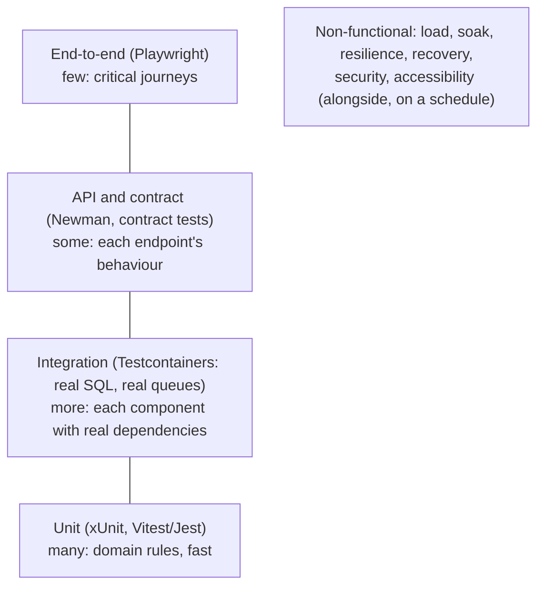

# Lecture Script: Testing and Non-Functional Testing

> **Instructor reference.** Phase 4: Log files, security and non-functional testing (Focus area 5), Module 13 | Duration: 7 hours (3 h concepts and demos, 4 h hands-on), run as Day 19 (3 h, Segments 1–7) and Day 20 (4 h, Segments 8–18) | Previous script: [Module 12 — Application Security and DevSecOps](Module-12-Application-Security-DevSecOps.md)

## Session overview

**Goal.** Learners prove ProcureFlow's non-functional requirements with evidence. They write an NFR test plan that gives every target in `nfr.md` a test type, tool, workload and pass criterion; put the functional suites on a quality gate and check them with mutation testing; load-test at 300 concurrent users and a month-end spike, find the slowest span in traces and fix it; run a 60-minute soak; inject a database outage and a Service Bus delay; run a backup-and-restore drill against the RPO and RTO; and run accessibility and cross-browser suites (Capstone increment CI-13).

**Learner profile at this point.** Learners have built, observed and secured ProcureFlow (Modules 4–12). They have tests from every module: domain unit tests (Module 7), contract tests (Module 7), concurrency and seed checks (Module 8), worker and shutdown tests (Module 9), function tests (Module 10), redaction tests (Module 11), security negative tests (Module 12), axe and Playwright (Module 6), and several k6 scripts (Modules 9 and 10). They have the NFR catalogue from Module 2 and traces, dashboards and alerts from Module 11. What they don't yet have is one plan that says, for every NFR, how it is proven and what number passes. Today introduces the first genuinely new idea of the testing module: **confidence comes from tests designed to fail: every NFR has a workload, a measurement and a pass line, and every test is itself checked for whether it would catch a real bug.**

**Key outcome.** Every learner can build a test strategy on the test pyramid and shift-left, mapping every NFR to a test and a pass criterion; use unit, integration (Testcontainers), API (Postman/Newman) and end-to-end (Playwright) tests with sensible mocking; measure test quality with mutation testing (Stryker) and enforce it with quality gates; design load, stress, spike, soak, scalability and capacity tests with k6 (and know JMeter) from a realistic workload model; read throughput, p95/p99, error rate and saturation, and find the bottleneck with traces; measure serverless cold starts, concurrency and queue backlog; run fault-injection and chaos experiments; validate failover, backup and restore against RPO and RTO; include security, accessibility, compatibility and usability testing in the plan; and add performance baselines and regression checks to the pipeline.

**Case for this session.** ProcureFlow at Meridian Components. NFRs from Module 2: **NFR-PERF-01** 95% of submit/approve actions under 2 s at 140 concurrent users at month-end; **NFR-SCAL-01** 468 invoices a day with no change to NFR-PERF-01; **NFR-AVL-01** 99.5% availability in business hours; **NFR-AVL-02** no planned downtime in the last 5 working days; **NFR-REC-01** lose at most 15 minutes of data; NFR-SEC-01 to 04; NFR-AUD-01; NFR-SUP-01. The program adds: p95 under 500 ms for read APIs at **300 concurrent users** on seeded data (10,000 requisitions); **3× load at month-end without errors**; RTO 1 hour; WCAG 2.2 AA; and coverage of **70% at v0.4 (this sprint), 80% at v1.0**, on domain and service layers. **How the two fit:** Meridian's month-end peak is about 140 concurrent users (an assumption, Module 1), so 140 is the NFR-PERF-01 workload; the program's 300 is the **headroom test** (about 2× the assumed peak, covering +30% growth and the uncertainty in the 140 estimate); and the month-end **spike is 3 × 140 = 420** users. Meridian has no RTO yet: propose **NFR-REC-02: restore service within 1 hour** (the program's figure) and confirm it with Priya. The trainer plays the tech lead and, in the opening, Priya at the Sprint 4 review.

**Note on tool versions and licences.** xUnit, Vitest or Jest, Playwright, Testcontainers for .NET (`Testcontainers.MsSql`), Newman (Apache-2.0; the Postman app has its own terms), Stryker.NET and StrykerJS (Apache-2.0), SonarCloud (free for public projects; paid for private ones: check terms) or a coverage gate with Coverlet and ReportGenerator, k6 (AGPL-3.0: a tool we run, not code we ship), Apache JMeter (Apache-2.0), Toxiproxy (MIT), Azure Chaos Studio (check region availability), and `az sql db restore`. Every new package goes through the Module 5 package gate. Check `--help` and current docs on the day.

**Note on environments and cost.** Load, spike and soak tests run against each team's **dev environment** (or a dedicated test environment), never production, and at agreed times so teams don't load each other's shared resources. Running Azure at load costs money: check the calculator, and scale back down afterwards. Load tests need tokens for many test users without MFA prompts: use the instructor's load-test users and token mechanism, valid only in the test environment.

**Note on AI output and measurements.** AI-generated tests, k6 scripts and test data vary run to run; examples are marked **illustrative**. All load, soak, restore and timing numbers here are illustrative: your environment, plan sizes and data decide the real ones.

## Timing breakdown

| Segment | Duration | Cumulative | Kind |
| --- | --- | --- | --- |
| SEGMENT 1: Opening — Test Strategy: Every NFR a Test | 25 min | 0:25 | Concept + demo |
| SEGMENT 2: Functional Testing, Mutation Testing and Quality Gates | 25 min | 0:50 | Concept + demo |
| SEGMENT 3: Lab 1 — NFR Test Plan and the Functional Quality Gate | 50 min | 1:40 | Hands-on |
| **BREAK** | 10 min | — |  |
| SEGMENT 4: Performance Testing Types | 10 min | 1:50 | Concept + demo |
| SEGMENT 5: k6, JMeter and Realistic Workload Models | 20 min | 2:10 | Concept + demo |
| SEGMENT 6: Reading Results and Finding the Bottleneck | 15 min | 2:25 | Concept + demo |
| SEGMENT 7: Lab 2A — Load Test at 300 Concurrent Users | 35 min | 3:00 | Hands-on |
| **END OF DAY 19** | — | — |  |
| SEGMENT 8: Lab 2B — Month-End Spike, Stress and the Slowest Span | 25 min | 3:25 | Hands-on |
| SEGMENT 9: Lab 3A — Start the Soak Test | 10 min | 3:35 | Hands-on |
| SEGMENT 10: Serverless Performance | 15 min | 3:50 | Concept + demo |
| SEGMENT 11: Resilience and Chaos Testing | 20 min | 4:10 | Concept + demo |
| **BREAK** | 10 min | — |  |
| SEGMENT 12: Lab 4 — Database Outage and Service Bus Delay | 40 min | 4:50 | Hands-on |
| SEGMENT 13: Availability and Recovery Testing | 15 min | 5:05 | Concept + demo |
| SEGMENT 14: Security, Accessibility, Compatibility and Usability Testing | 15 min | 5:20 | Concept + demo |
| **BREAK** | 10 min | — |  |
| SEGMENT 15: Lab 5 — Restore Drill; Accessibility and Cross-Browser Runs | 40 min | 6:00 | Hands-on |
| SEGMENT 16: Performance Baselines in the Pipeline | 10 min | 6:10 | Concept + demo |
| SEGMENT 17: Lab 3B — Read the Soak | 25 min | 6:35 | Hands-on |
| SEGMENT 18: CI-13 Review and Wrap-Up | 25 min | 7:00 | Hands-on + close |

Concepts and demos: 25 + 25 + 10 + 20 + 15 + 15 + 20 + 15 + 15 + 10 + 10 (close) = 180 min (43%). Labs and CI-13 review: 50 + 35 + 25 + 10 + 40 + 40 + 25 + 15 = 240 min (57%). Total 420 min = 7 h, matching the module's 3 h / 4 h split. Day 19: Segments 1–7 = 180 min; Day 20: Segments 8–18 = 240 min. Breaks are not counted. Lab 2 is split into 2A and 2B across the two days; Lab 3 (the 60-minute soak) starts in Segment 9 and is read in Segment 17, running in the background in between.

## SEGMENT 1: Opening — Test Strategy: Every NFR a Test (25 min)

### The Hook (8 min)

**Do:** Play Priya at the Sprint 4 review.

> *"My CFO asked me one question this morning: 'Will it work on the 31st of March, when everyone approves at once?' What do I tell her?"*

**Show one slide: "What the team said, and what the pilot showed".**

> **Team:** "412 automated tests, 71% coverage, all green."
> **Pilot:**
> 1. A third of the AI-generated unit tests assert nothing meaningful; deleting the code they test doesn't make them fail.
> 2. Module 11's incident: no test ever ran exports and approvals at the same time.
> 3. Module 11's memory leak took a week to appear; no test ran longer than four minutes.
> 4. Backups exist. Nobody has ever restored one, or knows how long it takes.
> 5. On the warehouse tablet, the approvals page cuts off the Approve button.
> 6. Nobody can say which NFR any of the 412 tests proves.

**Ask:** *"Pick any NFR from `nfr.md`. Which test would fail tomorrow if we broke it today?"*

**Do:** Take 4–5 answers. Most will be "none", or "probably the unit tests".

**Respond to likely answers:**

- *"The unit tests cover NFR-SEC-02."* → *"Good: which test name? And would it fail if the check were removed?"*
- *"We load-tested in Module 9."* → *"Catalogue search, 50 users, 60 seconds. Which NFR does that prove?"*
- *"Coverage is 71%."* → *"Coverage says the code ran during tests. Does it say anything was checked?"*

**Say:** *"In Module 2 we wrote a line on the board: a requirement you can't test is just a wish. Today we find out how many of our NFRs are still wishes."*

**Write on board, large, and leave it up all day:**

> **An NFR without a test, a workload and a number is still a wish.**

### The Pyramid and Shift-Left (7 min)



**Say:** *"Many fast unit tests at the bottom, fewer slow end-to-end tests at the top: the cheapest test that can catch a bug is the right one. **Shift-left** means testing earlier: NFRs designed in from Module 2, contract tests in Module 7, security scans on every PR. Non-functional tests don't sit on the pyramid; they run alongside it, on a schedule, against a running environment."*

### Every NFR, a Test (7 min)

| Column | Means | Example (NFR-PERF-01) |
| --- | --- | --- |
| NFR | ID and target from `nfr.md` | 95% of submit/approve < 2 s at 140 concurrent users, month-end |
| Test type | Which kind of test proves it | Load test |
| Tool | What runs it | k6 against the dev environment |
| Workload | Users, mix, think time, data, duration | 140 VUs, month-end mix, 10–30 s think time, 10,000 seeded requisitions, 15 min steady |
| Pass criterion | The number that passes | p95 of `flow:submit` and `flow:approve` < 2,000 ms; error rate < 1% |
| Evidence | Where the result lives | `docs/testing/nft/load-140.md`, k6 summary, trace links |
| When | How often it runs | Nightly on dev; before every release |

**Do (live, 2 min of the 7):** Open `docs/requirements/nfr.md`, take NFR-REC-01 ("lose at most 15 minutes of data"), and fill in the row on screen with the room: test type (restore drill), tool (`az sql db restore`), workload (marker rows written every minute), pass criterion (data loss ≤ 15 minutes), evidence, frequency (quarterly).

### Comprehension Check (3 min)

1. *"Why does the load test belong to the dev environment and not the unit-test run?"* (It needs a running system, realistic data and infrastructure; it's slow and costly, so it runs on a schedule.)
2. *"NFR-AVL-02 says no planned downtime in the last 5 working days. What kind of test proves it?"* (A release-calendar check, plus a zero-downtime deployment test in Module 14; not a load test.)

**Common misconception:** "high coverage means well tested." (Coverage measures what ran, not what was checked; mutation testing measures that.)

**Re-teach trigger:** if learners can't fill a row, do NFR-SEC-02 together: unit test of the domain rule, integration test of the policy, named tests, pass = both fail when the check is removed.

**Transition — Say:** *"Before the expensive tests, make sure the cheap ones actually check something."*

## SEGMENT 2: Functional Testing, Mutation Testing and Quality Gates (25 min)

### The Functional Layers (6 min)

| Layer | Tool | Proves | ProcureFlow example | Mock what? |
| --- | --- | --- | --- | --- |
| Unit | xUnit; Vitest or Jest | One rule or component | `IndiaRouting` at ₹50,000 and ₹50,000.01 (Module 7) | Nothing for pure domain code; ports (`TimeProvider`, repositories) for handlers |
| Integration | xUnit + Testcontainers | A component with real infrastructure | Repository + `rowversion` conflict against real SQL Server (Module 8) | Only external systems you don't own (SAP, email) |
| API | Newman (Postman collections), or `.http` files | Endpoints' behaviour through HTTP | Submit, approve, withdraw, 409, 403 flows | Nothing inside the service |
| Contract | oasdiff + exported OpenAPI (Module 7) | Code matches the agreed contract | Renamed field fails the build | — |
| End-to-end | Playwright | A user journey across the whole stack | Requester submits; approver approves; requester sees status | Nothing; use test users |

**Say:** *"Mock at the boundary you don't own, not the one you do. A repository test with a mocked `DbContext` proves nothing about SQL; Testcontainers gives a real SQL Server in a container in seconds."*

### Live Demo: A Real Database in a Test (6 min)

```csharp
public sealed class SqlFixture : IAsyncLifetime
{
    private readonly MsSqlContainer _sql = new MsSqlBuilder()
        .WithImage("mcr.microsoft.com/mssql/server:2022-latest").Build();   // Developer edition: testing only

    public string ConnectionString => _sql.GetConnectionString();

    public async Task InitializeAsync()
    {
        await _sql.StartAsync();
        await using var db = TestDb.Create(ConnectionString);
        await db.Database.MigrateAsync();                                   // the same migrations as production (Module 8)
    }

    public Task DisposeAsync() => _sql.DisposeAsync().AsTask();
}
```

**Say:** *"Same migrations as production, a fresh database per test run, gone afterwards. Module 8's concurrency test belongs here. In CI it needs Docker on the runner; GitHub's Linux runners have it."*

### Live Demo: Mutation Testing (7 min)

**Say:** *"How do you test the tests? **Mutation testing** makes small changes to your code (turn `<=` into `<`, `true` into `false`, remove a line) and runs your tests against each change. If a test fails, the mutant is **killed**. If every test still passes, the mutant **survived**: your tests didn't notice the code was wrong."*

```bash
dotnet tool install --global dotnet-stryker
cd api/tests/ProcureFlow.Requisitioning.Tests
dotnet stryker --project ProcureFlow.Requisitioning.csproj --threshold-high 80 --threshold-low 60 --break-at 50
```

**Do:** Run it on the routing code with a deliberately weak test that only checks ₹10,000. Show a survived mutant: `<= 50_000m` changed to `< 50_000m`, and no test failed.

**Example output (illustrative — layout and numbers vary):**

```
[Survived] Equality mutation on line 9: '<=' → '<'   IndiaRouting.cs
Mutation score: 41.67%   (threshold break: 50%)  → build fails
```

**Say:** *"That's Module 7's boundary lesson, measured. Add the ₹50,000 test, re-run, the mutant dies. A mutation score is the honest version of coverage."*

### Quality Gates (3 min)

| Gate | Checks | ProcureFlow setting |
| --- | --- | --- |
| Tests | All pass | Every PR |
| Coverage | Line coverage on domain and service layers | 70% now (v0.4), 80% for v1.0 (program DoD) |
| Mutation score | Tests catch changes in critical code | Domain projects; break below 50% (raise over time) |
| Static analysis | New issues, duplication, analyser warnings (zero, Module 5) | SonarCloud or analysers with warnings as errors |
| Security scans | Module 12 | Fail on critical and high |

### Comprehension Check (3 min)

1. *"A test with no assertions gives 100% coverage of a method. What does mutation testing say?"* (Every mutant survives; the score shows the test checks nothing.)
2. *"Why use Testcontainers rather than an in-memory database provider for repository tests?"* (In-memory providers behave differently from SQL Server: no `rowversion`, no constraints, different SQL; you'd be testing a different database.)

**Common misconception:** "mutation testing is too slow to be useful." (Run it on the domain projects that matter, incrementally on changed files in PRs, and fully on a schedule.)

**Re-teach trigger:** if the survived-mutant idea doesn't land, do it by hand: change one `<=` in the code on screen, run the suite, watch it stay green.

**Transition — Say:** *"Write the plan, and put the cheap tests on a gate worth trusting."*

## SEGMENT 3: Lab 1 — NFR Test Plan and the Functional Quality Gate (50 min)

**Say:** *"Two deliverables. First, the NFR test plan: every NFR in `nfr.md`, plus the program's, with a test type, tool, workload, pass criterion, evidence location and schedule. Second, the quality gate: let the AI write unit tests for the domain, then use mutation testing to find out which of them are worth keeping."*

### Instructions (read aloud, step by step)

1. **NFR test plan (20 min).** Create `docs/testing/nft-test-plan.md` from the template below: one row per NFR from Module 2's `nfr.md`, plus the program's NFRs (300-user read latency, 3× month-end, RTO, coverage, WCAG 2.2 AA). Add NFR-REC-02 (RTO 1 hour) as *proposed*. Mark any NFR you can't test yet (for example, NFR-SCAL-01 if invoice features aren't built) as a gap with a reason.
2. **AI-generated unit tests (10 min).** Use the AI prompt below for the `Requisition` aggregate and the routing strategies. Commit the tests on a branch.
3. **Mutation run (12 min).** Run Stryker.NET on the Requisitioning domain project. For each surviving mutant in routing, approval or withdrawal logic, add or fix a test until it dies. Delete AI tests that kill no mutants and assert nothing useful. Record the before and after mutation scores.
4. **Quality gate (8 min).** In CI: tests, line coverage on domain and service projects with a 70% threshold (Coverlet and ReportGenerator, or SonarCloud), and Stryker on the domain project with `--break-at 50`. Analyser warnings stay at zero.

### The AI Prompt (give to learners)

```
Write xUnit tests for this C# Requisition aggregate and the IndiaRouting / UkRouting
strategies (code attached). Cover every rule: routing boundaries (₹50,000 and ₹5,00,000,
each side), self-approval refused, approval order, withdrawn requisitions can't be
approved, currency mismatch refused, expiry only from Draft. Use a fake TimeProvider.
Every test must assert the business outcome, not internal calls. Name tests after the rule.
```

### Starter: Test Plan Template

```markdown
# docs/testing/nft-test-plan.md
| NFR | Target | Test type | Tool | Workload / setup | Pass criterion | Evidence | When |
|---|---|---|---|---|---|---|---|
| NFR-PERF-01 | 95% submit/approve < 2 s at 140 concurrent, month-end | Load | k6 → dev | 140 VUs, month-end mix, 10–30 s think, 10k seed, 15 min steady | p95 flow:submit, flow:approve < 2,000 ms; errors < 1% | docs/testing/nft/load-140.md | Nightly; pre-release |
| Program: read latency | p95 read APIs < 500 ms at 300 concurrent | Load (headroom) | k6 → dev | 300 VUs … | p95 reads < 500 ms; errors < 1% | … | Pre-release |
| Program: 3× month-end | No errors at 3× | Spike, then stress | k6 → dev | 140 → 420 VUs in 30 s; hold 5 min | errors < 1%; p95 recovers within 2 min | … | Pre-release |
| NFR-REC-01 | ≤ 15 min data loss | Restore drill | az sql db restore | marker rows every minute | measured loss ≤ 15 min | … | Quarterly |
```

### Reference Solution (instructor): Typical Mutation Findings

**Example (illustrative — AI output varies):**

| AI test | Problem | Mutation evidence | Fix |
| --- | --- | --- | --- |
| `Approve_works()`: approves, asserts `result != null` | Asserts nothing meaningful | Removing the status change survives | Assert status, approval step and event |
| `Routing_returns_line_manager()` at ₹10,000 only | No boundary | `<=` → `<` survives | Tests at ₹50,000 and ₹50,000.01 |
| `Withdraw_calls_repository()` with a mock | Tests implementation, not behaviour | Removing the "only while awaiting" check survives | Assert a withdrawn requisition can't be approved |
| Copies the production formula into the test's expected value | Tautology: the test agrees with any bug | Arithmetic mutants survive | Hard-code the expected values from the rule |

**Say:** *"The AI wrote tests that make coverage look great. Stryker shows which ones catch bugs. Keep the ones that kill mutants; fix or delete the rest. That's the checkpoint: a mutation score shows whether the tests mean anything."*

### Instructor Circulates

- **Plan rows with "fast" or "should handle load":** every pass criterion is a number.
- **Gaps hidden:** an untestable NFR is listed as a gap with a reason and an owner, not left out.
- **Mutation run on the whole solution:** limit to the domain project today; it's the critical logic.
- **Thresholds lowered to pass:** raise tests, not thresholds; if a threshold is unrealistic today, record the plan to raise it.
- **AI tests kept because they pass:** passing isn't the bar; killing mutants is.

**Success check:** the test plan covers every NFR in `nfr.md` and the program's NFRs, each with a workload, a numeric pass criterion, evidence location and schedule (gaps marked with reasons); domain mutation score recorded before and after, above 50%; CI enforces tests, 70% coverage on domain and service layers, the Stryker break threshold and zero analyser warnings.

### BREAK (10 min)

*Suggested break prompt:* *"At 10 a.m. on the 31st, what are Meridian's 140 users actually doing? Write down the mix of actions."*

## SEGMENT 4: Performance Testing Types (10 min)

### Six Types (6 min)

| Type | Question | Shape | ProcureFlow |
| --- | --- | --- | --- |
| Load | Does it meet targets at expected load? | Ramp up, hold, ramp down | 140 VUs (NFR-PERF-01); 300 VUs (headroom) |
| Stress | Where does it break, and how? | Keep increasing until failure | Beyond 420 until errors or p95 blow up |
| Spike | Does it survive a sudden jump? | Sudden step up, hold, step down | 140 → 420 in 30 s (month-end 3×) |
| Soak (endurance) | Does it degrade over time? | Moderate load for a long time | 140 VUs for 60 minutes |
| Scalability | Does adding capacity add throughput? | Same test at 1, 2, 4 instances | App Service scale-out |
| Capacity | How much can this configuration handle? | Find the maximum within targets | Users per instance before p95 > 2 s |

```
Load:   ___/‾‾‾‾‾‾‾\___        Spike:  ___|‾‾‾|___        Soak:  __/‾‾‾‾‾‾‾‾‾‾‾‾‾‾‾‾‾‾‾‾\__
Stress: ___/‾/‾/‾/‾ (until it breaks)
```

### Comprehension Check (2 min)

*"The memory leak in Module 11 took a week to cause a restart. Which test type should have found it, and why didn't a load test?"* (A soak: leaks grow with time, not with load; a 15-minute load test ends before they matter.)

### Live Demo: The Shapes in k6 (2 min)

**Do:** Show the `stages` arrays for load, spike and soak in one k6 file and the resulting VU graph in the k6 output.

**Common misconception:** "a load test tells you the system's capacity." (A load test checks targets at a chosen load; capacity and breaking points need stress testing.)

**Re-teach trigger:** if learners confuse spike and stress, draw both curves and ask which one stops at a fixed level.

**Transition — Say:** *"The type is easy. The workload, what users actually do, is where most load tests lie."*

## SEGMENT 5: k6, JMeter and Realistic Workload Models (20 min)

### Tools (3 min)

| | k6 | Apache JMeter |
| --- | --- | --- |
| Tests written as | JavaScript code, versioned with the app | XML test plans, usually built in a GUI |
| Strengths | Developer-friendly, thresholds as pass criteria, CI-friendly | Many protocols, mature plugins, common in client QA teams |
| ProcureFlow | Our choice: scripts in `perf/`, reviewed in PRs | Know it: some clients will hand you `.jmx` files |

### A Workload Model From the User Profile (7 min)

**Ask:** *"Your break question: what are 140 users doing at 10 a.m. on the 31st?"*

**Say:** *"Build the workload from Module 1's profile, not from imagination."*

| Input (Module 1 / 2) | Value | Workload decision |
| --- | --- | --- |
| Users by role | 1,200 requesters, 150 approvers (about 89% / 11%) | At 140 VUs: about 125 requester VUs, 15 approver VUs; at 300: about 267 and 33 |
| Concurrency at month-end | ~140 (assumption) | NFR-PERF-01 load level |
| What requesters do | Search catalogue, submit, check status | Per iteration: search (always), submit (about 1 in 3), status (always) |
| What approvers do | Open pending list, approve | Per iteration: pending list, approve one |
| Finance controllers | Export reports (Module 11's incident) | 1 VU exporting every 5 minutes, alongside everything else |
| Think time | Humans pause between actions | 10–30 s random |
| Data | 10,000 seeded requisitions (Module 8), approvals assigned to test approvers | Reset the database before each run, so runs are comparable |

**Say:** *"Two models of load. **Closed**: a fixed number of virtual users, each waiting for its response before thinking and acting again; when the system slows, the load drops. **Open**: requests arrive at a fixed rate regardless; when the system slows, requests pile up, like real month-end arrivals. Use closed for 'N concurrent users' NFRs; use an arrival-rate executor to test 'requests per second' targets and spikes honestly."*

### Live Demo: The Month-End Script (7 min)

```js
// perf/month-end.js (k6) — scenarios from the workload model
import http from "k6/http";
import { check, sleep } from "k6";
import { SharedArray } from "k6/data";
import { uuidv4 } from "https://jslib.k6.io/k6-utils/1.4.0/index.js";

const requesters = new SharedArray("requesters", () => JSON.parse(open("./data/requester-tokens.json")));
const approvers  = new SharedArray("approvers",  () => JSON.parse(open("./data/approver-tokens.json")));
const BASE = __ENV.BASE_URL;
const VUS = Number(__ENV.VUS || 140);

export const options = {
  scenarios: {
    requesters: { executor: "ramping-vus", exec: "requester", stages: [
      { duration: "5m", target: Math.round(VUS * 0.89) }, { duration: "15m", target: Math.round(VUS * 0.89) }, { duration: "2m", target: 0 } ] },
    approvers:  { executor: "ramping-vus", exec: "approver", stages: [
      { duration: "5m", target: Math.round(VUS * 0.11) }, { duration: "15m", target: Math.round(VUS * 0.11) }, { duration: "2m", target: 0 } ] },
    finance:    { executor: "constant-arrival-rate", exec: "exporter", rate: 1, timeUnit: "5m", duration: "22m", preAllocatedVUs: 1 },
  },
  thresholds: {
    "http_req_duration{kind:read}":     ["p(95)<500"],    // program read-latency NFR
    "http_req_duration{flow:submit}":   ["p(95)<2000"],   // NFR-PERF-01
    "http_req_duration{flow:approve}":  ["p(95)<2000"],   // NFR-PERF-01
    http_req_failed: ["rate<0.01"],
  },
};

const auth = (t) => ({ Authorization: `Bearer ${t}`, "Content-Type": "application/json" });

export function requester() {
  const u = requesters[(__VU - 1) % requesters.length];
  const search = http.get(`${BASE}/v1/catalogue/items?search=gloves&page=1&pageSize=20`, { headers: auth(u.token), tags: { kind: "read" } });
  check(search, { "search 200": (r) => r.status === 200 });
  sleep(10 + Math.random() * 20);

  if (Math.random() < 1 / 3) {
    const body = JSON.stringify({ site: u.site, neededBy: "2026-04-30", justification: "Month-end consumables for line 3",
      lines: [{ catalogueItemId: "CAT-0002", description: "Safety gloves, nitrile, size L", quantity: 4, unitPrice: 850 }] });
    const res = http.post(`${BASE}/v1/requisitions`, body,
      { headers: { ...auth(u.token), "Idempotency-Key": uuidv4() }, tags: { flow: "submit" } });
    check(res, { "submit 201": (r) => r.status === 201 });
    sleep(10 + Math.random() * 20);
  }

  const mine = http.get(`${BASE}/v1/requisitions?page=1&pageSize=20`, { headers: auth(u.token), tags: { kind: "read" } });
  check(mine, { "list 200": (r) => r.status === 200 });
  sleep(10 + Math.random() * 20);
}

export function approver() { /* GET /v1/approvals/pending (kind:read), then POST an approval (flow:approve) */ }
export function exporter() { /* GET /v1/requisitions/export.csv for last month (kind:export) */ }
```

**Say:** *"The thresholds are the NFRs, word for word. If k6 exits non-zero, an NFR failed. Note the tags: `kind:read` for the 500 ms read target, `flow:submit` and `flow:approve` for NFR-PERF-01. And the exporter runs alongside, because Module 11 taught us that's the realistic month-end."*

### Comprehension Check (3 min)

1. *"Why does the script use one `Idempotency-Key` per submit, and a fresh one every time?"* (Each submit is a new requisition; reusing a key would make k6 measure replays, not real submits.)
2. *"Why reset the database before each run?"* (Data volume and state change results; comparable runs need the same starting point.)

**Common misconception:** "100 users with no think time is the same as 100 real users." (Without think time, each VU behaves like dozens of humans; the load is far higher and the wrong shape.)

**Re-teach trigger:** if learners can't derive the VU split, compute it together from 1,200 and 150 on the board.

**Transition — Say:** *"The run produces numbers. Which ones matter, and how do you find the cause of a bad one?"*

## SEGMENT 6: Reading Results and Finding the Bottleneck (15 min)

### Four Numbers (5 min)

| Measure | Means | Watch for |
| --- | --- | --- |
| Throughput | Requests (or business actions) per second | Flattening while VUs rise: something is saturated |
| p95 / p99 latency | The time 95% / 99% of requests beat | p99 far above p95: a slow tail (locks, cold paths, GC) |
| Error rate | Failed requests over all requests | Any rise; read the error types, not just the rate |
| Saturation (USE, Module 11) | How full the resources are | SQL CPU and connection-pool waits, thread-pool queue, Service Bus backlog |

**Say:** *"Never report an average latency for a load test. Averages hide exactly the users who are suffering. And read latency next to throughput: if throughput stopped rising at 250 VUs while latency climbed, the system hit a ceiling at 250."*

### Live Demo: From a Slow p95 to a Span (5 min)

**Do:** Show a k6 summary from an instructor run where `flow:submit` p95 is 2.6 s. Then, in Application Insights (Module 11), filter the run's window to `POST /v1/requisitions`, sort by duration, open a slow trace, and expand it.

```kusto
dependencies
| where timestamp between (datetime(2026-04-01 04:40) .. datetime(2026-04-01 05:00))
| where operation_Name == "POST /v1/requisitions"
| summarize p95_ms = percentile(duration, 95), calls_per_request = count() / dcount(operation_Id) by target, name
| order by p95_ms desc
```

**Say:** *"Two numbers per dependency: how slow, and how many calls per request. Here the catalogue lookups have five calls per submit, made one after another. Each is fast; together they're most of the 2.6 seconds. That's Module 8's N+1, across a network."*

### Saturation and Little's Law (2 min)

**Say:** *"A quick sanity check: concurrent requests in the system ≈ throughput × response time. At 20 requests a second taking 2 seconds, about 40 requests are in flight; if each holds a SQL connection, that's 40 of the pool's 100 per instance. Push throughput or latency up and you can predict when the pool runs out: Module 11's incident, calculated in advance."*

### Comprehension Check (3 min)

1. *"VUs rise from 200 to 300, throughput stays flat, p95 doubles. What's happening?"* (A resource is saturated; extra users just queue. Look at USE signals and traces to find which one.)
2. *"The p95 is fine but p99 is ten times higher. Where do you look?"* (The slowest traces: locks, GC pauses, cold caches, retries, or one slow dependency call.)

**Common misconception:** "the slowest endpoint is the bottleneck." (The bottleneck is the saturated resource; one slow endpoint may simply be waiting on it.)

**Re-teach trigger:** if learners can't read the trace, walk one slow trace span by span, adding up the durations on the board.

**Transition — Say:** *"Run it: 300 users, today's last 35 minutes."*

## SEGMENT 7: Lab 2A — Load Test at 300 Concurrent Users (35 min)

**Say:** *"Write your workload model, let the AI draft the k6 script from it, review it against the model, and run the headroom load test at 300 virtual users against your dev environment. Record results against the plan's pass criteria."*

### Instructions (read aloud, step by step)

1. **Workload model (8 min).** In `docs/testing/nft/workload-model.md`: the role mix, actions per iteration, think time, data reset, test users and how tokens are obtained (the instructor's load-test token mechanism, test environment only).
2. **AI-generated script (10 min).** Use the prompt below. Review against the model and the Segment 5 script: tags, thresholds from the plan, think time, fresh idempotency keys, exporter scenario. Fix what's wrong.
3. **Run at 300 (12 min).** Reset the database (Module 8's bundle and seeder). Run `k6 run -e VUS=300 -e BASE_URL=… perf/month-end.js --summary-export=docs/testing/nft/load-300.json`. Keep the Module 11 dashboard open while it runs.
4. **Record (5 min).** In `docs/testing/nft/load-300.md`: throughput, p95 and p99 per tag, error rate and types, the USE signals at peak, and pass or fail for each threshold.

### The AI Prompt (give to learners)

```
Write a k6 script from this workload model: <paste workload-model.md>. Scenarios per role
with ramping-vus (VU count from env VUS), random think time 10–30 s, a fresh
Idempotency-Key per submit, tokens from JSON files per role, tags kind:read for reads,
flow:submit / flow:approve for writes, kind:export for exports. Thresholds exactly as in
this test plan: <paste rows>. Add checks for expected status codes. No hard-coded URLs.
```

### What the AI Draft Typically Gets Wrong (show learners)

| AI draft does this (illustrative — varies by run) | Fix |
| --- | --- |
| `sleep(1)` or no think time | 10–30 s random, from the model |
| One token for every VU | One test user per VU, per role |
| Same idempotency key for every submit | Fresh key per submit |
| Average latency thresholds (`avg<500`) | p95 thresholds from the plan |
| Thresholds on all requests together | Tags per NFR: reads versus submit/approve |
| No exporter scenario | Add it: month-end realism |

**Example result (illustrative — your environment decides):** reads p95 within 500 ms, `flow:submit` p95 above 2 s, errors below 1%; the submit failure feeds Lab 2B.

### Instructor Circulates

- **Running against another team's environment, or at the same time as the neighbouring team on a shared resource:** stop; check the schedule.
- **No database reset:** results aren't comparable.
- **k6 running on a laptop that's itself saturated (CPU at 100%):** the generator is the bottleneck; reduce VUs per machine or use the instructor's runner.
- **Results reported as averages:** p95 and p99.
- **Tokens committed to the repo:** token files are generated at run time and ignored by Git.

**Success check:** workload model committed; reviewed k6 script with plan thresholds; a 300-VU run completed after a database reset; results recorded per threshold with USE signals at peak.

### END OF DAY 19

*Overnight prompt:* *"Your submit p95 (or another slow measure) missed its target. Write down your guess for the slowest span; tomorrow, the trace decides."*

## SEGMENT 8: Lab 2B — Month-End Spike, Stress and the Slowest Span (25 min)

**Say (Day 20 opening):** *"Yesterday's line: an NFR without a test, a workload and a number is still a wish. This morning: spike from 140 to 420 users, keep pushing to find where it breaks, then find yesterday's slowest span in the traces, fix it, and prove the fix with the same run."*

### Instructions (read aloud, step by step)

1. **Spike and stress (8 min).** Run the spike profile: 140 VUs for 3 minutes, jump to 420 in 30 seconds, hold 5 minutes. Then continue ramping (stress) until the error rate exceeds 1% or submit p95 exceeds 2 s; note the VU level, and whether App Service scale-out reacted (and how late).
2. **Slowest span (7 min).** For your worst-performing flow, query the run's window (Segment 6) and open the slowest traces. Name the span that dominates and whether it's one slow call or many fast ones.
3. **Fix (6 min).** Fix the cause. Common cases: sequential catalogue lookups per line (add a batch endpoint, contract first, or bounded parallel calls); the pending-approvals query (Module 8's filtered index); a missing index found in the plan.
4. **Prove it (4 min).** Reset the database and re-run the same profile. Record before and after for the flow and the span in `docs/testing/nft/spike-stress.md`.

### Reference Solution (instructor): Batch Lookup

```csharp
// Request API: one call for all catalogue lines, instead of one per line
var ids = cmd.Lines.Where(l => l.CatalogueItemId is not null).Select(l => l.CatalogueItemId!).Distinct().ToArray();
var prices = ids.Length == 0 ? new Dictionary<string, CataloguePrice>()
                             : await catalogue.GetPricesAsync(ids, ct);   // GET /v1/catalogue/items?ids=CAT-0002,CAT-0007 (contract updated first)
```

**Example before / after (illustrative):** `flow:submit` p95 from about 2.6 s to well under 1 s; catalogue calls per submit from 5 to 1.

**Say:** *"The spike tells you whether month-end survives; the stress tells you how much room is left. Write both numbers down: 'breaks at N users' is the most useful sentence a capacity plan can have, and Module 14's scaling rules will use it."*

### Instructor Circulates

- **Fix applied without a re-run:** a fix isn't proven until the same test passes.
- **Stress run continued after errors spike for minutes:** stop at the breaking point; you're loading a shared environment.
- **Batch endpoint added without a contract change:** contract first (Module 7).
- **Autoscale "worked" but only after five minutes:** record the lag; month-end spikes don't wait.

**Success check:** spike result against the 3× criterion; breaking point recorded; slowest span named with trace evidence; fix merged; before-and-after numbers from identical runs.

## SEGMENT 9: Lab 3A — Start the Soak Test (10 min)

**Say:** *"Start a 60-minute soak at month-end level now. It runs in the background while we do resilience and recovery; we'll read it at the end of the day. Write down your predictions first."*

### Instructions (read aloud, step by step)

1. **Configure (4 min).** Use the month-end script with `VUS=140` and a single 60-minute steady stage (5-minute ramp up, 60 minutes steady, 2-minute ramp down). Include the exporter scenario.
2. **Start and baseline (4 min).** Reset the database, start the run on the instructor's runner (so it survives your laptop sleeping), and note the start time and the starting values of: GC heap size, SQL active connections, thread-pool queue, p95 for reads and submits, Redis memory, outbox unpublished rows.
3. **Predict (2 min).** In `docs/testing/nft/soak-60.md`, write what each signal should do over 60 minutes if the system is healthy.

**Note (instructor):** if the team fixed Module 11's leak, the soak may be flat, which is a valid, useful result. To make the lab worth reading for every team, the instructor can enable `seeded/connection-leak` on some environments: the spend-report endpoint opens a `SqlConnection` without disposing it, so connections leak slowly until the pool runs out.

**Success check:** soak running from a durable runner; start time and baselines recorded; predictions written.

## SEGMENT 10: Serverless Performance (15 min)

### What's Different (4 min)

| Concern | What to measure | ProcureFlow |
| --- | --- | --- |
| Cold start | First-call latency after idle | Module 10's experiment; only matters for user-facing HTTP functions |
| Concurrency limits | Messages processed in parallel per instance; maximum instances | `maxConcurrentCalls` and scale-out caps (Module 10) |
| Queue backlog | Active messages waiting; age of the oldest | `notifications` subscription during the month-end run |
| End-to-end lag | Time from the business event to the function finishing | Approval → email: outbox interval + publish + delivery + processing |

### Live Demo: Backlog Under Load (6 min)

**Do:** From yesterday's 300-VU run, show the Service Bus subscription's active message count over time, and this lag query:

```kusto
// Approval → notification sent: end-to-end lag, using the trace from Module 11
requests
| where timestamp between (datetime(2026-04-01 04:30) .. datetime(2026-04-01 05:00))
| where cloud_RoleName == "procureflow-functions" and name == "NotifyOnRequisitionEvent"
| join kind=inner (requests | where name startswith "POST /v1/requisitions" and name has "approvals"
                   | project operation_Id, approvedAt = timestamp) on operation_Id
| extend lag_s = datetime_diff("second", timestamp, approvedAt)
| summarize p50 = percentile(lag_s, 50), p95 = percentile(lag_s, 95), max = max(lag_s) by bin(timestamp, 5m)
```

**Say:** *"Because Module 11 put the function in the same trace, this query is possible at all. The lag has three parts: the outbox relay's polling interval, Service Bus delivery, and the function's processing. Under load, watch whether the backlog drains between bursts or keeps growing. If it keeps growing, the consumers can't keep up: raise concurrency within what the email provider and SQL allow, or accept the lag and write it down as a target."*

### Concurrency Limits (2 min)

**Say:** *"Serverless scales until something stops it: the plan's maximum instances, the per-instance concurrency setting, or a downstream limit. Test at least one burst large enough to hit the cap, so you know which limit you meet first and what users notice. Usually: emails a little later, nothing lost."*

### Comprehension Check (3 min)

1. *"Notifications arrive 40 seconds after approval at month-end. Where do you look first?"* (The lag breakdown: outbox unpublished rows, subscription backlog and age, the function's duration and errors.)
2. *"Why don't cold starts appear in the notification lag at month-end?"* (Under steady load, instances are warm; cold starts matter after idle periods.)

**Common misconception:** "serverless doesn't need performance testing." (Backlogs, concurrency caps, cold starts and downstream limits are all performance behaviour; they just show up as lag instead of slow pages.)

**Re-teach trigger:** if learners can't split the lag, draw the four stages on a timeline with yesterday's numbers.

**Transition — Say:** *"Performance is how it behaves when it's busy. Resilience is how it behaves when something breaks."*

## SEGMENT 11: Resilience and Chaos Testing (20 min)

### Four Ideas (6 min)

| Idea | Means | ProcureFlow |
| --- | --- | --- |
| Fault injection | Deliberately cause a specific failure | Stop SQL; add 3 s latency to Service Bus |
| Chaos experiment | A controlled fault with a hypothesis, a limited blast radius and an abort plan | "If SQL is down for 60 s, approvals fail cleanly with 503 and nothing is lost" |
| Dependency failure | One dependency fails; the rest should cope | Module 7's Catalogue chaos test |
| Retry storm | Retries at several layers multiply load on a struggling dependency | EF Core retries × gateway retries × client retries during a SQL outage |

### Anatomy of an Experiment (5 min)

```markdown
**Hypothesis:** with SQL unreachable for 60 s during month-end load, the Request API returns
503 ProblemDetails within 5 s, the gateway marks it unhealthy, the web app shows a friendly
message and keeps the form, no requisition is half-saved, and no event is lost.
**Blast radius:** our team's dev environment only. **Abort:** restore SQL connectivity.
**Measure:** error types and timings (k6), gateway health, outbox rows, audit and requisition
consistency queries, notification count after recovery.
```

**Say:** *"Start with a hypothesis you can be wrong about. The value is in the surprises."*

### Tools (4 min)

| Tool | Fault | Where |
| --- | --- | --- |
| Docker (`stop`, `pause`) | A whole dependency down | Local stack |
| Toxiproxy | Latency, timeouts, cut connections between two services | Local stack: sits between the API and SQL, or the relay and Service Bus |
| Azure Chaos Studio | Faults on Azure resources (where supported) | Dev or test environments; check supported faults and regions |

```bash
# Toxiproxy (local): proxy SQL and the Service Bus emulator's AMQP port; point connection strings at the proxies
toxiproxy-cli create --listen 0.0.0.0:21433 --upstream sqlserver:1433 sql
toxiproxy-cli create --listen 0.0.0.0:25672 --upstream servicebus:5672 servicebus
toxiproxy-cli toxic add --type latency --attribute latency=3000 servicebus      # 3 s delay
toxiproxy-cli toggle sql                                                         # SQL "down" (toggle again to restore)
```

### Retry Storms (2 min)

**Say:** *"If EF Core retries 6 times, the API's caller retries 3 times, and the BFF retries twice, one user action can become 36 database attempts against a database that's already down. Retries belong in one layer per dependency, with back-off, jitter and a budget (Module 7), and the other layers fail fast. Today's experiment counts the attempts."*

### Comprehension Check (3 min)

1. *"Why should the Request API's readiness check fail when SQL is down, but not when the Catalogue is down?"* (SQL is its own essential dependency; the Catalogue is optional for most actions. Module 7.)
2. *"What does 'blast radius' mean for our experiments?"* (Only our own dev environment, at an agreed time, with a way to stop immediately.)

**Common misconception:** "chaos engineering means randomly breaking production." (It means controlled experiments with hypotheses, limited scope and abort plans, starting in non-production.)

**Re-teach trigger:** if learners skip the hypothesis, ask: *"How will you know whether the experiment passed?"*

**Transition — Say:** *"Write your hypotheses, then break the database and slow the queue."*

### BREAK (10 min)

*Suggested break prompt:* *"During a 60-second SQL outage, what should a requester in the middle of filling the form see when they press Submit?"*

## SEGMENT 12: Lab 4 — Database Outage and Service Bus Delay (40 min)

**Say:** *"Two experiments on your local stack, with Toxiproxy in the middle, and month-end load running from k6. Write each hypothesis first. Then verify retries, dead-lettering, user-facing messages and data consistency, and record every surprise."*

### Instructions (read aloud, step by step)

1. **Hypotheses (5 min).** In `docs/testing/nft/resilience.md`, write a hypothesis, blast radius, abort step and measurements for each experiment (template from Segment 11).
2. **Database outage (15 min).** With the 140-VU month-end script running locally, toggle the SQL proxy off for 60 seconds, then on. Observe: response codes and timings, the gateway's health status, the web app's message (keep a browser open on the form), the outbox, and the number of SQL connection attempts during the outage (retry count). After recovery, run the consistency queries below.
3. **Service Bus delay and outage (12 min).** Add 3 s latency to the Service Bus proxy for 5 minutes, then cut it for 60 seconds, then restore. Observe: outbox unpublished rows, subscription backlog, notification lag, dead-letter queue, duplicates. After recovery: every approval during the window produced exactly one notification.
4. **Record and fix (8 min).** For each hypothesis: held, or failed (with evidence). Fix the most important failure, or record it as a backlog item with an owner.

### Starter: Consistency Queries

```sql
-- No requisition marked Approved without a full set of approved steps
SELECT r.Number FROM req.Requisitions r
WHERE r.Status = 'Approved'
  AND EXISTS (SELECT 1 FROM req.Approvals a WHERE a.RequisitionId = r.Id AND (a.Decision IS NULL OR a.Decision <> 'Approved'));

-- Every approval decision has its audit entry (Module 8: same transaction)
SELECT a.Id FROM req.Approvals a
JOIN req.Requisitions r ON r.Id = a.RequisitionId
WHERE a.Decision IS NOT NULL
  AND NOT EXISTS (SELECT 1 FROM audit.AuditEntries e WHERE e.EntityKey = r.Number AND e.OccurredAt = a.DecidedAt);

-- Outbox drained after recovery
SELECT COUNT(*) AS Unpublished FROM ops.OutboxMessages WHERE PublishedAt IS NULL;
```

**Note:** the audit-join query assumes the audit entry's timestamp equals the decision time; adapt it to how your Module 8 audit rows reference approvals.

### Expected Observations (instructor debrief)

**Example (illustrative — depends on each team's settings):**

| Check | Healthy result | Common surprise |
| --- | --- | --- |
| API responses during SQL outage | 503 ProblemDetails with correlation ID, within the retry budget | 500 with no friendly message: transient SQL errors not mapped to 503 |
| Gateway | Marks the Request API unhealthy within one or two health-check intervals | Readiness doesn't include SQL, so traffic keeps flowing to a broken instance |
| Web app | "ProcureFlow is temporarily unavailable; your form is kept" (Module 6) | Generic error page; form cleared |
| Retry count | Bounded: one layer retries | Dozens of attempts per action: a retry storm |
| Data consistency | All three queries return 0 after recovery | — (transactions from Module 8 usually hold) |
| Service Bus delay | Outbox backlog grows, then drains; notifications late, none lost, none duplicated | Relay crashes on timeout instead of retrying next interval |

**Say:** *"Two surprises are worth more than ten confirmations. The most common one today: the API returns 500 for a database outage. To a user, 500 means 'we broke'; 503 with `Retry-After` means 'try again shortly', and the web app can say so kindly. That's one line in the platform's exception mapping."*

### Instructor Circulates

- **No hypothesis written before breaking things:** write it first.
- **Experiment run without load:** month-end behaviour needs traffic; keep k6 running.
- **Consistency not checked after recovery:** run the queries; "it came back" isn't the same as "nothing was lost".
- **Fixes applied during the experiment:** finish, record, then fix.

**Success check:** two experiments with written hypotheses, each marked held or failed with evidence; retry count measured; consistency queries return 0; exactly one notification per approval after recovery; the most important failure fixed or logged with an owner.

## SEGMENT 13: Availability and Recovery Testing (15 min)

### Words That Must Have Numbers (5 min)

| Term | Means | ProcureFlow target |
| --- | --- | --- |
| Availability | Share of time the service works | 99.5% in business hours (NFR-AVL-01) |
| Failover | Switching to a healthy instance or replica when one fails | Two instances per service (Module 9); Azure SQL's built-in high availability |
| RPO (recovery point objective) | How much data you can afford to lose | 15 minutes (NFR-REC-01) |
| RTO (recovery time objective) | How long until the service is back | 1 hour (proposed NFR-REC-02, from the program) |

**Say:** *"A backup you haven't restored is a hope. The drill measures both numbers: how much data the restore really lost (RPO), and how long it really took to get users working again (RTO), including the people steps."*

### Live Demo: Point-in-Time Restore (5 min)

```bash
# Azure SQL point-in-time restore to a NEW database (never over the original)
az sql db restore --resource-group rg-procureflow-dev --server procureflow-dev \
  --name procureflow --dest-name procureflow-drill-0402 --time "2026-04-02T05:30:00Z"
```

**Say:** *"Azure SQL takes automated backups, including frequent log backups, so point-in-time restore is possible within the retention period; check the current documentation for backup frequency and the RPO it gives. The restore creates a new database. Getting users back means switching the app to it (configuration, identity permissions from Module 12, migrations state) and smoke-testing. That switching is usually where RTO goes."*

### Instance Failover (2 min)

**Say:** *"For compute, the simplest failover test: with load running, restart or stop one App Service instance and watch errors and latency. With two instances and health checks (Module 7), users should see little more than a blip. Zone-redundant or geo-redundant setups cost more; whether Meridian needs them is a cost-versus-NFR decision for the ADR, priced in the calculator."*

### Comprehension Check (3 min)

1. *"The restore completes in 12 minutes. Is RTO 12 minutes?"* (No: RTO includes detecting the problem, deciding to restore, switching the app, fixing permissions and smoke-testing.)
2. *"How do you measure the real RPO in a drill?"* (Write marker rows on a schedule, restore to the latest possible point, and compare the newest marker restored with the newest written.)

**Common misconception:** "the cloud backs it up, so recovery is covered." (Backups are covered; recovery is a procedure your team must run, time and practise.)

**Re-teach trigger:** if learners equate restore time with RTO, list the drill's steps on the board with a time beside each.

**Transition — Say:** *"Four more kinds of testing belong in the plan, briefly."*

## SEGMENT 14: Security, Accessibility, Compatibility and Usability Testing (15 min)

### In the Plan (11 min)

| Kind | What | Pass criterion | Source |
| --- | --- | --- | --- |
| Security | ZAP DAST, authentication and authorisation negative tests, IDOR tests | Zero open critical or high; all negative tests pass | Module 12 |
| Accessibility | axe (WCAG 2.2 A and AA tags) on key screens; keyboard walkthrough | Zero critical violations; walkthrough script passes | Module 6 |
| Compatibility | Browsers and devices Meridian actually uses | Key journeys pass on each; layout usable | Today |
| Usability | Real people doing real tasks | Task success, time, errors; a System Usability Scale score | Today |

**Say:** *"Compatibility starts with a question for Meridian's IT: which browsers and devices? It's a Microsoft shop, so Edge and Chrome on Windows are likely; the warehouse uses tablets for goods receipt (PF-016); some approvers will approve on phones. Confirm the list (a RAID item), then test what's on it, not everything."*

| Browser / device | Engine (Playwright project) | Why |
| --- | --- | --- |
| Edge, Chrome on Windows | Chromium | Most office users |
| Firefox | Firefox | Some users; catches Chromium-only assumptions |
| Safari on iPad | WebKit with an iPad device profile | Warehouse tablets (to confirm) |
| Phone (approvals) | WebKit and Chromium mobile profiles | Approving on the move |

**Say:** *"Usability testing doesn't need a lab: three to five people from outside the team, each given a task ('submit a requisition with three catalogue lines needed by next Friday'), watched without help. Note where they hesitate. The System Usability Scale, a standard 10-question survey, gives a comparable score."*

### Live Demo: Playwright Projects (2 min)

```ts
// web/playwright.config.ts (excerpt) — device names from Playwright's built-in list; check your version's list
projects: [
  { name: "chromium", use: { ...devices["Desktop Chrome"] } },
  { name: "firefox",  use: { ...devices["Desktop Firefox"] } },
  { name: "ipad",     use: { ...devices["iPad (gen 7)"] } },
  { name: "phone",    use: { ...devices["Pixel 5"] } },
],
```

### Comprehension Check (2 min)

*"The approve button is cut off on the iPad profile but fine on desktop. Which test caught it, and which WCAG 2.2 criterion is close to it?"* (The WebKit iPad project; related to reflow and 2.4.11 Focus Not Obscured, depending on the cause.)

**Common misconception:** "testing in Chrome covers Edge, so we're done." (Edge shares Chromium, but Safari and Firefox don't; tablets and phones also change layout and input.)

**Re-teach trigger:** if learners want to test every browser, ask who uses each one at Meridian.

**Transition — Say:** *"Restore the database for real, and run the browsers."*

### BREAK (10 min)

*Suggested break prompt:* *"If the restore you're about to run took 45 minutes, would NFR-REC-02 still pass? What else is in the hour?"*

## SEGMENT 15: Lab 5 — Restore Drill; Accessibility and Cross-Browser Runs (40 min)

**Say:** *"Run a restore drill against your dev database and measure the real RPO and RTO. While the restore runs, put Module 6's accessibility tests and the key journeys on every browser and device profile."*

### Instructions (read aloud, step by step)

1. **Restore drill (20 min, mostly waiting).** Start the marker writer (a small script inserting a row with the time into `ops.DrillMarkers` every 30 seconds). Note the time you "declare the incident". Run a point-in-time restore of the dev database to the latest restorable point, into a new database. While it runs, start step 2. When it's done: point a second Request API instance (or a scratch slot) at it, run the smoke test (sign in, list, submit, approve), and record: the newest marker in the restored database versus the newest written (RPO), and declaration-to-smoke-test-passing (RTO). Delete the drill database afterwards.
2. **Cross-browser and accessibility (15 min).** Add the Segment 14 projects to Playwright. Run the key journeys (submit with three lines; approve; requester sees status) and Module 6's axe tests on every project. Fix any critical failure, or log it.
3. **Record (5 min).** `docs/testing/nft/recovery-drill.md` (timeline, RPO, RTO, every manual step and its time, what slowed you down) and `docs/testing/nft/compatibility-accessibility.md` (matrix of journeys by browser, axe results).

**Note:** if your environment can't run an Azure restore today, do the drill on the local SQL container with full and log backups (`BACKUP DATABASE … TO DISK`, `BACKUP LOG …`, `RESTORE … WITH STOPAT`), and record that the Azure drill is still owed.

### Reference Results (instructor debrief)

**Example (illustrative — restore duration depends on size, tier and region):**

| Measure | Result | Against target |
| --- | --- | --- |
| Data loss (newest marker restored versus written) | Minutes | NFR-REC-01: ≤ 15 min |
| Restore operation | Tens of minutes | — |
| Switch app, fix identity access, smoke test | Often longer than the restore itself | — |
| Total, declaration to working | Close to or over an hour on the first try | NFR-REC-02 (proposed): ≤ 1 h |

**Say:** *"The first drill almost always finds the slow part isn't the restore: it's the managed identity's database user (Module 12) not existing in the restored database, or nobody knowing which setting to change. That's what the runbook (Module 15) must capture, and why the drill repeats quarterly."*

### Instructor Circulates

- **Restoring over the original database:** never; always to a new name.
- **RTO measured from when the restore started:** measure from the moment the incident was declared.
- **Drill database left running:** delete it; it costs money.
- **Accessibility failures on mobile profiles waved away:** they're real users (approvers on phones).
- **Journeys tested only in Chromium:** every project in the matrix.

**Success check:** restore drill completed with measured RPO and RTO against targets and every step timed; drill database deleted; key journeys and axe tests run on all browser and device projects, with failures fixed or logged.

## SEGMENT 16: Performance Baselines in the Pipeline (10 min)

### Catching Regressions Early (4 min)

**Say:** *"A full load test is too slow for every merge. A short, fixed **performance smoke test** after each deploy to dev isn't: 20 VUs for two minutes, same data, same script. Compare its p95s with a stored baseline. If a merge makes submit 30% slower, the pipeline says so the same day, not at the next month-end."*

```yaml
# .github/workflows/deploy-dev.yml (after deploy) — thresholds and tolerance are teaching values
- name: Performance smoke
  run: |
    k6 run -e VUS=20 -e BASE_URL=${{ vars.DEV_URL }} perf/smoke.js --summary-export=smoke.json
    node perf/compare-baseline.mjs smoke.json perf/baseline.json --tolerance 0.20   # fail if any p95 is >20% worse
```

### What a Baseline Is (3 min)

**Say:** *"The baseline is a committed file of p95s from a known-good build, updated deliberately (in a PR, with the reason) when performance changes on purpose. Noisy environments make small differences meaningless, so the tolerance is generous and the nightly full load test is the real judge."*

### Comprehension Check (3 min)

1. *"Why not run the 300-VU test on every PR?"* (Slow, costly, loads shared environments; the smoke test catches large regressions cheaply, the nightly run catches the rest.)
2. *"The baseline check fails after a change that made a report slower on purpose (more data). What do you do?"* (Update the baseline in a PR with the reason, reviewed like code.)

**Common misconception:** "performance testing happens once, before go-live." (Performance regresses with every change; baselines and scheduled runs keep it honest.)

**Re-teach trigger:** if learners don't see the value, show two smoke results from builds before and after Lab 2B's fix.

**Transition — Say:** *"Your soak has been running for well over an hour. Go and read it."*

## SEGMENT 17: Lab 3B — Read the Soak (25 min)

**Say:** *"The 60-minute soak has finished. Compare every signal at the end with the start and with your predictions. Flat lines are a result; rising lines are a finding. Either way, the evidence goes in the report."*

### Instructions (read aloud, step by step)

1. **Pull the signals (10 min).** For the soak window, chart over time: GC heap size, SQL active connections or pool usage, thread-pool queue length, p95 for reads and submits, error rate, Redis memory, outbox unpublished rows, subscription backlog. Use the Module 11 dashboard and KQL.
2. **Analyse (8 min).** For each signal: flat, rising, or sawtooth (normal for GC). For anything rising, use Module 11's tools: traces for the endpoints involved, `dotnet-counters`, and a dump if memory rises.
3. **Record (7 min).** `docs/testing/nft/soak-60.md`: predictions versus results, each signal's verdict, findings with evidence, and pass or fail against the plan's soak criteria (no upward trend in memory or connections; p95 and errors within targets for the whole hour).

### Reference Analysis (instructor)

**Example (illustrative):** on environments with `seeded/connection-leak` enabled, SQL connections climb in steps each time the exporter or spend report runs, never returning to the baseline; after enough runs, pool timeouts appear in the logs (Module 11's event) and submit p95 rises in the last minutes. The trace for the spend-report endpoint shows the Dapper query; the code shows `new SqlConnection(...)` without `await using`. On healthy environments: memory sawtooths around a stable level, connections stay flat, p95 is stable.

**Say:** *"A soak's job is to find what grows. One undisposed connection per report looks like nothing in a 15-minute load test, and like Module 11's month-end incident after a day of normal use."*

### Instructor Circulates

- **Looking only at the end of the run:** trends need the whole hour.
- **GC sawtooth called a leak:** look at the floor of the sawtooth, not the peaks.
- **"Passed" without numbers:** each signal gets start, end and trend.

**Success check:** every planned signal charted over the hour with a verdict; any rising signal investigated with evidence; predictions compared; soak pass or fail recorded against the plan.

## SEGMENT 18: CI-13 Review and Wrap-Up (25 min)

### CI-13 Peer Review — Quick Swap (15 min)

**Say:** *"Swap with the team to your left. Pick three NFRs from their test plan at random and follow each to its evidence. Open their pipeline's last run: is the quality gate real? Read their soak and recovery reports. One strength, one gap."*

**CI-13 checklist (put on screen):**

**Functional suites on the quality gate**

- [ ] Unit, integration (Testcontainers), API (Newman or equivalent), contract and end-to-end (Playwright) suites in CI
- [ ] Gate enforces tests, 70% line coverage on domain and service layers (80% planned for v1.0), the mutation-score threshold and zero analyser warnings; AI-generated tests kept only if they kill mutants

**Test plan against every NFR**

- [ ] `docs/testing/nft-test-plan.md`: every NFR from `nfr.md` and the program, with test type, tool, workload, numeric pass criterion, evidence and schedule; gaps marked; NFR-REC-02 proposed

**Load and stress**

- [ ] 300-VU headroom load and 140-VU NFR-PERF-01 results against thresholds; spike to 420 (3×) and the breaking point recorded; slowest span fixed and proven with identical re-runs

**Soak**

- [ ] 60-minute soak with every planned signal charted, predictions compared, findings investigated

**Resilience**

- [ ] Database-outage and Service Bus delay experiments with written hypotheses, verdicts, retry counts, consistency checks and user-facing messages verified

**Recovery**

- [ ] Restore drill with measured RPO and RTO, every step timed, against NFR-REC-01 and NFR-REC-02

**Accessibility**

- [ ] axe and key journeys on every browser and device profile in the compatibility matrix

**Also from today**

- [ ] Performance smoke test with a baseline comparison after each dev deploy

**Say (during the swap):** *"Following three random NFRs to their evidence is the honest test. If one leads nowhere, that's your comment."*

### What We Covered Today (2 min)

- The pyramid, shift-left, and a test plan with a number for every NFR
- Unit, integration with Testcontainers, API, contract and end-to-end tests; mocking at the right boundary
- Mutation testing and quality gates: tests that catch bugs, not just run code
- Load, stress, spike, soak, scalability and capacity tests; k6 and JMeter
- Workload models from the user profile; think time, ramp-up, open and closed models
- Throughput, p95/p99, errors and saturation; finding the bottleneck in traces
- Serverless cold starts, concurrency limits and queue backlog
- Fault injection, chaos experiments, dependency failures and retry storms
- Failover, backup and restore, RPO and RTO
- Security, accessibility, compatibility and usability in the plan; performance baselines in the pipeline

### Back to the Opening (3 min)

**Show "What the team said, and what the pilot showed" again.** For each line, ask which part of today fixes it.

(Expected: 1. Tests that assert nothing → mutation testing and the gate. 2. Exports and approvals never tested together → the workload model's exporter scenario. 3. The leak took a week → the 60-minute soak, and soak in the schedule. 4. Never restored → the restore drill with measured RPO and RTO. 5. Tablet layout → the compatibility matrix with device profiles. 6. No test linked to an NFR → the test plan.)

**Point at the board:** *"Back to Priya's question: will it work on the 31st? Now the answer is a test plan, numbers, and the breaking point, not '412 tests, all green'."*

### Exit Ticket (3 min, written, one per learner)

> *"Priya adds a new NFR: 'Approvers receive a notification within 1 minute of a requisition being submitted, at month-end.' Write the test-plan row."*

**Expected answer:** NFR ID; test type: load with end-to-end lag measurement (plus a resilience variant with Service Bus delay); tool: k6 month-end script plus the KQL lag query (Segment 10) or timestamps from the fake email sender; workload: 140 VUs month-end mix, 15 minutes steady, database reset; pass criterion: p95 of submit-to-notification lag ≤ 60 s (and no lost notifications); evidence: `docs/testing/nft/notification-lag.md`; schedule: nightly and pre-release.

**Re-teach trigger:** if more than a quarter write a criterion without a number or a workload, open Module 14 with two minutes rewriting one together.

### Bridge to What Comes Next (2 min)

**Say:** *"This morning, '412 tests, all green' couldn't answer Priya. Now every NFR has a test, a workload and a number, and we know where ProcureFlow breaks. Remember: an NFR without a test, a workload and a number is still a wish. But all of it ran against a dev environment someone set up by hand. Next, in **Module 14 — CI/CD, Containers and Cloud Deployment**, we build every environment from code, promote releases through them with these tests as gates, and get ready for production."*

### Homework / Self-Practice

1. **Close the gap.** Fix the peer-review gap through a PR, with the test or re-run that proves it.
2. **Test schedule in the pipeline.** Encode the plan's "When" column: smoke on every dev deploy, 140-VU load nightly, ZAP nightly (Module 12), soak and mutation runs weekly, restore drill as a quarterly calendar item with an owner. Document it in `docs/testing/nft-test-plan.md`.
3. **Usability test.** Run the requisition task with three people from outside your team; record task success, time, hesitations and a System Usability Scale score; turn the top three issues into backlog items.

## Q&A & Doubt Solving

**Likely questions and suggested answers:**

**Q: Why 140 for NFR-PERF-01 and 300 for the headroom test? Which one is "the" load test?** → NFR-PERF-01 is Meridian's requirement at their assumed month-end peak, so 140 is the pass/fail load for it. The program's 300 tests headroom above that: growth (+30%) and the risk that 140 is wrong. Both rows are in the plan with their own criteria. If Priya confirms a different peak, change the workload, not the method.

**Q: Should we load-test production?** → Not as a habit: you'd load real users and real SAP. Use a production-like test environment, sized like production. If production must be tested, do it in a quiet window, with Meridian's agreement, test data isolated, and an abort plan.

**Q: k6 is AGPL. Is that a problem?** → It's a tool we run, not code we ship or link into ProcureFlow; most dependency policies treat that differently. Check `DEPENDENCIES.md` covers tools explicitly (Module 9's homework question).

**Q: What mutation score is good enough?** → There's no universal number. Start by breaking the build only on large drops in critical domain code, and raise the bar as tests improve. Surviving mutants in approval or money logic matter far more than in mapping code.

**Q: How do load tests get tokens with MFA on?** → Dedicated load-test users in the test environment, excluded from interactive MFA by a narrowly scoped policy that applies only there, or a test-only token issuer trusted only by the test environment. Never weaken production identity for testing.

**Q: Is a restore drill on dev meaningful if production is bigger?** → It proves the procedure and finds the people and permission steps. Restore duration scales with size, so also run one against a production-sized copy before go-live (Module 15's readiness review).

**Q: Should Newman replace our contract tests?** → No: they check different things. Contract tests check the API's shape against the agreed contract; Newman runs behaviour scenarios (submit, approve, 409). Keep both; they're cheap.

## Instructor Notes

- **Prepare the load-test identity mechanism:** test users per role in the test environment (enough for 420 VUs, or a sensible reuse pattern), with token generation that doesn't require interactive MFA and works only in the test environment. Generate token files at run time; never commit them.
- **Provide a durable k6 runner** (a VM or CI runner) for the 300-VU, spike and soak runs, so laptops don't become the bottleneck or go to sleep. Schedule teams so they don't load the same shared resources at once.
- **Prepare `seeded/connection-leak`** (undisposed `SqlConnection` in the spend-report path) and decide which environments get it before Day 20.
- **Toxiproxy:** add it to the starter kit's compose file with proxies for SQL and the Service Bus emulator, and connection strings switchable to the proxies.
- **Restore drill:** confirm learners have permission to run point-in-time restores in the dev subscription and to delete the drill database; prepare the marker-writer script; prepare the local backup/restore fallback.
- **Cost:** scale App Service and SQL back down after the load runs; delete drill databases.
- **Say the workload decisions out loud:** 140 (Meridian), 300 (program headroom), 420 (3× month-end); NFR-REC-02 proposed; the compatibility list depends on Meridian IT (RAID).
- **Common mistake:** k6 runs from overloaded laptops; results measure the laptop.
- **Common mistake:** no database reset between runs.
- **Common mistake:** RTO measured from the start of the restore command.
- **Engagement tip:** the strongest moments are the survived mutant at ₹50,000, the five catalogue calls in one trace, the API returning 500 for a database outage, and the restore taking longer to *use* than to *run*. Pause for each.
- **Time check:** Day 19 ends exactly at 3:00 with the 300-VU run; if it's late, run at 300 on the instructor's runner and let teams record results the next morning.
- **Materials to prepare:** Priya's question and the opening slide; runner; token mechanism; seeded branch; Toxiproxy setup; marker script; templates for every report.

## Common Mistakes — Quick Reference

| Mistake | Symptom | Fix |
| --- | --- | --- |
| NFRs without numeric pass criteria | "Passed" means nothing | Test plan rows with numbers and workloads |
| Coverage as the quality measure | Green tests that catch nothing | Mutation score in the gate |
| Mocking what you own (`DbContext`, the database) | Tests pass, production fails | Testcontainers with real SQL |
| No think time; one token for all VUs | Unrealistic load shape | Workload model from the user profile |
| Averages in results | Slow users hidden | p95 and p99 per tagged flow |
| No database reset | Runs not comparable | Bundle and seeder before each run |
| Load generator saturated | Results measure the laptop | Dedicated runner; watch its CPU |
| Fix without an identical re-run | Unproven improvement | Same script, same data, before and after |
| Soak skipped or too short | Leaks found in production | 60-minute soak on a schedule |
| Experiments without hypotheses | Nothing learned | Hypothesis, blast radius, abort, measures |
| 500 for dependency outages | Users told "we broke" | 503 with `Retry-After`; friendly message |
| Retries at every layer | Retry storms | One retrying layer per dependency, with budget |
| Backups never restored | Unknown RPO and RTO | Timed drills, quarterly |
| Testing only Chromium | Tablet and phone users broken | Compatibility matrix from Meridian's devices |

## Timing Contingencies

| Situation | Action |
| --- | --- |
| Lab 1 running long | Hand out a half-filled test plan; keep the mutation run and the gate |
| Dev environment can't take 300 VUs (plan too small) | Run at the highest safe level, record it, and scale the plan for the pre-release run (cost noted) |
| Runner unavailable | Instructor runs one class-wide 300-VU run; teams analyse the shared results |
| Soak didn't start or crashed | Use the instructor's reference soak data for Lab 3B; rerun overnight |
| Azure restore not permitted | Local SQL backup/restore drill; the Azure drill becomes a dated action |
| Toxiproxy setup fails | Use `docker pause` / `docker stop` for the SQL outage; skip the latency variant |
| Day 20 running long | Cut the CI-13 swap to the three-random-NFR check |
| Advanced team finishes early | Arrival-rate spike (open model) versus VU spike; capacity per instance at 1, 2 and 4 instances |

## End-of-Session Quiz (5 Questions)

1. Write the complete test-plan row for NFR-PERF-01, and explain why 140, 300 and 420 users each appear in ProcureFlow's plan.
2. A teammate's AI-generated test suite has 95% coverage and a 30% mutation score. What does each number tell you, and what do you do?
3. In a 300-VU run, throughput flattens at 240 VUs while p95 rises sharply. Describe how you find the cause, naming the signals and tools.
4. Write a chaos experiment for "Service Bus unavailable for two minutes at month-end": hypothesis, blast radius, abort step and three measurements.
5. Your restore operation finished in 18 minutes. Explain why that isn't the RTO, how you measure RTO and RPO properly in a drill, and what usually takes the extra time.

**Answer key (instructor):**

1. NFR-PERF-01 | 95% submit/approve < 2 s at 140 concurrent, month-end | load | k6 → dev | 140 VUs, month-end mix (89% requesters, 11% approvers, one exporter), 10–30 s think, 10k seed reset, 15 min steady | p95 `flow:submit` and `flow:approve` < 2,000 ms, errors < 1% | report path | nightly and pre-release. 140 is Meridian's assumed month-end peak (the NFR's own load); 300 is the program's headroom test (growth and uncertainty); 420 is the month-end spike at 3 × 140.
2. Coverage: the tests execute 95% of lines. Mutation score: only 30% of deliberate code changes make a test fail, so most tests don't check outcomes. Keep tests that kill mutants, fix weak assertions (boundaries, outcomes), delete tests that check nothing, and keep the mutation threshold in the gate.
3. Saturation: check USE signals for the run window (SQL CPU and connection pool, thread-pool queue, Service Bus backlog, Redis), then open the slowest traces for the worst flows (Module 11) to see which span dominates or queues; use Little's law to check whether a pool limit is being hit; fix and re-run identically.
4. Hypothesis: with Service Bus unreachable for 2 minutes under month-end load, approvals keep succeeding, outbox rows accumulate and drain within N minutes of recovery, notifications arrive late but exactly once, and nothing is dead-lettered. Blast radius: own dev or local stack, agreed time. Abort: restore connectivity (toggle the proxy). Measures: approval error rate and p95; outbox unpublished count over time; notifications sent versus approvals made, and duplicates; dead-letter count.
5. RTO runs from declaring the incident to users working again: detection, decision, restore, switching the app to the new database, recreating identity access and permissions, smoke testing. Measure RPO with marker rows written on a schedule: newest marker written versus newest restored. Extra time usually goes on the app switch, identity and permission fixes, and finding the right steps without a runbook.

## Homework Rubric

| Criterion | Excellent (4) | Good (3) | Needs Work (2) | Incomplete (1) |
| --- | --- | --- | --- | --- |
| Gap fixed | Fixed via PR with the test or identical re-run that proves it | Fixed; evidence thin | Fixed without evidence | Not attempted |
| Test schedule in the pipeline | Smoke, nightly load, nightly ZAP, weekly soak and mutation runs encoded; quarterly drill owned and dated | Most encoded; one missing | Described but not encoded | Not attempted |
| Usability test | Three outside participants; task success, time, hesitations and SUS recorded; top three issues as backlog items | Done with two participants or thin notes | Team members as participants; no measures | Not attempted |

**Total:** /12. Pass threshold: 8/12.

## Materials Checklist

- [ ] Opening slide: "What the team said, and what the pilot showed"
- [ ] Load-test users and token mechanism, test environment only; token files generated at run time
- [ ] Dedicated k6 runner and a run schedule across teams
- [ ] `seeded/connection-leak` branch; decision on which environments enable it
- [ ] Toxiproxy in the starter kit compose file with SQL and Service Bus proxies
- [ ] Marker-writer script; restore permissions in the dev subscription; local backup/restore fallback
- [ ] Stryker.NET, Testcontainers, Newman and Playwright browsers installed on runners
- [ ] Templates: test plan, workload model, load, spike/stress, soak, resilience, recovery, compatibility/accessibility
- [ ] RAID entries: NFR-REC-02 proposed; compatibility list from Meridian IT
- [ ] AI assistant access tested
- [ ] Timer visible for all labs
