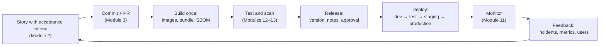
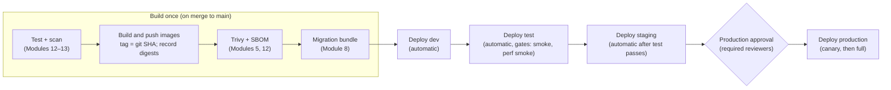

# Lecture Script: CI/CD, Containers and Cloud Deployment

> **Instructor reference.** Phase 5: Deploy, operate and support (Focus area 4), Module 14 | Duration: 7 hours (2.5 h concepts and demos, 4.5 h hands-on), run as Day 21 (4 h, Segments 1–7) and Day 22 (3 h, Segments 8–14) | Previous script: [Module 13 — Testing and Non-Functional Testing](../Phase-4/Module-13-Testing-and-Non-Functional-Testing.md)

## Session overview

**Goal.** Learners make ProcureFlow's delivery repeatable and reversible. They write multi-stage Dockerfiles that cut image size by at least half, provision every environment with Bicep (or Terraform), build one pipeline that builds once and promotes the same artefact through dev, test and staging with a manual approval for production, deploy services with Helm and functions with slots, run migrations, perform a canary release and a rollback, and fix five seeded deployment failures (Capstone increment CI-14).

**Learner profile at this point.** Learners have built, observed, secured and tested ProcureFlow (Modules 4–13). Since Module 3 a starter pipeline has deployed to each team's dev environment; Module 5 publishes packages from tags; Module 8 builds migration bundles; Module 12 runs CodeQL, Trivy and ZAP; Module 13 adds a performance smoke test. But environments were set up partly by hand, images are built in more than one place, and nobody has rolled back under pressure. Today introduces the first genuinely new idea of Phase 5: **the delivery pipeline is part of the product: environments come from code, one tested artefact moves through them, and every release has a proven way back.**

**Key outcome.** Every learner can describe the full delivery lifecycle and the DORA metrics; tell continuous integration, delivery and deployment apart; build small, secure, non-root images with multi-stage Dockerfiles and run local stacks with Docker Compose; build a GitHub Actions (or Azure DevOps) pipeline with environments, approvals and promotion of one artefact; provision infrastructure with Bicep or Terraform and review what-if or plan output; explain Kubernetes pods, deployments, services, ingress, ConfigMaps, Secrets, probes, resource limits and autoscaling; package services with Helm and deploy functions with slots; run migrations safely in the pipeline; use feature flags and rolling, blue-green and canary releases; roll back; and manage versions, release notes and change approval.

**Case for this session.** ProcureFlow at Meridian Components. Hosting decision update: ADR-0004 (Module 4) chose App Service, with Container Apps a close second and a spike to decide. With every service now a container image (scanned by Trivy since Module 12), revision-based canary releases and rollback, and event-driven scaling for workers, teams write **ADR-0012: Azure Container Apps for web, gateway and services, superseding ADR-0004**, in an India region (NFR-SEC-04), with two replicas per service (program NFR). This is Module 4's rule in action: never edit an accepted ADR; supersede it with evidence. **Kubernetes and Helm** are learned hands-on on a local **kind** cluster (the program's stack allows "AKS or local kind"); many clients run AKS, and Container Apps runs on Kubernetes underneath. Functions stay on the plan chosen in ADR-0010. NFR-AVL-02 (no planned downtime in the last 5 working days) means releases must be zero-downtime and the release calendar must respect month-end. The trainer plays the tech lead and, in the opening, Meridian's IT change manager.

**Note on tool versions.** Docker with BuildKit (Dockerfile syntax features such as secret mounts with `env=` need a recent syntax version), .NET 8 or later container images (including chiseled images), Node.js LTS for Next.js standalone output, GitHub Actions with OIDC federation to Azure, Bicep (or Terraform with the AzureRM provider), Azure Container Apps and Azure Container Registry, kind, kubectl and Helm 3. **Deployment slots for Azure Functions are not available on every hosting plan** (check whether your ADR-0010 plan supports them; Premium and Dedicated plans do), and Durable Functions needs a different task hub per slot. **The community ingress-nginx controller was retired in 2026**; new Kubernetes work uses Gateway API implementations; check the current state. Use current resource API versions in Bicep (the linter suggests them). Check `--help` and current docs on the day.

**Note on prices and licences.** Container Apps, Container Registry, Key Vault, SQL, Service Bus, Functions plans, Redis and Log Analytics are all billed. Never quote a price: price each environment in the calculator, India region, and date it; scale down or delete test environments when not in use. Every new tool goes through the Module 5 package gate; kind, Helm and Bicep are Apache-2.0 or MIT at the time of writing; Terraform's licence changed in 2023 (OpenTofu is the open-source fork): check before choosing.

**Note on AI output.** AI-generated pipeline YAML, IaC and Helm values vary run to run; examples are marked **illustrative**. What-if and plan output, image sizes and deployment timings depend on your environment; all such output here is illustrative.

## Timing breakdown

| Segment | Duration | Cumulative | Kind |
| --- | --- | --- | --- |
| SEGMENT 1: Opening — The Delivery Lifecycle, DevOps and DORA | 20 min | 0:20 | Concept + demo |
| SEGMENT 2: Docker: Multi-Stage, Small and Secure Images | 20 min | 0:40 | Concept + demo |
| SEGMENT 3: Lab 1 — Multi-Stage Dockerfiles | 45 min | 1:25 | Hands-on |
| **BREAK** | 10 min | — |  |
| SEGMENT 4: Infrastructure as Code With Bicep or Terraform | 20 min | 1:45 | Concept + demo |
| SEGMENT 5: Lab 2 — Provision the Environment | 55 min | 2:40 | Hands-on |
| **BREAK** | 10 min | — |  |
| SEGMENT 6: CI/CD: Environments, Approvals and One Artefact | 20 min | 3:00 | Concept + demo |
| SEGMENT 7: Lab 3 — Build Once, Promote Everywhere | 60 min | 4:00 | Hands-on |
| **END OF DAY 21** | — | — |  |
| SEGMENT 8: Kubernetes Essentials | 25 min | 4:25 | Concept + demo |
| SEGMENT 9: Helm and Function Slots | 10 min | 4:35 | Concept + demo |
| SEGMENT 10: Migrations, Feature Flags, Release Strategies and Rollback | 15 min | 4:50 | Concept + demo |
| SEGMENT 11: Lab 4 — Helm, Slots, Migrations, Canary and Rollback | 55 min | 5:45 | Hands-on |
| **BREAK** | 10 min | — |  |
| SEGMENT 12: Troubleshooting Deployments | 10 min | 5:55 | Concept + demo |
| SEGMENT 13: Lab 5 — Troubleshooting Gauntlet | 40 min | 6:35 | Hands-on |
| SEGMENT 14: CI-14 Review and Wrap-Up | 25 min | 7:00 | Hands-on + close |

Concepts and demos: 20 + 20 + 20 + 20 + 25 + 10 + 15 + 10 + 10 (close) = 150 min (36%). Labs and CI-14 review: 45 + 55 + 60 + 55 + 40 + 15 = 270 min (64%). Total 420 min = 7 h, matching the module's 2.5 h / 4.5 h split. Day 21: Segments 1–7 = 240 min; Day 22: Segments 8–14 = 180 min (Module 15 takes Day 22's last hour). Breaks are not counted.

## SEGMENT 1: Opening — The Delivery Lifecycle, DevOps and DORA (20 min)

### The Hook (6 min)

**Do:** Read the email as Meridian's IT change manager.

> *"Before we approve ProcureFlow for production, I reviewed how release v0.4 reached your test environment:*
> *1. A developer built the images on a laptop at 11 p.m. Were they the images you tested? Nobody could say.*
> *2. Test has settings that dev doesn't, set in the portal by hand. Nobody knows who changed what.*
> *3. A database migration was run by hand and failed half-way; the app was already deployed.*
> *4. To roll back, the team rebuilt an old commit. It took 40 minutes, and the old commit had a different base image.*
> *5. Staging doesn't exist yet. 'We'll create it like test.'*
> *6. Your plan is to deploy production on the last working day of the month. NFR-AVL-02 says no planned downtime then.*
> *Show me how you'll do it properly, and how you'll undo it."*

**Ask:** *"Which of these is a tooling problem, and which is a process problem?"*

**Do:** Take 4–5 answers.

**Respond to likely answers:**

- *"Number 1: build in CI."* → *"Yes. And then? Build again for test, again for production?"*
- *"Number 2: document the settings."* → *"Documents drift too. What can't drift?"*
- *"Number 4: keep the old image."* → *"Good. How fast can you point production back at it?"*
- *"Number 6 is just scheduling."* → *"Partly. What would make deploying on that day safe enough not to matter?"*

**Write on board, large, and leave it up all day:**

> **Build once, deploy the same thing everywhere, and always know the way back.**

### The Whole Lifecycle (4 min)



### Integration, Delivery, Deployment (4 min)

| Practice | Means | ProcureFlow |
| --- | --- | --- |
| Continuous integration | Every change merged to main often, built and tested automatically | Since Module 3 |
| Continuous delivery | Every passing build **could** go to production; a person decides when | Production: manual approval (today) |
| Continuous deployment | Every passing build **does** go to production automatically | Dev, and later test, deploy automatically |

**Say:** *"DevOps isn't a team or a tool. It's one team owning a change from story to production and back again, with automation doing the repetitive parts and fast feedback at every step."*

### DORA Metrics (3 min)

| Metric | Measures | How we get it |
| --- | --- | --- |
| Deployment frequency | How often you release to production | Pipeline runs that reached production |
| Lead time for changes | Commit to running in production | Commit time to production deploy time |
| Change failure rate | Share of deployments that cause a failure needing a fix or rollback | Incidents and rollbacks linked to releases |
| Failed deployment recovery time (formerly "time to restore") | How fast you recover from a failed change | Incident start to recovery |

**Say:** *"Two speed measures, two stability measures. Teams that are good at one are usually good at both: small, frequent, reversible changes are both faster and safer. Check the current DORA report for the latest definitions."*

### Comprehension Check (3 min)

1. *"We deploy to dev on every merge and to production after a manager approves. Which practice is that?"* (Continuous delivery; continuous deployment to dev.)
2. *"Which DORA metric would finding 4's 40-minute rollback hurt?"* (Failed deployment recovery time.)

**Common misconception:** "deploying less often is safer." (Rare deployments are large and risky; frequent small ones are easier to test and roll back.)

**Re-teach trigger:** if learners can't tell delivery from deployment, ask: *"Who decides the moment production changes: a person or the pipeline?"*

**Transition — Say:** *"The thing we build once is a container image. Let's make it a good one."*

## SEGMENT 2: Docker: Multi-Stage, Small and Secure Images (20 min)

### Live Demo: Naive Versus Multi-Stage (10 min)

**Do:** Show a naive single-stage Dockerfile for the Request API (SDK image, copy everything, `dotnet run`), build it, and show its size. Then the multi-stage version:

```dockerfile
# syntax=docker/dockerfile:1
# api/Dockerfile — build stage has the SDK; the final stage has only the runtime and our files
FROM mcr.microsoft.com/dotnet/sdk:8.0 AS build
WORKDIR /src
COPY . .
RUN --mount=type=cache,id=nuget,target=/root/.nuget/packages \
    --mount=type=secret,id=nuget_token,env=NUGET_AUTH_TOKEN \
    dotnet restore api/src/ProcureFlow.Api/ProcureFlow.Api.csproj --locked-mode
RUN --mount=type=cache,id=nuget,target=/root/.nuget/packages \
    dotnet publish api/src/ProcureFlow.Api/ProcureFlow.Api.csproj -c Release -o /app --no-restore

FROM mcr.microsoft.com/dotnet/aspnet:8.0-jammy-chiseled AS final
WORKDIR /app
COPY --from=build /app .
USER $APP_UID
EXPOSE 8080
ENTRYPOINT ["dotnet", "ProcureFlow.Api.dll"]
```

**Example output (illustrative — sizes depend on versions and your code):**

```
procureflow/request-api   naive          ~ 900 MB   (SDK, sources, obj folders)
procureflow/request-api   multi-stage    ~ 120 MB   (chiseled runtime + published app)
```

**Say:** *"Three things changed. The final image has no SDK, no source and no shell: smaller to pull, less to attack, fewer CVEs for Trivy to find. The platform packages come from our private feed (Module 5), so the token arrives as a BuildKit **secret mount**, never a build argument; build arguments end up in the image's history. And it runs as a non-root user. Remember Module 11: no tools inside; diagnostics come in a separate container."*

### Small and Secure: Seven Rules (5 min)

| Rule | Why | How |
| --- | --- | --- |
| Multi-stage builds | Build tools never ship | `AS build` → `COPY --from=build` |
| Minimal base images | Fewer packages, fewer CVEs | .NET chiseled or Alpine-based images; pin by tag and, for production, by digest |
| Non-root user | A container escape gets less | `USER $APP_UID` (.NET), `USER node` (Node.js) |
| No secrets in images | Image layers are readable by anyone who can pull | Secret mounts at build; Key Vault at runtime (Module 12) |
| `.dockerignore` | Keeps `bin/`, `obj/`, `.git/`, `node_modules/`, `.env` out of the build context | One per build context |
| Restore before copying everything (where practical) | Dependency layers cache | Cache mounts for NuGet and npm |
| One process per container, logs to stdout | Orchestrators manage processes and logs | Module 11's JSON console logging |

### Docker Compose for Local Stacks (2 min)

**Say:** *"Compose has run our local stack since the starter kit: SQL, Redis, the Service Bus emulator, Azurite, the Aspire dashboard, Toxiproxy. Today it also runs our **real images**, the same ones the pipeline will build, so 'works locally' means 'works in the image'."*

### Comprehension Check (3 min)

1. *"Why pass the NuGet token as a secret mount and not as `ARG NUGET_TOKEN`?"* (Build arguments are recorded in image metadata and history; secret mounts aren't.)
2. *"A chiseled image has no shell. How do you run `dotnet-dump` against it?"* (A separate diagnostics container sharing its process namespace and `/tmp`, Module 11.)

**Common misconception:** "containers are secure by default." (A container running as root with a full OS and secrets baked in is a liability; security comes from what you leave out.)

**Re-teach trigger:** if learners don't see why size matters, run `docker history` on the naive image and point at each large layer.

**Transition — Say:** *"Your turn: every image, smaller by at least half."*

## SEGMENT 3: Lab 1 — Multi-Stage Dockerfiles (45 min)

**Say:** *"Write multi-stage Dockerfiles for the web app, the Request API, the Catalogue service and the gateway. Measure the naive size first. The target: each image at least 50% smaller, non-root, no secrets, and clean of fixable critical and high findings in Trivy."*

### Instructions (read aloud, step by step)

1. **Measure the naive images (5 min).** Build the starter kit's (or a deliberately naive single-stage) image for each component. Record sizes in `docs/delivery/images.md`.
2. **.NET services (15 min).** Multi-stage Dockerfiles for the Request API, Catalogue and gateway (one pattern; the `pf-service` template from Module 5 can carry it for future services). Secret mount for the private NuGet feed, cache mounts, chiseled runtime, non-root.
3. **Next.js (12 min).** Enable `output: "standalone"` in `next.config.js`. Three stages: install dependencies (secret mount for the npm feed), build, run with only `.next/standalone`, `.next/static` and `public`, as `USER node`. **Check for `NEXT_PUBLIC_` variables:** they're baked in at build time, which would make the image environment-specific (Segment 6).
4. **Hygiene and scan (8 min).** `.dockerignore` for each build context. Run Trivy locally on each image (Module 12); fix base-image findings by updating tags.
5. **Compose and record (5 min).** Point `docker-compose.yml` at the new images; run the stack; smoke-test sign-in, submit and approve. Record new sizes and the percentage reduction.

### Starter: Next.js Dockerfile

```dockerfile
# syntax=docker/dockerfile:1
FROM node:22-alpine AS deps
WORKDIR /app
COPY web/package.json web/package-lock.json web/.npmrc ./
RUN --mount=type=secret,id=npm_token,env=NODE_AUTH_TOKEN npm ci

FROM node:22-alpine AS build
WORKDIR /app
COPY --from=deps /app/node_modules ./node_modules
COPY web/ .
RUN npm run build

FROM node:22-alpine AS run
WORKDIR /app
ENV NODE_ENV=production
COPY --from=build /app/.next/standalone ./
COPY --from=build /app/.next/static ./.next/static
COPY --from=build /app/public ./public
USER node
EXPOSE 3000
CMD ["node", "server.js"]
```

**Note:** check the Node.js LTS tag current on the day; for production, pin base images by digest and let Dependabot (Module 5) update them.

### Reference Solution (instructor): Sizes

**Example (illustrative):**

| Image | Naive | Multi-stage | Reduction |
| --- | --- | --- | --- |
| request-api | ~900 MB | ~120 MB | ~87% |
| catalogue | ~900 MB | ~115 MB | ~87% |
| gateway | ~880 MB | ~110 MB | ~88% |
| web | ~1.2 GB | ~180 MB | ~85% |

**Say:** *"Every image cleared 50% by a wide margin, and Trivy's list got shorter for free. That's the cheapest security work you'll do all week."*

### Instructor Circulates

- **Token as `ARG` or in a copied `.npmrc` with the value:** secret mounts only; check `docker history`.
- **`COPY . .` without `.dockerignore`:** `node_modules`, `.git` and `.env` end up in the context, sometimes in the image.
- **Next.js image includes the full `node_modules`:** use standalone output.
- **Running as root:** add the `USER` line; test that the app still starts (port 8080 for .NET images, not 80).
- **`NEXT_PUBLIC_REALTIME_URL` baked in:** note it now; Lab 3 fixes it.

**Success check:** four images at least 50% smaller than naive, recorded; all run as non-root; no secrets in layers or history; no fixable critical or high Trivy findings; the Compose stack works with the new images.

**Extension (fast teams):** try `dotnet publish /t:PublishContainer` (.NET SDK container support) for one service and compare its image and build time with the Dockerfile.

### BREAK (10 min)

*Suggested break prompt:* *"Finding 2: test has settings nobody remembers adding. What would stop that happening to staging?"*

## SEGMENT 4: Infrastructure as Code With Bicep or Terraform (20 min)

### Why Code (4 min)

**Ask:** *"Your break question?"* (Expect: nobody may change environments by hand; changes go through code.)

**Say:** *"Infrastructure as code: environments described in files, reviewed in PRs, applied by the pipeline. The files say **what** should exist (declarative); the tool works out how to get there. Same files plus different parameters gives dev, test, staging and production that differ only where we say so. Finding 2 and finding 5 both disappear: there's no 'by hand', and staging is one parameter file."*

### Live Demo: A Bicep Module (8 min)

```bicep
// infra/modules/messaging.bicep
param env string
param location string = 'centralindia'          // NFR-SEC-04: an India region
param requestApiPrincipalId string
param functionsPrincipalId string

resource sb 'Microsoft.ServiceBus/namespaces@2022-10-01-preview' = {
  name: 'sb-procureflow-${env}'
  location: location
  sku: { name: 'Standard' }                     // topics need Standard or higher
  properties: { disableLocalAuth: true }        // no connection strings: identities only (Module 12)
}

resource topic 'Microsoft.ServiceBus/namespaces/topics@2022-10-01-preview' = {
  parent: sb
  name: 'requisition-events'
  properties: { requiresDuplicateDetection: true, duplicateDetectionHistoryTimeWindow: 'PT10M' }
}

resource notifications 'Microsoft.ServiceBus/namespaces/topics/subscriptions@2022-10-01-preview' = {
  parent: topic
  name: 'notifications'
  properties: { maxDeliveryCount: 10, deadLetteringOnMessageExpiration: true }
}

var serviceBusDataSender = '69a216fc-b8fb-44d8-bc22-1f3c2cd27a39'    // built-in role ID: check in the docs
resource sendRole 'Microsoft.Authorization/roleAssignments@2022-04-01' = {
  name: guid(sb.id, requestApiPrincipalId, serviceBusDataSender)
  scope: sb
  properties: {
    roleDefinitionId: subscriptionResourceId('Microsoft.Authorization/roleDefinitions', serviceBusDataSender)
    principalId: requestApiPrincipalId
    principalType: 'ServicePrincipal'
  }
}
```

**Say:** *"Module 10's topic, Module 12's least-privilege role assignment and the no-connection-strings rule, all in code that a reviewer can read. `disableLocalAuth` turns off keys entirely, so nobody can fall back to a connection string. And the role assignment's name is a deterministic GUID, so re-running the deployment doesn't create duplicates."*

### What-If and Plan (4 min)

```bash
az deployment group what-if \
  --resource-group rg-procureflow-test \
  --template-file infra/main.bicep \
  --parameters infra/env/test.bicepparam
```

**Example output (illustrative — format varies by CLI version):**

```
Resource changes: 1 to create, 2 to modify, 1 to delete.
  - Microsoft.Sql/servers/databases/procureflow-test    ← DELETE
  ~ Microsoft.App/containerApps/ca-request-api-test
      ~ properties.template.scale.minReplicas: 1 => 2
```

**Say:** *"Read every what-if before applying, especially deletes. That line would drop the test database because someone renamed a parameter. The pipeline shows this output in the PR and requires approval before applying to test, staging and production. Terraform's equivalent is `terraform plan`; same rule."*

### Bicep or Terraform (2 min)

| | Bicep | Terraform (or OpenTofu) |
| --- | --- | --- |
| Clouds | Azure only | Many clouds and services |
| State | Azure is the state; nothing to store | A state file you must store, lock and protect |
| New Azure features | Available immediately | When the provider adds them |
| ProcureFlow | Default (Azure-only client) | Choose for multi-cloud clients or existing Terraform estates |

### Comprehension Check (2 min)

*"The what-if says one resource will be deleted and recreated. What do you do before approving?"* (Find why; if it holds data, stop: fix the template so it updates in place, or plan a migration.)

**Common misconception:** "IaC means we never touch the portal." (You can look; changes go through code. A portal change is drift the next deployment will undo, or worse, won't notice.)

**Re-teach trigger:** if learners can't read what-if, walk the example line by line: symbol, resource, property, old value, new value.

**Transition — Say:** *"Describe ProcureFlow's environment in code, review the what-if, and deploy dev from it."*

## SEGMENT 5: Lab 2 — Provision the Environment (55 min)

**Say:** *"Write Bicep (or Terraform) for ProcureFlow's environment: Container Apps environment and apps, Container Registry, Function App, Service Bus, Azure SQL, Key Vault, Redis, Log Analytics and Application Insights, with identities and least-privilege role assignments. Let the AI draft modules; review them against the checklist and the what-if before anything is applied."*

### Instructions (read aloud, step by step)

1. **AI draft (12 min).** Use the prompt below to draft `infra/main.bicep` and modules (`network`, `observability`, `data`, `messaging`, `compute`, `functions`, `keyvault`). Bicep parameter files per environment in `infra/env/`.
2. **Review (10 min).** Check every module against the review checklist below. Fix what fails; record each AI mistake in `docs/delivery/iac-review.md`.
3. **What-if (8 min).** Run what-if against your dev resource group. Read every create, modify and delete aloud in your team. Nothing is applied until everyone agrees.
4. **Deploy dev (15 min).** Apply to dev. Import or recreate anything that was made by hand before; delete hand-made resources the code doesn't own (after checking).
5. **Test and staging parameters (5 min).** Create `test.bicepparam` and `staging.bicepparam` (sizes, replica counts, names). Run what-if for staging; don't apply it yet (Lab 3's pipeline will).
6. **Record (5 min).** Price each environment in the calculator (India region, dated) and record it in `docs/delivery/environments.md`, with what scales down outside working hours.

### The AI Prompt (give to learners)

```
Write Bicep modules for ProcureFlow in an India region (parameter location):
Container Apps environment with apps web, gateway (external ingress), request-api and
catalogue (internal ingress), each with a user-assigned managed identity, readiness and
liveness probes on /health/ready and /health/live, minReplicas from a parameter,
activeRevisionsMode Multiple; Azure Container Registry (pull via managed identity, AcrPull);
Function App on <plan from ADR-0010>; Service Bus Standard with topic requisition-events and
subscriptions notifications and escalation, local auth disabled; Azure SQL with Entra-only
authentication; Key Vault with RBAC; Redis; Log Analytics and Application Insights.
Least-privilege data-plane role assignments only. No secrets in outputs. Parameter files per environment.
```

### Review Checklist

| Check | Pass if |
| --- | --- |
| Region | Every resource in the India region parameter (NFR-SEC-04) |
| No secrets | No keys or connection strings in parameters or outputs; local auth disabled where possible |
| Identities | User-assigned identities created first and granted `AcrPull` before apps pull images |
| Least privilege | Data-plane roles only (Module 12's table); no Owner or Contributor for apps |
| Probes and replicas | Readiness and liveness on every app; `minReplicas` 2 in staging and production |
| Revisions | `activeRevisionsMode: 'Multiple'` where canary releases are needed |
| Naming and tags | One convention; tags for app, environment and owner (cost reporting) |
| Deletion safety | No resource with data recreated by a name change; consider resource locks for production data |

### What the AI Draft Typically Gets Wrong (show learners)

| AI draft does this (illustrative — varies by run) | Fix |
| --- | --- |
| Outputs a Service Bus connection string | Remove; identities only |
| System-assigned identity pulling from ACR before its role exists | User-assigned identity with `AcrPull` assigned first |
| `Contributor` on the resource group for each app | Specific data-plane roles |
| Hard-coded `eastus` or `westeurope` | The location parameter, India region |
| Old API versions | Current versions (linter) |
| SQL with a password admin | Entra-only authentication with an Entra admin group |

### Instructor Circulates

- **Applying without reading what-if:** stop; read it as a team.
- **Hand-made resources left alongside coded ones:** either import them into code or delete them.
- **Secrets in parameter files:** Key Vault references, or nothing.
- **Every environment the same size:** test and dev can be smaller; staging mirrors production.
- **Forgetting to price it:** the environments table needs dated figures.

**Success check:** IaC for every listed resource in the repo; review checklist passes; dev deployed from code with what-if reviewed; test and staging parameter files ready with a staging what-if; environments priced and dated.

### BREAK (10 min)

*Suggested break prompt:* *"Your images are tagged `latest` in dev. What exactly is running in test right now, and how would you prove it?"*

## SEGMENT 6: CI/CD: Environments, Approvals and One Artefact (20 min)

### The Pipeline (5 min)



**Ask:** *"Your break question: what's running in test?"* (With `latest`, nobody can say.)

**Say:** *"Every image is built once, tagged with the commit SHA, and deployed everywhere by its **digest** (`sha256:…`), which can't change. What was tested in test is, byte for byte, what reaches production. Tags like `latest` move; digests don't."*

### Environments and Approvals (4 min)

| Environment | Deploys | Gate to enter | Data |
| --- | --- | --- | --- |
| dev | Every merge | Build, tests, scans pass | Seeded |
| test | Every merge (after dev) | Smoke tests in dev pass | Seeded; reset for NFT runs (Module 13) |
| staging | After test passes | Smoke and performance smoke in test pass | Production-like size; masked data |
| production | Manual | Required reviewers (tech lead and Meridian's change approver); release calendar respected | Real |

**Say:** *"GitHub **environments** hold each environment's settings and secrets (none, ideally: OIDC federation means the pipeline signs in to Azure with no stored password, Module 12's rule) and its protection rules: required reviewers, wait timers, which branches may deploy."*

### One Artefact, Runtime Configuration (4 min)

**Say:** *"'Build once' fails silently in two places. Next.js: anything named `NEXT_PUBLIC_` is compiled into the JavaScript at build time, so an image built with dev's realtime URL calls dev from production. Read per-environment values at runtime on the server and pass them to client components, or use same-origin relative paths through the gateway. And .NET: never read environment-specific values at build time; configuration comes from environment variables and Key Vault at runtime."*

### Migrations in the Pipeline (2 min)

**Say:** *"Module 8's bundle is an artefact too: built once, run in each environment before the new app version, with the migration identity, not the app's. If it fails, the deployment stops before any new code runs against an unfinished schema. In Container Apps, run it as a Container Apps **job** inside the environment's network."*

### Release Management (3 min)

| Practice | ProcureFlow |
| --- | --- |
| Versioning | Semantic versions for releases (`v1.0.0`), set by a Git tag on main; images keep the SHA tag too |
| Release notes | Generated from conventional commits (Module 3) and linked stories; human-edited summary for Priya |
| Change approval | Standard changes (pre-approved patterns: routine releases through the pipeline) versus normal changes (Meridian's change approver reviews); emergency changes for hotfixes (Module 15) |
| Calendar | No production releases in the last 5 working days of the month (NFR-AVL-02) unless emergency |

### Comprehension Check (2 min)

1. *"Why deploy by digest rather than by tag?"* (Digests are immutable; a tag can be moved to a different image.)
2. *"The production image calls the dev realtime hub. What happened?"* (A `NEXT_PUBLIC_` value was baked in at build time; read it at runtime instead.)

**Common misconception:** "each environment should build its own image from the same commit." (Rebuilding can pull different base images or packages; only one build makes 'what we tested' true.)

**Re-teach trigger:** if learners don't see the risk, build the same commit twice a minute apart after a base-image update and compare digests.

**Transition — Say:** *"Build the pipeline: once, by digest, through every environment."*

## SEGMENT 7: Lab 3 — Build Once, Promote Everywhere (60 min)

**Say:** *"One pipeline. On merge to main it builds and scans everything once, then deploys the same digests to dev, test and staging automatically, each behind its gates, and waits for a human approval before production. AI can draft the YAML; you review it like code."*

### Instructions (read aloud, step by step)

1. **Build job (15 min).** On push to main: tests and scans (existing jobs as prerequisites), then build and push each image to the Container Registry tagged with `${{ github.sha }}`; capture each image's digest as a job output; Trivy on each image; the SBOM (Module 5) and the migration bundle as artefacts.
2. **Reusable deploy workflow (15 min).** `deploy.yml` with inputs `environment` and the digests: sign in with OIDC (`azure/login`, no secret), run the migration bundle as a Container Apps job, update each container app to `image@digest`, wait for the new revision to be healthy, run smoke tests.
3. **Environments and approval (12 min).** GitHub environments `dev`, `test`, `staging`, `production`; required reviewers on `production`; deploy dev → test → staging automatically; production after approval, from the same digests.
4. **Gates (10 min).** After test: smoke tests and Module 13's performance smoke against the baseline. After staging: smoke tests and the ZAP baseline (Module 12). A failing gate stops promotion.
5. **Release tag and notes (8 min).** Tagging `v1.0.0-rc.1` on main triggers release notes generation from commits since the last tag. Fix the `NEXT_PUBLIC_` problem from Lab 1 (runtime configuration) so the web image is environment-agnostic.

### The AI Prompt (give to learners)

```
Write GitHub Actions workflows for ProcureFlow: ci.yml (on push to main) that runs the
existing test and scan jobs, then builds and pushes images web, gateway, request-api,
catalogue to <ACR> tagged with the git SHA using docker buildx with secret mounts for the
package feeds, outputs each image digest, runs Trivy (fail on fixable CRITICAL,HIGH),
uploads the SBOM and EF Core migration bundle; then calls deploy.yml for dev, test and
staging in sequence and production after approval. deploy.yml: azure/login with OIDC
(no client secret), run the migration bundle as a Container Apps job, update each
container app to image@digest, wait for healthy revision, run smoke tests.
Pin every action to a full commit SHA. Least-privilege permissions per job.
```

### Starter: Reusable Deploy Workflow (excerpt)

```yaml
# .github/workflows/deploy.yml (illustrative — pin actions to SHAs; check az CLI flags with --help)
on:
  workflow_call:
    inputs:
      environment: { type: string, required: true }
      api_digest:  { type: string, required: true }
      migrations_digest: { type: string, required: true }   # plus one input per image (web, gateway, catalogue)
permissions: { id-token: write, contents: read }
jobs:
  deploy:
    runs-on: ubuntu-latest
    environment: ${{ inputs.environment }}            # protection rules and variables per environment
    steps:
      - uses: azure/login@<sha>
        with: { client-id: "${{ vars.AZURE_CLIENT_ID }}", tenant-id: "${{ vars.AZURE_TENANT_ID }}", subscription-id: "${{ vars.AZURE_SUBSCRIPTION_ID }}" }
      - name: Run migrations
        run: az containerapp job start -n job-migrate-${{ inputs.environment }} -g ${{ vars.RESOURCE_GROUP }} --image ${{ vars.ACR }}/migrations@${{ inputs.migrations_digest }}
      - name: Deploy request-api
        run: |
          az containerapp update -n ca-request-api-${{ inputs.environment }} -g ${{ vars.RESOURCE_GROUP }} \
            --image ${{ vars.ACR }}/request-api@${{ inputs.api_digest }} --revision-suffix ${GITHUB_SHA::7}
      - name: Smoke test
        run: ./scripts/smoke.sh "${{ vars.BASE_URL }}"
```

**Note:** wait for the migration job to finish (and check its exit status) before updating the apps; `az containerapp job execution` commands show status. Packaging the migration bundle as its own small image is one way to run it as a job; check what suits your setup.

### Instructor Circulates

- **Building again in the deploy workflow:** deploy takes digests as inputs; it never builds.
- **`AZURE_CREDENTIALS` secret with a client secret:** use OIDC federated credentials (Module 12).
- **Production approval configured but staging deploys skipped "to save time":** promotion is sequential.
- **Gates that don't fail the job:** a failed smoke test must stop promotion.
- **Actions pinned to tags:** pin to SHAs (Module 12).
- **Web image still environment-specific:** check for `NEXT_PUBLIC_` values that differ per environment.

**Success check:** one merge produces one set of digests deployed to dev, test and staging automatically with gates; production waits for approval; migrations run before apps in each environment; OIDC login with no stored secret; release notes generated from a tag; the web image is the same in every environment.

### END OF DAY 21

*Overnight prompt:* *"If v1.0.1 has a bug in production at 10 a.m., what exactly would you click or type to go back to v1.0.0, and how long would it take?"*

## SEGMENT 8: Kubernetes Essentials (25 min)

### The Objects (8 min)

**Ask:** *"Your overnight question: how would you go back, and how long?"* Collect answers; return to them in Segment 10.

**Say:** *"Container Apps runs on Kubernetes and hides most of it. Many clients run Kubernetes directly (AKS, EKS, GKE, on-premises), so an FDE needs the core objects."*

| Object | Does | ProcureFlow / Container Apps equivalent |
| --- | --- | --- |
| Pod | One or more containers scheduled together | A replica of a container app |
| Deployment | Keeps N pods of a version running; rolls out new versions | A container app's revisions and replica count |
| Service | A stable name and address for a set of pods | Internal ingress name (`request-api`) |
| Ingress / Gateway API | Routes external HTTP to services | External ingress on the gateway app |
| ConfigMap | Non-secret configuration | Environment variables |
| Secret | Secret values (base64-encoded, **not encrypted** by default) | Key Vault references (better: the Key Vault CSI driver with workload identity on AKS) |
| Probes | Liveness (restart if dead), readiness (send traffic only when ready), startup (allow slow starts) | Same three, on `/health/live` and `/health/ready` (Modules 5 and 7) |
| Resource requests and limits | Guaranteed and maximum CPU and memory | CPU and memory per container |
| HorizontalPodAutoscaler / KEDA | Scale by CPU, memory, or events such as queue length | Container Apps scale rules (HTTP concurrency, Service Bus) |

### Live Demo: A Deployment With Probes and Limits (8 min)

```yaml
# Rendered by Helm in Lab 4; shown plain here
apiVersion: apps/v1
kind: Deployment
metadata: { name: request-api }
spec:
  replicas: 2
  selector: { matchLabels: { app: request-api } }
  template:
    metadata: { labels: { app: request-api } }
    spec:
      securityContext: { runAsNonRoot: true }
      containers:
        - name: request-api
          image: procureflow/request-api:dev
          ports: [{ containerPort: 8080 }]
          readinessProbe: { httpGet: { path: /health/ready, port: 8080 }, periodSeconds: 10 }
          livenessProbe:  { httpGet: { path: /health/live,  port: 8080 }, periodSeconds: 20, failureThreshold: 3 }
          resources:
            requests: { cpu: 250m, memory: 256Mi }
            limits:   { memory: 512Mi }
          envFrom: [{ configMapRef: { name: request-api-config } }]
---
apiVersion: v1
kind: Service
metadata: { name: request-api }
spec: { selector: { app: request-api }, ports: [{ port: 80, targetPort: 8080 }] }
```

**Do:** On the kind cluster, `kubectl apply` it, then `kubectl get pods -w` while it starts. Show a pod becoming Ready only after its readiness probe passes.

**Say:** *"Module 9 taught that liveness checks nothing external and readiness checks our own dependencies. Kubernetes acts on exactly that: a failing liveness probe restarts the container; a failing readiness probe just stops traffic. Get them backwards and a database blip restarts every pod at once."*

### Autoscaling (4 min)

**Say:** *"The HorizontalPodAutoscaler scales on CPU or memory. Queue-driven work (Module 10's consumers, the outbox relay) scales better on events: **KEDA** watches things like Service Bus subscription length. Container Apps has KEDA built in, so its scale rules can say 'add a replica per 100 waiting messages'. Use Module 13's breaking point to set the maximums."*

### Container Apps or AKS (3 min)

| | Azure Container Apps | AKS |
| --- | --- | --- |
| You manage | Apps, revisions, scale rules | The cluster: node pools, upgrades, add-ons, networking |
| Kubernetes API | Hidden | Full |
| Fits | Small teams, standard web services and workers | Platform teams, complex networking, custom operators, many workloads |
| ProcureFlow | Chosen (ADR-0012) | Revisit if Meridian standardises on AKS or needs features Container Apps lacks |

### Comprehension Check (2 min)

1. *"Pods restart every few minutes, and logs show the app was healthy. Which probe is wrong?"* (Liveness: probably checking a dependency or the wrong path or port.)
2. *"Why isn't a Kubernetes Secret enough on its own for the SQL password?"* (Base64 isn't encryption; anyone with read access decodes it. Better: no password at all (managed identity), or Key Vault through the CSI driver.)

**Common misconception:** "Kubernetes makes apps scalable and reliable automatically." (It runs what you describe; wrong probes, missing limits and stateful code (Module 9) make it unreliable fast.)

**Re-teach trigger:** if probes confuse learners, act it out: liveness is "are you alive?" (restart if not), readiness is "can you take customers?" (wait if not).

**Transition — Say:** *"Writing that YAML for every service and environment by hand doesn't scale. Helm templates it; slots do a similar job for functions."*

## SEGMENT 9: Helm and Function Slots (10 min)

### Helm (5 min)

```
charts/procureflow-service/
├── Chart.yaml
├── values.yaml                    # defaults for every service
└── templates/
    ├── deployment.yaml            # probes, limits, securityContext from values
    ├── service.yaml
    ├── configmap.yaml
    └── hpa.yaml
values/request-api.yaml            # this service's settings
values/request-api.dev.yaml        # this environment's overrides
```

```bash
helm upgrade --install request-api charts/procureflow-service \
  -f values/request-api.yaml -f values/request-api.dev.yaml \
  --set image.tag=$GIT_SHA --wait --timeout 5m
helm history request-api
helm rollback request-api 3                     # back to revision 3
```

**Say:** *"One chart for every ProcureFlow service, the way Module 5's template gave every service the same start. Values files layer: defaults, then the service, then the environment. Helm records each release as a numbered revision, so rollback is one command."*

### Function Slots (3 min)

**Say:** *"A **deployment slot** is a second, live copy of the function app. Deploy the new version to the `staging` slot, warm it up and test it, then **swap**: the slot becomes production with no cold start. To roll back, swap again. Three cautions: slots aren't available on every hosting plan (check yours); settings that must stay with an environment are marked as slot settings; and Durable Functions needs a **different task hub name per slot**, or both slots fight over the same orchestrations."*

### Comprehension Check (2 min)

*"After `helm rollback`, is the database schema rolled back too?"* (No: Helm rolls back Kubernetes objects; schema changes need backward-compatible migrations, Segment 10.)

**Common misconception:** "Helm is a deployment tool that makes things safe." (It templates and versions manifests; safety comes from probes, gradual rollout and compatible migrations.)

**Re-teach trigger:** if layering confuses learners, render with `helm template` and diff dev against staging.

**Transition — Say:** *"Rollback has a catch: the database. That decides how we release."*

## SEGMENT 10: Migrations, Feature Flags, Release Strategies and Rollback (15 min)

### Migrations That Allow Rollback (4 min)

**Say:** *"During any gradual release, the old and the new version run at the same time against the same database. And after a rollback, the old version runs against the **new** schema. So every migration must be backward compatible: **expand, then contract**."*

| Step | Release | Example: renaming `NeededBy` to `RequiredBy` |
| --- | --- | --- |
| Expand | n | Add `RequiredBy`; write both columns; read `NeededBy` |
| Migrate | n+1 | Backfill; read `RequiredBy`; still write both |
| Contract | n+2 (after n+1 is proven) | Stop writing `NeededBy`; drop it in a later migration |

**Say:** *"Module 8's warning, 'a rename can become a drop and an add', is exactly what breaks rollback. Expand–contract turns one risky change into three safe ones."*

### Feature Flags (3 min)

**Say:** *"A feature flag deploys code switched off, and switches it on separately: per environment, per site, per percentage of users. Deploy and release become two different decisions. ProcureFlow can ship the 'send back' action dark, turn it on for Pune approvers first, and turn it off in seconds without a deployment. Azure App Configuration with the .NET feature-management library is one option; flags are configuration, so they're versioned and reviewed, and old flags get removed."*

### Release Strategies (4 min)

| Strategy | How | Rollback | ProcureFlow |
| --- | --- | --- | --- |
| Rolling | Replace instances a few at a time | Roll forward or redeploy the old version | Default for small changes |
| Blue-green | Run the new version alongside, switch all traffic at once | Switch back | Function slot swap |
| Canary | Send a small share of traffic to the new version, watch, then increase | Set the new version's share to 0% | Container Apps revisions with traffic weights |

```bash
# Container Apps canary: 10% to the new revision, then 100%, or back to 0%
az containerapp ingress traffic set -n ca-request-api-staging -g rg-procureflow-staging \
  --revision-weight ca-request-api-staging--a1b2c3d=90 ca-request-api-staging--e4f5a6b=10
```

**Say:** *"A canary is only as good as what you watch: Module 11's dashboards, split by revision (error rate and p95 for the new revision versus the old). Decide in advance what number promotes it and what number rolls it back."*

### Rollback (2 min)

**Ask:** *"Back to your overnight answer: how long to go back?"* (Now: set the old revision to 100%, seconds; or `helm rollback`; or swap the slot back.)

### Comprehension Check (2 min)

*"A release adds a NOT NULL column with no default and the canary is at 10%. What breaks?"* (The old revision's inserts fail because it doesn't set the new column; migrations must be backward compatible: add it nullable or with a default first.)

**Common misconception:** "rollback means restoring the database backup." (Restoring loses every transaction since the backup; design releases so code can roll back without touching data.)

**Re-teach trigger:** if expand–contract doesn't land, draw old and new versions side by side reading and writing the table during each step.

**Transition — Say:** *"Now do all of it: Helm on kind, slots for functions, migrations, a canary, a rollback."*

## SEGMENT 11: Lab 4 — Helm, Slots, Migrations, Canary and Rollback (55 min)

**Say:** *"Five parts. Deploy ProcureFlow's services to a local kind cluster with a Helm chart, break an upgrade and roll it back. Deploy the function app to a staging slot and swap. Make one migration expand–contract. Then, in the cloud staging environment, run a canary release on Container Apps and roll it back on the numbers."*

### Instructions (read aloud, step by step)

1. **Helm on kind (15 min).** `kind create cluster --name procureflow`. Load your images (`kind load docker-image …`). Create `charts/procureflow-service` (AI may draft the templates; review against Segment 8: probes, limits, non-root). Install the Request API and Catalogue with per-service values; reach them with `kubectl port-forward`. (Local SQL and Redis can run in Compose, reached from the cluster by host address.)
2. **Break and roll back (8 min).** `helm upgrade` the Request API with a values change that breaks readiness (wrong port). Watch `kubectl get pods` and `helm history`. `helm rollback`. Record the time from noticing to healthy.
3. **Function slot (10 min).** In the cloud, deploy the function app to its `staging` slot, with a different Durable task hub name as a slot setting; warm it up; swap. If your plan doesn't support slots, document the alternative you'd use and why in ADR-0010's consequences.
4. **Expand–contract (7 min).** Pick one pending schema change and split it into an expand migration for this release; record the contract step as a backlog item for a later release.
5. **Canary on staging (15 min).** Deploy a new version to staging as a new revision with 0% traffic. Shift 10%. Watch error rate and p95 split by revision in Application Insights for five minutes under a small k6 load. Decide using criteria written **before** you look: promote to 100%, or roll back to 0%. Do both once: promote, then deliberately deploy a faulty revision and roll it back.

### Starter: Revision Comparison Query

```kusto
requests
| where timestamp > ago(15m) and cloud_RoleName == "procureflow-request-api"
| extend revision = tostring(customDimensions["revision"])          // emit the revision name as a resource attribute; check the field name
| summarize total = count(), failed = countif(success == false), p95_ms = percentile(duration, 95) by revision, bin(timestamp, 1m)
```

**Note:** add the Container Apps revision name (an environment variable inside the container) to the OpenTelemetry resource attributes in the platform (Module 11) so telemetry can be split by revision.

### Reference Solution (instructor): Canary Criteria

```markdown
# docs/delivery/canary-criteria.md
Promote when, over 5 minutes at 10% with at least 200 requests on the new revision:
- failed rate (new) ≤ failed rate (old) + 0.5 percentage points
- p95 (new) ≤ p95 (old) × 1.2
Roll back immediately when: any 5xx burst > 2% on the new revision, or a SEV alert fires.
```

**Say:** *"Criteria written before the canary starts. Otherwise everyone looks at noisy numbers and sees what they hoped to see."*

### Instructor Circulates

- **kind cluster pulling images from the internet instead of loading them:** `kind load docker-image`.
- **Liveness and readiness pointing at the same check:** Module 9's distinction.
- **Same Durable task hub in both slots:** set a slot-specific hub name.
- **Canary decided by feel:** criteria file first.
- **Rollback "tested" only by reading the command:** actually do it, and time it.

**Success check:** services running on kind from one Helm chart with probes and limits; a broken upgrade rolled back with `helm rollback` and timed; functions swapped via slot (or the alternative documented); one migration split into expand and contract; on staging, one canary promoted and one rolled back using written criteria, with timings.

### BREAK (10 min)

*Suggested break prompt:* *"A new revision shows 'provisioning failed'. List the first three things you'd check, in order."*

## SEGMENT 12: Troubleshooting Deployments (10 min)

### Symptom to Evidence (6 min)

| Symptom | Kubernetes | Container Apps | Usual causes |
| --- | --- | --- | --- |
| Image won't pull | `ImagePullBackOff`; `kubectl describe pod` | Revision provisioning failed; system logs | Wrong tag or digest; registry permission (`AcrPull`) missing |
| Container keeps restarting | `CrashLoopBackOff`; `kubectl logs --previous` | Replica restarts; `az containerapp logs show` | Startup exception: missing configuration, wrong secret, options validation (Module 7's `ValidateOnStart`) |
| Never becomes ready | Pod not Ready; probe failures in events | Revision unhealthy | Wrong probe path or port; dependency unreachable |
| Runs but calls fail with 401/403 | App logs | App logs, Application Insights | Missing role assignment for the managed identity |
| Deploy stops at migrations | Job logs | Job execution logs | Breaking migration; missing permission; timeout |

**Say:** *"Order matters: is the image there, does the container start, does it become ready, can it reach what it needs? Each step has one place to look. And the start-up exception for a wrong setting is the most useful log line you'll see all day; Module 7's `ValidateOnStart` is what makes it appear at start-up instead of on a user's first request."*

### Live Demo: Read the Events (2 min)

**Do:** On kind, apply a deployment with a misspelled image tag. Run `kubectl describe pod` and point at the event that names the tag.

### Comprehension Check (2 min)

*"The new revision starts, but every request to Service Bus fails with 'Unauthorized'. What do you check first?"* (The app identity's role assignments on the namespace: `az role assignment list --assignee <principal ID> --scope <namespace ID>`.)

**Common misconception:** "if the pipeline is green, the deployment worked." (Green means commands succeeded; health, readiness and smoke tests prove it works.)

**Re-teach trigger:** if learners jump to code, return to the order: image, start, ready, reach.

**Transition — Say:** *"Five broken deployments are waiting for you."*

## SEGMENT 13: Lab 5 — Troubleshooting Gauntlet (40 min)

**Say:** *"Your test environment has five seeded deployment failures, released one at a time from `seeded/deploy-failure-1` to `-5`. For each: deploy it through your pipeline, diagnose from evidence (not from reading the diff), fix it, redeploy, and record the time to diagnose. The diff is off-limits until you've named the cause from evidence."*

### Instructions (read aloud, step by step)

1. **Five failures (7 min each, 35 min).** For each branch: merge it to your gauntlet branch, let the pipeline deploy to test, observe, diagnose using Segment 12's table, fix, redeploy, confirm smoke tests pass.
2. **Record (5 min).** In `docs/delivery/gauntlet.md`: for each failure, the symptom, the evidence that named the cause (command and output line), the fix, and the time to diagnose.

### The Five Failures (instructor only)

| # | Seeded change | Symptom | Evidence | Fix |
| --- | --- | --- | --- | --- |
| 1 | Bad image tag: values file references `request-api@sha256:<digest of a deleted image>` | Revision provisioning fails | System logs: manifest unknown | Deploy the digest from the build job's output |
| 2 | Wrong secret: Key Vault reference to `Email--ApiKey` misspelled as `Email-ApiKey` | Function app or container fails at start-up | Start-up log: options validation failed for `EmailOptions.ApiKey` | Correct the reference name |
| 3 | Failing probe: liveness path changed to `/healthz` | Replicas restart every minute | Restart count; probe failure events | Restore `/health/live` |
| 4 | Missing role assignment: the function app's `Azure Service Bus Data Receiver` assignment removed from IaC | Notifications stop; function logs 401 Unauthorized | Function exceptions; `az role assignment list` shows no receiver role | Restore the assignment in Bicep; redeploy IaC |
| 5 | Broken migration: renames a column with a drop and an add, and adds a NOT NULL column without a default | Pipeline stops at the migration job | Job logs: SQL error on NOT NULL; EF warning about data loss in the PR | Rewrite as expand–contract; nullable or default first |

**Say (debrief):** *"Notice what each failure did not do. Failure 1 never replaced the running revision. Failure 5 stopped before any new code ran. Failure 2 crashed at start-up instead of at a user's first email. The pipeline, probes and start-up validation made five bad changes visible and harmless. That's 'always know the way back' working before you even need it."*

### Instructor Circulates

- **Reading the diff first:** evidence first; the diff only confirms.
- **Fixing by hand in the portal:** fix in code and redeploy; a portal fix is drift.
- **Failure 4 "fixed" with Contributor:** restore the specific data-plane role.
- **Failure 5 fixed by editing a migration already applied to dev:** add a new migration; never edit applied ones.

**Success check:** all five failures diagnosed from evidence, fixed in code and redeployed through the pipeline; gauntlet record with symptoms, evidence lines, fixes and times.

## SEGMENT 14: CI-14 Review and Wrap-Up (25 min)

### CI-14 Peer Review — Quick Swap (15 min)

**Say:** *"Swap with the team to your left. Read their IaC and last what-if. Find the digest running in their staging and trace it back to the build that produced it. Ask them to roll back staging while you time it. One strength, one gap."*

**CI-14 checklist (put on screen):**

**Infrastructure as code**

- [ ] Bicep (or Terraform) for Container Apps, registry, Function App, Service Bus, SQL, Key Vault, Redis and observability; India region; identities and least-privilege roles; no secrets in outputs
- [ ] What-if (or plan) reviewed before every apply; environments priced and dated

**Full pipeline with environment promotion**

- [ ] Build once on merge: images by SHA, digests recorded, Trivy, SBOM, migration bundle; OIDC to Azure; actions pinned
- [ ] Same digests promoted dev → test → staging with gates; production behind required reviewers; release notes from tags

**Staging deployment**

- [ ] Staging running the promoted digests with two replicas per service, probes, migrations applied by the pipeline

**Rollback proven**

- [ ] Canary on staging promoted and rolled back using written criteria; `helm rollback` and a slot swap (or documented alternative) timed

**Also from today's labs**

- [ ] Images at least 50% smaller, non-root, no secrets; Helm chart with probes and limits; gauntlet record; ADR-0012 drafted

**Say (during the swap):** *"Timing their rollback is the honest test. If nobody on the team knows the command without searching, that's the gap."*

### What We Covered Today (2 min)

- The delivery lifecycle; continuous integration, delivery and deployment; DORA metrics
- Multi-stage, small, non-root images; secret mounts; Compose with real images
- Bicep or Terraform; what-if and plan reviews; parameters per environment
- One artefact by digest; environments, gates and approvals; runtime configuration; OIDC
- Pods, deployments, services, ingress and Gateway API, ConfigMaps, Secrets, probes, limits, autoscaling
- Helm charts and values; function slots and Durable task hubs
- Expand–contract migrations; feature flags; rolling, blue-green and canary; rollback
- Versioning, release notes and change approval; troubleshooting from evidence

### Back to the Opening (3 min)

**Show the change manager's email again.** For each finding, ask what fixes it.

(Expected: 1. Laptop builds → build once in CI, deploy by digest. 2. Hand-made settings → IaC, what-if, no portal changes. 3. Half-run migration → bundle as a gated pipeline step before the app. 4. 40-minute rollback → revisions, `helm rollback`, slot swap: seconds to minutes, proven. 5. No staging → one parameter file. 6. Month-end deploy → release calendar, canary with criteria, and NFR-AVL-02 respected by zero-downtime strategies.)

**Point at the board:** *"Build once: 1. Same thing everywhere: 2 and 5. The way back: 3, 4 and 6."*

### Exit Ticket (3 min, written, one per learner)

> *"v1.0.1 needs a new column for a 'send back' reason. Write the release plan: migration steps, how it reaches production, and how you'd roll back at each step."*

**Expected answer:** Expand: a nullable `SendBackReason` column (backward compatible), released behind a feature flag that's off. Build once; promote through dev, test, staging with gates; production after approval, as a canary at 10% with written criteria; then 100%. Turn the flag on for one site, then all. Rollback: before full release, set the old revision to 100% (the old code ignores the nullable column); after the flag is on, turn the flag off first; no schema rollback needed. Contract (if any) only in a later release.

**Re-teach trigger:** if more than a quarter plan a NOT NULL column or a database restore as rollback, open Module 15 with the expand–contract table.

### Bridge to What Comes Next (2 min)

**Say:** *"Yesterday, a change manager's list of everything that could go wrong on release night. Now environments come from code, one tested artefact moves through them, and the way back takes seconds. Remember: build once, deploy the same thing everywhere, and always know the way back. One question remains: when production is live and something breaks anyway, who answers the phone? Next, in **Module 15 — Production Support and Operations**, we get ProcureFlow ready to be run by people other than us."*

### Homework / Self-Practice

1. **Close the gap.** Fix the peer-review gap through a PR and the pipeline, with the evidence.
2. **ADR-0012.** Finish `docs/adr/0012-container-apps-hosting.md`, superseding ADR-0004: context (Module 4's close scores, containers since Module 12), options (App Service, Container Apps, AKS), decision, consequences (cost from the calculator, dated; what changes in Modules 9–11's App Service assumptions), and "revisit if". Mark ADR-0004 as superseded.
3. **DORA baseline.** From your pipeline history, measure this sprint's deployment frequency, lead time for changes, change failure rate and failed deployment recovery time. Record them in `docs/delivery/dora.md` with how each was measured.

## Q&A & Doubt Solving

**Likely questions and suggested answers:**

**Q: Why Container Apps for the cloud and Kubernetes only locally?** → Container Apps gives ProcureFlow what it needs (containers, revisions, canary, KEDA scaling) without running a cluster, which Module 4 showed this team shouldn't take on. Learning Kubernetes on kind prepares you for the many clients who do run AKS. If Meridian mandates AKS, the same images and Helm chart move over; ADR-0012's "revisit if" says when.

**Q: GitHub Actions or Azure DevOps?** → Either supports environments, approvals, OIDC to Azure and reusable pipelines. Use what the client uses; the principles (build once, promote by digest, gates, approvals) are the same. ProcureFlow's code is on GitHub, so Actions is simplest.

**Q: Should production use the same container registry as dev?** → It can, with digests making it safe. Some organisations promote images into a separate production registry (`az acr import`) so production pulls only approved images. Either way, the digest is the same.

**Q: How do we deploy during month-end if NFR-AVL-02 says no planned downtime?** → Our releases have no planned downtime (rolling, canary, slot swaps), but the calendar still avoids non-urgent production changes in the last 5 working days; risk, not downtime, is the reason. Emergency changes go through the hotfix process (Module 15).

**Q: Do feature flags replace canaries?** → No; they complement them. Canaries limit the blast radius of new **code**; flags limit the blast radius of new **behaviour** and let you turn it off without a deploy.

**Q: Bicep or Terraform for a client who's only on Azure but already uses Terraform elsewhere?** → Terraform: consistency with their estate and skills outweighs Bicep's advantages. Record it in an ADR.

**Q: Who approves production deployments?** → The tech lead plus Meridian's change approver for normal changes; standard changes (pre-agreed, low-risk patterns) may need only the tech lead. Agree it with Meridian's change management and put it in the environment protection rules.

## Instructor Notes

- **Azure subscription preparation:** a resource group per team per environment (dev, test, staging), permission to deploy Bicep and create role assignments at those scopes, a federated credential per team repo for OIDC, Container Apps and Functions plan availability confirmed in the India region, and budget alerts. Delete or scale down after the module.
- **kind on learner machines:** test `kind create cluster` and image loading on a learner-spec laptop (Docker Desktop or WSL memory settings).
- **Seed the gauntlet:** `seeded/deploy-failure-1` to `-5` per the instructor table, tested end to end against a test environment, including restoring each team's environment after the lab.
- **Naive images:** have a naive Dockerfile per component ready, so teams measure the same baseline.
- **Run the package gate in advance** for any new GitHub Actions (pin SHAs), the feature-management library and Helm chart dependencies.
- **Say the hosting decision out loud:** ADR-0012 supersedes ADR-0004 with evidence; it's the practice Module 4 taught, not a reversal.
- **Common mistake:** rebuilding images per environment.
- **Common mistake:** `NEXT_PUBLIC_` values making the web image environment-specific.
- **Common mistake:** non-backward-compatible migrations during canaries.
- **Engagement tip:** the strongest moments are the image size drop, the what-if line that would delete the database, rolling back a canary in seconds, and failure 5 stopping the pipeline before any code ran. Pause for each.
- **Time check:** Lab 3 is the longest. If it overruns, hand out the reference workflows and keep the digests, OIDC and production approval; gates become homework.
- **Materials to prepare:** the change manager's email; naive Dockerfiles; IaC reference modules; reference workflows with pinned SHAs; Helm chart reference; gauntlet branches; canary criteria template.

## Common Mistakes — Quick Reference

| Mistake | Symptom | Fix |
| --- | --- | --- |
| Single-stage images with SDKs and sources | Large images, many CVEs | Multi-stage, minimal runtime images |
| Tokens as build arguments | Secrets in image history | BuildKit secret mounts |
| Running as root | Bigger blast radius | Non-root users |
| Hand-made environment changes | Drift; unrepeatable environments | IaC only; what-if; import or delete hand-made resources |
| Applying without reading what-if | Deleted databases | Review every create, modify and delete |
| Rebuilding per environment | "What we tested" isn't what we deployed | Build once; deploy by digest |
| `NEXT_PUBLIC_` per-environment values | Environment-specific web images | Runtime configuration or same-origin paths |
| Client secrets for pipeline login | Secrets to leak and rotate | OIDC federated credentials |
| Migrations after the app, or run by hand | Code against an unfinished schema | Gated bundle step before the app |
| Breaking migrations during canaries | Old version fails mid-release | Expand–contract |
| Liveness checks dependencies | Mass restarts on a database blip | Liveness: process only; readiness: own dependencies |
| Same Durable task hub in two slots | Orchestrations interfere | Slot-specific hub names |
| Canary judged by feel | Bad releases promoted | Written promote and rollback criteria |
| Portal fixes during incidents | Drift; next deploy undoes them | Fix in code; redeploy |

## Timing Contingencies

| Situation | Action |
| --- | --- |
| Lab 1 image builds slow on laptops | Build one .NET service and the web app; the other services use the reference Dockerfile |
| Azure deployments slow or quota-limited | Deploy dev only in Lab 2; test and staging come from the instructor's pre-provisioned environments |
| Lab 3 running long | Hand out the reference workflows; keep digests, OIDC and the production approval |
| kind won't start on some machines | Pair up; or do the Helm part on the instructor's cluster |
| Function plan has no slots | Document the alternative in ADR-0010; spend the time on the canary |
| Gauntlet running long | Do failures 1, 3 and 5; 2 and 4 become homework with the same recording |
| Advanced team finishes early | Gateway API canary with weighted routes on kind; feature flag for "send back" with per-site targeting |

## End-of-Session Quiz (5 Questions)

1. Define the four DORA metrics and say which two of the change manager's six findings each of two metrics would expose.
2. Name five practices that make ProcureFlow's images small and secure, and explain why the NuGet token must not be a build argument.
3. Describe how one commit reaches production in ProcureFlow's pipeline, including what's built, how it's identified, which gates it passes and who approves.
4. Explain liveness versus readiness probes, and what goes wrong if the liveness probe checks the database.
5. A canary at 10% shows the new revision's error rate rising. Describe the rollback, and explain why the database doesn't need restoring if migrations follow expand–contract.

**Answer key (instructor):**

1. Deployment frequency (how often production changes), lead time for changes (commit to production), change failure rate (share of deployments causing failures), failed deployment recovery time (how fast you recover). For example: finding 4's slow rollback shows in recovery time; finding 3's failed migration counts towards change failure rate; laptop builds and manual steps lengthen lead time.
2. Any five: multi-stage builds; minimal or chiseled runtime images; non-root user; `.dockerignore`; no secrets in layers; pinned base images by digest; one process with logs to stdout; cache mounts. Build arguments are stored in the image's metadata and history, so anyone who can pull the image can read them; secret mounts aren't stored.
3. On merge to main: tests and scans; images built once, tagged with the SHA and identified by digest; Trivy, SBOM and migration bundle produced. The same digests deploy automatically to dev, then test (smoke and performance smoke gates), then staging (smoke and ZAP gates), each with migrations before apps and OIDC sign-in. Production needs required reviewers (tech lead and Meridian's change approver) and respects the release calendar; it's released as a canary, then fully.
4. Liveness asks "is the process alive?" and restarts it if not; readiness asks "can it serve now?" and stops traffic if not. If liveness checks the database, a database blip makes every replica fail liveness and restart at once, turning a brief dependency problem into a full outage.
5. Set the traffic weight of the old revision to 100% and the new one to 0% (seconds), confirm error rates return to normal, and investigate. Because expand–contract migrations are backward compatible, the old code works with the new schema, so no data changes or restores are needed; a restore would lose every transaction since the backup.

## Homework Rubric

| Criterion | Excellent (4) | Good (3) | Needs Work (2) | Incomplete (1) |
| --- | --- | --- | --- | --- |
| Gap fixed | Fixed in code through the pipeline, with evidence | Fixed; evidence thin | Fixed by hand in an environment | Not attempted |
| ADR-0012 | Options compared with Module 4's evidence; dated costs; consequences for earlier App Service assumptions; ADR-0004 marked superseded; clear "revisit if" | Complete; one area thin | Decision without options or costs | Not attempted |
| DORA baseline | All four metrics measured from pipeline and incident history, with methods stated | Measured; methods vague | Estimated rather than measured | Not attempted |

**Total:** /12. Pass threshold: 8/12.

## Materials Checklist

- [ ] The change manager's email (opening and close)
- [ ] Azure resource groups per team and environment; OIDC federated credentials; plan availability in the India region confirmed; budget alerts
- [ ] Naive Dockerfiles per component for the size baseline
- [ ] Reference Bicep modules and parameter files; reference CI and deploy workflows with actions pinned to SHAs
- [ ] kind, kubectl and Helm installed and tested on learner machines
- [ ] Reference Helm chart for ProcureFlow services
- [ ] `seeded/deploy-failure-1` to `-5`, tested, with an environment reset script
- [ ] Canary criteria and gauntlet record templates
- [ ] Clean-up plan: scale down or delete test and staging after the module
- [ ] AI assistant access tested
- [ ] Timer visible for all labs
