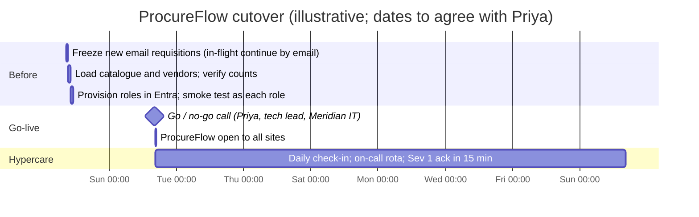
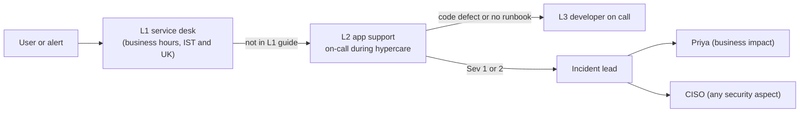

# Lecture Script: Production Support and Operations

> **Instructor reference.** Phase 5: Deploy, operate and support (Focus area 4), Module 15 | Duration: 4 hours (1.5 h concepts and demos, 2.5 h hands-on), run as Day 22 (1 h, Segments 1–3) and Day 23 (3 h, Segments 4–13) | Previous script: [Module 14 — CI/CD, Containers and Cloud Deployment](Module-14-CICD-Containers-Cloud-Deployment.md)

## Session overview

**Goal.** Learners get ProcureFlow ready to be run by people who didn't build it. They hold a production readiness review against evidence, survive a game-day incident (triage by severity, communicate, find the cause in logs and traces, ship a hotfix through the pipeline), write a runbook and support handover pack that a member of another team uses, unaided, to resolve a second incident, and run a blameless postmortem whose actions land in the backlog (Capstone increment CI-15).

**Learner profile at this point.** Learners have built, observed, secured, tested and automated ProcureFlow (Modules 4–14). They already have most of the raw material for support: dashboards and SLO alerts (Module 11), runbook sections for alerts and dead letters (Module 10 and 11 homework), an incident report and postmortem format (Module 11), security alerts (Module 12), NFR test reports and a restore drill (Module 13), and a pipeline with proven rollback (Module 14). What they haven't done is hand the system to someone else. Forward Deployed Engineers leave; the client's people stay. Today introduces the first genuinely new idea of the final phase: **operability: the product isn't done until people who didn't build it can run it, support it and improve it.**

**Key outcome.** Every learner can run a production readiness review, write a go-live checklist and cutover plan, and plan hypercare; describe L1, L2 and L3 support, on-call and escalation; explain ITIL incident, problem, change and request management and use a known error database; set severity levels and relate SLAs, SLOs and error budgets; communicate during incidents with templates; write runbooks and playbooks, one per alert, with safe automation; run the hotfix process through the pipeline; produce a support handover pack; and feed postmortem actions, user feedback and NFR updates back into the backlog.

**Case for this session.** ProcureFlow at Meridian Components, a week before go-live. Today Meridian approves purchases by email and spreadsheet; ProcureFlow replaces that. NFR-SUP-01: during the last 5 working days, a month-end approval outage gets a response within 1 hour. The program adds: **a runbook for every alert**, and **Severity 1 acknowledged within 15 minutes during the hypercare period**. Support roles at Meridian (an assumption to confirm, logged in the RAID log): **L1** is Meridian IT's service desk; **L2** is Meridian's application support analyst, with the FDE team alongside during hypercare; **L3** is the development team. Priya is the business owner; the CISO is the escalation point for security. The trainer plays the tech lead, Priya, and, during the game day, the users reporting the incident.

**Note on tools.** Everything from earlier modules: Application Insights and KQL (Module 11), the pipeline and environments (Module 14), GitHub issues or Azure Boards for the backlog and the known error database, and a team chat channel for incident communication. A service-management tool (such as ServiceNow or Jira Service Management) is common at clients; today we use markdown files and issues to learn the process, not a product.

**Note on AI output.** AI-drafted runbooks and incident summaries vary run to run; examples are marked **illustrative**. A runbook is accepted only after another team executes it successfully.

## Timing breakdown

| Segment | Duration | Cumulative | Kind |
| --- | --- | --- | --- |
| SEGMENT 1: Opening — Go-Live: Readiness, Cutover and Hypercare | 15 min | 0:15 | Concept + demo |
| SEGMENT 2: Lab 1 — Production Readiness Review | 35 min | 0:50 | Hands-on |
| SEGMENT 3: Support Model: L1, L2, L3 and On-Call | 10 min | 1:00 | Concept + demo |
| **END OF DAY 22** | — | — |  |
| SEGMENT 4: ITIL Basics: Incident, Problem, Change, Request | 10 min | 1:10 | Concept + demo |
| SEGMENT 5: Severity, SLAs, SLOs and Incident Communication | 10 min | 1:20 | Concept + demo |
| SEGMENT 6: Runbooks, Playbooks and Safe Automation | 10 min | 1:30 | Concept + demo |
| SEGMENT 7: The Hotfix Process | 10 min | 1:40 | Concept + demo |
| SEGMENT 8: Lab 2 — Game Day | 50 min | 2:30 | Hands-on |
| **BREAK** | 10 min | — |  |
| SEGMENT 9: Knowledge Transfer and Handover | 5 min | 2:35 | Concept |
| SEGMENT 10: Lab 3 — Runbook and Handover Pack, Proven by Another Team | 40 min | 3:15 | Hands-on |
| SEGMENT 11: Feeding Production Back Into the Backlog | 10 min | 3:25 | Concept + demo |
| SEGMENT 12: Lab 4 — Blameless Postmortem | 15 min | 3:40 | Hands-on |
| SEGMENT 13: CI-15 Review and Wrap-Up | 20 min | 4:00 | Hands-on + close |

Concepts and demos: 15 + 10 + 10 + 10 + 10 + 10 + 5 + 10 + 10 (close) = 90 min (37.5%). Labs and CI-15 review: 35 + 50 + 40 + 15 + 10 = 150 min (62.5%). Total 240 min = 4 h, matching the module's 1.5 h / 2.5 h split. Day 22: Segments 1–3 = 60 min (after Module 14's 3 hours); Day 23: Segments 4–13 = 180 min (Module 16 takes Day 23's last hour). Breaks are not counted.

## SEGMENT 1: Opening — Go-Live: Readiness, Cutover and Hypercare (15 min)

### The Hook (5 min)

**Do:** Play Priya.

> *"Go-live is Monday. My CFO asked me two questions and I couldn't answer either. One: if ProcureFlow breaks at 10 a.m. on the 31st, who picks up the phone, and how long until approvers can work again? Two: your team leaves in a month. Who fixes it then?"*

**Ask:** *"Answer Priya. Who picks up the phone?"*

**Do:** Take 4–5 answers.

**Respond to likely answers:**

- *"We do."* → *"At 10 a.m. on the 31st of next March, when you're on another client?"*
- *"Meridian IT."* → *"With what? Do they know what a dead-letter queue is? Where's the page they'd follow?"*
- *"We have alerts and runbooks."* → *"Has anyone who didn't write them ever used them?"*
- *"We'll train them."* → *"Good. What's the evidence they can do it without you?"*

**Write on board, large, and leave it up all day:**

> **Ready means someone else can run it, fix it and explain it without you.**

### Readiness, Cutover, Hypercare (8 min)

**Say:** *"Three ideas carry a go-live."*

| Idea | Means | ProcureFlow |
| --- | --- | --- |
| Production readiness review | A go / no-go decision against evidence: tests, scans, monitoring, runbooks, rollback, support | Lab 1, today |
| Cutover plan | The minute-by-minute plan for switching from the old way to the new one, including how to reverse it | Email approvals stop; ProcureFlow starts; in-flight requisitions handled |
| Hypercare | A period after go-live with extra support: the building team on call, faster responses, daily check-ins | Two weeks (to confirm), Sev 1 acknowledged in 15 minutes |

**Do (live, 3 of the 8 minutes):** Show the cutover plan's timeline.



**Say:** *"Notice the go/no-go milestone and what's **not** on the chart: go-live is never planned for the last 5 working days of a month (NFR-AVL-02), and the plan says how to reverse. Here, reversing means approvers fall back to email for a day; ugly, but safe, and Priya needs to have agreed to it in advance."*

### Comprehension Check (2 min)

*"What makes a readiness review different from a status meeting?"* (Every item is answered with evidence (a report, a test run, a link), and the outcome is a go / no-go decision with named owners for any exceptions.)

**Common misconception:** "go-live is the finish line." (It's the start of operations; hypercare exists because the first weeks find what testing didn't.)

**Re-teach trigger:** if learners can't name cutover steps, ask: *"What happens at 08:00 Monday to a requisition someone emailed on Friday?"*

**Transition — Say:** *"Hold your own go/no-go review, with evidence."*

## SEGMENT 2: Lab 1 — Production Readiness Review (35 min)

**Say:** *"Run a production readiness review of ProcureFlow against the checklist below. Every line needs evidence: a link to a report, a run, a dashboard, a document. Then decide: go, go with exceptions (each with an owner and a date), or no-go. The trainer plays the approver and will ask for the evidence behind any line."*

### Instructions (read aloud, step by step)

1. **Gather evidence (20 min).** Copy the checklist into `docs/operations/readiness-review.md`. For each item, link the evidence from earlier modules, or mark it missing.
2. **Rate (8 min).** Each item: *pass*, *pass with exception* (risk, owner, date), or *fail*. Any fail on a blocker row means no-go.
3. **Decide (7 min).** Write the decision and the signatories (tech lead, Priya, Meridian IT, CISO for security rows). Present it to the trainer in two minutes.

### Readiness Checklist

| Area | Item | Evidence (example) | Blocker? |
| --- | --- | --- | --- |
| NFRs | Every NFR tested with a result (Module 13) | `docs/testing/nft-test-plan.md` with linked reports | Yes |
| Performance | Month-end load and spike passed; breaking point known | Load-140, load-300, spike-stress reports | Yes |
| Security | No open critical or high findings; threat model current (Module 12) | Pipeline scan results; `SECURITY.md` exceptions | Yes |
| Identity | SSO with MFA; roles provisioned for go-live users | Entra configuration; role assignment list | Yes |
| Logging and alerts | Logging standard met; SLO and key alerts firing to the right people (Module 11) | Dashboard; alert test records | Yes |
| Runbooks | One runbook section per alert, tested by someone who didn't write it | `docs/runbook.md`; Lab 3 today | Yes |
| Recovery | Restore drill within RPO and RTO (Module 13) | Recovery drill report | Yes |
| Rollback | Rollback proven in staging (Module 14) | Canary and rollback records | Yes |
| Data | Catalogue and vendors loaded and verified; retention configured (Module 8) | Load scripts and counts; ADR-0008 | Yes |
| Support | Support model, rota and escalation agreed with Meridian | Support model document | Yes |
| Users | Users trained; how-to guides; communication sent | Training records; guides | No (exception allowed) |
| Cutover | Cutover plan and reversal agreed | Cutover plan signed by Priya | Yes |
| Change | Production change approved through Meridian's process | Change record | Yes |

**Say (as you circulate):** *"'We did that' isn't evidence. A link is. If the link doesn't exist, that's not a failure of the review, it's the review working."*

### Reference Solution (instructor): A Typical Outcome

**Example (illustrative):** most teams reach *go with exceptions*: users not fully trained (owner: Priya's team, date before go-live), one medium security exception with an expiry, and runbooks marked *pass* only after Lab 3 today. A no-go is common where the restore drill exceeded the RTO or never ran against Azure.

### Instructor Circulates

- **Items marked pass without links:** ask for the link.
- **Exceptions without owners or dates:** an exception is a decision with a person and a deadline.
- **Teams afraid to say no-go:** a no-go with a clear plan is a professional answer; a go on missing evidence is not.

**Success check:** every checklist row has evidence or is marked missing; every exception has a risk, owner and date; a recorded decision with signatories; a two-minute presentation given.

## SEGMENT 3: Support Model: L1, L2, L3 and On-Call (10 min)

### Who Does What (4 min)

| Level | Who (Meridian, to confirm) | Handles | Example |
| --- | --- | --- | --- |
| L1 | Meridian IT service desk | First contact; known how-to and access issues; logging tickets | "I can't see the Approvals tab" → check the user's role assignment |
| L2 | Meridian application support (FDE team alongside during hypercare) | Runbooks, configuration, known errors, data fixes through approved procedures | Dead-letter alert → follow the runbook; resubmit safely |
| L3 | Development team | Code defects, hotfixes, problem root causes | A bug in approval routing → hotfix |

### On-Call and Escalation (3 min)



**Say:** *"Meridian works across India and the UK, so 'business hours' runs from 08:00 IST to 18:00 UK time (NFR-AVL-01); the rota covers that window, with on-call outside it during hypercare only if Priya and Meridian IT agree it's needed. An on-call rota names a person per day, a backup, and how they're reached. Escalation paths say when to involve the business owner and when to involve security, before anyone needs them."*

### Comprehension Check (3 min)

1. *"An approver can't see a requisition assigned to them. Which level starts, and what do they check first?"* (L1: the user's role assignment and that they're the assigned approver; escalate to L2 if those are correct.)
2. *"Why must the CISO be on the escalation path before go-live?"* (Security incidents need fast, informed decisions; finding the right person during an incident wastes the time that matters.)

**Common misconception:** "support is the developers' job until they leave." (Support is a designed service; developers are L3, and the client's people must be able to handle L1 and L2 without them.)

**Re-teach trigger:** if learners can't place an issue, sort five sample tickets into L1, L2 and L3 together.

**Transition — Say:** *"Tomorrow: the vocabulary every client's operations team uses, and then something breaks."*

### END OF DAY 22

*Overnight prompt:* *"Read your team's `docs/runbook.md` as if you'd never seen ProcureFlow. Mark every place you'd get stuck."*

## SEGMENT 4: ITIL Basics: Incident, Problem, Change, Request (10 min)

### Four Practices (5 min)

**Say:** *"ITIL is the most widely used framework for IT service management. Most client operations teams speak its language, so an FDE should too. Four practices matter most for us."*

| Practice | Goal | ProcureFlow example |
| --- | --- | --- |
| Incident management | Restore service as fast as possible | Approvals failing: roll back, then investigate |
| Problem management | Find and remove the underlying cause, so incidents don't recur | Why did a configuration rename break routing, and how do we stop the class of error? |
| Change management (change enablement) | Make changes safely: standard, normal, emergency | Module 14's releases; today's hotfix is an emergency change |
| Request management | Handle routine requests | "Please make me an approver for the Leeds site" |

**Say:** *"The key distinction: an **incident** is about now: restore service, even with a workaround. A **problem** is about why: root cause and permanent fix, which can take weeks. One problem can cause many incidents."*

### The Known Error Database (2 min)

```markdown
# docs/operations/known-errors.md
## KE-003: Notifications delayed after Service Bus maintenance
- Symptoms: approval emails arrive minutes late; notifications backlog alert
- Cause: relay retries after the namespace's brief unavailability (problem PRB-002)
- Workaround: none needed; backlog drains automatically. If > 30 min, follow runbook §notifications-backlog
- Permanent fix: shorter relay retry interval (backlog item #412), due v1.1
```

**Say:** *"A known error is a problem whose cause is understood, with a workaround. L1 and L2 search it first; it turns a 2-hour investigation into a 2-minute answer."*

### Comprehension Check (3 min)

*"The game-day incident will be fixed by a hotfix. Is that incident management, problem management or change management?"* (All three: restoring service is incident management; the hotfix is an emergency change; finding why it happened is problem management.)

**Common misconception:** "ITIL means heavy process and slow approvals." (Used well, standard changes are pre-approved and fast; process scales with risk.)

**Re-teach trigger:** if incident and problem blur, give two sentences ("approvals are down" / "this is the third time a config key broke") and ask which is which.

**Transition — Say:** *"How bad is it, and who needs to know? Severity and communication."*

## SEGMENT 5: Severity, SLAs, SLOs and Incident Communication (10 min)

### Severity Levels (4 min)

| Severity | Definition | ProcureFlow example | Acknowledge | Updates |
| --- | --- | --- | --- | --- |
| Sev 1 | Service unusable for most users, data loss, or security breach | Nobody can sign in; approvals impossible at all sites | 15 minutes during hypercare (program NFR); response within 1 hour at month-end (NFR-SUP-01) | Every 30 minutes |
| Sev 2 | A key function broken for a site or role, or a month-end NFR breached | Leeds approvals fail; submit p95 above 2 s at month-end | 30 minutes (teaching value) | Every hour |
| Sev 3 | Minor function broken; workaround exists | Export slow; spend report late | Next business day | Daily |
| Sev 4 | Cosmetic or request | Label typo | Backlog | — |

**Say:** *"Severity comes from **user impact**, not from how interesting the bug is. Agree the table with Priya before go-live, and use it to decide who gets woken up."*

### SLA, SLO, SLI (2 min)

| Term | Is | ProcureFlow |
| --- | --- | --- |
| SLI (indicator) | A measurement | Share of approvals under 2 s |
| SLO (objective) | An internal target on an SLI, with an error budget (Module 11) | 95% under 2 s per business day |
| SLA (agreement) | A commitment to the client, often with consequences | Response times in the support contract (NFR-SUP-01) |

**Say:** *"SLOs are stricter than SLAs, so you know you're in trouble before you break a promise. And an **error budget policy** says what happens when the budget is spent: for example, feature releases pause and the next sprint goes to reliability."*

### Live Demo: An Incident Update (2 min)

```markdown
**[INC-2026-0412] Sev 2 — Leeds approvals failing — UPDATE 2 (10:40 IST / 06:10 UK)**
**Impact:** Approvers for Leeds requisitions see "Something went wrong" when approving. Pune and Chennai are not affected. Submitting and viewing work everywhere.
**Since:** 09:42 IST, shortly after this morning's release.
**Now:** Cause identified (a configuration value for UK approval limits). Fix being prepared; rollback ready as a fallback.
**Workaround:** Leeds approvals can wait; no data is lost. Urgent Leeds approvals: contact Priya's office.
**Next update:** 11:10 IST or sooner.
```

**Say:** *"Five things in every update: impact in user words, since when, what's happening, what users can do now, and when the next update comes. Send updates on schedule even when nothing has changed; silence is what makes executives call."*

### Comprehension Check (2 min)

*"Submit p95 is 3 s at 10 a.m. on the 31st but nothing is failing. What severity?"* (Sev 2: a month-end NFR is breached for everyone; it'll become Sev 1 if it worsens.)

**Common misconception:** "severity is the engineers' call alone." (It's agreed with the business in advance; engineers apply the agreed table.)

**Re-teach trigger:** if severities scatter, rate five scenarios together against the table's definitions.

**Transition — Say:** *"When an alert fires, the responder needs a page that says what to do. That's a runbook."*

## SEGMENT 6: Runbooks, Playbooks and Safe Automation (10 min)

### Anatomy of a Runbook Section (4 min)

```markdown
## Alert: Approvals SLO fast burn  {#approvals-slo-breach}
**Means for users:** approvals are failing or slow for many users.
**Severity:** Sev 2 (Sev 1 if all sites, or failure rate > 20%)
**First checks (5 minutes):**
1. Dashboard "ProcureFlow — RED": which service and which endpoint? (link)
2. Recent changes: last production deploy time (pipeline link). If within 2 hours → consider rollback (step 4).
3. KQL: top exceptions in the last 15 minutes (query below, copy-paste ready).
**Mitigate:**
4. Roll back: `az containerapp ingress traffic set … --revision-weight <previous>=100 <current>=0` (Module 14)
5. If SQL pool timeouts (event 8012): check concurrent exports; follow §export-limits.
**Escalate:** L3 on-call (rota link) if not mitigated in 30 minutes; Priya for Sev 1.
**Verify:** failure rate back under 1% for 15 minutes; post the final update.
**Last tested:** 2026-04-01 by <another team> · **Owner:** <role>
```

**Say:** *"Write it for someone tired, stressed and new to ProcureFlow. Exact commands and queries, links, decisions as yes/no questions. And the two last lines: when it was last tested, and by whom. An untested runbook is a guess."*

### Playbooks and Automation (4 min)

| | Runbook | Playbook |
| --- | --- | --- |
| Scope | One alert or task | A scenario with decisions: "month-end slowdown", "suspected data breach" |
| Content | Steps | Roles, decision points, which runbooks to use, communication |

**Say:** *"Automate remediation only where it's safe, reversible and well understood: autoscaling, restarting an unhealthy replica (the platform already does that via probes), clearing a cache. Never automate actions that change business data or skip a human judgement, like bulk-resubmitting dead-lettered messages without looking at why they failed."*

### Comprehension Check (2 min)

*"Why does a runbook include 'last tested by'?"* (Systems change; a runbook nobody has run recently is probably wrong somewhere, and this makes the risk visible.)

**Common misconception:** "runbooks are documentation, so the developers write them once." (They're operational tools, tested regularly by the people who'll use them, and updated after every incident.)

**Re-teach trigger:** if a learner's runbook says "investigate the issue", ask: *"Which command? Which link? What answer means what?"*

**Transition — Say:** *"Sometimes the fix is code, now. That's a hotfix."*

## SEGMENT 7: The Hotfix Process (10 min)

### The Flow (4 min)

```mermaid
flowchart LR
  I["Incident: rollback not enough<br/>or not possible"] --> D["Decide: hotfix<br/>(incident lead + Priya)"]
  D --> B["Branch from the release tag<br/>hotfix/1.0.1 (or fix on main if main is releasable)"]
  B --> F["Fix + regression test<br/>PR reviewed (fast, not skipped)"]
  F --> P["Expedited pipeline:<br/>same build, tests, scans;<br/>long NFT runs deferred"]
  P --> E["Emergency change approval"]
  E --> R["Release v1.0.1: canary, then full"]
  R --> V["Post-release verification"]
  V --> M["Merge back to main; problem record"]
```



**Say:** *"First question in any incident: can we roll back? Module 14 made that seconds. A hotfix is for when rollback isn't possible (the bug is old, or the rollback would lose a needed change) or isn't enough. With trunk-based development (Module 3), if main is releasable, fix on main and release; if main has unreleased work, branch from the release tag, fix there, release, then merge back."*

### Fast, Not Reckless (3 min)

**Say:** *"An expedited pipeline is the **same** pipeline: build once, unit and integration tests, contract tests, security scans, deploy by digest, canary. What's deferred is what takes hours: the nightly load test, the soak. The PR still gets a reviewer. Every hotfix includes a test that fails without the fix, because a fix without a test is how the same incident returns in three months."*

### Post-Release Verification (1 min)

**Say:** *"Verify like a user, not like a pipeline: the reporter can approve again; the SLO dashboard is green for 15 minutes; no new errors. Then the final incident update."*

### Comprehension Check (2 min)

*"During a hotfix, a teammate suggests skipping the security scans to save 8 minutes. What do you say?"* (No: a hotfix is still a production change; skipping scans risks a worse incident. If 8 minutes matters, use the rollback or a feature flag while the hotfix goes through properly.)

**Common misconception:** "emergency means bypass the pipeline." (Emergency means faster decisions and priority in the queue, not fewer safety checks.)

**Re-teach trigger:** if learners want to patch production directly, ask how they'd know what's running there tomorrow (Module 14's digest rule).

**Transition — Say:** *"Enough theory. Production is about to have a bad morning."*

## SEGMENT 8: Lab 2 — Game Day (50 min)

**Say:** *"Your staging environment is now 'production' for the next 50 minutes. The trainer will inject a production incident and play the users reporting it. Run it for real: assign an incident lead, a communications lead and investigators; classify the severity; send updates on schedule; find the cause from logs and traces; decide rollback or hotfix; ship the fix through the pipeline; verify; close."*

### Instructions (read aloud, step by step)

1. **Roles and triage (8 min).** When the first report arrives, assign incident lead, communications lead and investigators. Open `docs/operations/incidents/INC-<number>.md`. Classify severity with the agreed table. Send the first update to "Priya" (the trainer) within the acknowledgement target.
2. **Communicate (7 min across the lab).** Updates on schedule using the template, from the communications lead only.
3. **Investigate (15 min).** Use Module 11's tools: dashboards, KQL, the trace for a failing request (from the user's reference number). Timeline in UTC. Check the known error database and recent changes first.
4. **Fix (15 min).** Decide: rollback, or hotfix. If hotfix: branch, fix with a regression test, PR, expedited pipeline, emergency change approval (the trainer), canary, full release.
5. **Verify and close (5 min).** Post-release verification; final update; incident record complete (timeline, actions, decision log).

### Instructor Script: The Incident (instructor only)

**Setup before the lab:** release `v1.0.0-rc.2` to each team's staging. It renames a configuration key used by UK approval routing (`ApprovalLimits:GBP:DepartmentHead` becomes `ApprovalLimits:Gbp:DeptHead` in code), while the environment's settings still use the old key. Options for the UK strategy are bound lazily and not validated at start-up, so the service starts healthy and fails only when a Leeds requisition is approved.

**What users see:** "Something went wrong. Reference: …" when approving Leeds requisitions. Pune and Chennai are fine.

**Reports to play (timed):**
- 0:00 — Leeds approver: *"I can't approve anything this morning. Reference 4bf92f35…"*
- 0:06 — Priya: *"Leeds is asking me what's going on. What do I tell them?"*
- 0:20 — Priya: *"The CFO is asking whether this affects month-end."*

**Evidence available:** an exception in the Request API (`InvalidOperationException` from `UkRouting`: limit not configured), only for Leeds requisitions; started at the release time; the trace from the reference shows the failing span.

**Good decisions:** Sev 2 (one site, key function). Rollback is possible (the previous revision is healthy) and is the fastest restore; then the hotfix: align the key, add `ValidateOnStart` and validation for UK limits (Module 7's rule, missed in the UK strategy), and a test that starts the host with the production settings file and approves a Leeds requisition.

### Reference Solution (instructor): Expected Timeline

**Example (illustrative):**

| Time (UTC) | Event |
| --- | --- |
| 04:12 | Release rc.2 promoted to staging |
| 04:14 | First Leeds approval fails |
| 04:16 | Report received; Sev 2; incident lead assigned |
| 04:20 | First update sent |
| 04:27 | Trace from reference shows `UkRouting` exception; release identified as change |
| 04:30 | Rollback: previous revision to 100%; Leeds approvals work |
| 04:31 | Update: service restored by rollback; fix in progress |
| 04:45 | Hotfix PR (key aligned, start-up validation, regression test) merged |
| 04:58 | v1.0.1-rc.3 canary 10%, then 100% |
| 05:05 | Verified: Leeds approvals succeed; final update |

**Say (debrief):** *"Two lessons. Rollback restored service in 15 minutes; the hotfix took longer and didn't need to be rushed, because users were already working. And the root cause is a class of error: settings that aren't validated at start-up fail on a user's first request instead of on deploy. Module 7 taught `ValidateOnStart`; one strategy missed it. That's a problem record, and a check for every options class."*

### Instructor Circulates

- **Everyone investigating, nobody communicating:** the communications lead sends updates on time.
- **Fixing before restoring:** ask *"Can you restore service first?"*
- **Hotfix skipping tests or scans:** same pipeline.
- **Timeline in mixed time zones:** UTC (Module 11).
- **Incident closed without verification:** the reporter must be able to approve.

**Success check:** severity set with the agreed table; updates sent on schedule with all five elements; cause found with log or trace evidence; service restored (rollback or hotfix) and the hotfix shipped through the pipeline with a regression test; verification done; incident record complete.

### BREAK (10 min)

*Suggested break prompt:* *"If your team left Meridian tonight, what would its support analyst need tomorrow morning that isn't written down anywhere?"*

## SEGMENT 9: Knowledge Transfer and Handover (5 min)

### The Handover Pack (3 min)

| Section | Contents | From |
| --- | --- | --- |
| System overview | What ProcureFlow does, for whom; C4 diagrams | Modules 1, 4 |
| Decisions | ADR index with one line each | Modules 4–14 |
| Environments and access | Every environment, how to get access, who owns subscriptions and the tenant | Modules 12, 14 |
| Deploy and roll back | The pipeline, approvals, rollback commands | Module 14 |
| Monitoring | Dashboards, alerts, SLOs, where logs are, retention | Module 11 |
| Runbooks and known errors | `docs/runbook.md`, `known-errors.md` | Today |
| Support model | Levels, rota, escalation, contacts | Today |
| Data | Schema, retention, audit, backups, restore procedure | Modules 8, 13 |
| Security | Threat model, `SECURITY.md`, exceptions with expiry dates | Module 12 |
| Open items | RAID log, postmortem actions, deferred backlog | Modules 5, 15 |

**Say:** *"Most of this already exists in the repo; the handover pack is the map to it, written for someone who's never seen it. The test isn't whether it's complete; it's whether someone else can use it."*

### Comprehension Check (2 min)

*"What's the single best evidence that a handover worked?"* (Someone from the receiving side resolves a real or practised incident using only the pack and runbook, without calling the team.)

**Common misconception:** "handover is a meeting at the end." (It's a pack, practised use and a period of shadowing; knowledge transfer happens through doing.)

**Re-teach trigger:** if learners list only documents, ask what the receiving analyst would *do* on day one with each one.

**Transition — Say:** *"Write the runbook and pack. Then someone from another team uses them on a real incident, with you not allowed to help."*

## SEGMENT 10: Lab 3 — Runbook and Handover Pack, Proven by Another Team (40 min)

**Say:** *"Let AI draft runbook sections from your alerts, logs and today's incident; make them right; assemble the handover pack. Then a member of the team to your left gets a second incident on your system, with only your runbook. You watch in silence. The runbook is accepted only if they resolve it."*

### Instructions (read aloud, step by step)

1. **AI draft (8 min).** Use the prompt below with your alert definitions, the game-day incident record and representative (redacted) log lines. Save the drafts.
2. **Complete runbook and pack (17 min).** Fix the drafts: exact commands, queries, links, decisions, escalation, verification, owner, last tested. One section per alert. Assemble `docs/operations/handover-pack.md` from the Segment 9 table, linking existing documents.
3. **Swap and execute (15 min).** One member from the team to your left comes to your system. The trainer triggers incident two (below). They resolve it using only your runbook and handover pack. Your team observes silently and writes down every place they hesitated. Mark the runbook section *accepted* only if they resolved it; fix every hesitation point afterwards.

### The AI Prompt (give to learners)

```
Draft runbook sections for these alerts (definitions attached), using this incident record
and these redacted log lines as examples. For each alert: what it means for users,
severity guidance, first checks with exact KQL queries and dashboard names, mitigation
steps with exact commands, when and to whom to escalate, how to verify recovery.
Write for an application support analyst who has never seen the code. Use only commands
and resources that appear in the attached material; mark anything you're unsure of.
```

### Instructor Script: Incident Two (instructor only)

Inject a burst of malformed events onto each team's `notifications` subscription in staging (a payload missing `requisitionNumber`), plus a few valid ones. The dead-letter alert from Module 10/11 fires. The correct runbook path: check the dead-letter reason (`InvalidPayload`), confirm valid events were processed, identify the sender (no real sender produces this payload: the outbox only writes valid events, so suspect a test tool or a contract change), do **not** resubmit invalid messages, record and escalate to L3 if a deployed component produced them, and verify no notifications were lost for real approvals.

### What AI Drafts Typically Get Wrong (show learners)

| AI draft does this (illustrative — varies by run) | Fix |
| --- | --- |
| "Investigate the logs" | The exact KQL query and what result means what |
| Invents resource names or CLI flags | Only names from the IaC; flags checked with `--help` |
| "Resubmit dead-lettered messages" as the first step | Read the reason first; resubmit only messages that failed for transient reasons |
| No escalation or verification | Escalation thresholds and a recovery check |
| Steps that need developer access | Steps L2 can perform with L2 permissions, or explicit escalation |

### Instructor Circulates

- **Teams helping their visitor:** silence; hesitations are the data.
- **Runbook accepted although the visitor needed a hint:** not accepted until fixed and re-run.
- **Handover pack that only lists files:** each section should say what the reader does with it.

**Success check:** runbook with one section per alert, each with commands, queries, escalation, verification, owner and last-tested; handover pack covering every section of the table; incident two resolved by a member of another team using only the runbook (section marked accepted), and every hesitation point fixed.

## SEGMENT 11: Feeding Production Back Into the Backlog (10 min)

### Three Loops (5 min)

| Source | Becomes | ProcureFlow example |
| --- | --- | --- |
| Postmortem actions | Backlog items with owners and due dates, prioritised against features | "Validate every options class at start-up" from today's incident |
| User feedback | Triaged stories, bugs or how-to articles | "Approvers want to approve from email" → story for Priya to prioritise |
| Production data | NFR updates and closed assumptions | Real login data replaces the "~140 concurrent at month-end" assumption (RAID A-01, open since Module 1) |

**Say:** *"The assumption we've carried since Module 1, about 140 concurrent users at month-end, finally gets an answer after the first real month-end. If it's 210, NFR-PERF-01, the load tests and the scaling rules all change. That's the loop closing: production evidence goes back into the requirements we started with."*

### Live Demo: Closing an Assumption (3 min)

```kusto
// After the first month-end: peak concurrent signed-in users (distinct users per 5 minutes, at the busiest time)
requests
| where timestamp between (datetime(2026-04-27) .. datetime(2026-05-01))
| summarize users = dcount(user_AuthenticatedId) by bin(timestamp, 5m)
| top 5 by users desc
```

**Say:** *"One query, and RAID entry A-01 becomes a fact with a source. Update `users.md`, `nfr.md` and the test plan in the same PR. Note the query counts distinct signed-in user IDs: pseudonymous IDs, not names (Module 11)."*

### Comprehension Check (2 min)

*"A postmortem has seven actions. How do you make sure they're done?"* (Each becomes a backlog item with an owner and a due date, prioritised in sprint planning, and the postmortem record links to them; review open actions at each sprint review.)

**Common misconception:** "postmortem actions are extra work on top of the backlog." (They are backlog work, prioritised like any other, or they never happen.)

**Re-teach trigger:** if learners treat feedback as a separate list, show the sprint board with postmortem items next to features.

**Transition — Say:** *"Write the postmortem for this morning's incident, blamelessly, and put its actions where they'll get done."*

## SEGMENT 12: Lab 4 — Blameless Postmortem (15 min)

**Say:** *"Write the postmortem for the game-day incident using Module 11's template: impact, UTC timeline, root cause with evidence, 5 Whys, contributing factors, what went well, actions. Then put every action in the backlog with an owner and a due date."*

### Instructions (read aloud, step by step)

1. **Write it (10 min).** `docs/operations/postmortems/INC-<number>.md`. The 5 Whys must reach a condition of the system of work (for example, "options classes aren't all validated at start-up, and no test starts the host with production settings"), not a person.
2. **Actions to backlog (5 min).** Each action as a backlog item (issue) with owner, due date and a link from the postmortem. Add the known error to `known-errors.md` if users could meet it again before the fix ships.

### Reference Solution (instructor): Expected Actions

**Example (illustrative):**

| Action | Type | Owner | Due |
| --- | --- | --- | --- |
| Validate every options class at start-up (`ValidateOnStart`), enforced by an architecture test | Prevent | L3 tech lead | Next sprint |
| Integration test that starts the host with each environment's settings file | Detect | QA | Next sprint |
| Configuration key changes listed in release notes and checked against environment settings in the pipeline | Prevent | DevOps | v1.1 |
| Runbook §approvals-slo-breach: "if within 2 hours of a release, roll back first" made step 1 | Mitigate | L2 | This week |

### Instructor Circulates

- **"Developer renamed a key" as the root cause:** ask the next "why".
- **Actions without owners or dates:** they won't happen.
- **Only preventive actions:** include detection and mitigation too.

**Success check:** blameless postmortem with evidence-backed timeline and 5 Whys reaching a system condition; every action in the backlog with owner and date; known error recorded if relevant.

## SEGMENT 13: CI-15 Review and Wrap-Up (20 min)

### CI-15 Peer Review — Quick Swap (10 min)

**Say:** *"Swap with the team to your left: you've already used their runbook. Now read their readiness review, incident record, postmortem and handover pack against the checklist. One strength, one gap."*

**CI-15 checklist (put on screen):**

**Readiness review sign-off**

- [ ] `docs/operations/readiness-review.md`: every row with evidence; exceptions with risk, owner and date; a go / no-go decision with signatories

**Runbook**

- [ ] One section per alert with commands, queries, escalation, verification, owner and last-tested; accepted after another team executed it; hesitation points fixed

**Incident and postmortem records**

- [ ] Game-day incident record: severity, updates on schedule, UTC timeline, evidence, restore and hotfix through the pipeline, verification
- [ ] Blameless postmortem with 5 Whys reaching a system condition; actions in the backlog with owners and dates; known error recorded

**Support handover pack**

- [ ] `docs/operations/handover-pack.md` covering overview, decisions, environments and access, deploy and rollback, monitoring, runbooks and known errors, support model, data, security and open items

### What We Covered Today (2 min)

- Readiness reviews on evidence; cutover plans with a way back; hypercare
- L1, L2, L3, on-call and escalation
- Incident, problem, change and request management; the known error database
- Severity from user impact; SLAs, SLOs and error budgets; incident updates
- Runbooks tested by others; playbooks; automation only where safe
- Hotfixes through the same pipeline, with a regression test and verification
- Handover packs proven by use; feeding production back into the backlog and NFRs

### Back to the Opening (3 min)

**Read Priya's two questions again.**

(Expected: 1. Who picks up the phone at 10 a.m. on the 31st, and how long until approvers work again? → L1 then L2 on the rota, Sev 2 or Sev 1 by the agreed table, runbook first step "roll back if recent release": today that restored service in about 15 minutes. 2. Who fixes it after you leave? → Meridian's L2 with the handover pack and runbooks, proven today by someone who didn't build ProcureFlow; L3 for code, through the same pipeline.)

**Point at the board:** *"Someone else can run it: the runbook test. Fix it: rollback and the hotfix process. Explain it: the handover pack and the postmortem."*

### Exit Ticket (3 min, written, one per learner)

> *"It's day three of hypercare. The SLO alert fires at 10:05 IST, two hours after a release. You're L2 on call. Write your first five actions, in order."*

**Expected answer:** (1) Acknowledge the alert within the target and open an incident record; (2) classify severity from the dashboard's impact (Sev 2 or Sev 1); (3) send the first update to the agreed audience; (4) follow the runbook: a release within two hours, so roll back to the previous revision; (5) verify recovery on the SLO dashboard and update; then escalate to L3 for root cause and a hotfix if needed.

**Re-teach trigger:** if more than a quarter start by investigating code, open Module 16 with the "restore first" rule and the game-day timeline.

### Bridge to What Comes Next (2 min)

**Say:** *"This morning Priya couldn't answer her CFO. Now she can: who answers, how fast, and how Meridian keeps it running after we leave. Remember: ready means someone else can run it, fix it and explain it without you. One step left: the real release. Next, in **Module 16 — End-to-End Capstone: Release and Presentation**, you freeze scope, harden, deploy v1.0 to production, and present the whole journey, with evidence for every claim."*

### Homework / Self-Practice

1. **Close the gap.** Fix the peer-review gap through a PR.
2. **Support model agreement.** Turn the support model into a one-page agreement for Priya and Meridian IT: levels, hours (IST and UK), rota during hypercare, severities with response targets, escalation contacts, and how the hypercare period ends.
3. **Playbook.** Write the "month-end slowdown" playbook: roles, decision points (scale out, limit exports, roll back, communicate), which runbook sections it uses, and the communication schedule, drawing on Modules 11 and 13's evidence.

## Q&A & Doubt Solving

**Likely questions and suggested answers:**

**Q: Do we really need ITIL words with a small client?** → You need the ideas: restore first, find causes separately, change safely, handle requests routinely. Use the client's own words and tools; most enterprise IT teams already speak ITIL, so it helps you fit in.

**Q: Should the incident lead be the most senior engineer?** → Not necessarily. The incident lead coordinates and decides; the best investigators should be free to investigate. Rotate the role so more people can do it.

**Q: When is a hotfix better than rolling back?** → When rollback isn't possible (the faulty change is old, or a schema change can't be reversed safely), or when rolling back would remove something users urgently need. Otherwise, roll back first and hotfix calmly.

**Q: How long should hypercare last?** → Long enough to cover at least one month-end, the riskiest period for ProcureFlow, and until incident volumes settle. Agree exit criteria with Priya: for example, no Sev 1 or 2 for two weeks and L2 resolving issues without the FDE team.

**Q: Can AI write our runbooks?** → It can draft them quickly from alerts and incidents. A runbook is accepted only when someone else executes it successfully; that's the check, not the AI's fluency.

**Q: Who owns the known error database?** → Problem management, usually L2 with L3 input. Every known error has a workaround and a link to the problem and its fix.

**Q: What if Meridian has no on-call culture?** → Agree a business-hours model with clear severities, plus hypercare cover from the FDE team; record the risk if Sev 1 outside hours has no owner, and let Priya decide with the evidence.

## Instructor Notes

- **Prepare the game day:** release `v1.0.0-rc.2` with the renamed UK limits key to every team's staging before Day 23, confirm the failure only affects Leeds approvals, and have the previous revision available for rollback. Prepare the timed report cards.
- **Prepare incident two:** a script to send malformed and valid events to each team's `notifications` subscription; confirm the dead-letter alert fires and routes to the team.
- **Staging as production:** for the game day, treat staging as production: emergency change approval goes through you; no portal fixes.
- **Support assumptions:** L1/L2/L3 roles, hypercare length and severity response targets are assumptions until Meridian agrees; log them in the RAID log.
- **Common mistake:** investigating root cause while users are still down; restore first.
- **Common mistake:** runbooks that need developer knowledge or access.
- **Common mistake:** postmortem actions left in the document instead of the backlog.
- **Engagement tip:** the strongest moments are the first incident update going out on time, the rollback restoring Leeds in seconds, and a visitor from another team resolving incident two with only the runbook. Pause for each.
- **Time check:** if the game day overruns, let teams finish with rollback and write the hotfix during Lab 3's swap waiting time.
- **Materials to prepare:** Priya's questions; readiness checklist; incident and update templates; game-day release and report cards; incident-two script; postmortem template (Module 11).

## Common Mistakes — Quick Reference

| Mistake | Symptom | Fix |
| --- | --- | --- |
| Readiness by opinion | "Go" with gaps nobody saw | Evidence links for every row |
| Go-live in month-end week | Maximum risk at maximum load | Calendar respects NFR-AVL-02 |
| No cutover reversal | No safe option when go-live goes wrong | Agreed fallback with Priya |
| Severity by engineering interest | Wrong people woken, or not woken | Agreed table based on user impact |
| Silence during incidents | Executives escalate; trust falls | Scheduled updates with the five elements |
| Investigating before restoring | Users down longer | Rollback first where possible |
| Hotfix bypassing the pipeline | Unknown code in production | Same pipeline, expedited; regression test |
| Untested runbooks | Responders stuck | Executed by someone else; last-tested date |
| Unsafe automated remediation | Bad data changes at scale | Automate only safe, reversible actions |
| Blame in postmortems | People hide mistakes | System conditions in the 5 Whys |
| Actions not in the backlog | Same incident repeats | Owner, due date, prioritised |
| Assumptions never closed | NFRs stay guesses | Update `users.md`, `nfr.md` and tests from production data |

## Timing Contingencies

| Situation | Action |
| --- | --- |
| Readiness evidence scattered | Give 5 extra minutes from the game-day buffer; mark missing items honestly rather than hunting |
| Game-day injection fails for a team | Pair them with another team's incident as co-investigators |
| Hotfix pipeline slow | Restore by rollback; ship the hotfix during Lab 3 |
| Incident two can't be triggered | Run it as a tabletop exercise with the visitor narrating each runbook step |
| Day 23 running long | Shorten Segment 11 to the assumption query; postmortem actions still go to the backlog |
| Advanced team finishes early | Write the "suspected data breach" playbook with the CISO's escalation path |

## End-of-Session Quiz (5 Questions)

1. List six blocker items in ProcureFlow's readiness review and the evidence each needs.
2. Explain the difference between an incident and a problem using the game-day example, and say where the known error database fits.
3. Classify these by severity and give the acknowledgement target during hypercare: (a) nobody can sign in; (b) Leeds approvals fail; (c) the spend report is a day late; (d) a label is misspelled.
4. Describe ProcureFlow's hotfix process from decision to verification, and name what's deferred in the expedited pipeline and what is never skipped.
5. What makes a runbook "accepted" in this program, and why is that the right test?

**Answer key (instructor):**

1. Any six: NFR test results (test plan with reports); month-end load and spike (load and spike reports); no open critical or high security findings (scan results, exceptions with expiry); SSO with MFA and roles provisioned (configuration, assignments); logging and alerts routed (dashboard, alert tests); runbooks tested by others (runbook with last-tested); restore within RPO and RTO (drill report); rollback proven (canary and rollback records); data loaded and verified (counts); support model agreed (document); cutover plan with reversal (signed plan); production change approved (change record).
2. The incident was "Leeds approvals failing": restore service (rollback). The problem was "why a configuration rename could break production unnoticed": root cause and permanent fix (start-up validation, settings test). The known error database records the cause and workaround so L1 and L2 can resolve repeats quickly until the permanent fix ships.
3. (a) Sev 1, acknowledged within 15 minutes; (b) Sev 2, 30 minutes (teaching value); (c) Sev 3, next business day; (d) Sev 4, backlog.
4. The incident lead and Priya decide a hotfix is needed (rollback impossible or insufficient); branch from the release tag (or fix on main if releasable); fix with a regression test; reviewed PR; the same pipeline builds once, runs tests and scans, deploys by digest; emergency change approval; canary then full release; post-release verification as a user and on the SLO dashboard; merge back and open a problem record. Long NFT runs (nightly load, soak) are deferred; tests, scans, review and the canary are never skipped.
5. Someone from another team resolves an incident using only the runbook, without help; hesitations are fixed. It tests what matters: whether people who didn't build the system can operate it, which is the whole point of a runbook.

## Homework Rubric

| Criterion | Excellent (4) | Good (3) | Needs Work (2) | Incomplete (1) |
| --- | --- | --- | --- | --- |
| Gap fixed | Fixed via PR with evidence | Fixed; evidence thin | Fixed informally | Not attempted |
| Support model agreement | Levels, hours across IST and UK, rota, severities with targets, escalation contacts and hypercare exit criteria on one page | Complete; one area vague | Describes levels without targets or contacts | Not attempted |
| Month-end slowdown playbook | Roles, decision points, linked runbooks, communication schedule, grounded in Modules 11 and 13 evidence | Complete; decisions thin | Generic steps without ProcureFlow specifics | Not attempted |

**Total:** /12. Pass threshold: 8/12.

## Materials Checklist

- [ ] Priya's two questions (opening and close)
- [ ] Readiness checklist template
- [ ] Incident record and update templates; severity table agreed for the course
- [ ] Game-day release `v1.0.0-rc.2` deployed to every team's staging; previous revision available; timed report cards
- [ ] Incident-two script for malformed events; dead-letter alert routing confirmed
- [ ] Postmortem template (Module 11) and backlog access
- [ ] Handover pack template
- [ ] RAID entries: support levels, hypercare length, severity targets
- [ ] AI assistant access tested
- [ ] Timer visible for all labs
